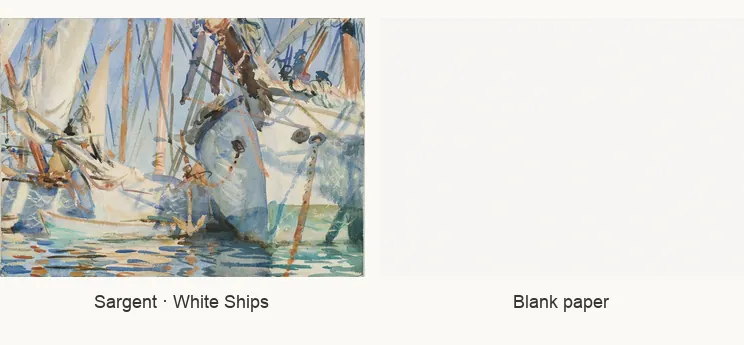

# Unpainting: It's All a Pigment of Your Imagination

`unpainting` is a Node.js watercolor and ink simulator. It paints an input image one brushstroke at a time. It specializes in the rather obscure and somewhat useless goal of making incomplete paintings.

* It does not use a black-box neural net or pixel-by-pixel hill climbing... to actually implement the brushstrokes.[^nn]
* It combines watercolor physics with planning and execution tools for large language models (LLMs) to make transparent paintings. Models with vision and reasoning do best. This is not efficient!!!
* You can stop or rewind a painting at any point between blank page and finished product. At every point it should look as if a human painted it, in the painting behavior as well as the pixels. In theory.
* It doesn't actually make the painting! It only unmakes them, so you can't start with a photo. It will almost always make something worse than where you started, but it's about the journey.

<p align="center"></p>

<p align="center">Yale Rosewalk.</p>

Try the [quick start](#try-it), paint by hand in [Paint Lab](https://sabj.github.io/unpainting/demos/lab/), watch mushrooms paint themselves in [Spore Studies](https://sabj.github.io/unpainting/demos/fungi/), or take a painting apart [layer by layer](https://sabj.github.io/unpainting/demos/layers/). This is just a side experiment, so caveat emptor. And apologies for some Git repo slop, stale claims, or weird overfittings -- this is 99.9% AI code and 99% AI documentation so, you know, good luck.

## Why model paint drying

<p align="center">Why not.</p>

<div align="center">

<table>
<tr>
<td align="center" width="25%"><a href="https://sabj.github.io/unpainting/demos/lab/"><br>Paint Lab, to try it</a></td>
<td align="center" width="25%"><a href="https://samjackson.org/writing/whats-a-painting-anyway-part-1/"><br>Blog post on the motivations</a></td>
<td align="center" width="25%"><a href="docs/reading-list.md"><br>Literature review, to see more</a></td>
<td align="center" width="25%"><a href="https://sabj.github.io/unpainting/demos/"><br>More demos</a></td>
</tr>
</table>

</div>

## How it works

A painting needs three things: the picture, a line drawing of it, and simplified versions of it. An image model makes the line drawing. Code traces it and puts the lines in the order a hand would draw them. An image model also makes the simplified versions, which show the picture as flat patches of colour, from coarse to fine. The drawing goes down first and dries. Then the paint goes on in washes, which are thin layers of diluted paint, from light to dark.

<p align="center"><a href="docs/how-it-paints.md"></a></p>

While a painting runs, a guard stops the code from reading the target's pixels: [how it paints](docs/how-it-paints.md), [the guard](docs/honesty.md).

<p align="center"></p>

## Try it

Start with a picture already in watercolor or ink-and-wash style. A photo gives poor results. Requires [Node.js](https://nodejs.org/en/download) 25 or later.

```sh
git clone https://github.com/sabj/unpainting.git
cd unpainting
npm ci
npm run quick-start
```

Open `work/plan-graded-wash/result.png`: a blue wash fading from dark to light, in about five seconds. Then the bundled public-domain examples:

```sh
npm run example:animal      # Tiepolo, Punchinello Riding a Camel: a drawing and one simplified picture
npm run example:portrait    # Sargent, A Tramp: one simplified picture, no drawing
```

<p align="center"></p>

[Getting started](docs/running.md) covers your own image, the benchmark's pictures and model painters. `ffmpeg` is needed for MP4 videos (`--video 0` skips them). Python 3 is needed for tracing a drawing, finding regions and scoring.

`npm run unpaint` is one command for painting, benchmark runs, cloud GPUs and scoring ([benchmark](bench/README.md#run-it)):

```sh
npm run unpaint -- --help
npm run unpaint -- paint mittens-closeup-qs plan              # plan or paint one of the shipped pictures
npm run unpaint -- benchmark --out work/bench-04 --set core   # lists every session; --start runs them
npm run unpaint -- status work/bench-04                       # progress of the runs
```

## How long it takes

A painting takes about 13 minutes on a Mac mini with 16 GB. A quick preview takes about 5. Rented cloud GPUs are slower per painting but run many at once.

The pictures that ship with the repo are ready to paint. To add your own, an open image model (Qwen-Image-Edit, run locally) first makes a few studies of it: a pencil lay-in and three simplified colour versions. The painter and the models plan from those. See [preparing a picture](tools/prepare/README.md).

## Benchmark

[unpaint-bench](bench/README.md) tests how well AI models paint with the simulator's brush and pen. Each score is measured against Auto, which is the code's own planner working alone. Version 0.4 starts a new series, so its scores do not compare with rounds V1 to V5.

There are fifteen pictures: twelve from museums and three generated ([credits](bench/PICTURES.md)). Five are core pictures. Auto and all four levels paint those. The other ten get Auto and level 2.

Every level is a fresh, independent session. The model hands in its own painting script. The anti-cheat guard is on, so its code cannot read the original's pixels. It gets no feedback from the judges. It can try its script on test paintings, with a budget of 3.0 units, and has 60 minutes.

- L1: the picture, the script format and painting tips.
- L2: adds the prepared drawing, simplified colour versions of the picture, named parts and their outlines. Nothing from Auto.
- L3: adds Auto's plan to read and Auto's finished painting to improve on.
- L4: gives the same as L3, in an open session with a shell, Python tools and the painter's commands. Every model gets the same tools.

A model that hands in Auto's plan or the planner's settings is refused at every level.

Three open-weight models judge each painting. They score how human it looks from ten stills of the video, and how good it is next to the original. Human-ness counts twice as much.

<p align="center"><a href="docs/what-the-model-gets.md"></a></p>

[What the model gets](docs/what-the-model-gets.md), [script format](docs/painting-script.md), [rules](bench/docs/rules.md), [scoring](bench/docs/scoring.md), [changelog](CHANGELOG.md).

Rounds V1 to V5 are kept as a record: [leaderboard](bench/results/leaderboard.md), [gallery](bench/results/gallery.md), [findings](bench/results/FINDINGS.md). Tag `v0.3.2` replays V4 and V5.

<p align="center"><a href="bench/results/leaderboard.md"></a></p>

<p align="center"><a href="bench/results/gallery.md"></a></p>

## References and license

- [The essay about how this was built](https://samjackson.org/writing/whats-a-painting-anyway-part-1/)
- [Reading list](docs/reading-list.md)
- [Contributing](CONTRIBUTING.md)
- Code: MIT ([LICENSE](LICENSE)). Painter output from public-domain inputs: CC BY 4.0. Bundled photos and third-party credits: [NOTICE](NOTICE) and [THIRD_PARTY_NOTICES.md](THIRD_PARTY_NOTICES.md).

[^nn]: Pretrained models are used only before painting starts: image models make the line drawing and block-in studies, and SAM finds regions in the target ([reading list](docs/reading-list.md)).
