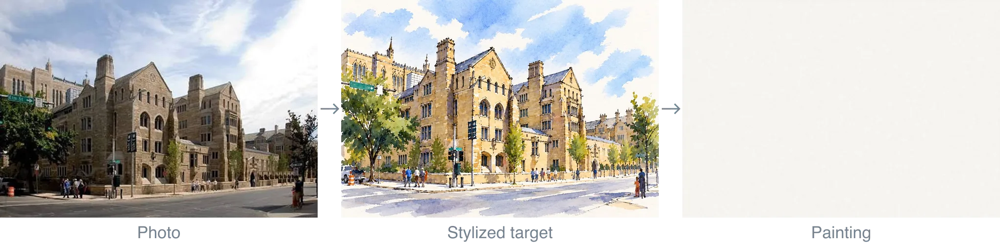
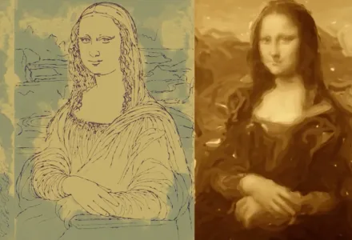
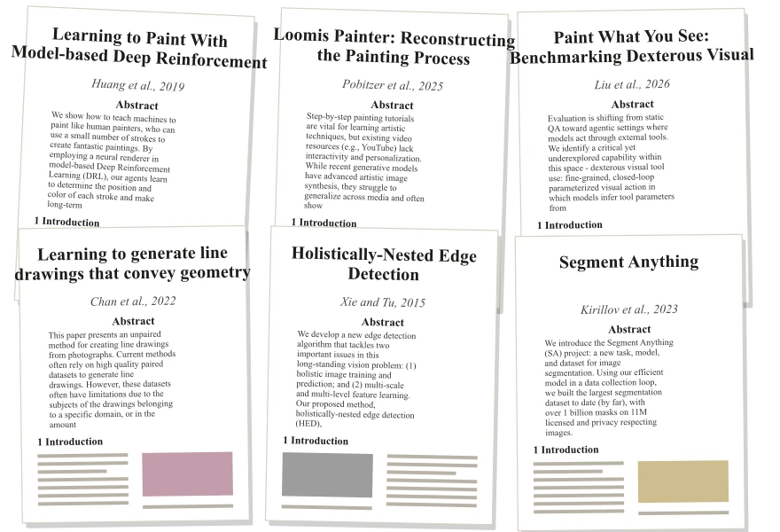
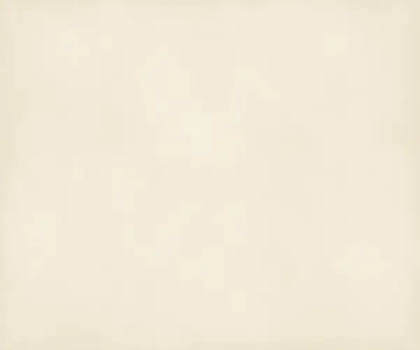
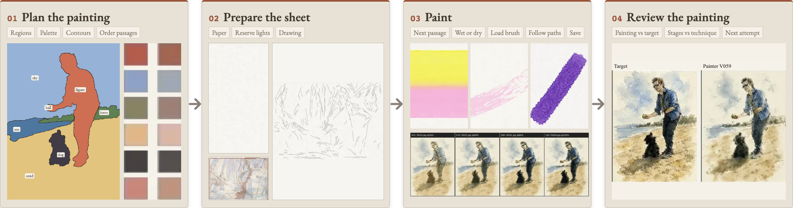
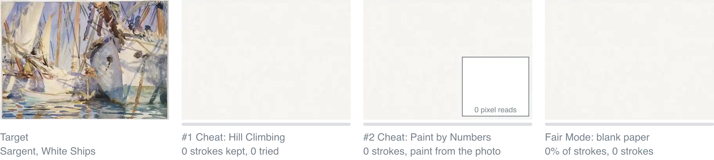
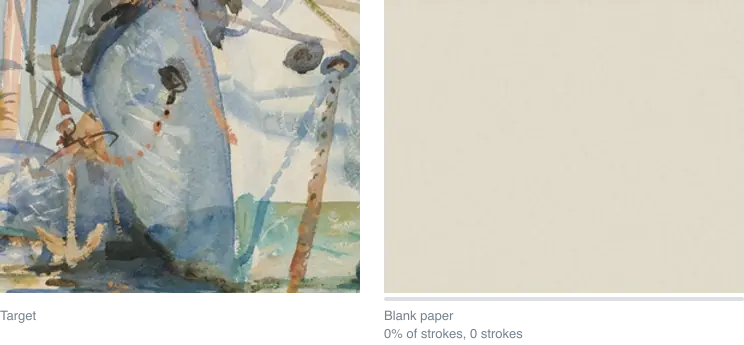
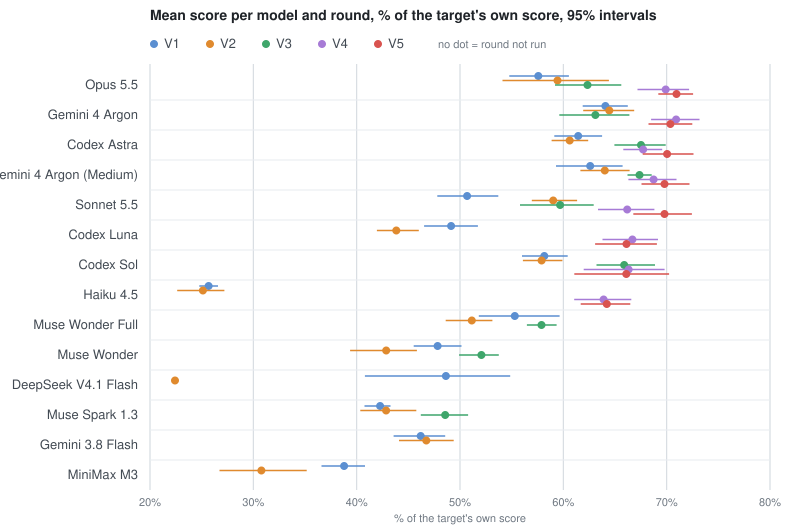
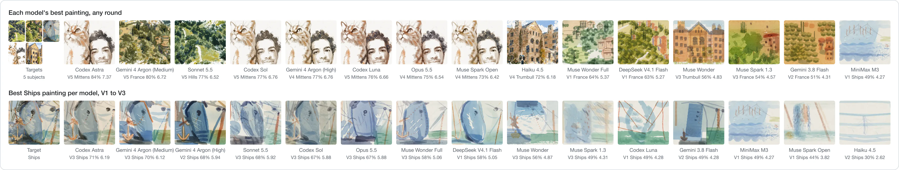

# Unpainting: It's All a Pigment of Your Imagination

`unpainting` is a Node.js watercolor and ink simulator. It paints an input image one brushstroke at a time. It specializes in the rather obscure and somewhat useless goal of making incomplete paintings.

* It does not use a black-box neural net or pixel-by-pixel hill climbing... to actually implement the brushstrokes.[^nn]
* It combines watercolor physics with planning and execution tools for large language models (LLMs) to make transparent paintings. Models with vision and reasoning do best. This is not efficient!!!
* You can stop or rewind a painting at any point between blank page and finished product. At every point it should look as if a human painted it, in the painting behavior as well as the pixels. In theory.
* It doesn't actually make the painting! It only unmakes them, so you can't start with a photo. It will almost always make something worse than where you started, but it's about the journey.

Want to help? The [open problems](docs/future-ideas.md) need work: linework, washes, judging and more. Issues and pull requests welcome.

<p align="center"></p>

<p align="center">Trumbull College, painted with release 0.1.0 (painter V096, sim 100).</p>


Try the [quick start](#try-it), paint by hand in [Paint Lab](https://sabj.github.io/unpainting/demos/lab/), watch mushrooms paint themselves in [Spore Studies](https://sabj.github.io/unpainting/demos/fungi/), or take a painting apart [layer by layer](https://sabj.github.io/unpainting/demos/layers/). This is a side experiment, so caveat emptor. The code is 99.9% AI-written and the docs 99%, so expect some slop and odd overfitting.

## Why model paint drying

<p align="center">Why not.</p>

<div align="center">

<table>
<tr>
<td align="center" width="25%"><a href="https://sabj.github.io/unpainting/demos/lab/"><br>Paint Lab, to try it</a></td>
<td align="center" width="25%"><a href="https://samjackson.org/writing/whats-a-painting-anyway-part-1/"><br>Blog post on the motivations</a></td>
<td align="center" width="25%"><a href="docs/reading-list.md"><br>Literature review, to see more</a></td>
<td align="center" width="25%"><a href="https://sabj.github.io/unpainting/demos/"><br>More demos</a></td>
</tr>
</table>

</div>

## What's included

```text
unpainting/
├── docs/           guides and plan format
├── demos/          Paint Lab, the layers page and other browser demos
├── bench/          unpaint-bench: protocol, run records, scores, gallery
├── examples/       public-domain targets and runnable stroke plans
├── src/
│   ├── media/      paper, water, pigment, brush, pen and pencil physics (CPU + WebGPU)
│   ├── paint/
│   │   ├── methods/     generic watercolor methods: washes, glazes, layers, drawing order
│   │   ├── techniques/  techniques for a kind of problem: faces, dark fur, foliage, skies, sea, buildings
│   │   └── tuned/       settings fitted to specific benchmark images
│   └── crop/       target analysis: regions, value masses, palette fitting
├── tools/
│   ├── paint-plate.mjs   paint an image with target-pixel reads blocked
│   ├── run-plan.mjs      execute a JSON stroke plan
│   └── seg/              line and contour proposals (Python)
├── .agents/skills/ watercolor technique and painting planner, for agents
└── .claude/skills  symlink to ../.agents/skills for Claude Code
```

## How does it work

The pipeline has seven steps: instructions, planning tools, plan execution, tool preparation, tool use, judgment and practice between attempts. It takes a painting-style image and prepares paper, colors and brushes. It plans the painting, executes the plan, then judges the result and improves on it.

A drawing goes down first and dries before any wash, a layer of diluted paint. Washes then build from light to dark. In 0.2.0 the drawing medium defaults to pencil. A plan, `--outlinemedium ink` or the [automatic stage choice](docs/ink.md#automatic-drawing-stages) can add ink.

<p align="center"><a href="docs/how-it-paints.md"></a></p>

<p align="center">Card 2 is a White Ships run from release 0.1.0 (painter V096, sim 100).</p>

The Part 1 post walks through the [full painting pipeline](https://samjackson.org/writing/whats-a-painting-anyway-part-1/#suffering-xl-pipeline) with pictures of each stage. Locally, [how it paints](docs/how-it-paints.md) covers the materials, and [the plan format](docs/plan-format.md) defines the commands a planner can issue. While a painting runs, the guard blocks reads of the target's pixels. The painter works from its plan and what it sees on the sheet.

[Rules, records and limits](docs/honesty.md).

<p align="center"></p>

<p align="center">The painter's run in the last panel was made with release 0.1.0 (painter V096, sim 100).</p>

More recorded paintings are in the [painting sequences](docs/examples.md).

## Try it

Start with a picture already in watercolor or ink-and-wash style. A photo gives poor results.

Requires [Node.js](https://nodejs.org/en/download) 25 or later.

```sh
git clone https://github.com/sabj/unpainting.git
cd unpainting
npm ci
npm run quick-start
```

Open `work/plan-graded-wash/result.png` to see a blue wash fade from dark to light. It takes about five seconds on an Apple M3.

To paint one of the bundled public-domain targets, or your own:

```sh
npm run example:portrait    # Sargent, A Tramp
node tools/paint-plate.mjs --image path/to/painting.jpg --width 540 --mode fast --out work/mine
```

<p align="center"></p>

Sargent's White Ships, left, and Sol's benchmark painting, right, made with painter V096 and sim 100 (release 0.1.0). The outline is the brush; paint shows up at the next saved frame.

Unless told otherwise, the painter runs its default recipe, a preset of painter settings (`src/paint/recipe.mjs`). [Methods, techniques and tuned settings](docs/techniques.md) lists every part of the painter, which settings were fitted to benchmark images, and how to turn each one off.

[Running the painter](docs/running.md) covers the recipe, sheet size, saved stages, animations and Paint Lab. Supporting tools need more:

- `ffmpeg` on your `PATH` for animations of the painting. Pass `--video 0` to skip them.
- Python 3 for the optional scoring and segmentation tools. The scorer lists its packages in [bench/scorer/requirements.txt](bench/scorer/requirements.txt).

Everything runs on a basic machine. A GPU, including a local one through WebGPU, runs faster and in parallel. That helps when you steer towards an outcome.

## Benchmark

[unpaint-bench](bench/README.md) tests how well AI models paint, in five rounds, V1 to V5, with more help each time.

- V1 to V3: the model writes scripts that lay every stroke, within about 15 minutes and 2,500 strokes. V2 adds technique guides, V3 the model's earlier attempts.
- V4 and V5: the model writes a plan and the painter turns it into strokes. V5 adds feedback from the previous try.

The leaderboard uses painter V096, sim 100 and judges J1, from releases 0.1.0 and 0.1.1 ([changelog](CHANGELOG.md), [versions](docs/versions.md)). It has not been rerun for 0.2.0 or 0.2.1: those releases replayed only the Opus 5.5 V5 plans ([0.2.0 comparison](docs/release-performance-0.2.0.md)).

Models ran at their highest reasoning setting.

| Round | What the model gets | Subjects | Top model | Score (% of target) | Raw / 10 |
|---|---|---:|---|---:|---:|
| V1 | Tools | 5 | [Gemini 4 Argon (High)](bench/models.json) | 64.1% | 5.50 |
| V2 | Tools and technique guides | 5 | Gemini 4 Argon (High) | 64.5% | 5.53 |
| V3 | Tools, guides, and practice between tries | 3 | Codex Astra | 67.5% | 5.77 |
| V4 | Full pipeline: planner, painter presets and scoring tools | 5 | Gemini 4 Argon (High) | 70.9% | 6.09 |
| V5 | Full pipeline and practice between tries | 5 | Opus 5.5 | 71.0% | 6.10 |

A try is one model session that paints the requested targets. Scores are a percentage of each target scored against itself. V3 uses three subjects, without Mittens and Trumbull; compare it with V1 and V2 on the [shared subjects](bench/results/FINDINGS.md).

Gemini 4 Argon paints best on its own: it ranks first in V1 and V2. With the harness it is level with Opus 5.5. Argon leads V4 and Opus edges V5, both within the margin of error.

<p align="center"><a href="bench/results/leaderboard.md"></a></p>

<p align="center"><a href="bench/results/gallery.md"></a></p>

The harness helped Sonnet, Haiku and Luna most: they trailed with only the tools and caught up with the full pipeline.

Scores are relative and coarse. [Leaderboard](bench/results/leaderboard.md), [gallery](bench/results/gallery.md), [scoring](bench/docs/scoring.md).

## Credits and references

- [The essay about how this was built](https://samjackson.org/writing/whats-a-painting-anyway-part-1/)
- [The docs](docs/README.md): paints, paper, ink, stroke plans and code
- [Prior work and credits](docs/reading-list.md)
- [Working on the code](CONTRIBUTING.md)

## License

Code: MIT ([LICENSE](LICENSE)). Painter output from public-domain inputs: CC BY 4.0. My photos: noncommercial use. Details: [NOTICE](NOTICE), [THIRD_PARTY_NOTICES.md](THIRD_PARTY_NOTICES.md).

[Image sources](NOTICE)

[^nn]: Pretrained models are used only to guide painting: optional prep tools use them to find lines and regions in the target. See the [reading list](docs/reading-list.md).
