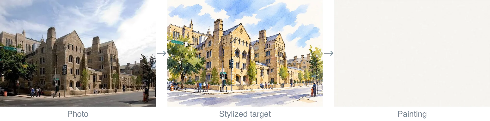
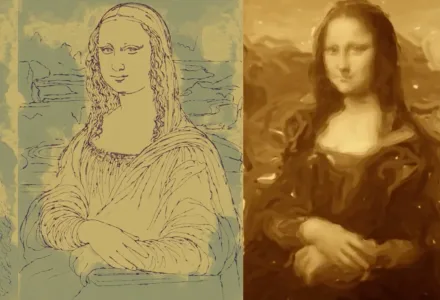
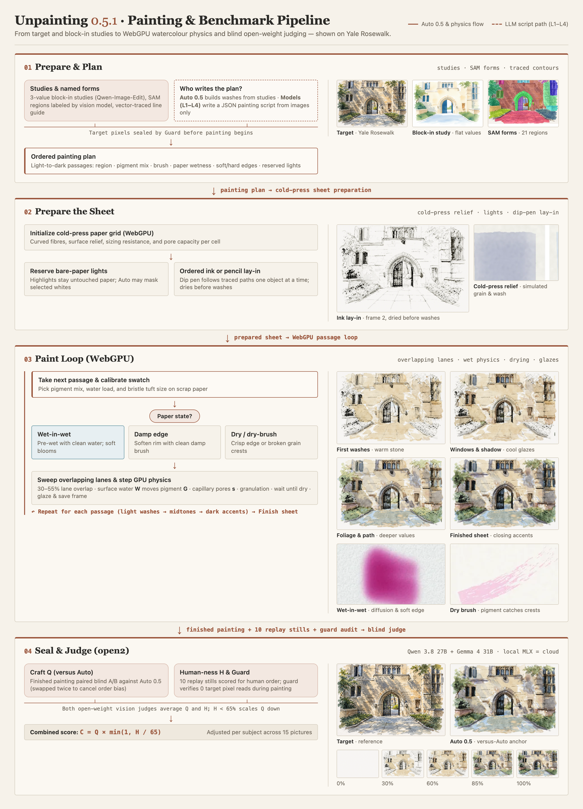
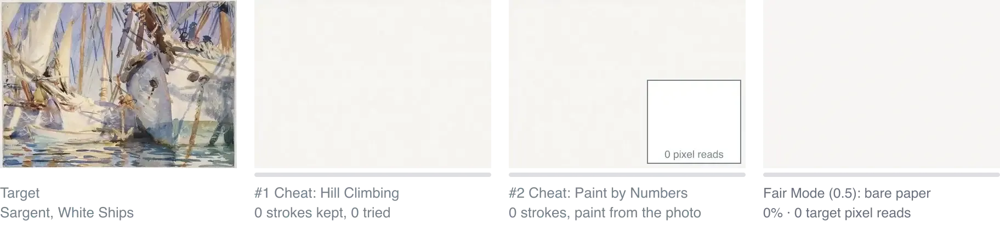
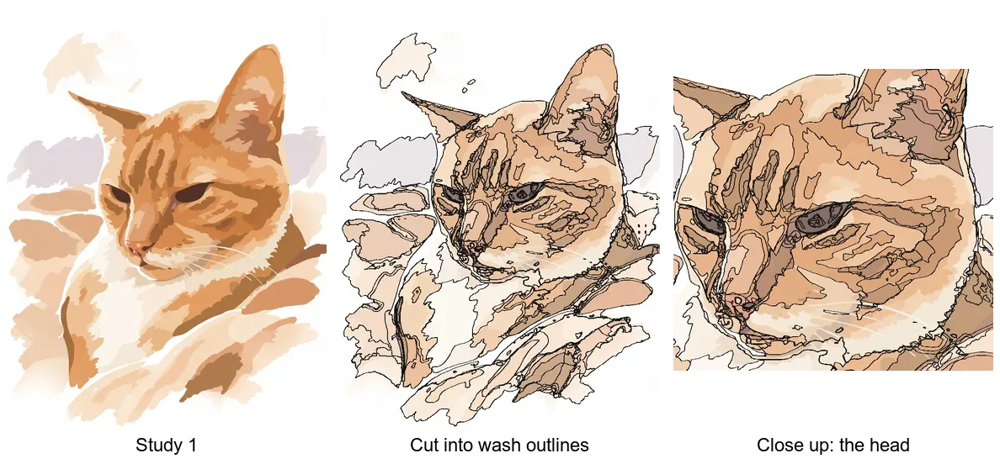
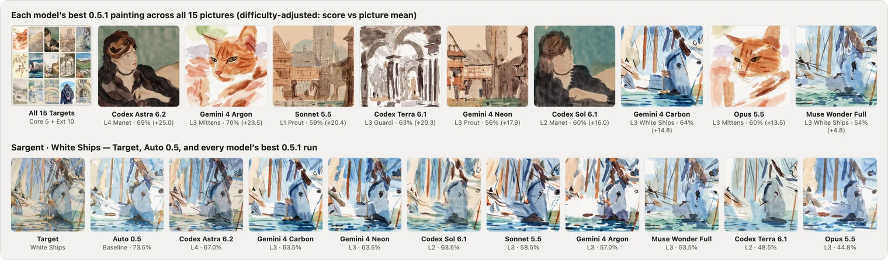

# Unpainting: It's All a Pigment of Your Imagination

`unpainting` is a Node.js watercolor and ink simulator. It paints an input image one brushstroke at a time and specializes in making incomplete paintings.

* No black-box neural net or pixel-by-pixel hill climbing implements the brushstrokes.[^nn]
* It pairs watercolor physics with planning and execution tools for vision-language models to make transparent paintings. This is not efficient.
* You can stop or rewind a painting anywhere between blank paper and the finished sheet. At every point it should look as if a person painted it, in the stroke order as well as the pixels.
* It unmakes paintings rather than making them from photos. Start with a watercolor or ink-and-wash image.

<p align="center"></p>

<p align="center">Trumbull College, painted with release 0.1.0 (painter V096, sim 100).</p>

Try the [quick start](#try-it), paint by hand in [Paint Lab](https://sabj.github.io/unpainting/demos/lab/), watch mushrooms paint themselves in [Spore Studies](https://sabj.github.io/unpainting/demos/fungi/), or take a painting apart [layer by layer](https://sabj.github.io/unpainting/demos/layers/). The code and docs are AI-written; issues and pull requests are welcome.

<div align="center">

<table>
<tr>
<td align="center" width="25%"><a href="https://sabj.github.io/unpainting/demos/lab/"><br>Paint Lab</a></td>
<td align="center" width="25%"><a href="https://samjackson.org/writing/whats-a-painting-anyway-part-1/"><br>Part 1 essay</a></td>
<td align="center" width="25%"><a href="docs/reading-list.md"><br>Reading list</a></td>
<td align="center" width="25%"><a href="https://sabj.github.io/unpainting/demos/"><br>More demos</a></td>
</tr>
</table>

</div>

## Repository layout

```text
unpainting/
├── docs/           guides, pipeline contract and script formats
├── demos/          Paint Lab, Spore Studies and Layers browser demos
├── bench/          unpaint-bench: pictures, runners, scorer, run records, gallery
├── examples/       public-domain targets and runnable stroke plans
├── src/
│   ├── media/      paper, water, pigment, brush, pen and pencil physics (CPU + WebGPU)
│   ├── paint/      study washes, glazes, drawing stages and named techniques
│   ├── crop/       target analysis: regions, line files, palette fitting
│   └── eval/       repeatable image and stage measurements
├── tools/
│   ├── paint-plate.mjs   paint an image with target-pixel reads blocked
│   ├── run-plan.mjs      execute a JSON stroke plan
│   ├── paint/            npm run paint: registered subjects and model sessions
│   └── seg/              tracing and ordering a drawing, SAM regions (Python)
├── .agents/skills/ watercolor-technique and painting-planner skills
└── .claude/skills  symlink to ../.agents/skills for Claude Code
```

## How it works

A painting takes a target image, a prepared drawing file and one or more block-in studies. An image model draws a clean line drawing of the subject, which is traced and ordered as a hand draws it. Another simplifies the subject into flat colour studies, coarse to fine. The drawing goes down first and dries; diluted washes then build from light to dark.

<p align="center"><a href="docs/how-it-paints.md"></a></p>

<p align="center">Card 2 is a White Ships run from release 0.1.0 (painter V096, sim 100).</p>

While a painting runs, a guard blocks reads of the target's pixels. The painter works from its plan and what is on the sheet. See [How it paints](docs/how-it-paints.md), [Plan format](docs/plan-format.md) and [Honesty](docs/honesty.md).

<p align="center"></p>

<p align="center">The painter's run in the last panel was made with release 0.1.0 (painter V096, sim 100).</p>

## Try it

Requires [Node.js](https://nodejs.org/en/download) 25 or later.

```sh
git clone https://github.com/sabj/unpainting.git
cd unpainting
npm ci
npm run quick-start
```

Open `work/plan-graded-wash/result.png` to see a blue wash fade from dark to light (about five seconds on an Apple M3).

To paint the bundled public-domain examples:

```sh
npm run example:animal      # Tiepolo, Punchinello Riding a Camel: drawing and study
npm run example:portrait    # Sargent, A Tramp: study only
```

<p align="center"></p>

Sargent's *White Ships* (left) and Sol's benchmark painting (right, release 0.1.0).

[Running the painter](docs/running.md) covers your own images, sheet size, saved stages, animations and Paint Lab. Optional tools:

- `ffmpeg` on `PATH` for MP4 animations (pass `--video 0` to skip).
- Python 3 for tracing a drawing, SAM segmentation and scoring ([bench/scorer/requirements.txt](bench/scorer/requirements.txt)).
- WebGPU uses a local or cloud GPU when available and falls back to the CPU when `--gpu auto` is set.

## How long things take

Measured on 0.4 rc7 candidates, Auto painting unless a model is named. Machines: a Mac mini (M4, 16 GB) and rented
pods with one RTX 4090. Times are for one painting with nothing else on its GPU.

| What | Where | Time |
|---|---|---|
| A half-size look of the whole sheet (Mittens, 543 cells across), no film | Mac mini | 4.4 min: plan 1.1, painting 2.0, finish 1.0 |
| The same look with its film (175 frames) | Mac mini | 6.6 min: painting 3.9 |
| A full-size painting with film (Mittens, 1,086 x 1,448 cells) | Mac mini | 13.1 min: plan 3.5, painting 7.6, finish 1.0 |
| The same full-size painting with film | pod | 30.4 min: plan 9.8, painting 17.4, finish 0.9 |
| Full-size paintings with film, eight pictures | pod | 8.4 to 38.6 min each: plan 1.2 to 12.2, painting 6.3 to 23.3, finish 0.3 to 1.3 |
| The finish (drying, the 2x display render, writing the files) | either | 0.3 to 1.3 min; the 2x render was not timed apart from it |
| A look inside a model's session (rc3 to rc5, before rc6's speed work) | as the sessions recorded | 3.1 to 8.1 min each, 29 looks |
| One level's session, L2 or L3 (Neon, Argon, Sonnet at medium; rc3 to rc5) | a Mac | 11.7 to 65.9 min wall, of which the model's own 0.9 to 23 min; the rest is waiting for looks |
| Preparing a picture: the three studies | a 128 GB Mac | about an hour (the preparation notes' figure; not timed by the gate) |
| Preparing a picture: drawing, named forms, registration | a Mac | minutes; not timed apart |

Not measured on rc7: a full-size painting without film, a level 1 session, a level 4 session, and a model's session
on the one-area sheet. The pod's plan phase runs on the pod's CPU, which is why a pod can take longer than the mini
for one painting; pods are used to paint many at once.

## What runs where

| Part | Needs | Local or cloud |
|---|---|---|
| The painter | a GPU that WebGPU can use | local |
| Planning, fitting the drawing, segmentation | CPU | local |
| Studies for a new picture | the image model: about 100 GB of memory as run here on Apple silicon, or a rented GPU for about an hour | local on a large machine, or cloud |
| Studies for the shipped pictures | nothing: they come already made | local |
| Judges | the local panel (large memory), or the same open models hosted (an API key) | either |
| The models under test | their makers' command-line tools | their makers' clouds |

Running the benchmark on the shipped pictures needs only the painter and the planner, plus a route to the judges and
to the models under test.

Measured: one full-size Auto painting of Mittens (1,086 x 1,448 cells, no film) on a Mac mini (M4, 16 GB), nothing
else painting there, at rc7 45115256, with `/usr/bin/time -l`. The painter's process peaked at 11.0 GB resident
(10,981,392,384 bytes) and finished in 11.3 min. macOS reported a peak memory footprint of 43.0 GB for the same
process; that figure counts compressed pages at their full size and memory shared with the GPU, so it is larger than
the machine's memory.

The smallest machine that has done each thing here: painting and planning, the 16 GB Mac mini; everything including
new studies and the local judges, a 128 GB Mac.

Not measured: GPU memory apart from the process; a painting with film; any other picture or sheet size; a machine
with less than 16 GB; the memory of the image model and of the local judge panel (the 100 GB is the preparation
notes' figure).

## Benchmark

[unpaint-bench](bench/README.md) tests how well AI models paint with the simulator's brush and pen, using "Auto" (the code planner alone) as the reference. **0.4 is a new series**; its scores are not comparable with rounds V1 to V5.

**Pictures.** Fifteen works in four museum groups of three (figural, architectural, landscape, abstract or loose) and a bonus group of three generated pictures ([bench/PICTURES.md](bench/PICTURES.md)). Five core pictures (one per group) run Auto and levels 1 to 4; the other ten run Auto and level 2.

**Levels.** Every level is one try that hands in the model's own painting script, with a budget of 3.0 look units:

- **L1**: the freehand kit (`bench/kit.mjs`) and its technique guides and worked examples. Paper colour is the model's choice. Budget: 3 runs of its script (1.0 unit each).
- **L2**: the same inputs the code planner gets (prepared drawing, three colour studies as pictures, named forms). No code plan.
- **L3**: one retry of L2 after self-study of its own L2 finished painting, film and stroke map. Fresh 3.0 budget.
- **L4**: one retry of L3 from its own L3 painting, film and stroke map, plus the studies' traced shapes offered as regions it may use, change or ignore. Fresh 3.0 budget.

Nothing of Auto (plan, planner, settings, painting, film or stroke map) is given at any level. Handing in planner settings or the code's plan is refused.

**Rules and scoring:**

- **Drawing**: the model chooses pencil, pen (waterproof or soluble) or none. The prepared drawing is offered, not required.
- **Sheet**: every picture is painted on a quarter sheet (27.9 × 38.1 cm, 0.26 mm a cell) in its own proportions. The original's real size is told to the model as a fact.
- **Looks**: priced by size and share (0.3 for a half-size whole look, 1.0 full-size, partial looks their share, minimum 0.2; final render free). How a model paints (water, strokes, dryings) is free and measured beside the score. Water steps over 10× Auto, 1,000 tool steps and a 6-hour clock are runaway guards only.
- **Scores**: an open-weight panel (GLM-5.3-Flash, Qwen3.8-27B, Gemma-4-31B), run locally or hosted with zero data retention, scores **human-ness** from the film (untouched paper opening as context, the drawing before the first wash scored beside, and 10 frames from the first wash to the finished sheet) and **quality** against the original (scored independently; a painting's quality is its share of the original's). A combined number weights human-ness 2:1 over quality.

<p align="center"><a href="docs/auto-vs-model.md"></a></p>

- [Auto vs model script](docs/auto-vs-model.md) and [Painting script format](docs/painting-script.md)
- [Benchmark levels, rules and replication](bench/README.md)
- [Scoring and rubric](bench/docs/scoring.md)
- [Changelog](CHANGELOG.md#040-not-released)

### History: rounds V1 to V5

Rounds V1 to V5 (2,500 strokes or an 85-minute clock, painter V096, sim 100, judges J1, releases 0.1.0 and 0.1.1, highest reasoning effort) are kept as a record. V4 and V5 are retired in 0.4; tag `v0.3.2` replays them.

| Round | What the model gets | Subjects | Top model | Score (% of target) | Raw / 10 |
|---|---|---:|---|---:|---:|
| V1 | Tools | 5 | [Gemini 4 Argon (High)](bench/models.json) | 64.1% | 5.50 |
| V2 | Tools and technique guides | 5 | Gemini 4 Argon (High) | 64.5% | 5.53 |
| V3 | Tools, guides, and practice between tries | 3 | Codex Astra | 67.5% | 5.77 |
| V4 | Full pipeline: planner, painter presets and scoring tools | 5 | Gemini 4 Argon (High) | 70.9% | 6.09 |
| V5 | Full pipeline and practice between tries | 5 | Opus 5.5 | 71.0% | 6.10 |

<p align="center"><a href="bench/results/leaderboard.md"></a></p>

<p align="center"><a href="bench/results/gallery.md"></a></p>

See the [leaderboard](bench/results/leaderboard.md), [gallery](bench/results/gallery.md) and [findings](bench/results/FINDINGS.md).

## References and license

- [Part 1 essay](https://samjackson.org/writing/whats-a-painting-anyway-part-1/)
- [Documentation index](docs/README.md) and [Reading list](docs/reading-list.md)
- [Contributing](CONTRIBUTING.md)
- Code: MIT ([LICENSE](LICENSE)). Painter output from public-domain inputs: CC BY 4.0. Bundled photos and third-party credits: [NOTICE](NOTICE) and [THIRD_PARTY_NOTICES.md](THIRD_PARTY_NOTICES.md).

[^nn]: Pretrained models are used only before painting starts: image models make the line drawing and block-in studies, and SAM finds regions in the target ([reading list](docs/reading-list.md)).
