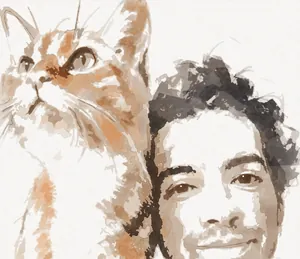

# unpaint-bench

AI models paint a subject with the simulator's brush and pen. Judges score how human the making looks and how good the painting is. The code planner alone, Auto, is the reference. 0.4 scores are not comparable with rounds V1 to V5.

## Pictures

Fifteen: four groups of three museum works, and three made with an image generator. Core pictures are in bold.

| Group | Pictures |
|---|---|
| Figural | **Manet, Morisot with a Fan** · Tiepolo, Bacchus and Ariadne · Homer, The Water Fan |
| Architectural | **Prout, Laundresses before the Wasserturm** · Guardi, A Colonnade · Bonington, French Town |
| Landscape | **Turner, The Fort of L'Esseillon** · Sargent, In Austrian Tyrol · Ender, Mountain Valley |
| Abstract or loose | **Sargent, White Ships** · Morisot, Avenue du Bois · Cezanne, Bathers Under a Bridge |
| Generated | **Mittens** · Kasha portrait · Yale Rosewalk |

Core (five): levels 1 to 4. Extended (all fifteen): the other ten run Auto and level 2. [PICTURES.md](PICTURES.md) has each picture's museum, medium, size, rights and credit line.

Every picture is painted on a quarter sheet (27.9 x 38.1 cm, 0.26 mm a cell, about 1.57 million cells) in the picture's own proportions, whole, never a crop; the one exception is Manet's Morisot with a Fan (head, shoulders and hand). Only registrations made under this rule (ids ending `-qs`, listed in [`run-sets.json`](run-sets.json)) run in the benchmark. `node tools/paint/sheet-rule.mjs` lists every subject's sheet; `node tools/paint/run-sets.mjs check` says which are registered and prepared.

At levels 2 to 4 the task tells the model the original's real size beside the sheet's, as a fact; it never sizes the sheet. Sizes are in [`real-sizes.json`](real-sizes.json) (height x width, cm). A generated picture gets a nominal size, said as such. Morisot, Avenue du Bois has none recorded and is told nothing.

## Levels

Every level is one try that hands in the model's own script, with a budget of 3.0 look units.

| Level | What the model is given |
|---|---|
| L1 | The freehand kit and its tips. Paper colour is its choice. One attempt: 3 runs of its script. |
| L2 | What the code planner gets: the prepared drawing, the three colour studies as pictures, the named forms. No code plan. |
| L3 | One retry of L2 after studying its own L2 painting, film and stroke map. Fresh budget. |
| L4 | One more retry from its L3 files, plus the studies' traced shapes as regions it may use, change or ignore. Fresh budget. |

Nothing of Auto is given at any level; a hand-in of planner settings or of the code's plan is refused. Each step changes several things at once, so a gain between levels is the effect of the whole step ([levels](docs/levels.md)).

- Drawing is the model's choice: pencil, pen or none. Pen ink is waterproof or soluble.
- Retries are self-study: the model writes its own assessment and never sees a score or critique.
- A look costs by size: half-size whole 0.3, full size 1.0, a partial look its share, never under 0.2. At L2 to L4 the full-size final is painted after the session and not charged; at L1 the painting is its last completed run. How a model paints is free and measured beside the score. One runaway guard: more than ten times Auto's water steps stops the painting, reported as a stop and not scored. At L2 to L4 steps and the six-hour clock are runaway guards only; at L1 the session has 60 minutes on the clock. Details: [rules](docs/rules.md).
- Scores, from one judge panel, `open3` (GLM-5.3-Flash, Qwen3.8-27B, Gemma-4-31B): human-ness (the main one, from ten stills of the film), quality, likeness (own column, not in the combined figure). Combined is two parts human-ness to one part quality. Auto sets the difficulty. A failed run counts as a failure, never dropped. See [scoring](docs/scoring.md).

## Run it

Painting runs on the GPU: a Mac, a Mac mini over ssh, or rented pods through the render pool (`tools/paint/render-pool.mjs`, `UNPAINT_RENDER=pool`, `tools/cloud/render-pool-pods.py POOL_DIR`). Scoring runs locally or hosted. More in [running](../docs/running.md).

`npm run paint -- extended paint` paints Auto for all fifteen; `... --author neon-m --level L2` runs level 2 on all fifteen. At L3 and L4 a set is its core five, each from its own previous folder. `node tools/paint/run-sets.mjs core` lists every painting a set asks for and starts nothing.

```sh
# level 1: one attempt, closed like every session (the round is still named V3; targets in v3/crops.json)
node bench/scripts/run.mjs --round V3 --model neon-m --crops TARGET --out DIR

# levels 2 to 4 (model keys: argon-m, neon-m, hydrogen-m, carbon-m, sonnet-m; bench/models.json, tools/paint/authors.json)
npm run paint -- SUBJECT prepare                                   # once per subject
npm run paint -- SUBJECT paint --out AUTODIR                       # Auto, the reference
npm run paint -- SUBJECT paint --author neon-m --level L2 --out L2DIR
npm run paint -- SUBJECT paint --author neon-m --level L3 --previous L2DIR --out L3DIR
npm run paint -- SUBJECT paint --author neon-m --level L4 --previous L3DIR --out L4DIR
npm run paint -- SUBJECT paint --author neon-m --level L2 --dry-run   # paints nothing

# score every level together; Auto's painting sets the difficulty
JUDGE_ROUTE=openrouter OPENROUTER_API_KEY=... npm run bench:score04 -- AUTODIR L1_TRY_FOLDER RUN_FOLDER... --out DIR
npm run bench:score04 -- ... --out DIR --repeat 2                  # scored again, kept apart: the judges' noise
npm run bench:summary04 -- DIR/results.json --set core             # levels against Auto; failed and missing runs count 0
```

A level 1 target without a rendering unit is refused by name (today Prout and White Ships get theirs from their prepared Auto). `npm run bench:test` checks run records and that `results/` regenerates unchanged. [Adding a model](docs/rules.md#adding-a-model).

RESULTS: to be filled from the frozen run.

## Rounds V1 to V5

Earlier rounds, kept as a record. Their rules (2,500 strokes, 85 minutes of model time, look counts) no longer apply. V1 to V3: the model paints stroke by stroke. V4 and V5: the model writes a plan and the painter paints it. A try is one model session. All five used painter V096, sim 100, judges J1 (releases 0.1.0 and 0.1.1). V4 and V5 are retired; tags `v0.1.0`, `v0.1.1` and `v0.3.2` replay them.

<!-- rounds-table:start -->
| Round | What the model gets | Learns between tries | Winning painting (J1) |
|---|---|---|---|
| V1 | A painting toolkit and the targets | No | <a href="results/gallery.md"></a> |
| V2 | V1 plus the technique guides | No | <a href="results/gallery.md"></a> |
| V3 | V2 plus its own earlier tries | Yes | <a href="results/gallery.md"></a> |
| V4 | The full painting pipeline | No | <a href="results/gallery.md"></a> |
| V5 | The full pipeline plus its own earlier tries | Yes | <a href="results/gallery.md"></a> |
<!-- rounds-table:end -->

V3 ran the Claude, Codex, Gemini 4 Argon and Muse models; V4 and V5 ran all but Muse. V5 try 1 is V4 try 1.

| Subject | Style | Target |
|---|---|---|
| Hills | Loose ink and wash | Photo by Sam Jackson, see [NOTICE](../NOTICE) |
| France | Pen and light wash | Photo by Sam Jackson, see [NOTICE](../NOTICE) |
| Ships | Watercolor after Sargent | Public domain |
| Mittens | Portrait sketch and light washes | Photo by Sam Jackson, see [NOTICE](../NOTICE) |
| Trumbull | Architectural watercolor | Third-party photo, credited in [NOTICE](../NOTICE) |

V3 is compared on Hills, France and Ships. Trumbull scores may run high: a preset recipe was tuned on it. [Target sizes](crops/README.md).

- [Leaderboard](results/leaderboard.md), [gallery](results/gallery.md), [findings](results/FINDINGS.md)
- [Run format](docs/run-format.md), [cheat risk](docs/rules.md#cheat-risk)
- Inputs: [v2](v2/README.md), [v3](v3/README.md), [v4v5](v4v5/README.md); a V6 task is drafted in [v6/TASK.md](v6/TASK.md)
