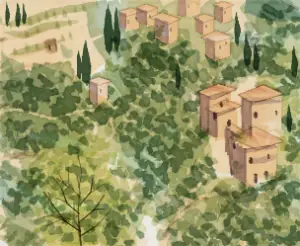

# unpaint-bench

AI models paint a subject with the simulator's brush and pen, and judges score how human the making looks and how good the painting is. The code planner alone, "Auto", is the reference. 0.4 is a new series: its scores are not comparable with the rounds V1 to V5.

## The ladder, in 0.4

Every level is one try that hands in the model's own script, with a budget of 3.0 look units.

| Level | What the model is given |
|---|---|
| L1 | The freehand kit and its tips (technique guides and worked examples). Paper colour is its choice (white or a tone). One attempt; budget 3 runs of its script (each run that lays a mark costs 1.0). |
| L2 | The same inputs the code planner gets: the prepared drawing, the three colour studies as pictures, the named forms. No code plan: the model plans the painting itself. |
| L3 | One retry of L2, after studying its own L2 painting (its finished full-size painting, film and stroke map). Fresh budget. |
| L4 | One more retry, from its own L3 painting, film and stroke map, now also given the studies' traced shapes as regions it may use, change or ignore (they may be wrong). Fresh budget. |

Nothing of Auto is given at any level: no plan, planner, painting, film or stroke map. A hand-in of planner settings, or of the code's plan, is refused.

Details: [levels](docs/levels.md), [rules](docs/rules.md) and [scoring](docs/scoring.md).

- Drawing is the model's choice: pencil, pen or none; no drawing is a normal choice. The prepared drawing is offered, not required, and its lines may go down before the washes, with a stage of them, or after. Pen ink is waterproof or soluble. It gets warnings, not refusals, where a choice only risks the painting.
- Retries are self-study. The model sees its own painting, replay and stroke map and writes its own assessment. It never gets a score or a critique.
- Budget for one try: 3.0 look units. A look's price is fixed by size: a half-size whole look 0.3, full size 1.0, a partial look its share, never under 0.2 (at L2 to L4 looks are half size; at L1 each run is a full-size painting, 1.0). At L2 to L4 the full-size final is painted after the session and not charged; at L1 the painting is its last completed run. How a model paints (water, strokes, waits, dryings) is free and measured beside the score: simulation work, sweeps, dryings, seconds, tokens (fresh, cached, output), steps. One runaway guard: water steps over ten times Auto's for the subject stop the painting (reported as a stop, not scored). Steps and the six-hour clock are runaway guards only.
- Scores: human-ness from the film (the judges see the opening, the untouched paper the painter chose, as context; then twelve snapshots evenly through the film, scored; then the finished sheet), plus quality and likeness, plus a combined number. The original is scored for quality too, and a painting's quality is its share of the original's. Auto sets the difficulty.
- Every picture is painted on one standard sheet. The original's real size is recorded and told to the model as a fact;
  it is not reproduced. Each picture is the whole sheet, never a crop, with one exception chosen by the owner (Manet's
  Morisot with a Fan, its head, shoulders and hand).
- Judges: an open-weight panel (GLM-5.3-Flash, Qwen3.8-27B, Gemma-4-31B), hosted on OpenRouter with zero data retention (`JUDGE_ROUTE=openrouter JUDGE_HOSTED_PANEL=open3`), or run locally through Ollama with those models named in `JUDGE_LOCAL_PANEL`. See [scoring](docs/scoring.md#judges).

## Real sizes of the originals (told to the model as a fact)

Tiepolo 31.2 x 24.3 cm · Guardi 45.4 x 30.1 · Homer, The Water Fan 37.4 x 53.4 · Homer, Adirondacks Guide 32.9 x 54.5 ·
Homer, Two Ladies 17.6 x 20.2 · Manet, Morisot with a Fan 20.9 x 16.8 (whole sheet) · Sargent, In Austrian Tyrol
29.9 x 45.2 · Turner 19.7 x 28 · Ender 21 x 28.5 · Morisot, Avenue du Bois 20 x 28 · Cezanne 21 x 27.2 · Sargent,
White Ships: to look up. Nominal, generated: Mittens and Kasha portrait 23 x 30.5 · Yale Rosewalk 28 x 38.

RESULTS: to be filled from the frozen run.

The first run uses Gemini 4 Argon, Neon and Hydrogen and Claude Sonnet 5.5, all at medium effort, on subscriptions only. Not in it: a container for replication, and the OpenAI models (gpt-6-astra, gpt-6.1-sol, gpt-6.1-terra).

## How to replicate 0.4

Machines: sessions run on a Mac (Apple silicon). Painting runs on the GPU: on that Mac, on a Mac mini over ssh, or on rented GPU pods, through the render pool (`tools/paint/render-pool.mjs`). Scoring runs locally or hosted.

```sh
# level 1: one attempt with the freehand kit (the runner keeps its old round name, V3; model keys in models.json;
# subjects in v3/crops.json; 360 sets the six-hour stop, which the brief then states)
BENCH_V3_ATTEMPT_MIN=360 node bench/scripts/run.mjs --round V3 --model neonmed --crops SUBJECT --out DIR

# (level 1 keys: argonmed, neonmed, sonnetmed; models.json has no Hydrogen key yet)

# levels 2 to 4 (model keys in tools/paint/authors.json: argon-m, neon-m, hydrogen-m, sonnet-m)
npm run paint -- SUBJECT prepare                                   # once per subject: the inputs every level gets
npm run paint -- SUBJECT paint --out AUTODIR                       # Auto, the reference (--author auto is the default)
npm run paint -- SUBJECT paint --author neon-m --level L2 --out L2DIR
npm run paint -- SUBJECT paint --author neon-m --level L3 --previous L2DIR --out L3DIR   # one retry from its L2 run folder
npm run paint -- SUBJECT paint --author neon-m --level L4 --previous L3DIR --out L4DIR
npm run paint -- SUBJECT paint --author neon-m --level L2 --dry-run   # what would run; paints nothing

# score with the 0.4 panel, hosted (or locally: docs/scoring.md#judges)
JUDGE_ROUTE=openrouter JUDGE_HOSTED_PANEL=open3 OPENROUTER_API_KEY=... npm run bench:score04 -- AUTODIR RUN_FOLDER... --out DIR   # Auto's painting of the subject sets the difficulty
```

`UNPAINT_RENDER=pool` paints a session's looks and final through the render pool (committed code only); the default, `local`, paints on this Mac. The pool folder's `mini.json` adds the Mac mini; `tools/cloud/render-pool-pods.py POOL_DIR` rents and returns the pods. More in [running](../docs/running.md).

## History: rounds V1 to V5

Everything below describes the earlier rounds, kept as a record. Their rules (2,500 strokes, 85 minutes of model time, look counts) no longer apply. V1 to V3 each gave 2,500 strokes and about 15 minutes. In V4 and V5 the model planned each painting and the painter painted it. Vision judges scored the finished painting and its order.

## Rounds

The benchmark has five rounds, V1 to V5, each with different tools or feedback. A try is one model session that paints the requested targets.

<!-- rounds-table:start -->
| Round | What the model gets | Learns between tries | Winning painting (J1) |
|---|---|---|---|
| V1 | A painting toolkit and the targets | No | <a href="results/gallery.md"></a> |
| V2 | V1 plus the technique guides | No | <a href="results/gallery.md"></a> |
| V3 | V2 plus its own earlier tries | Yes | <a href="results/gallery.md"></a> |
| V4 | The full painting pipeline | No | <a href="results/gallery.md"></a> |
| V5 | The full pipeline plus its own earlier tries | Yes | <a href="results/gallery.md"></a> |
<!-- rounds-table:end -->

V1 to V5 are published. V3 ran the Claude, Codex, Gemini 4 Argon and Muse models. V4 and V5 ran the Claude, Codex and Gemini 4 Argon models. Not every model ran every round. The [leaderboard](results/leaderboard.md) lists the tries each model ran. In V4 and V5 the first try is shared: V5 try 1 has no feedback yet, so it is also V4 try 1.

## Subjects

| Subject | Style | Target in the repo |
|---|---|---|
| Hills | Loose ink and wash | Yes, photo by Sam Jackson, see [NOTICE](../NOTICE) |
| France | Pen and light wash | Yes, photo by Sam Jackson, see [NOTICE](../NOTICE) |
| Ships | Watercolor after Sargent | Yes, public domain |
| Mittens | Portrait sketch and light washes | Yes, photo by Sam Jackson, see [NOTICE](../NOTICE) |
| Trumbull | Architectural watercolor | Yes, third-party photo credited in [NOTICE](../NOTICE) |

V3 is compared on Hills, France and Ships. The 0.1.1 Muse V3 runs painted all five targets; their Mittens and Trumbull paintings are shown but not counted. V4 and V5 painted all five. One of the painter's preset recipes was tuned on Trumbull, so V4 and V5 Trumbull scores may run high. [Target sizes](crops/README.md) gives the physical scale.

## Results

All five rounds were painted with painter V096, sim 100 and judges J1, in releases 0.1.0 and 0.1.1. Each result is labelled with its round, painter version, sim version, judge version and release. V4 and V5 were retired in 0.4; tag v0.3.2 reruns them, and a V6 task is drafted in [v6/TASK.md](v6/TASK.md). To reproduce, check out the tag a result names, `v0.1.0` or `v0.1.1`; [versions](../docs/versions.md) explains the scheme.

- [Leaderboard](results/leaderboard.md): scores, intervals, cost and time per model and round
- [Gallery](results/gallery.md): each model's best painting of each target, shown as its 10 to 100% stages
- [Findings](results/FINDINGS.md): what changed between rounds

## Method

- [Levels](docs/levels.md): the ladder L0 to L4
- [Rules](docs/rules.md): what a model may change, the workspace, budgets
- [Anti-cheat](docs/anti-cheat.md): the guard, a check that blocks target-pixel reads, and the cheat-risk score
- [Scoring](docs/scoring.md) and [statistics](docs/statistics.md)
- [Run format](docs/run-format.md): what each try records
- [Protocol inputs](v2/README.md): toolkit, briefs, technique guides and runners; [V3](v3/README.md) and [V4 and V5](v4v5/README.md) add their own briefs
- [Adding a model](docs/adding-a-model.md)

## Reproduce

You can rerun every round on your own machine, with the published briefs and rules. V4 and V5 run from a checkout of tag v0.3.2, whose painter still reads their plans. Scores can differ from the published V096 runs. From 0.3.3 V4 and V5 paint each target at its own size (about 300 cells wide on a 78 mm sheet, [subjects.json](v4v5/subjects.json)); the published runs painted it enlarged four times, 1200 to 1224 cells wide on 158 and 280 mm sheets. The two sizes never share a result group. The plan's drawing section and explicit arguments control the drawing medium and order; explicit command-line arguments take precedence. Keep new runs under their actual painter, simulator and judge versions rather than rewriting historical results. A V3 session offers `--tries` attempts (default 3). The published sessions offered up to five.

```sh
npm run bench:test                                   # check every run record, that results/ regenerates unchanged, and dry runs of V3 to V5
npm run bench:build                                  # rebuild results/ from runs/
npm run bench:run -- --dry-run                       # a scripted painter runs V1, no keys needed
npm run bench:run -- --dry-run --round V5            # a scripted planner runs V5 at a small size, no keys needed
npm run bench:run -- --round V4 --model opus         # one model, one lite planning try on the five targets
npm run bench:run -- --round V4 --model opus --profile full  # three full self-view tries
```

V5 try 1 reuses V4 try 1 (the same session).

## Routine development benchmark

`npm run bench:lite -- --plan` shows the offline allocation before any model calls.
`npm run bench:lite -- --gpu off` runs all five targets with Astra, Sol, Opus, Sonnet, Argon-high and Gemini Flash.
Use `--models all` or explicit keys such as `--models core,wonderfull,spark` to include other registered models.

Lite is a separate planning screen: one five-minute plan per target, one harness check and render after the model exits,
no automatic repairs, and J2-lite judging. Full mode keeps three tries and model self-view. Both paint each target at
source scale, one sheet cell for each target pixel on a sheet about 78 mm wide, and keep the guards and all required
stages. The painter does not paint from an enlarged source. Their results are grouped separately; a cheap screen does
not establish the quality of a full run. See [profiles and measurements](docs/profiles.md).
