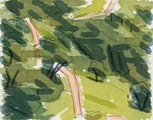

# unpaint-bench

AI models write painting scripts for the watercolour simulator, and judges score how human the making looks and how good the finished painting is. "Auto", the code planner alone, is the reference. **0.4 is a new series**; its scores are not comparable with rounds V1 to V5.

## Pictures

Fifteen pictures in four groups of three museum works and a bonus group of three generated pictures ([PICTURES.md](PICTURES.md)):

| Group | Pictures (core in bold) |
|---|---|
| Figural | **Manet, Morisot with a Fan** · Tiepolo, Bacchus and Ariadne · Homer, The Water Fan |
| Architectural | **Prout, Laundresses before the Wasserturm** · Guardi, A Colonnade · Bonington, French Town |
| Landscape | **Turner, The Fort of L'Esseillon** · Sargent, In Austrian Tyrol · Ender, Mountain Valley |
| Abstract or loose | **Sargent, White Ships** · Morisot, Avenue du Bois · Cezanne, Bathers Under a Bridge |
| Bonus (generated) | **Mittens** · Kasha portrait · Yale Rosewalk |

- **Core** (5 pictures, one per group): runs Auto and levels 1 to 4.
- **Extended** (all 15): the other ten run Auto and level 2.

Every picture is painted on the same area of paper: a quarter sheet (27.9 × 38.1 cm, about 1,063 cm² and 1.57 million cells at 0.26 mm a cell, `tools/paint/sheet-rule.mjs`) in the picture's own proportions. Each picture is the whole sheet except Manet's *Morisot with a Fan* (the approved crop of head, shoulders and hand).

### Real sizes

At levels 2 to 4 the brief states the original's size beside the sheet's (for example, `"The original is 19.7 x 28 cm; your sheet is 27 x 39.4 cm (height x width)."`). It is a fact for the model to weigh, never a change to the sheet size. Sizes live in [`real-sizes.json`](real-sizes.json) (height × width in cm):

- **Museum works**: Tiepolo 31.2 × 24.3 · Homer, *The Water Fan* 37.4 × 53.4 · Manet, *Morisot with a Fan* 20.9 × 16.8 (whole sheet) · Guardi 45.4 × 30.1 · Prout 30.2 × 21.6 · Bonington 18.1 × 14.3 · Sargent, *In Austrian Tyrol* 29.9 × 45.2 · Turner 19.7 × 28 · Ender 21 × 28.5 · Sargent, *White Ships* 35.2 × 49.2 · Cezanne 21 × 27.2. (*Morisot, Avenue du Bois* is omitted while its file proportions differ from the Met's 20 × 28 cm record.)
- **Generated (nominal)**: Mittens and Kasha portrait 30.5 × 23 · Yale Rosewalk 28 × 38.

## Levels

Every level is one try in a fresh session and workspace that hands in the model's own script, with a budget of 3.0 look units. L0 (the freehand kit with no tips) is defined, not run.

| Level | What the model is given |
|---|---|
| L1 | The freehand kit (`bench/kit.mjs`), technique guides and worked examples on blank sheets ([v3/TIPS.md](v3/TIPS.md)). Paper colour is its choice (white or `[r, g, b]`). One attempt; budget 3 runs of its script (1.0 unit each). |
| L2 | The same inputs the code planner gets: prepared drawing, three colour studies as pictures, named forms. No code plan; the model writes its own painting script. |
| L3 | One retry of L2 after studying its own L2 result (its dried full-size painting beside the subject, film and stroke map). Fresh 3.0 budget. |
| L4 | One retry of L3 from its own L3 painting, film and stroke map, plus the studies' traced shapes (`resources/shapes.json`) offered as regions it may use, change or ignore (they may be wrong). Fresh 3.0 budget. |

Nothing of Auto is given at any level: no plan, planner, settings, painting, film or stroke map. Handing in planner settings or the code's plan is refused, and a session that hands in no compiling script of its own fails.

**Retries are self-study.** Before a retry (L3, L4) the model receives its own previous files and painting read-only, writes its own assessment of what to change, and never receives a score, judge verdict or external critique. The last try counts, not the best. The harness reports how much each try changed from the previous one and flags identical or near-identical submissions.

## Rules and budgets

### What a model may change

- Its own painting script and palette (up to 14 paints at L2–L4 from the 16-pigment box; ink and graphite take the other two slots).
- Drawing medium: pencil, pen or none. No drawing is a normal choice.
- Pen ink: waterproof or soluble (`kit.open(task, { ink })` at L1, default soluble; `"ink"` in `choice.json` at L2–L4, default waterproof).
- Prepared lines (L2–L4): offered, not required; each line may go down before the washes, with a stage, after the washes, or be dropped, plus new lines of the model's own.
- Erasing: `kit.erase` at L1; `"kind": "erase"` passages at L2–L4 (on dry paper).
- Paper tone at L1: `kit.open(task, { paper: [r, g, b] })`.
- Risky technique choices raise warnings, not refusals. Only unreadable files, impossible requests or rule violations are refused.

### Workspace sandbox

- Every try starts in its own fresh folder outside the checkout.
- The model has a shell in its folder and may write and run any helper scripts to measure the input pictures.
- It cannot read the repository, other sessions or outside folders. Network access is gated to the model provider's hosts; the shell has no internet and one fixed Python toolbox (numpy, pillow, scipy, scikit-image, opencv).
- Reading the subject's pixels with code at L1, or calling the painter outside `./unpaint look` at L2–L4, disqualifies the run.

### Budgets and guards

- **Look budget**: 3.0 units per try. Price is fixed by size and share: 0.3 for a half-size whole look (L2–L4), 1.0 for a full-size painting (L1), and a partial stage (`--until`) or region (`--region`) look costs its share of the washes or passages, never under 0.2. At L2–L4 the full-size final render after the session is free; at L1 the last completed script run is the final painting.
- **How a model paints is free**: water, wetness, strokes, waits and dryings never cost budget.
- **Runaway guards**: a painting whose water steps exceed 10× Auto's for the subject stops (a stopped look costs nothing); a session asks for hand-in at 1,000 tool steps (`--steps`), refuses more than 20 returns to an earlier choice (`--reverts`), caps L1 at 2,500 strokes a painting, and stops at a 6-hour wall-clock safety limit (`--wallminutes 360`).
- **Recorded beside the score** (`usage.json`): look units, simulation work (sweeps, dryings, water steps, cell-steps, seconds), tokens (fresh, cached, output), provider cost, wall and model minutes, and tool use (commands, scripts, pictures opened, refusals).

## Running and scoring 0.4

[`run-sets.json`](run-sets.json) defines `core` and `extended`. Inspect what a set runs without starting anything:

```sh
node tools/paint/run-sets.mjs core
node tools/paint/run-sets.mjs extended
```

Run a subject or a set (sessions run on Apple silicon; GPU painting runs locally or on the render pool via `UNPAINT_RENDER=pool`):

```sh
# Level 1 (uses the V3 runner; model keys in bench/models.json: argonmed, neonmed, sonnetmed)
BENCH_V3_ATTEMPT_MIN=360 node bench/scripts/run.mjs --round V3 --model neonmed --crops SUBJECT --out DIR

# Levels 2 to 4 and Auto (model keys in tools/paint/authors.json: argon-m, neon-m, hydrogen-m, sonnet-m)
npm run paint -- SUBJECT prepare                                                         # once per subject
npm run paint -- SUBJECT paint --out AUTODIR                                             # Auto reference
npm run paint -- SUBJECT paint --author neon-m --level L2 --out L2DIR
npm run paint -- SUBJECT paint --author neon-m --level L3 --previous L2DIR --out L3DIR
npm run paint -- SUBJECT paint --author neon-m --level L4 --previous L3DIR --out L4DIR
npm run paint -- core paint --author neon-m --level L2 --dry-run

# Score with the 0.4 open-weight panel (hosted on OpenRouter with ZDR, or locally via Ollama)
JUDGE_ROUTE=openrouter JUDGE_HOSTED_PANEL=open3 OPENROUTER_API_KEY=... \
  npm run bench:score04 -- AUTODIR L2DIR L3DIR L4DIR --out SCOREDIR
```

Scoring details and the human-ness rubric: [docs/scoring.md](docs/scoring.md) and [docs/human-ness-rubric.md](docs/human-ness-rubric.md). Run records: [docs/run-format.md](docs/run-format.md).

### Adding a model

Add the model's key, provider ID, CLI runner (`claude`, `codex` or `agy`) and effort to `tools/paint/authors.json` (for L2–L4) and `bench/models.json` (for L1). Run `npm run paint -- SUBJECT preflight --author <key>` to verify its sandboxed CLI can read an image, run `./unpaint plan` and write a file before running the ladder.

## History: rounds V1 to V5

Rounds V1 to V5 (releases 0.1.0 and 0.1.1, painter V096, sim 100, judges J1, 2,500 strokes or 85 model minutes) are published history. V4 and V5 are retired in 0.4; check out tag `v0.3.2` to replay them.

<!-- rounds-table:start -->
| Round | What the model gets | Learns between tries | Winning painting (J1) |
|---|---|---|---|
| V1 | A painting toolkit and the targets | No | <a href="results/gallery.md"></a> |
| V2 | V1 plus the technique guides | No | <a href="results/gallery.md"></a> |
| V3 | V2 plus its own earlier tries | Yes | <a href="results/gallery.md"></a> |
| V4 | The full painting pipeline | No | <a href="results/gallery.md"></a> |
| V5 | The full pipeline plus its own earlier tries | Yes | <a href="results/gallery.md"></a> |
<!-- rounds-table:end -->

### V1 to V5 subjects

These five small targets ([crops/README.md](crops/README.md)) belong to V1–V5, not to 0.4:

| Subject | Style | Target in the repo |
|---|---|---|
| Hills | Loose ink and wash | Yes, photo by Sam Jackson, see [NOTICE](../NOTICE) |
| France | Pen and light wash | Yes, photo by Sam Jackson, see [NOTICE](../NOTICE) |
| Ships | Watercolor after Sargent | Yes, public domain |
| Mittens | Portrait sketch and light washes | Yes, photo by Sam Jackson, see [NOTICE](../NOTICE) |
| Trumbull | Architectural watercolor | Yes, third-party photo credited in [NOTICE](../NOTICE) |

### V1 to V5 results and checks

- [Leaderboard](results/leaderboard.md), [Gallery](results/gallery.md) and [Findings](results/FINDINGS.md)
- [Scoring](docs/scoring.md) and [Run format](docs/run-format.md)
- Protocol inputs: [V1/V2](v2/README.md), [V3](v3/README.md), [V4/V5](v4v5/README.md), and the [V6 draft](v6/TASK.md)

```sh
npm run bench:test                                   # validate all committed run.json files and scorer tests
npm run bench:build                                  # regenerate results/ from runs/
node bench/scripts/run.mjs --round V3 --dry-run      # scripted dry run of the V3/L1 harness
```
