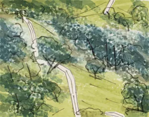

# unpaint-bench

AI models paint a picture with the simulator's brush and pen. Judges score how human the making looks and how good the painting is. Auto, the code planner alone, paints every picture too, and each model is measured against it.

## Pictures

Fifteen: four groups of three museum works and three made with an image generator. Core pictures are in bold.

| Group | Pictures |
|---|---|
| Figural | **Manet, Morisot with a Fan** · Tiepolo, Bacchus and Ariadne · Homer, The Water Fan |
| Architectural | **Prout, Laundresses before the Wasserturm** · Guardi, A Colonnade · Bonington, French Town |
| Landscape | **Turner, The Fort of L'Esseillon** · Sargent, In Austrian Tyrol · Ender, Mountain Valley |
| Abstract or loose | **Sargent, White Ships** · Morisot, Avenue du Bois · Cezanne, Bathers Under a Bridge |
| Generated | **Mittens** · Kasha portrait · Yale Rosewalk |

The five core pictures run Auto and levels 1 to 4; the other ten run Auto and level 2 ([run-sets.json](run-sets.json): `core` and `extended`). Museum, medium, size, rights and credit of each: [PICTURES.md](PICTURES.md).

Every picture is painted whole on a quarter sheet's area (27.9 x 38.1 cm, 0.26 mm a cell) in its own proportions; Manet's Morisot with a Fan is the one crop. The model is told the original's real size ([real-sizes.json](real-sizes.json)) as a fact.

## Levels

Every level is one fresh session, handed no other level's result, so all levels and pictures can run at once. Each adds one thing.

| Level | What the model is given | How it works |
|---|---|---|
| L1 | The picture, the [script format](../docs/painting-script.md) and painting tips | Fixed rounds |
| L2 | L1 and the prepared inputs: the drawing, the three colour studies, the named forms, the studies' traced shapes. Nothing of Auto | Fixed rounds |
| L3 | L2 and Auto's plan, to read, and Auto's finished painting, to improve on | Fixed rounds |
| L4 | L3's inputs | An open session with a shell and tools |

At every level the model hands in its own painting script, the budget is 3.0 look units, the session has 60 minutes on the clock, code may not read the picture's pixels, and no score or critique is shown. [Rules](docs/rules.md) has the detail; [scoring](docs/scoring.md) the judges.

## Run it

Set up as in [getting started](../docs/running.md#the-benchmarks-pictures): the inputs folder, `npm run doctor`, each model's command-line tool signed in. That page runs one picture by hand at each level. The scorer needs Python with `bench/scorer/requirements.txt` (`BENCH_SCORE_PYTHON` names it, else `python3`).

```sh
node tools/paint/run-sets.mjs core                           # every painting the set asks for; starts nothing
npm run unpaint -- prepare core --pool local --jobs 3        # once a commit: Auto's plan, traced shapes and painting
npm run unpaint -- benchmark --out work/bench-04 --set core --models neon-m,sonnet-m    # lists each session's command
npm run unpaint -- benchmark --out work/bench-04 --set core --models neon-m,sonnet-m --start
npm run unpaint -- status work/bench-04                      # sessions finished, failed, still running

JUDGE_ROUTE=openrouter OPENROUTER_API_KEY=... npm run unpaint -- score work/bench-04 --out work/bench-04/scores
npm run bench:summary04 -- work/bench-04/scores/results.json --set core
```

- Without `--models` the launcher runs the ten models of the roster in `run-sets.json`. `--levels` and `--pictures` narrow it.
- `--start` needs a clean checkout and Auto's painting prepared at this commit. It starts every session at once, each in `work/bench-04/<model>-<picture>-<level>/`, and paints through the [render pool](../docs/running.md#more-than-one-machine): a Mac mini or rented pods (`--pool mini,pod`; `--with-pods` starts the renter). On one machine, run the listed commands one after another instead.
- `score` writes the manifest of finished sessions and Auto's prepared paintings, then scores them into `--out`: `results.json` and `SCORES.md`. `JUDGE_ROUTE=local` (the default) reads with Ollama. `summary04` writes `SUMMARY.md`: every model's levels against Auto.
- By hand, without the launcher: `npm run bench:score04 -- AUTO_RUN MODEL_RUN... --out DIR`.

`npm run bench:test` tests the scorer and the run records. To add a picture see [preparing a picture](../tools/prepare/README.md); to add a model, [getting started](../docs/running.md#your-own-picture-and-your-own-model).

## Older rounds

V1 to V5 ran on releases 0.1 and 0.3 and are kept as a record: [older rounds](docs/older-rounds.md), [leaderboard](results/leaderboard.md), [gallery](results/gallery.md), [findings](results/FINDINGS.md). Their scores never share a table with 0.4.

<!-- rounds-table:start -->
| Round | What the model gets | Learns between tries | Winning painting (J1) |
|---|---|---|---|
| V1 | A painting toolkit and the targets | No | <a href="results/gallery.md"></a> |
| V2 | V1 plus the technique guides | No | <a href="results/gallery.md"></a> |
| V3 | V2 plus its own earlier tries | Yes | <a href="results/gallery.md"></a> |
| V4 | The full painting pipeline | No | <a href="results/gallery.md"></a> |
| V5 | The full pipeline plus its own earlier tries | Yes | <a href="results/gallery.md"></a> |
<!-- rounds-table:end -->
