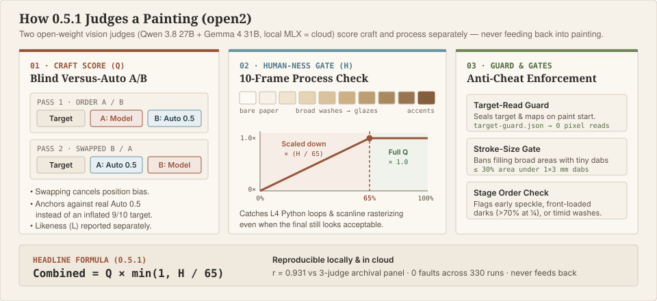
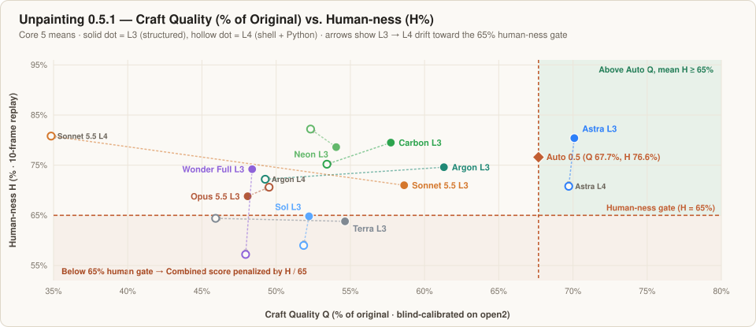
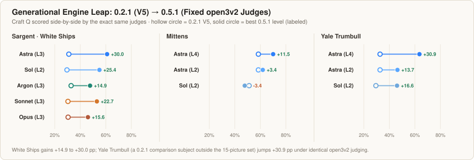
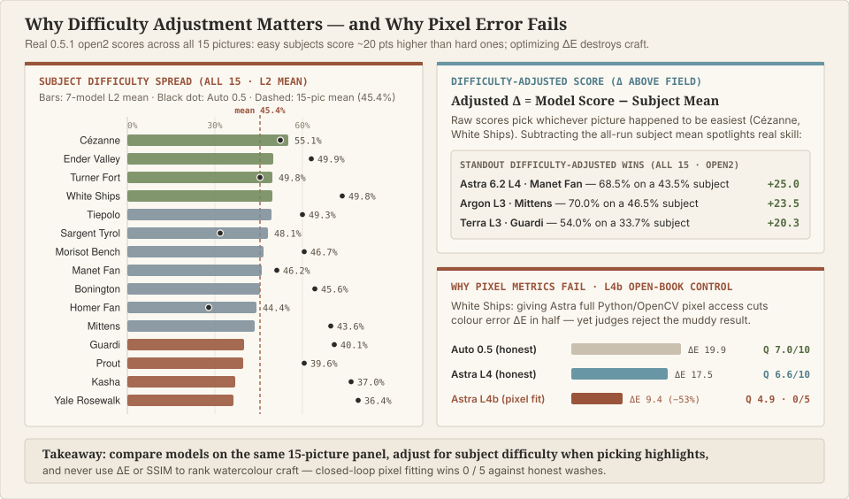

# Scoring

Every 0.5.1 benchmark run is scored on the local-first **`open2`** panel (**Qwen 3.8 27B** + **Gemma 4 31B**, running identically on local Apple Silicon MLX at `$0` or on OpenRouter).



## What counts

| Score | What the judges see | How it counts |
|---|---|---|
| Craft quality (`Q`) | The original, the candidate, and Auto 0.5 | Side-by-side `versus-auto` comparison beside the original (with A/B order alternated across readings). Judges score both paintings 0–10 and pick a winner. By default `Q` is **indexed to each picture's original** (`% of original`, calibrated via blind `Original vs. Auto` A/B pairs); a **non-indexed raw `0–100`** (`10 × score`) mode is available alongside. |
| Human-ness (`H`) | The painting film, without the original | Each of ten progress frames gets 1 to 5 for how a person would make those marks in that order. `H` is their mean as a percentage of 5. |
| Combined | Craft and human-ness scores | `Combined = Q × min(1, H / 65)`. At 65% human-ness or above, the painting keeps its craft score. Below 65%, it gets a fraction of that score. |
| Likeness (`L`) | Original and painting side by side | A separate mark from 1 to 5 for subject, composition, values and colour. Never blended into `Combined`; a mean of 1.5 or less is flagged. |

## Indexing to the original (and non-indexed raw mode)

Museum originals do not have replay films, so they have no progression / human-ness (`H`) subscore — only finished craft. To put every painting (including Auto 0.5) on a true **`% of original`** scale without needing a progression score on the original:

1. **Calibrate Auto against each Original blind:** On every one of the 15 pictures, the exact `open2` panel judges **Original vs. Auto 0.5** in 4 balanced blind A/B calls (2× Original-first, 2× Auto-first; not told which is the original) using the same `0–10` craft rubric ([`originals-index-051.json`](../results/originals-index-051.json)). That gives `Auto % of original = 100 × (Auto_pair / Original_pair)` in the same call.
2. **Chain models through Auto:** Each model's same-call `versus-auto` craft ratio (`Q_model / Auto_va`) chains onto Auto's original-indexed craft score:
   - `Q_orig = 100 × (Auto_pair / Original_pair) × (Q_model / Auto_va)` (Original = `100%`; Auto = `100 × Auto_pair / Original_pair`)
   - `Combined_orig = Q_orig × min(1, H / 65)`
3. **Non-indexed (`Raw 0–100`) mode:** Keeps raw `Q_raw = 10 × score` and `Combined_raw = Q_raw × min(1, H / 65)` directly without dividing by the original. Both modes are one click apart in the [Interactive Benchmark Explorer](https://sabj.github.io/unpainting/demos/bench/).

| Picture | Original (`open2` pair) | Auto 0.5 (blind vs. Original) | Auto `% of Original` | Auto Raw `Q` (`versus-auto`) |
|---|---:|---:|---:|---:|
| Mittens | 8.69 | 6.20 | **71.4%** | 69.7% |
| Turner, Fort of L'Esseillon | 7.49 | 5.80 | **77.5%** | 50.9% |
| Manet, Morisot with a Fan | 8.25 | 4.45 | **53.9%** | 51.2% |
| Prout, Laundresses | 8.14 | 6.24 | **76.6%** | 68.1% |
| Sargent, White Ships | 8.23 | 4.85 | **59.0%** | 73.5% |
| Tiepolo, Bacchus & Ariadne | 8.08 | 6.29 | **77.9%** | 60.0% |
| Homer, The Water Fan | 9.16 | 3.66 | **40.0%** | 43.2% |
| Bonington, French Town | 8.88 | 4.88 | **54.9%** | 64.2% |
| Guardi, A Colonnade | 8.54 | 7.09 | **83.0%** | 71.0% |
| Sargent, In Austrian Tyrol | 8.54 | 3.39 | **39.7%** | 51.8% |
| Ender, Mountain Valley | 8.38 | 4.64 | **55.4%** | 63.2% |
| Morisot, Avenue du Bois | 8.80 | 4.93 | **56.0%** | 70.4% |
| Cézanne, Bathers | 7.90 | 5.48 | **69.3%** | 61.9% |
| Kasha Portrait | 8.48 | 6.80 | **80.2%** | 76.8% |
| Yale Rosewalk | 8.61 | 6.60 | **76.6%** | 79.1% |
| **15-picture mean** | **8.41** | **5.42** | **64.8%** | **63.7%** |

Flat, striped or muddy washes lose craft marks even when the drawing makes the subject easy to recognise. In 0.4 the judges graded the painting and original separately, and human-ness counted twice in a weighted average. Those scores belong to a different series.

## Human-ness

The first frame shows the bare sheet. If there is a drawing, the judges see it just before the first wash. Then come the ten counted stills, starting at the first wash, followed by the finished sheet. The drawing and finish get separate marks.

The scorer picks frames by how much of the finished picture is visible. If a single wash jumps across several progress targets, it spreads the remaining picks over the progress left. This keeps a long pause on the same wash from filling the panel with near-duplicates. Each still carries its progress percentage. The judges score the marks and name any machine tells using the [human-ness rubric](human-ness-rubric.md).

## Judges

The `0.5.1` panel (`open2`) is **Qwen 3.8 27B** and **Gemma 4 31B** — two open-weight vision models that run identically on **local Apple Silicon MLX (`$0` API cost)** and on **OpenRouter** (`JUDGE_ROUTE=local` or `JUDGE_ROUTE=openrouter`). Each judge gives three readings; the scorer takes each judge’s median, then averages across the panel. The painter’s name and level are hidden.

## Run the scorer

Set `BENCH_SCORE_PYTHON` to a Python with the [scorer dependencies](../scorer/requirements.txt) and set `OPENROUTER_API_KEY` for the hosted panel.

```sh
JUDGE_ROUTE=openrouter npm run unpaint -- score work/bench-05 --profile 0.5.1 --out work/bench-05/scores
npm run bench:summary04 -- work/bench-05/scores/results.json --set core
```

For individual run folders, use `JUDGE_ROUTE=openrouter npm run bench:score04 -- AUTO_RUN MODEL_RUN --profile 0.5.1 --out DIR`. The script names in `package.json` still end in `04`. Pass the profile explicitly. If your shell sets `JUDGE_PANEL` or `JUDGE_REASONING`, those settings take precedence.

The scorer takes run folders or a manifest listing them. The launcher’s `score` command builds the manifest from finished runs and their Auto paintings. A scheduled failure stays in the table with its reason. A bad input, including a film with fewer than ten frames between the first wash and the finish, exits with code 2. An incomplete judge panel leaves the figure empty and exits with code 1.

The output folder holds `results.json`, `SCORES.md`, `.progress-cache.json` (which caches per-film frame progress measurements and invalidates automatically if `frames.json` changes), and the replies in `readings/`. Results record the panel, route, reasoning setting, frame scheme, rubric and prompts. Matching saved readings can be reused. `--fresh` reads again and `--repeat N` keeps a separate repeat.

### Local Apple Silicon MLX judging ($0 API cost)

On Apple Silicon running `rapid-mlx`, the same `open2` panel (`qwen3.8-27b-4bit` with `--no-spec-decode` + `gemma-4-31b-8bit`, `think=False`) runs fully offline at `$0` API cost using the same `versus-auto` craft prompt and per-snapshot `1..5` human-ness scoring. Always pass `--no-spec-decode` when serving `qwen3.8-27b-4bit` with vision inputs to avoid multimodal speculative-decode hangs.

**Local MLX vs. cloud OpenRouter validation (Core 5 `L2`, 50 paintings):** overall 9-model ranking agrees tightly (**`r = 0.955`**, Spearman **`ρ = 0.917`**; identical top 3: Sol, Astra, Carbon), and craft `Q` tracks closely (`r = 0.827`, `MAE = 4.2 pp`). Quantized local weights grade 10-frame human-ness `H` more harshly (`−13.7 pp` mean bias, `r = 0.325`), so published 0.5.1 leaderboard numbers use full-precision `open2` 3× repeats (which correlate at **`r = 0.957`**, `ρ = 0.917` across 17 model-effort variants with the 3-judge cloud panel `GLM-5.3-Flash + Kimi-K3.1-Pro + Gemma 4 31B`).

## Craft vs. human-ness & cross-version leap





Explore formula sensitivity, judge splits, and 95% bootstrap intervals in the **[Interactive Benchmark Explorer](https://sabj.github.io/unpainting/demos/bench/)**.

## Difficulty-adjusted scoring & why pixel error fails

Subjects vary by ~20 points in average difficulty (Cézanne `55.1%` vs. Yale Rosewalk `36.4%` across the 7-model `L2` panel). Rankings always compare models on the exact same picture set (`All 15 · L2` or `Core 5 · L1–L4`); highlight galleries subtract each picture’s field mean (`Adjusted Δ = score − subject mean`) so standout work on hard scenes isn’t buried behind easy subjects.



## The summary

`SUMMARY.md` lists every model's levels against Auto, then each model's pictures (`bench/scripts/levels.mjs`).

- A level's score is the average of the combined figure (0 to 100) over the pictures that [run-sets.json](../run-sets.json) schedules at that level. A failed run, or a scheduled picture with no painting, counts as 0 and is listed with the reason.
- The adjustment divides a model's gain over Auto by the room left above Auto, with a minimum of a fifth of the scale. The interval comes from resampling the pictures (a bootstrap).
- L3 against L2, and L4 against L3, are shown for the pictures that both levels painted.
- The summary requires a matching Auto run and a complete judge panel. It checks Auto’s commit, judge label and frame scheme before averaging.

## Beside the score

These are never blended into the score. They are the painter's [cheat risk](rules.md#cheat-risk), a measure computed by code against the original (`bench/scorer/classic.py`, which rates tone shapes, edges and marks from 0 to 10), and each run's usage (look units, steps, tokens, cost and minutes).

The V1–V5 results are in [older rounds](older-rounds.md).
