# Gallery

Generated from [results.json](results.json) by `scripts/build-leaderboard.mjs`.

Every published result: painter V096 · sim 100 · judges J1 · release 0.1.0. V1-V3 used the models' own toolkit on this painter's simulator; V4/V5 used the V096 pipeline (unpublished benchmark build, same recipe). Each result is labelled with its round, painter version, sim version and release. To benchmark a newer painter or sim, rerun V4 or V5 with it. To reproduce a result, check out its release tag (v0.1.0).

Each row is one model's highest-scoring painting of the target in trials 1 to 3. A trial is one model session; V1 to V5 are benchmark versions. The row of images beside it shows the painting at 10, 25, 50 and 75% of its strokes. These stages are faded to make the finished painting easier to see. A grey [x] tile marks a target with no scored painting from that model, with the reason from its run records. The first row of each table is the target scored against itself, the realistic ceiling that paintings are indexed to.

## V1: Tools only

Painter V096 · sim 100 · judges J1 · release 0.1.0.

### Hills

<table>
<tr><th width="150">Finished</th><th width="110">Model</th><th width="100" align="right">Score: % of target, /10 (trial)</th><th width="520">Saved stages (10, 25, 50, 75% of strokes)</th></tr>
<tr><td width="150"></td><td width="110">Target (scored against itself)</td><td width="100" align="right">100% · 8.43</td><td width="520"></td></tr>
<tr><td width="150"></td><td width="110">Opus 5.5</td><td width="100" align="right"><a href="../runs/v1-naive/opus/1/run.json">61% · 5.15 (1)</a></td><td width="520"></td></tr>
<tr><td width="150">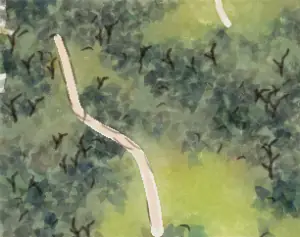</td><td width="110">Sonnet 5.5</td><td width="100" align="right"><a href="../runs/v1-naive/sonnet/1/run.json">60% · 5.07 (1)</a></td><td width="520"></td></tr>
<tr><td width="150">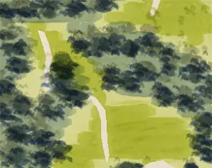</td><td width="110">Codex Astra</td><td width="100" align="right"><a href="../runs/v1-naive/astra/2/run.json">58% · 4.88 (2)</a></td><td width="520"></td></tr>
<tr><td width="150">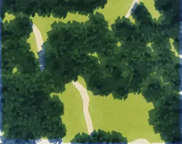</td><td width="110">Codex Sol</td><td width="100" align="right"><a href="../runs/v1-naive/sol/2/run.json">57% · 4.82 (2)</a></td><td width="520"></td></tr>
<tr><td width="150">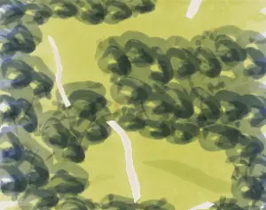</td><td width="110">DeepSeek V4.1 Flash</td><td width="100" align="right"><a href="../runs/v1-naive/dsflash/2/run.json">56% · 4.72 (2)</a></td><td width="520"></td></tr>
<tr><td width="150"></td><td width="110">Codex Luna</td><td width="100" align="right"><a href="../runs/v1-naive/luna/3/run.json">53% · 4.48 (3)</a></td><td width="520"></td></tr>
<tr><td width="150">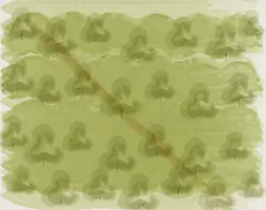</td><td width="110">MiniMax M3</td><td width="100" align="right"><a href="../runs/v1-naive/minimax/3/run.json">44% · 3.68 (3)</a></td><td width="520"></td></tr>
<tr><td width="150">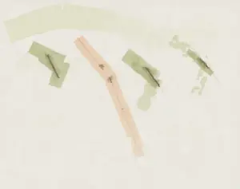</td><td width="110">Haiku 4.5</td><td width="100" align="right"><a href="../runs/v1-naive/haiku/2/run.json">25% · 2.12 (2)</a></td><td width="520">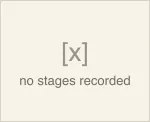</td></tr>
</table>

### France

<table>
<tr><th width="150">Finished</th><th width="110">Model</th><th width="100" align="right">Score: % of target, /10 (trial)</th><th width="520">Saved stages (10, 25, 50, 75% of strokes)</th></tr>
<tr><td width="150"></td><td width="110">Target (scored against itself)</td><td width="100" align="right">100% · 8.43</td><td width="520"></td></tr>
<tr><td width="150"></td><td width="110">Codex Astra</td><td width="100" align="right"><a href="../runs/v1-naive/astra/1/run.json">69% · 5.80 (1)</a></td><td width="520"></td></tr>
<tr><td width="150"></td><td width="110">Codex Sol</td><td width="100" align="right"><a href="../runs/v1-naive/sol/3/run.json">67% · 5.67 (3)</a></td><td width="520"></td></tr>
<tr><td width="150"></td><td width="110">Opus 5.5</td><td width="100" align="right"><a href="../runs/v1-naive/opus/1/run.json">67% · 5.61 (1)</a></td><td width="520"></td></tr>
<tr><td width="150">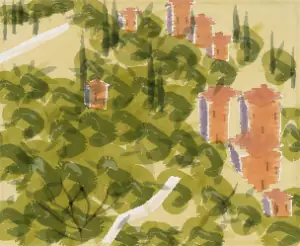</td><td width="110">DeepSeek V4.1 Flash</td><td width="100" align="right"><a href="../runs/v1-naive/dsflash/2/run.json">63% · 5.27 (2)</a></td><td width="520"></td></tr>
<tr><td width="150">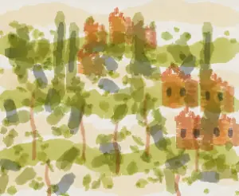</td><td width="110">Codex Luna</td><td width="100" align="right"><a href="../runs/v1-naive/luna/1/run.json">58% · 4.85 (1)</a></td><td width="520"></td></tr>
<tr><td width="150"></td><td width="110">Sonnet 5.5</td><td width="100" align="right"><a href="../runs/v1-naive/sonnet/1/run.json">55% · 4.62 (1)</a></td><td width="520"></td></tr>
<tr><td width="150">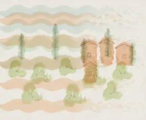</td><td width="110">MiniMax M3</td><td width="100" align="right"><a href="../runs/v1-naive/minimax/3/run.json">40% · 3.41 (3)</a></td><td width="520"></td></tr>
<tr><td width="150"></td><td width="110">Haiku 4.5</td><td width="100" align="right"><a href="../runs/v1-naive/haiku/2/run.json">27% · 2.25 (2)</a></td><td width="520"></td></tr>
</table>

### Ships

<table>
<tr><th width="150">Finished</th><th width="110">Model</th><th width="100" align="right">Score: % of target, /10 (trial)</th><th width="520">Saved stages (10, 25, 50, 75% of strokes)</th></tr>
<tr><td width="150"></td><td width="110">Target (scored against itself)</td><td width="100" align="right">100% · 8.76</td><td width="520"></td></tr>
<tr><td width="150">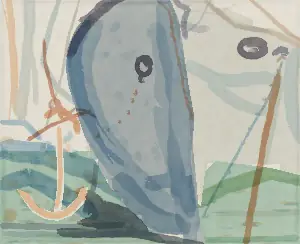</td><td width="110">Codex Astra</td><td width="100" align="right"><a href="../runs/v1-naive/astra/3/run.json">63% · 5.53 (3)</a></td><td width="520"></td></tr>
<tr><td width="150"></td><td width="110">Codex Sol</td><td width="100" align="right"><a href="../runs/v1-naive/sol/3/run.json">58% · 5.09 (3)</a></td><td width="520"></td></tr>
<tr><td width="150">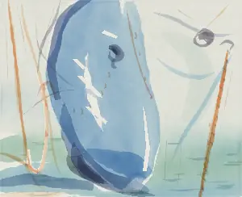</td><td width="110">DeepSeek V4.1 Flash</td><td width="100" align="right"><a href="../runs/v1-naive/dsflash/2/run.json">58% · 5.05 (2)</a></td><td width="520"></td></tr>
<tr><td width="150">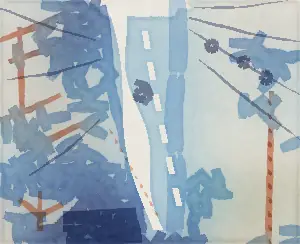</td><td width="110">Opus 5.5</td><td width="100" align="right"><a href="../runs/v1-naive/opus/1/run.json">57% · 5.01 (1)</a></td><td width="520"></td></tr>
<tr><td width="150"></td><td width="110">Sonnet 5.5</td><td width="100" align="right"><a href="../runs/v1-naive/sonnet/1/run.json">50% · 4.40 (1)</a></td><td width="520"></td></tr>
<tr><td width="150">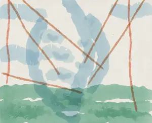</td><td width="110">Codex Luna</td><td width="100" align="right"><a href="../runs/v1-naive/luna/1/run.json">49% · 4.28 (1)</a></td><td width="520">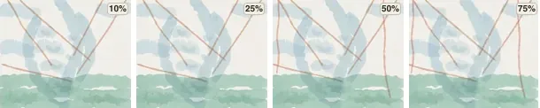</td></tr>
<tr><td width="150">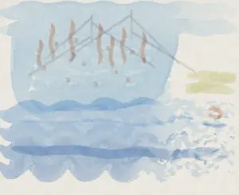</td><td width="110">MiniMax M3</td><td width="100" align="right"><a href="../runs/v1-naive/minimax/3/run.json">49% · 4.27 (3)</a></td><td width="520"></td></tr>
<tr><td width="150">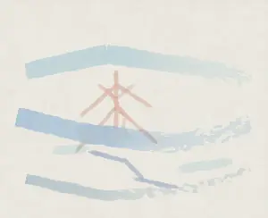</td><td width="110">Haiku 4.5</td><td width="100" align="right"><a href="../runs/v1-naive/haiku/2/run.json">28% · 2.46 (2)</a></td><td width="520"></td></tr>
</table>

### Mittens

<table>
<tr><th width="150">Finished</th><th width="110">Model</th><th width="100" align="right">Score: % of target, /10 (trial)</th><th width="520">Saved stages (10, 25, 50, 75% of strokes)</th></tr>
<tr><td width="150"></td><td width="110">Target (scored against itself)</td><td width="100" align="right">100% · 8.76</td><td width="520"></td></tr>
<tr><td width="150"></td><td width="110">Codex Astra</td><td width="100" align="right"><a href="../runs/v1-naive/astra/3/run.json">67% · 5.86 (3)</a></td><td width="520"></td></tr>
<tr><td width="150"></td><td width="110">Codex Sol</td><td width="100" align="right"><a href="../runs/v1-naive/sol/2/run.json">62% · 5.46 (2)</a></td><td width="520"></td></tr>
<tr><td width="150"></td><td width="110">Opus 5.5</td><td width="100" align="right"><a href="../runs/v1-naive/opus/2/run.json">57% · 4.98 (2)</a></td><td width="520"></td></tr>
<tr><td width="150"></td><td width="110">DeepSeek V4.1 Flash</td><td width="100" align="right"><a href="../runs/v1-naive/dsflash/2/run.json">54% · 4.73 (2)</a></td><td width="520"></td></tr>
<tr><td width="150"></td><td width="110">Sonnet 5.5</td><td width="100" align="right"><a href="../runs/v1-naive/sonnet/1/run.json">53% · 4.67 (1)</a></td><td width="520"></td></tr>
<tr><td width="150"></td><td width="110">Codex Luna</td><td width="100" align="right"><a href="../runs/v1-naive/luna/2/run.json">49% · 4.27 (2)</a></td><td width="520"></td></tr>
<tr><td width="150">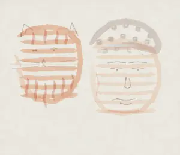</td><td width="110">MiniMax M3</td><td width="100" align="right"><a href="../runs/v1-naive/minimax/3/run.json">40% · 3.54 (3)</a></td><td width="520"></td></tr>
<tr><td width="150"></td><td width="110">Haiku 4.5</td><td width="100" align="right"><a href="../runs/v1-naive/haiku/2/run.json">28% · 2.41 (2)</a></td><td width="520"></td></tr>
</table>

### Trumbull

<table>
<tr><th width="150">Finished</th><th width="110">Model</th><th width="100" align="right">Score: % of target, /10 (trial)</th><th width="520">Saved stages (10, 25, 50, 75% of strokes)</th></tr>
<tr><td width="150"></td><td width="110">Target (scored against itself)</td><td width="100" align="right">100% · 8.57</td><td width="520"></td></tr>
<tr><td width="150"></td><td width="110">Codex Astra</td><td width="100" align="right"><a href="../runs/v1-naive/astra/1/run.json">66% · 5.67 (1)</a></td><td width="520"></td></tr>
<tr><td width="150"></td><td width="110">Codex Sol</td><td width="100" align="right"><a href="../runs/v1-naive/sol/3/run.json">63% · 5.42 (3)</a></td><td width="520"></td></tr>
<tr><td width="150"></td><td width="110">Opus 5.5</td><td width="100" align="right"><a href="../runs/v1-naive/opus/2/run.json">56% · 4.81 (2)</a></td><td width="520"></td></tr>
<tr><td width="150"></td><td width="110">Codex Luna</td><td width="100" align="right"><a href="../runs/v1-naive/luna/3/run.json">56% · 4.78 (3)</a></td><td width="520">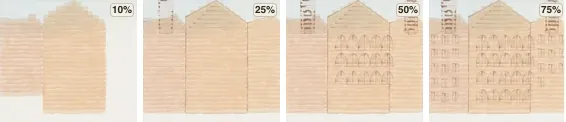</td></tr>
<tr><td width="150"></td><td width="110">Sonnet 5.5</td><td width="100" align="right"><a href="../runs/v1-naive/sonnet/1/run.json">51% · 4.40 (1)</a></td><td width="520"></td></tr>
<tr><td width="150">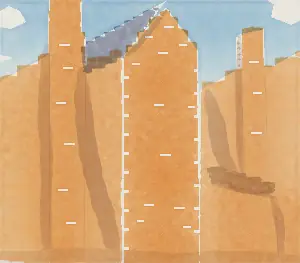</td><td width="110">DeepSeek V4.1 Flash</td><td width="100" align="right"><a href="../runs/v1-naive/dsflash/2/run.json">44% · 3.75 (2)</a></td><td width="520"></td></tr>
<tr><td width="150">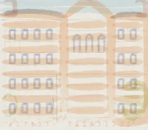</td><td width="110">MiniMax M3</td><td width="100" align="right"><a href="../runs/v1-naive/minimax/3/run.json">42% · 3.64 (3)</a></td><td width="520"></td></tr>
<tr><td width="150">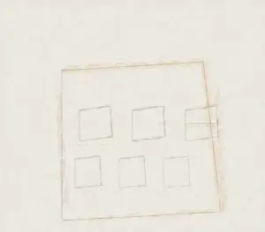</td><td width="110">Haiku 4.5</td><td width="100" align="right"><a href="../runs/v1-naive/haiku/1/run.json">25% · 2.15 (1)</a></td><td width="520"></td></tr>
</table>

## V2: Tools and technique guides

Painter V096 · sim 100 · judges J1 · release 0.1.0.

### Hills

<table>
<tr><th width="150">Finished</th><th width="110">Model</th><th width="100" align="right">Score: % of target, /10 (trial)</th><th width="520">Saved stages (10, 25, 50, 75% of strokes)</th></tr>
<tr><td width="150"></td><td width="110">Target (scored against itself)</td><td width="100" align="right">100% · 8.43</td><td width="520"></td></tr>
<tr><td width="150">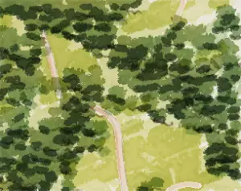</td><td width="110">Opus 5.5</td><td width="100" align="right"><a href="../runs/v2-skill/opus/1/run.json">68% · 5.74 (1)</a></td><td width="520"></td></tr>
<tr><td width="150"></td><td width="110">Codex Astra</td><td width="100" align="right"><a href="../runs/v2-skill/astra/1/run.json">62% · 5.19 (1)</a></td><td width="520"></td></tr>
<tr><td width="150">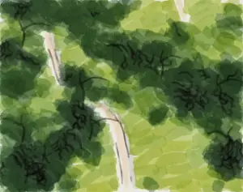</td><td width="110">Sonnet 5.5</td><td width="100" align="right"><a href="../runs/v2-skill/sonnet/2/run.json">60% · 5.03 (2)</a></td><td width="520"></td></tr>
<tr><td width="150">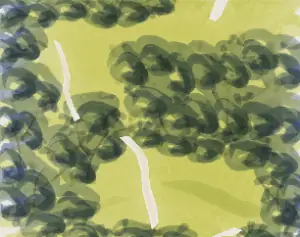</td><td width="110">Codex Sol</td><td width="100" align="right"><a href="../runs/v2-skill/sol/1/run.json">54% · 4.57 (1)</a></td><td width="520"></td></tr>
<tr><td width="150">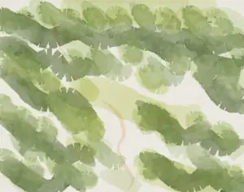</td><td width="110">Codex Luna</td><td width="100" align="right"><a href="../runs/v2-skill/luna/3/run.json">47% · 3.98 (3)</a></td><td width="520"></td></tr>
<tr><td width="150">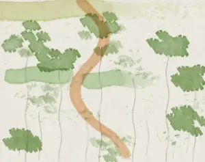</td><td width="110">MiniMax M3</td><td width="100" align="right"><a href="../runs/v2-skill/minimax/1/run.json">41% · 3.49 (1)</a></td><td width="520"></td></tr>
<tr><td width="150">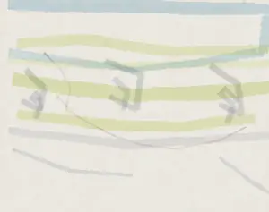</td><td width="110">Haiku 4.5</td><td width="100" align="right"><a href="../runs/v2-skill/haiku/1/run.json">27% · 2.28 (1)</a></td><td width="520"></td></tr>
<tr><td width="150"></td><td width="110">DeepSeek V4.1 Flash</td><td width="100" align="right"><a href="../runs/v2-skill/dsflash/1/run.json">22% · 1.89 (1)</a></td><td width="520"></td></tr>
</table>

### France

<table>
<tr><th width="150">Finished</th><th width="110">Model</th><th width="100" align="right">Score: % of target, /10 (trial)</th><th width="520">Saved stages (10, 25, 50, 75% of strokes)</th></tr>
<tr><td width="150"></td><td width="110">Target (scored against itself)</td><td width="100" align="right">100% · 8.43</td><td width="520"></td></tr>
<tr><td width="150">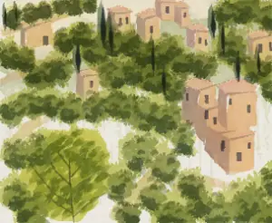</td><td width="110">Codex Astra</td><td width="100" align="right"><a href="../runs/v2-skill/astra/1/run.json">68% · 5.73 (1)</a></td><td width="520"></td></tr>
<tr><td width="150">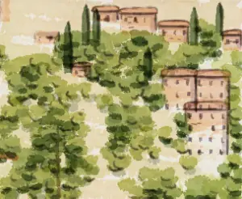</td><td width="110">Opus 5.5</td><td width="100" align="right"><a href="../runs/v2-skill/opus/1/run.json">67% · 5.68 (1)</a></td><td width="520"></td></tr>
<tr><td width="150">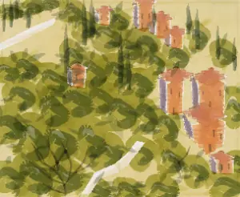</td><td width="110">Codex Sol</td><td width="100" align="right"><a href="../runs/v2-skill/sol/1/run.json">67% · 5.61 (1)</a></td><td width="520"></td></tr>
<tr><td width="150">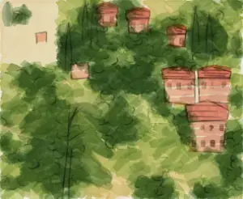</td><td width="110">Sonnet 5.5</td><td width="100" align="right"><a href="../runs/v2-skill/sonnet/2/run.json">66% · 5.58 (2)</a></td><td width="520"></td></tr>
<tr><td width="150">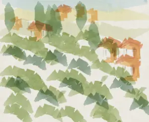</td><td width="110">Codex Luna</td><td width="100" align="right"><a href="../runs/v2-skill/luna/1/run.json">52% · 4.42 (1)</a></td><td width="520">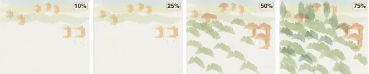</td></tr>
<tr><td width="150"></td><td width="110">MiniMax M3</td><td width="100" align="right"><a href="../runs/v2-skill/minimax/1/run.json">44% · 3.69 (1)</a></td><td width="520"></td></tr>
<tr><td width="150">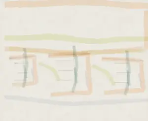</td><td width="110">Haiku 4.5</td><td width="100" align="right"><a href="../runs/v2-skill/haiku/1/run.json">28% · 2.35 (1)</a></td><td width="520"></td></tr>
<tr><td width="150">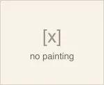</td><td width="110">DeepSeek V4.1 Flash</td><td width="100" align="right">–</td><td width="520"></td></tr>
</table>

### Ships

<table>
<tr><th width="150">Finished</th><th width="110">Model</th><th width="100" align="right">Score: % of target, /10 (trial)</th><th width="520">Saved stages (10, 25, 50, 75% of strokes)</th></tr>
<tr><td width="150"></td><td width="110">Target (scored against itself)</td><td width="100" align="right">100% · 8.76</td><td width="520"></td></tr>
<tr><td width="150"></td><td width="110">Codex Astra</td><td width="100" align="right"><a href="../runs/v2-skill/astra/1/run.json">64% · 5.57 (1)</a></td><td width="520"></td></tr>
<tr><td width="150">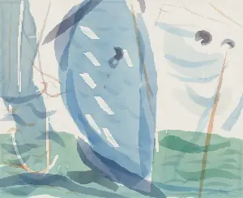</td><td width="110">Codex Sol</td><td width="100" align="right"><a href="../runs/v2-skill/sol/2/run.json">60% · 5.29 (2)</a></td><td width="520"></td></tr>
<tr><td width="150"></td><td width="110">Sonnet 5.5</td><td width="100" align="right"><a href="../runs/v2-skill/sonnet/1/run.json">57% · 4.98 (1)</a></td><td width="520"></td></tr>
<tr><td width="150"></td><td width="110">Opus 5.5</td><td width="100" align="right"><a href="../runs/v2-skill/opus/2/run.json">55% · 4.80 (2)</a></td><td width="520"></td></tr>
<tr><td width="150">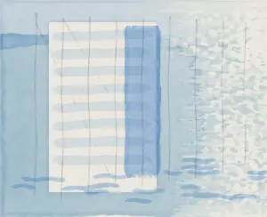</td><td width="110">MiniMax M3</td><td width="100" align="right"><a href="../runs/v2-skill/minimax/1/run.json">44% · 3.85 (1)</a></td><td width="520"></td></tr>
<tr><td width="150"></td><td width="110">Codex Luna</td><td width="100" align="right"><a href="../runs/v2-skill/luna/1/run.json">42% · 3.66 (1)</a></td><td width="520"></td></tr>
<tr><td width="150">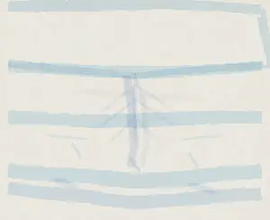</td><td width="110">Haiku 4.5</td><td width="100" align="right"><a href="../runs/v2-skill/haiku/1/run.json">30% · 2.62 (1)</a></td><td width="520"></td></tr>
<tr><td width="150"></td><td width="110">DeepSeek V4.1 Flash</td><td width="100" align="right">–</td><td width="520"></td></tr>
</table>

### Mittens

<table>
<tr><th width="150">Finished</th><th width="110">Model</th><th width="100" align="right">Score: % of target, /10 (trial)</th><th width="520">Saved stages (10, 25, 50, 75% of strokes)</th></tr>
<tr><td width="150"></td><td width="110">Target (scored against itself)</td><td width="100" align="right">100% · 8.76</td><td width="520"></td></tr>
<tr><td width="150"></td><td width="110">Codex Astra</td><td width="100" align="right"><a href="../runs/v2-skill/astra/3/run.json">63% · 5.50 (3)</a></td><td width="520"></td></tr>
<tr><td width="150"></td><td width="110">Sonnet 5.5</td><td width="100" align="right"><a href="../runs/v2-skill/sonnet/2/run.json">60% · 5.28 (2)</a></td><td width="520"></td></tr>
<tr><td width="150"></td><td width="110">Codex Sol</td><td width="100" align="right"><a href="../runs/v2-skill/sol/3/run.json">59% · 5.19 (3)</a></td><td width="520"></td></tr>
<tr><td width="150"></td><td width="110">Opus 5.5</td><td width="100" align="right"><a href="../runs/v2-skill/opus/2/run.json">57% · 5.02 (2)</a></td><td width="520"></td></tr>
<tr><td width="150"></td><td width="110">Codex Luna</td><td width="100" align="right"><a href="../runs/v2-skill/luna/1/run.json">44% · 3.83 (1)</a></td><td width="520"></td></tr>
<tr><td width="150">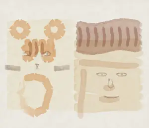</td><td width="110">MiniMax M3</td><td width="100" align="right"><a href="../runs/v2-skill/minimax/1/run.json">36% · 3.12 (1)</a></td><td width="520"></td></tr>
<tr><td width="150"></td><td width="110">Haiku 4.5</td><td width="100" align="right"><a href="../runs/v2-skill/haiku/2/run.json">26% · 2.29 (2)</a></td><td width="520"></td></tr>
<tr><td width="150"></td><td width="110">DeepSeek V4.1 Flash</td><td width="100" align="right">–</td><td width="520"></td></tr>
</table>

### Trumbull

<table>
<tr><th width="150">Finished</th><th width="110">Model</th><th width="100" align="right">Score: % of target, /10 (trial)</th><th width="520">Saved stages (10, 25, 50, 75% of strokes)</th></tr>
<tr><td width="150"></td><td width="110">Target (scored against itself)</td><td width="100" align="right">100% · 8.57</td><td width="520"></td></tr>
<tr><td width="150"></td><td width="110">Codex Astra</td><td width="100" align="right"><a href="../runs/v2-skill/astra/2/run.json">64% · 5.48 (2)</a></td><td width="520"></td></tr>
<tr><td width="150"></td><td width="110">Codex Sol</td><td width="100" align="right"><a href="../runs/v2-skill/sol/2/run.json">62% · 5.33 (2)</a></td><td width="520"></td></tr>
<tr><td width="150"></td><td width="110">Sonnet 5.5</td><td width="100" align="right"><a href="../runs/v2-skill/sonnet/2/run.json">62% · 5.30 (2)</a></td><td width="520"></td></tr>
<tr><td width="150"></td><td width="110">Opus 5.5</td><td width="100" align="right"><a href="../runs/v2-skill/opus/2/run.json">56% · 4.77 (2)</a></td><td width="520"></td></tr>
<tr><td width="150"></td><td width="110">Codex Luna</td><td width="100" align="right"><a href="../runs/v2-skill/luna/2/run.json">45% · 3.83 (2)</a></td><td width="520"></td></tr>
<tr><td width="150">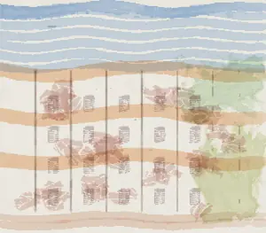</td><td width="110">MiniMax M3</td><td width="100" align="right"><a href="../runs/v2-skill/minimax/3/run.json">41% · 3.50 (3)</a></td><td width="520">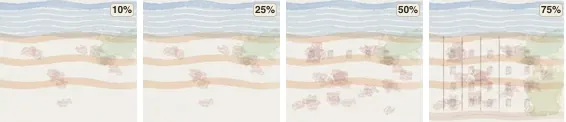</td></tr>
<tr><td width="150">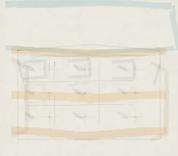</td><td width="110">Haiku 4.5</td><td width="100" align="right"><a href="../runs/v2-skill/haiku/1/run.json">28% · 2.43 (1)</a></td><td width="520"></td></tr>
<tr><td width="150"></td><td width="110">DeepSeek V4.1 Flash</td><td width="100" align="right">–</td><td width="520"></td></tr>
</table>

## V3: Technique guides and feedback between attempts

Painter V096 · sim 100 · judges J1 · release 0.1.0.

### Hills

<table>
<tr><th width="150">Finished</th><th width="110">Model</th><th width="100" align="right">Score: % of target, /10 (trial)</th><th width="520">Saved stages (10, 25, 50, 75% of strokes)</th></tr>
<tr><td width="150"></td><td width="110">Target (scored against itself)</td><td width="100" align="right">100% · 8.43</td><td width="520"></td></tr>
<tr><td width="150">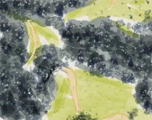</td><td width="110">Codex Astra</td><td width="100" align="right"><a href="../runs/v3-informed/astra/2/run.json">65% · 5.51 (2)</a></td><td width="520"></td></tr>
<tr><td width="150"></td><td width="110">Codex Sol</td><td width="100" align="right"><a href="../runs/v3-informed/sol/1/run.json">63% · 5.34 (1)</a></td><td width="520"></td></tr>
<tr><td width="150"></td><td width="110">Sonnet 5.5</td><td width="100" align="right"><a href="../runs/v3-informed/sonnet/2/run.json">63% · 5.31 (2)</a></td><td width="520"></td></tr>
<tr><td width="150"></td><td width="110">Opus 5.5</td><td width="100" align="right"><a href="../runs/v3-informed/opus/2/run.json">63% · 5.27 (2)</a></td><td width="520"></td></tr>
</table>

### France

<table>
<tr><th width="150">Finished</th><th width="110">Model</th><th width="100" align="right">Score: % of target, /10 (trial)</th><th width="520">Saved stages (10, 25, 50, 75% of strokes)</th></tr>
<tr><td width="150"></td><td width="110">Target (scored against itself)</td><td width="100" align="right">100% · 8.43</td><td width="520"></td></tr>
<tr><td width="150">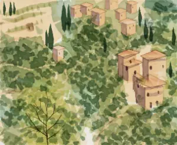</td><td width="110">Codex Astra</td><td width="100" align="right"><a href="../runs/v3-informed/astra/3/run.json">74% · 6.24 (3)</a></td><td width="520"></td></tr>
<tr><td width="150"></td><td width="110">Codex Sol</td><td width="100" align="right"><a href="../runs/v3-informed/sol/1/run.json">74% · 6.24 (1)</a></td><td width="520"></td></tr>
<tr><td width="150"></td><td width="110">Opus 5.5</td><td width="100" align="right"><a href="../runs/v3-informed/opus/2/run.json">73% · 6.12 (2)</a></td><td width="520"></td></tr>
<tr><td width="150">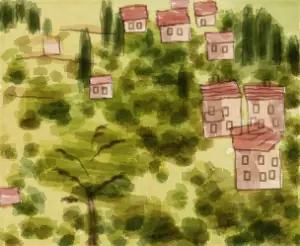</td><td width="110">Sonnet 5.5</td><td width="100" align="right"><a href="../runs/v3-informed/sonnet/3/run.json">62% · 5.21 (3)</a></td><td width="520"></td></tr>
</table>

### Ships

<table>
<tr><th width="150">Finished</th><th width="110">Model</th><th width="100" align="right">Score: % of target, /10 (trial)</th><th width="520">Saved stages (10, 25, 50, 75% of strokes)</th></tr>
<tr><td width="150"></td><td width="110">Target (scored against itself)</td><td width="100" align="right">100% · 8.76</td><td width="520"></td></tr>
<tr><td width="150"></td><td width="110">Codex Astra</td><td width="100" align="right"><a href="../runs/v3-informed/astra/3/run.json">71% · 6.19 (3)</a></td><td width="520"></td></tr>
<tr><td width="150"></td><td width="110">Sonnet 5.5</td><td width="100" align="right"><a href="../runs/v3-informed/sonnet/3/run.json">68% · 5.92 (3)</a></td><td width="520"></td></tr>
<tr><td width="150"></td><td width="110">Opus 5.5</td><td width="100" align="right"><a href="../runs/v3-informed/opus/3/run.json">67% · 5.88 (3)</a></td><td width="520"></td></tr>
<tr><td width="150"></td><td width="110">Codex Sol</td><td width="100" align="right"><a href="../runs/v3-informed/sol/3/run.json">67% · 5.88 (3)</a></td><td width="520"></td></tr>
</table>

## V4: Full painting pipeline

Painter V096 · sim 100 · judges J1 · release 0.1.0.

### Hills

<table>
<tr><th width="150">Finished</th><th width="110">Model</th><th width="100" align="right">Score: % of target, /10 (trial)</th><th width="520">Saved stages (10, 25, 50, 75% of strokes)</th></tr>
<tr><td width="150"></td><td width="110">Target (scored against itself)</td><td width="100" align="right">100% · 8.43</td><td width="520"></td></tr>
<tr><td width="150"></td><td width="110">Opus 5.5</td><td width="100" align="right"><a href="../runs/v4-pipeline/opus/1/run.json">74% · 6.25 (1)</a></td><td width="520"></td></tr>
<tr><td width="150">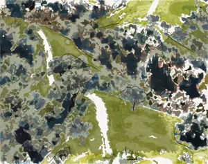</td><td width="110">Sonnet 5.5</td><td width="100" align="right"><a href="../runs/v4-pipeline/sonnet/1/run.json">69% · 5.84 (1)</a></td><td width="520"></td></tr>
<tr><td width="150">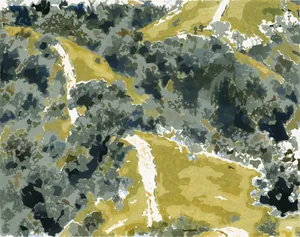</td><td width="110">Codex Sol</td><td width="100" align="right"><a href="../runs/v4-pipeline/sol/1/run.json">69% · 5.81 (1)</a></td><td width="520"></td></tr>
<tr><td width="150"></td><td width="110">Codex Astra</td><td width="100" align="right"><a href="../runs/v4-pipeline/astra/2/run.json">65% · 5.45 (2)</a></td><td width="520"></td></tr>
<tr><td width="150"></td><td width="110">Codex Luna</td><td width="100" align="right"><a href="../runs/v4-pipeline/luna/2/run.json">65% · 5.44 (2)</a></td><td width="520"></td></tr>
<tr><td width="150"></td><td width="110">Haiku 4.5</td><td width="100" align="right"><a href="../runs/v4-pipeline/haiku/3/run.json">63% · 5.28 (3)</a></td><td width="520"></td></tr>
</table>

### France

<table>
<tr><th width="150">Finished</th><th width="110">Model</th><th width="100" align="right">Score: % of target, /10 (trial)</th><th width="520">Saved stages (10, 25, 50, 75% of strokes)</th></tr>
<tr><td width="150"></td><td width="110">Target (scored against itself)</td><td width="100" align="right">100% · 8.43</td><td width="520"></td></tr>
<tr><td width="150"></td><td width="110">Codex Astra</td><td width="100" align="right"><a href="../runs/v4-pipeline/astra/1/run.json">73% · 6.12 (1)</a></td><td width="520"></td></tr>
<tr><td width="150">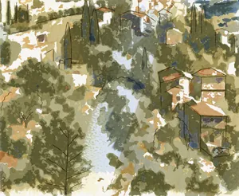</td><td width="110">Opus 5.5</td><td width="100" align="right"><a href="../runs/v4-pipeline/opus/2/run.json">71% · 5.97 (2)</a></td><td width="520"></td></tr>
<tr><td width="150"></td><td width="110">Codex Luna</td><td width="100" align="right"><a href="../runs/v4-pipeline/luna/3/run.json">70% · 5.92 (3)</a></td><td width="520"></td></tr>
<tr><td width="150">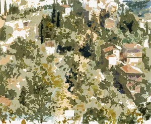</td><td width="110">Sonnet 5.5</td><td width="100" align="right"><a href="../runs/v4-pipeline/sonnet/1/run.json">68% · 5.75 (1)</a></td><td width="520"></td></tr>
<tr><td width="150"></td><td width="110">Haiku 4.5</td><td width="100" align="right"><a href="../runs/v4-pipeline/haiku/3/run.json">68% · 5.74 (3)</a></td><td width="520"></td></tr>
<tr><td width="150"></td><td width="110">Codex Sol</td><td width="100" align="right"><a href="../runs/v4-pipeline/sol/2/run.json">64% · 5.36 (2)</a></td><td width="520"></td></tr>
</table>

### Ships

<table>
<tr><th width="150">Finished</th><th width="110">Model</th><th width="100" align="right">Score: % of target, /10 (trial)</th><th width="520">Saved stages (10, 25, 50, 75% of strokes)</th></tr>
<tr><td width="150"></td><td width="110">Target (scored against itself)</td><td width="100" align="right">100% · 8.76</td><td width="520"></td></tr>
<tr><td width="150"></td><td width="110">Codex Sol</td><td width="100" align="right"><a href="../runs/v4-pipeline/sol/1/run.json">75% · 6.54 (1)</a></td><td width="520"></td></tr>
<tr><td width="150"></td><td width="110">Opus 5.5</td><td width="100" align="right"><a href="../runs/v4-pipeline/opus/1/run.json">72% · 6.32 (1)</a></td><td width="520"></td></tr>
<tr><td width="150"></td><td width="110">Codex Luna</td><td width="100" align="right"><a href="../runs/v4-pipeline/luna/3/run.json">68% · 6.00 (3)</a></td><td width="520"></td></tr>
<tr><td width="150"></td><td width="110">Codex Astra</td><td width="100" align="right"><a href="../runs/v4-pipeline/astra/3/run.json">66% · 5.82 (3)</a></td><td width="520"></td></tr>
<tr><td width="150"></td><td width="110">Haiku 4.5</td><td width="100" align="right"><a href="../runs/v4-pipeline/haiku/3/run.json">62% · 5.47 (3)</a></td><td width="520"></td></tr>
<tr><td width="150"></td><td width="110">Sonnet 5.5</td><td width="100" align="right"><a href="../runs/v4-pipeline/sonnet/3/run.json">62% · 5.46 (3)</a></td><td width="520"></td></tr>
</table>

### Mittens

<table>
<tr><th width="150">Finished</th><th width="110">Model</th><th width="100" align="right">Score: % of target, /10 (trial)</th><th width="520">Saved stages (10, 25, 50, 75% of strokes)</th></tr>
<tr><td width="150"></td><td width="110">Target (scored against itself)</td><td width="100" align="right">100% · 8.76</td><td width="520"></td></tr>
<tr><td width="150"></td><td width="110">Opus 5.5</td><td width="100" align="right"><a href="../runs/v4-pipeline/opus/1/run.json">75% · 6.54 (1)</a></td><td width="520"></td></tr>
<tr><td width="150"></td><td width="110">Sonnet 5.5</td><td width="100" align="right"><a href="../runs/v4-pipeline/sonnet/2/run.json">73% · 6.40 (2)</a></td><td width="520"></td></tr>
<tr><td width="150"></td><td width="110">Codex Astra</td><td width="100" align="right"><a href="../runs/v4-pipeline/astra/3/run.json">72% · 6.33 (3)</a></td><td width="520"></td></tr>
<tr><td width="150"></td><td width="110">Codex Sol</td><td width="100" align="right"><a href="../runs/v4-pipeline/sol/3/run.json">72% · 6.31 (3)</a></td><td width="520"></td></tr>
<tr><td width="150"></td><td width="110">Codex Luna</td><td width="100" align="right"><a href="../runs/v4-pipeline/luna/1/run.json">72% · 6.28 (1)</a></td><td width="520"></td></tr>
<tr><td width="150"></td><td width="110">Haiku 4.5</td><td width="100" align="right"><a href="../runs/v4-pipeline/haiku/3/run.json">71% · 6.26 (3)</a></td><td width="520"></td></tr>
</table>

### Trumbull

<table>
<tr><th width="150">Finished</th><th width="110">Model</th><th width="100" align="right">Score: % of target, /10 (trial)</th><th width="520">Saved stages (10, 25, 50, 75% of strokes)</th></tr>
<tr><td width="150"></td><td width="110">Target (scored against itself)</td><td width="100" align="right">100% · 8.57</td><td width="520"></td></tr>
<tr><td width="150"></td><td width="110">Codex Luna</td><td width="100" align="right"><a href="../runs/v4-pipeline/luna/1/run.json">74% · 6.36 (1)</a></td><td width="520"></td></tr>
<tr><td width="150"></td><td width="110">Opus 5.5</td><td width="100" align="right"><a href="../runs/v4-pipeline/opus/1/run.json">74% · 6.36 (1)</a></td><td width="520"></td></tr>
<tr><td width="150"></td><td width="110">Codex Sol</td><td width="100" align="right"><a href="../runs/v4-pipeline/sol/2/run.json">72% · 6.21 (2)</a></td><td width="520"></td></tr>
<tr><td width="150"></td><td width="110">Codex Astra</td><td width="100" align="right"><a href="../runs/v4-pipeline/astra/2/run.json">72% · 6.20 (2)</a></td><td width="520"></td></tr>
<tr><td width="150"></td><td width="110">Haiku 4.5</td><td width="100" align="right"><a href="../runs/v4-pipeline/haiku/3/run.json">72% · 6.18 (3)</a></td><td width="520"></td></tr>
<tr><td width="150"></td><td width="110">Sonnet 5.5</td><td width="100" align="right"><a href="../runs/v4-pipeline/sonnet/2/run.json">70% · 6.04 (2)</a></td><td width="520"></td></tr>
</table>

## V5: Full pipeline and feedback between attempts

Painter V096 · sim 100 · judges J1 · release 0.1.0.

### Hills

<table>
<tr><th width="150">Finished</th><th width="110">Model</th><th width="100" align="right">Score: % of target, /10 (trial)</th><th width="520">Saved stages (10, 25, 50, 75% of strokes)</th></tr>
<tr><td width="150"></td><td width="110">Target (scored against itself)</td><td width="100" align="right">100% · 8.43</td><td width="520"></td></tr>
<tr><td width="150"></td><td width="110">Sonnet 5.5</td><td width="100" align="right"><a href="../runs/v5-self-study/sonnet/3/run.json">77% · 6.52 (3)</a></td><td width="520"></td></tr>
<tr><td width="150"></td><td width="110">Opus 5.5</td><td width="100" align="right"><a href="../runs/v5-self-study/opus/1/run.json">74% · 6.25 (1)</a></td><td width="520"></td></tr>
<tr><td width="150"></td><td width="110">Codex Astra</td><td width="100" align="right"><a href="../runs/v5-self-study/astra/2/run.json">73% · 6.17 (2)</a></td><td width="520"></td></tr>
<tr><td width="150"></td><td width="110">Codex Luna</td><td width="100" align="right"><a href="../runs/v5-self-study/luna/3/run.json">71% · 6.00 (3)</a></td><td width="520"></td></tr>
<tr><td width="150"></td><td width="110">Codex Sol</td><td width="100" align="right"><a href="../runs/v5-self-study/sol/1/run.json">69% · 5.81 (1)</a></td><td width="520"></td></tr>
<tr><td width="150"></td><td width="110">Haiku 4.5</td><td width="100" align="right"><a href="../runs/v5-self-study/haiku/3/run.json">66% · 5.53 (3)</a></td><td width="520"></td></tr>
</table>

### France

<table>
<tr><th width="150">Finished</th><th width="110">Model</th><th width="100" align="right">Score: % of target, /10 (trial)</th><th width="520">Saved stages (10, 25, 50, 75% of strokes)</th></tr>
<tr><td width="150"></td><td width="110">Target (scored against itself)</td><td width="100" align="right">100% · 8.43</td><td width="520"></td></tr>
<tr><td width="150"></td><td width="110">Sonnet 5.5</td><td width="100" align="right"><a href="../runs/v5-self-study/sonnet/2/run.json">74% · 6.24 (2)</a></td><td width="520"></td></tr>
<tr><td width="150"></td><td width="110">Codex Astra</td><td width="100" align="right"><a href="../runs/v5-self-study/astra/1/run.json">73% · 6.12 (1)</a></td><td width="520"></td></tr>
<tr><td width="150"></td><td width="110">Opus 5.5</td><td width="100" align="right"><a href="../runs/v5-self-study/opus/3/run.json">69% · 5.80 (3)</a></td><td width="520"></td></tr>
<tr><td width="150"></td><td width="110">Haiku 4.5</td><td width="100" align="right"><a href="../runs/v5-self-study/haiku/3/run.json">68% · 5.75 (3)</a></td><td width="520"></td></tr>
<tr><td width="150"></td><td width="110">Codex Luna</td><td width="100" align="right"><a href="../runs/v5-self-study/luna/1/run.json">68% · 5.75 (1)</a></td><td width="520"></td></tr>
<tr><td width="150"></td><td width="110">Codex Sol</td><td width="100" align="right"><a href="../runs/v5-self-study/sol/3/run.json">61% · 5.15 (3)</a></td><td width="520"></td></tr>
</table>

### Ships

<table>
<tr><th width="150">Finished</th><th width="110">Model</th><th width="100" align="right">Score: % of target, /10 (trial)</th><th width="520">Saved stages (10, 25, 50, 75% of strokes)</th></tr>
<tr><td width="150"></td><td width="110">Target (scored against itself)</td><td width="100" align="right">100% · 8.76</td><td width="520"></td></tr>
<tr><td width="150"></td><td width="110">Codex Sol</td><td width="100" align="right"><a href="../runs/v5-self-study/sol/1/run.json">75% · 6.54 (1)</a></td><td width="520"></td></tr>
<tr><td width="150"></td><td width="110">Opus 5.5</td><td width="100" align="right"><a href="../runs/v5-self-study/opus/1/run.json">72% · 6.32 (1)</a></td><td width="520"></td></tr>
<tr><td width="150"></td><td width="110">Codex Astra</td><td width="100" align="right"><a href="../runs/v5-self-study/astra/3/run.json">71% · 6.22 (3)</a></td><td width="520"></td></tr>
<tr><td width="150"></td><td width="110">Sonnet 5.5</td><td width="100" align="right"><a href="../runs/v5-self-study/sonnet/2/run.json">68% · 5.93 (2)</a></td><td width="520"></td></tr>
<tr><td width="150"></td><td width="110">Codex Luna</td><td width="100" align="right"><a href="../runs/v5-self-study/luna/3/run.json">65% · 5.65 (3)</a></td><td width="520"></td></tr>
<tr><td width="150"></td><td width="110">Haiku 4.5</td><td width="100" align="right"><a href="../runs/v5-self-study/haiku/2/run.json">62% · 5.43 (2)</a></td><td width="520"></td></tr>
</table>

### Mittens

<table>
<tr><th width="150">Finished</th><th width="110">Model</th><th width="100" align="right">Score: % of target, /10 (trial)</th><th width="520">Saved stages (10, 25, 50, 75% of strokes)</th></tr>
<tr><td width="150"></td><td width="110">Target (scored against itself)</td><td width="100" align="right">100% · 8.76</td><td width="520"></td></tr>
<tr><td width="150"></td><td width="110">Codex Astra</td><td width="100" align="right"><a href="../runs/v5-self-study/astra/3/run.json">84% · 7.37 (3)</a></td><td width="520"></td></tr>
<tr><td width="150"></td><td width="110">Codex Sol</td><td width="100" align="right"><a href="../runs/v5-self-study/sol/3/run.json">77% · 6.76 (3)</a></td><td width="520"></td></tr>
<tr><td width="150"></td><td width="110">Codex Luna</td><td width="100" align="right"><a href="../runs/v5-self-study/luna/3/run.json">76% · 6.66 (3)</a></td><td width="520"></td></tr>
<tr><td width="150"></td><td width="110">Sonnet 5.5</td><td width="100" align="right"><a href="../runs/v5-self-study/sonnet/3/run.json">75% · 6.60 (3)</a></td><td width="520"></td></tr>
<tr><td width="150"></td><td width="110">Opus 5.5</td><td width="100" align="right"><a href="../runs/v5-self-study/opus/1/run.json">75% · 6.54 (1)</a></td><td width="520"></td></tr>
<tr><td width="150"></td><td width="110">Haiku 4.5</td><td width="100" align="right"><a href="../runs/v5-self-study/haiku/3/run.json">67% · 5.87 (3)</a></td><td width="520"></td></tr>
</table>

### Trumbull

<table>
<tr><th width="150">Finished</th><th width="110">Model</th><th width="100" align="right">Score: % of target, /10 (trial)</th><th width="520">Saved stages (10, 25, 50, 75% of strokes)</th></tr>
<tr><td width="150"></td><td width="110">Target (scored against itself)</td><td width="100" align="right">100% · 8.57</td><td width="520"></td></tr>
<tr><td width="150"></td><td width="110">Sonnet 5.5</td><td width="100" align="right"><a href="../runs/v5-self-study/sonnet/2/run.json">76% · 6.51 (2)</a></td><td width="520"></td></tr>
<tr><td width="150"></td><td width="110">Opus 5.5</td><td width="100" align="right"><a href="../runs/v5-self-study/opus/2/run.json">74% · 6.37 (2)</a></td><td width="520"></td></tr>
<tr><td width="150"></td><td width="110">Codex Luna</td><td width="100" align="right"><a href="../runs/v5-self-study/luna/1/run.json">74% · 6.36 (1)</a></td><td width="520"></td></tr>
<tr><td width="150"></td><td width="110">Codex Sol</td><td width="100" align="right"><a href="../runs/v5-self-study/sol/3/run.json">72% · 6.19 (3)</a></td><td width="520"></td></tr>
<tr><td width="150"></td><td width="110">Haiku 4.5</td><td width="100" align="right"><a href="../runs/v5-self-study/haiku/1/run.json">71% · 6.11 (1)</a></td><td width="520"></td></tr>
<tr><td width="150"></td><td width="110">Codex Astra</td><td width="100" align="right"><a href="../runs/v5-self-study/astra/2/run.json">70% · 6.04 (2)</a></td><td width="520"></td></tr>
</table>
