# Tips: brush technique in this painter, by worked example

Eighteen small examples. Each was painted on a blank sheet (320 x 200 cells, 83 x 52 mm) by the code shown beside it,
and the picture is its dried result. None is a picture of anything: they show how the brush, the water and the paper
behave, and nothing about what to paint.

How to read this in each setting:

- **Painting with the kit (level 1).** The code runs as it stands: `bench/tips/N-name.mjs`, pictures
  `bench/tips/N-name.png`. Lines marked *kit only* are about kit calls.
- **Writing a plan or a script for the session painter (levels 2 to 4).** You do not call the kit; read each example
  for its physics and its mistake. In that vocabulary a "wash" is one passage; "wet into wet" and "charge" are a
  passage laid while its neighbour is wet; a "glaze" is a passage over a dried one; "reserve" and "lift" are the white
  of the paper; a passage's strokes follow the direction you give it. The same rules about overlap, drying and which
  way the strokes run apply.

Three things hold everywhere:

1. **Water moves only in time.** A wash is one wash only if its strokes are all wet together; strokes laid on a dried
   sheet keep their own edges for good.
2. **A brush runs out.** One dip covers one or two strokes of a wash (example 14). Dip again before it shows.
3. **The stroke is the unit, not the tile.** A shape is filled by a few long strokes that follow it, each overlapping
   the last. Squares laid side by side leave seams or paper between them and read as a mosaic.

## Single techniques

### 1. A flat wash
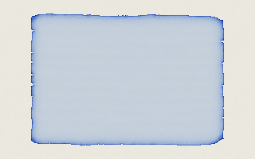

```js
const b = kit.createBrush({ radius: 12, bristles: 24, capacity: 80 });
const paint = kit.mix({ ultramarine: 0.35 });
let row = 0;
for (let y = 30; y <= H - 30; y += 14, row++) {            // rows 14 cells apart, brush 24 wide: each overlaps the last by almost half
  kit.dip(b, { water: 0.9, conc: paint });                  // a full brush for every row
  const [x0, x1] = row % 2 ? [W - 40, 40] : [40, W - 40];   // back and forth
  kit.stroke(b, sheet, [{ x: x0, y, p: 0.9 }, { x: (x0 + x1) / 2, y: y + 1, p: 0.9 }, { x: x1, y, p: 0.9 }],
    { between: s => { if (s % 6 === 0) kit.step(sheet, O); } });
}
for (let q = 0; q < 20; q++) kit.step(sheet, O);            // all rows still wet: they level into one
kit.dryAll(sheet, O);
```

- Physics: neighbouring wet rows share their water, so the paint evens out across the joins before it settles.
- Prevents: a wash laid as separate tiles or rows with paper gaps, or with a dry row between wet ones (stripes).
- *Kit only:* the darker rim round the wash is real: paint gathers where the wet edge dries last.

### 2. A graded wash
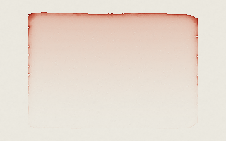

```js
for (let r = 0; r < rows; r++) {
  const y = 30 + 14 * r, fade = 1 - r / (rows - 1);                             // 1 at the top, 0 at the bottom
  kit.dip(b, { water: 0.95, conc: kit.mix({ sienna: 0.5 * fade * fade }) });    // the same water every row, less paint each time
  ...the same overlapping row as in the flat wash...
}
for (let q = 0; q < 30; q++) kit.step(sheet, O);
kit.dryAll(sheet, O);
```

- Physics: each row is a little weaker than the one it overlaps, and the shared water blends the step away.
- Prevents: a gradation built from dried bands of different strength, which reads as stairs.

### 3. Wet into wet
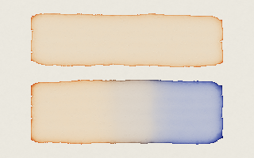

```js
rows(114, 170, 40, 190, kit.mix({ ochre: 0.3 }));                       // the first colour (rows() is the flat wash's loop)
rows(114, 170, 150, W - 40, kit.mix({ ultramarine: 0.5, rose: 0.1 }));  // at once, the second from inside the wet first one outward
for (let q = 0; q < 12; q++) kit.step(sheet, O);
kit.dryAll(sheet, O);
```

- Physics: where the second colour meets water already on the paper it has no edge to stop at; it travels until the
  sheet dries. The wetter the first wash, the farther it goes.
- Prevents: blending two colours by laying a third, mixed one between them when both have dried (a hard-edged band).
- *Kit only:* the upper band in the picture had one strong stroke dropped into the middle of a wet wash. It all but
  vanished: the standing water thins it and carries it off. Bring the second colour in from the wash's edge instead.

### 4. A glaze over a dry wash
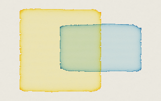

```js
wash(kit.mix({ hansa: 0.4 }), 40, W - 120, 30, H - 30);
kit.dryAll(sheet, O);                                        // the first wash is DRY before the second goes on
wash(kit.mix({ cerulean: 0.3 }), 120, W - 40, 60, H - 60);   // thin, laid once
kit.dryAll(sheet, O);
```

- Physics: dried paint is held in the paper; a thin wet layer over it adds its colour without moving what is below,
  and light passes through both.
- Prevents: darkening or shifting a colour by painting into it while it is damp (it lifts and goes muddy), and
  mixing every colour on the palette when two clean layers would do.

### 5. A soft edge next to a hard one
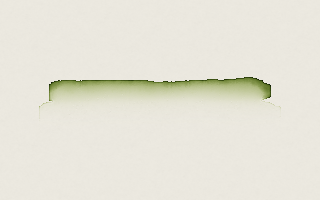

```js
for (const y of [112, 126, 140, 154]) {                      // clean water only, below where the stroke will go
  kit.dip(water, { water: 1, conc: kit.mix({}) });
  kit.stroke(water, sheet, [{ x: 40, y, p: 0.9 }, { x: W - 40, y, p: 0.9 }], { between: s => { if (s % 6 === 0) kit.step(sheet, O); } });
}
kit.dip(b, { water: 0.7, conc: kit.mix({ sapgreen: 1.2, umber: 0.4 }) });
kit.stroke(b, sheet, [{ x: 50, y: 92, p: 0.9 }, { x: 160, y: 94, p: 0.9 }, { x: W - 50, y: 92, p: 0.9 }], ...);   // upper half on dry paper, lower half on the wet band
for (let q = 0; q < 40; q++) kit.step(sheet, O);
```

- Physics: paint stops where the wet stops. Against dry paper that is a line; into wet paper there is no line.
- Prevents: a shape with the same cut-out edge all the way round. Decide for each edge whether it is found or lost.
- *Kit only:* clean water is `kit.mix({})`.

### 6. A dry-brush mark
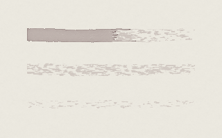

```js
const b = kit.createBrush({ radius: 9, bristles: 14, capacity: 40, flat: true });
for (const [y, water, p] of [[50, 0.8, 0.9], [100, 0.3, 0.5], [150, 0.15, 0.3]]) {   // wet and full; drier and lighter; driest and lightest
  kit.dip(b, { water, conc: kit.mix({ umber: 0.9, ultramarine: 0.3 }) });
  kit.stroke(b, sheet, [{ x: 40, y, p }, { x: 160, y: y + 2, p }, { x: W - 40, y, p: p * 0.7 }]);
}
```

- Physics: a brush with little water touches only the tops of the paper's grain; the hollows stay white.
- Prevents: making texture out of hundreds of tiny dots. One dry stroke breaks up by itself.

### 7. Paper white: reserve it, mask it, or lift it
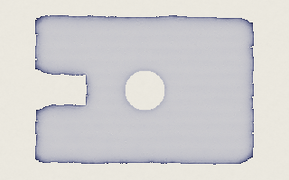

```js
kit.applyResist(sheet, disc(160, 100, 22));                  // middle: masking fluid before any paint (a 0/1 field, one value a cell)
...the flat wash, its rows stopping short of the notch on the left and starting again after it...
kit.blot(sheet, disc(250, 100, 22), { strength: 1, pigmentShare: 1 });   // right: a tissue on the wash at once
kit.dryAll(sheet, O);
kit.liftResist(sheet);                                       // the mask comes off when the sheet is dry
```

- Physics: watercolour has no white paint; the lightest light is paper that never got paint. Left: painted round.
  Middle: masked and washed straight over. Right: blotted, which in this picture took almost nothing.
- Prevents: planning to "add the highlights at the end". Decide the whites before the first wash.
- *Kit only:* blotting lifts only water still standing on the surface; do not rely on it for a white.

### 8. A pen line over a wash
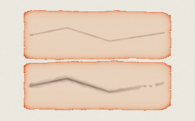

```js
band(30, 86); kit.dryAll(sheet, O);                          // top: washed, DRIED, then drawn on
line(58);
band(114, 170); for (let q = 0; q < 4; q++) kit.step(sheet, O);   // bottom: drawn on while wet
line(142);
```

- Physics: ink on dry paper stays where the nib put it; ink on wet paper spreads into the water.
- Prevents: crisp drawing lost because the wash under it was still wet (or a soft line that was meant to be crisp).

## Rendering a shape with a brush

The second picture of each is the same result with every stroke drawn as an arrow, numbered in the order laid, the
line thicker where the pressure was higher.

### 9. Filling an irregular shape
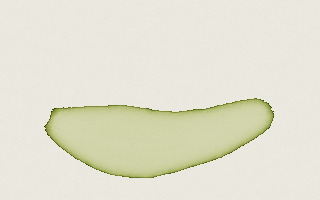 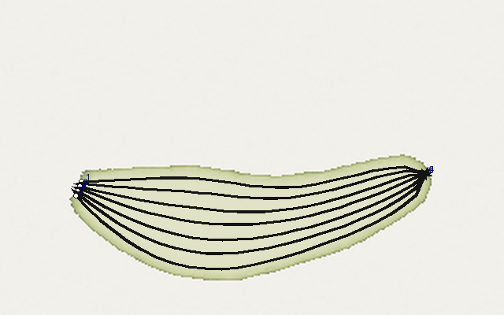

```js
const R = 8, b = kit.createBrush({ radius: R, bristles: 18, capacity: 70 });   // 16 cells wide: several strokes fit even where the shape is narrowest
const lanes = 7;                                              // 2 x 38 / 7 = 11 cells apart at the widest, under the brush's 16
for (let k = 0; k < lanes; k++) {
  const side = -1 + 2 * (k + 0.5) / lanes, pts = [];          // -1 is one edge of the shape, +1 the other
  for (let i = 0; i <= 24; i++) {
    const t = i / 24, c = centre(t), d = centre(Math.min(1, t + 0.01)), n = Math.hypot(d.x - c.x, d.y - c.y) || 1;
    const off = side * Math.max(0, half(t) - R * 0.8);        // keep the brush's own edge inside the outline
    pts.push({ x: c.x - (d.y - c.y) / n * off, y: c.y + (d.x - c.x) / n * off, p: 0.85 });
  }
  kit.dip(b, { water: 0.9, conc: kit.mix({ sapgreen: 0.45, ochre: 0.15 }) });
  kit.stroke(b, sheet, k % 2 ? pts.reverse() : pts, { between: s => { if (s % 6 === 0) kit.step(sheet, O); } });
}
```

- Physics: seven strokes, each the whole length of the shape and bending with it, are wet together and become one
  wash. Where the shape narrows the strokes close up and overlap more; none stops inside the shape.
- Prevents: a grid of tiles laid over an outline (seams, paper gaps, a stepped edge), and strokes that run across the
  shape's short way, which need many more of them and leave a ribbed fill.
- Choosing the brush: about a third to a half of the shape's narrowest width, so two or three strokes fit there.

### 10. A crescent
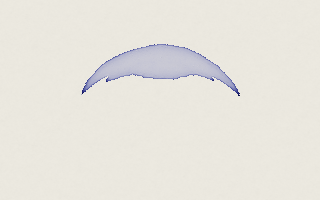 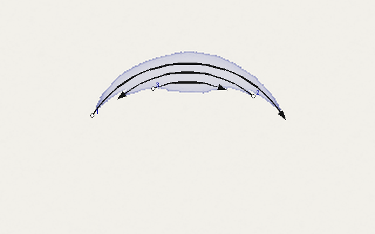

```js
const arc = (r, a0, a1) => Array.from({ length: 25 }, (_, i) => { const t = i / 24, a = a0 + (a1 - a0) * t;
  return { x: 160 + r * Math.cos(a), y: 150 - r * Math.sin(a), p: 0.12 + 0.8 * Math.sin(Math.PI * t) }; });   // pressure: nothing, full, nothing
for (const r of [96, 88, 80]) { ...dip; one stroke along arc(r, ...), the inner arcs shorter... }
```

- Physics: the brush is as wide as it is pressed. Rising and falling pressure along a curved path gives a shape that
  is thin at both ends and full in the middle, in three strokes.
- Prevents: building the points of a shape out of small dabs.

### 11. Tapering to a point by lifting pressure
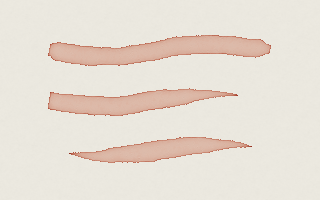 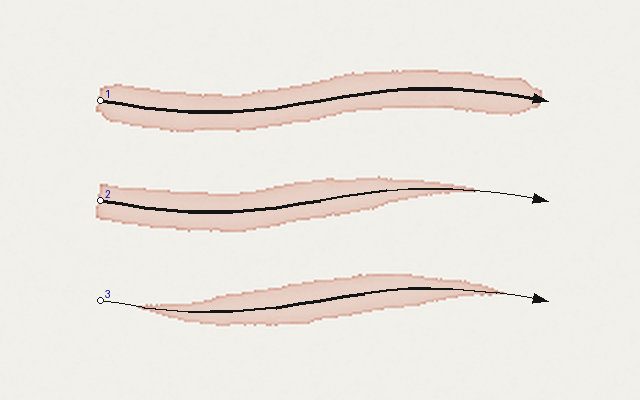

```js
[() => 0.85,                                                             // top: even pressure, blunt at both ends
 t => (t < 0.5 ? 0.85 : 0.85 * (1 - (t - 0.5) / 0.5) ** 1.5 + 0.03),     // middle: lifted away over the second half
 t => 0.05 + 0.85 * Math.sin(Math.PI * t) ** 1.5]                        // bottom: thin, thick, thin: a sliver from one stroke
```

- Physics: lifting the brush leaves only its tip on the paper.
- Prevents: every mark ending in the same blunt stop.
- *Kit only:* `p` is the pressure at each point of the path, 0 to 1; give a stroke enough points for it to change smoothly.

### 12. Going round a reserved white
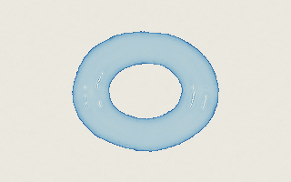 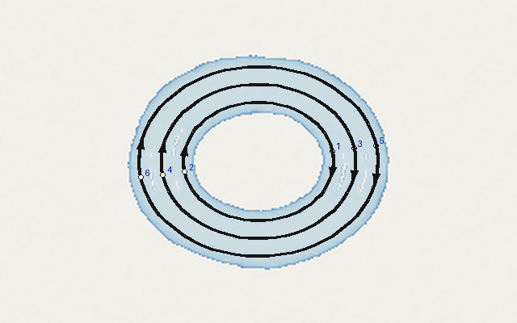

```js
const R = 7;                                                  // the ring is 36 cells wide: a brush 14 wide goes round three times, overlapping
for (const r of [hole + R, hole + R + 11, hole + R + 22])     // three laps, the one beside the hole first
  for (const from of [0, Math.PI]) {                          // each lap in two halves, a fresh dip for each
    kit.dip(b, { water: 0.9, conc: kit.mix({ cerulean: 0.5, ultramarine: 0.15 }) });
    kit.stroke(b, sheet, round(r, from - 0.17), ...);         // each half starts before the last one ended: the joins overlap while wet
  }
```

- Physics: the edge of the white is drawn by the side of one travelling stroke, so it is one clean line.
- Prevents: painting across a light and trying to get it back, or dabbing up to it from all sides (a ragged edge).

### 13. Two shapes meeting along a shared edge
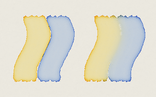 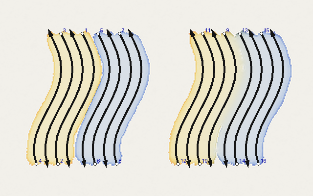

```js
block(90, -1, yellow); kit.dryAll(sheet, O);                  // left pair: dry first, then the neighbour: a crisp shared edge
block(90, +1, blue);   kit.dryAll(sheet, O);
block(235, -1, yellow);                                       // right pair: the neighbour laid while the first is wet: a lost edge
block(235, +1, blue);
```

- Physics: a wet shape laid against a dry one stops at it; laid against a wet one, the two run together.
- Prevents: a paper gap left between two shapes "to be safe" (it reads as a white outline), and an accidental bleed
  where a crisp edge was wanted. In both pairs the strokes run along the shared edge, the one beside it first.

### 14. How long a dip lasts
 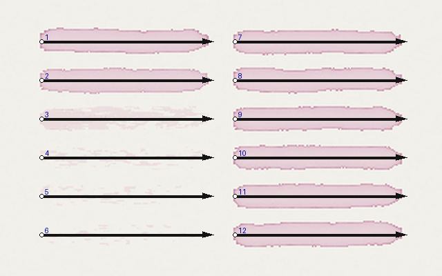

```js
kit.dip(b, { water: 0.85, conc: paint });                     // left: one dip, six strokes
for (let k = 0; k < 6; k++) kit.stroke(b, sheet, [{ x: 30, y: 30 + 28 * k, p: 0.85 }, { x: 150, y: 30 + 28 * k, p: 0.85 }]);
for (let k = 0; k < 6; k++) { kit.dip(b, { water: 0.85, conc: paint }); kit.stroke(b, sheet, ...); }   // right: a dip before each
```

- Physics: the brush holds a fixed load. With this brush (radius 9, capacity 70) and strokes 120 cells long, the first
  two are full, the third is breaking up and the fourth is nearly empty.
- Prevents: a wash that starts strong and fades to scratches because the brush was never refilled. For a wash, dip
  before every stroke; keep a running brush for dry-brush texture on purpose.
- *Kit only:* a bigger `capacity` or a shorter stroke lasts longer; `brush.load` tells you what is left.

## Drawing: pencil, pen and ink

What exists, said plainly. **The kit (level 1) has a pen and two inks (`sepia`, `lampblack`) and nothing else to draw
with: no pencil and no eraser.** The simulator does have graphite (the session painter at levels 2 to 4 lays the
pencil drawing with it), but the kit does not hand it to you, and nothing anywhere rubs graphite or ink out. So the
pencil and erasing notes below are for levels 2 to 4 and are words only; the pen examples were painted with the kit.

### 15. The pen line: nib, flex, pressure, speed
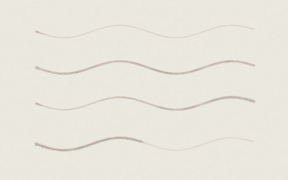 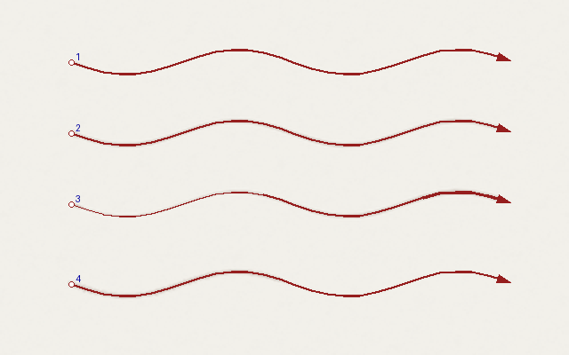

```js
const fine = kit.createPen({ nib: 0.8, flex: 0.2 });   kit.dipPen(fine, ink);  kit.penStroke(fine, sheet, wave(35, 0.6));    // a fine stiff nib
const broad = kit.createPen({ nib: 2.4, flex: 0.2 });  kit.dipPen(broad, ink); kit.penStroke(broad, sheet, wave(75, 0.6));   // a broad one
const flexy = kit.createPen({ nib: 0.8, flex: 2.5 });  kit.dipPen(flexy, ink);
kit.penStroke(flexy, sheet, wave(115, t => 0.1 + 0.9 * t));                    // pressure opens a flexible nib: thin to thick
kit.penStroke(flexy, sheet, wave(160, 0.6, t => (t < 0.5 ? 0.5 : 8)));         // v: slow for the first half, fast for the second
```

- Physics: the nib sets the least width; pressure spreads a flexible nib's tines; a slow pen leaves more ink (darker,
  a little wider), a fast one less (paler, and it may skip on the paper's grain).
- Prevents: every line the same weight. A drawing reads by the difference between its thin and its thick lines.
- *Kit only:* `nib` and `flex` are in cells (0.259 mm); `p` is pressure and `v` speed at each point of the path.

### 16. Hatching and cross-hatching
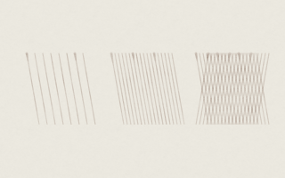 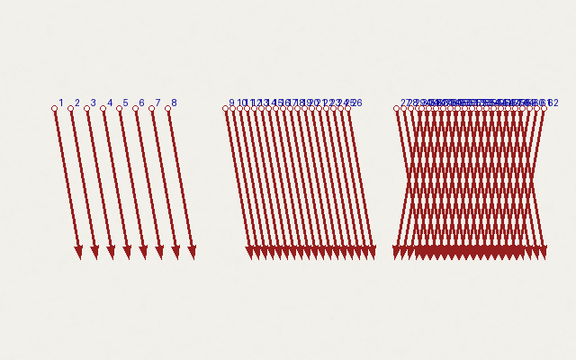

```js
const hatch = (x0, gap, slope) => { let k = 0; for (let x = x0; x <= x0 + 70; x += gap, k++) {
  if (k % 6 === 0) kit.dipPen(pen, ink);                                        // a pen runs out too
  kit.penStroke(pen, sheet, [{ x, y: 60, p: 0.5 }, { x: x + slope * 0.5, y: 100, p: 0.7 }, { x: x + slope, y: 140, p: 0.4 }]); } };
hatch(30, 9, 14);                       // wide apart: a light tone
hatch(125, 4, 14);                      // close: darker
hatch(220, 4, 14); hatch(234, 4, -14);  // crossed by a second set: darkest
```

- Physics: ink does not dilute on dry paper, so tone comes from how much paper the lines cover: their spacing, and a
  second set across the first.
- Prevents: filling a dark with a solid block of ink, or scribbling. Lines of one set are parallel and drawn the same
  way; darker means closer or crossed, not pressed harder.

### 17 and 18. A pen line under a wash: soluble ink and waterproof ink
 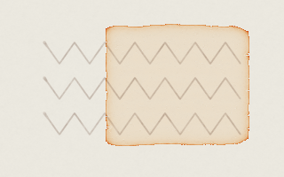

```js
const { sheet, O, W, H } = await kit.open('tips');                           // 17: soluble ink, the default
const { sheet, O, W, H } = await kit.open('tips', { ink: 'waterproof' });    // 18: the same script, waterproof ink
...three zigzags with the pen; kit.dryAll(sheet, O); then a pale wash over the right two thirds...
```

- Physics: soluble ink rewets: water laid over it loosens some and the wash carries it, so the line softens and tints
  the wash. Waterproof ink holds to the paper once dry and the wash passes over it. In these two pictures the
  difference is small (the soluble lines under the wash are a little softer): a pale wash laid once moves little; a
  wetter wash, or one worked over twice, moves more.
- Prevents: a drawing dissolved by its own washes (draw in waterproof ink, or lay each wash once and leave it), and
  the opposite surprise, a line that was meant to bleed and did not.
- At levels 2 to 4 the same choice is the setting `"ink": "waterproof"` or `"soluble"`.
- A pen line over a wash, on dry paper and on damp, is example 8.

### Pencil (levels 2 to 4; the kit has none)

- A pencil line is graphite caught on the tops of the paper's grain: light pressure gives a pale broken line, heavy
  pressure a dark continuous one that also dents the paper. Decide the weight line by line; a lay-in drawn all at one
  weight reads as an outline, not a drawing.
- Under a wash: a pale wash lets every pencil line show; a dark wash hides the light ones and keeps only the heavy. So
  draw lightly where a pale wash will sit and the line should not show, and expect lines under the darks to vanish.
- Loose graphite is picked up by the first wet wash over it and greys it a little. Fewer, lighter lines under clean
  pale colours.
- Pencil over a dry wash sits on top of the paint, crisp and a little shiny; over a damp wash it digs in and cannot
  be undone. Wait for the sheet to dry.
- In the session painter the pencil is your choice of the drawing's lines: which are laid before the washes, which
  after, which not at all, and each one's weight.

### Erasing and correcting

- **Before paint:** pencil rubs out of dry paper almost completely; heavy lines leave their dent. In the session
  painter that is simply leaving a line out of your choice, or giving it a lighter weight: decide before the washes.
- **After a wash has dried over it:** the graphite under the paint is sealed in and does not come off; only pencil
  drawn on top of the dry wash can be rubbed back, and rubbing lifts some paint with it. Do not plan on it.
- **A pen line cannot be erased.** Waterproof ink stays for good. Soluble ink can be softened by a wet brush while it
  is fresh, which spreads it rather than removing it. A wrong pen line is corrected by drawing the right one more
  firmly beside it, or by a dark wash over both; so draw the pen last where you are unsure.
- *Kit only:* there is no eraser call. `kit.blot` lifts standing water and the paint in it (example 7), not a dried
  line.
