# Tips: painting with the kit, by worked example

Fourteen small paintings. Each was painted with the kit on a blank full-size sheet (1462 x 1082 cells, 379 x 280 mm)
by the script beside it, `bench/tips/N-name.mjs`; `N-name.png` is the dried result and `N-name-arrows.png` the same
with every stroke drawn as a numbered arrow (thicker where the brush pressed harder; pen red, pencil green, eraser
orange). Positions are shares of the sheet (`W * 0.3`); the brushes' capacities are set for this full-size sheet (on a
smaller one a dip goes further). The subjects are
random: they show how the brush, the water and the paper behave, nothing about what to paint. They open a blank sheet
called `'tips'` that exists only where they were made: your own script imports `./kit.mjs` and opens the task the
brief names.

## The box

- Brush paints (`kit.BRUSH_PAINTS`): ultramarine, cerulean, hansa (yellow), ochre, sienna, umber, rose, sapgreen.
  `kit.mix({ ultramarine: 1, sienna: 0.5 })`: the numbers are strengths; a mix totals at most 8. In one layer, about
  0.5 is a pale tint, 1 to 2 a light to middle wash, 4 a middle dark, 6 to 8 a strong dark. Clean water is `kit.mix({})`.
- Pen inks (`kit.INK`): sepia, lampblack, at most 8 in all; `kit.mix({ sepia: 3 })` is a full black-brown line.
- A brush (`kit.createBrush`) is the main painter's own brush: a tuft with a belly and a point, or with `flat: true` a
  flat with a blade. Its `radius` is in cells (0.259 mm); it is about twice that wide pressed fully. `bristles` is how
  many lanes of hair it has across (more: finer streaks where it runs dry); `capacity` is how much each holds, so
  capacity and bristles together set how far one dip goes (example 13). A dip always fills the brush to its capacity:
  for a brush that runs dry sooner, make one with less.
- At each point of a stroke: `x`, `y`; `p` the pressure, 0 to 1 (how much of the brush lies down, so how wide it is);
  and if you want them, `v` the hand's speed in mm/s (default 60: slower leaves more paint, faster less) and, for a flat,
  `blade`, the blade's angle to the direction of travel in degrees (default 90, square across: full width; 0, on its
  edge: a thin line). Both are eased from point to point, and the blade turns a little after the path, as a wrist does.
  A round's width follows the pressure. A flat's width follows its blade (about its full width times the sine of the
  blade angle); pressure hardly changes it (only below 0.05), but presses more of the hairs down and lays more paint.
- The stroke option `{ upright: true }` holds a flat's blade at one direction on the sheet, measured from straight down
  the sheet instead of from the direction of travel: blade 90 then lies across the sheet, left to right, whichever way
  the stroke goes. `{ upright: 'sweep' }` measures it from the line between the stroke's first and last points.
- Strokes meant to join into one form: overlap each with the last by a quarter to a half of its width and lay it while
  the last is still wet (no drying between); they fuse with a soft join.
- `kit.finish(note)` does not dry the sheet: the examples dry once at the end, to show the dried painting.

## What is yours to decide, and what the kit does

You decide what a painter decides: which brush, how loaded, which way each stroke runs, how wet the paper is, when to
wait, when to dry, when to stop. The kit does the rest: while a brush or pen is on the paper it moves the water for
the time that passed. Strokes laid while the sheet is wet run together; on a dry sheet they keep their edges.
`kit.wait(sheet, moments)` lets the water run with the brush off the paper (a moment is one water step, about the
time a brush takes to travel 17 cells); `kit.dryAll(sheet)` dries the sheet.

## Brushwork: the brush makes the form

The commonest thing that makes a painting look made by a machine is a form painted as a flat, even patch: an outline
filled with one tone. A painter makes a form with the brush itself. The brush is as wide as it is pressed, a flat is
as wide as its blade is turned, the paint pools where the hand slows and thins where it hurries, and the stroke runs
dry as the load runs out. Change these as the stroke travels and one stroke becomes a leaf, a wedge, a fold; two or
three side by side become a rock or a bush.

Use shaped strokes for anything with a shape of its own: leaves, petals, folds, rocks, hulls, sleeves, branches,
foliage, the wedge of a shadow, the dark accents. Use a wash for what is big, flat and quiet: a sky, a ground, water,
a wall, the first light over a whole form. Give a stroke enough points (a dozen or more) for its changes to be smooth.

### 7. One stroke, one form: leaves, petals, grass
 

```js
const swell = t => 0.08 + 0.85 * Math.sin(Math.PI * t) ** 1.2;   // pressure: nothing, full, nothing
kit.stroke(b, sheet, leafPath.map((q, i) => ({ ...q, p: swell(i / (leafPath.length - 1)) })));   // a leaf: one stroke
// a petal: the same, curved; grass: pressed at the root, lifted to nothing at the tip
```

- The brush is as wide as it is pressed. A leaf, a petal, a blade of grass is one stroke: press, then lift. No
  outline, no filling in. Give a stroke enough points (a dozen or more) for its pressure to change smoothly.
- On a full-size sheet: 25 sweeps, 1 drying, 191 water steps; 73 s on Apple M5 Max (shared with other work).

### 14. One stroke, shaped as it travels
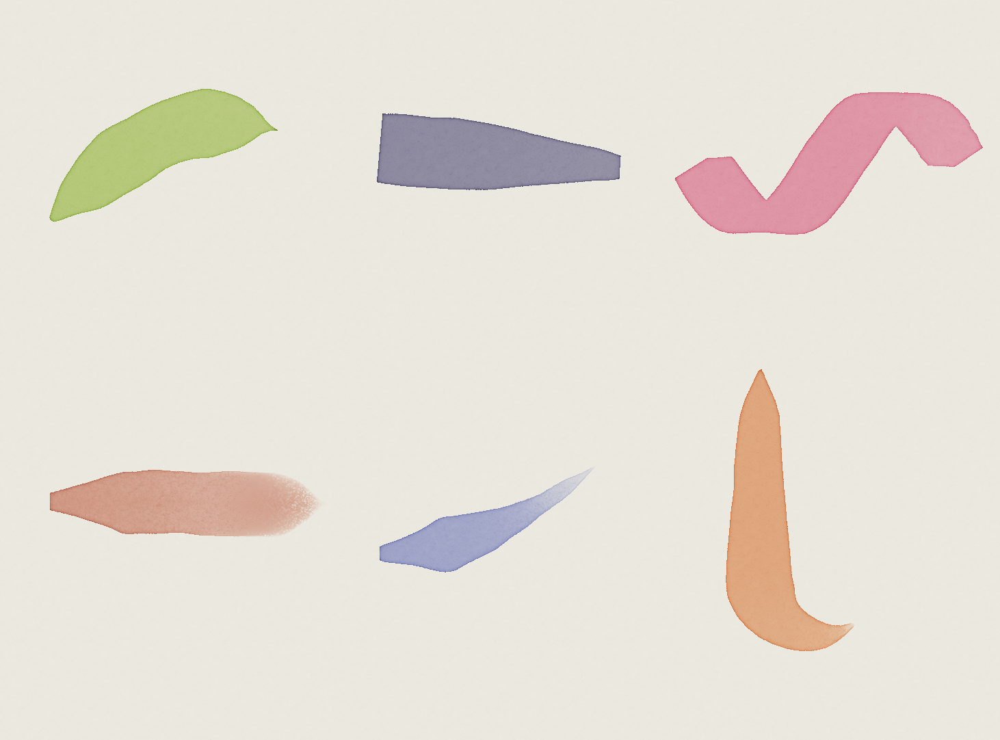 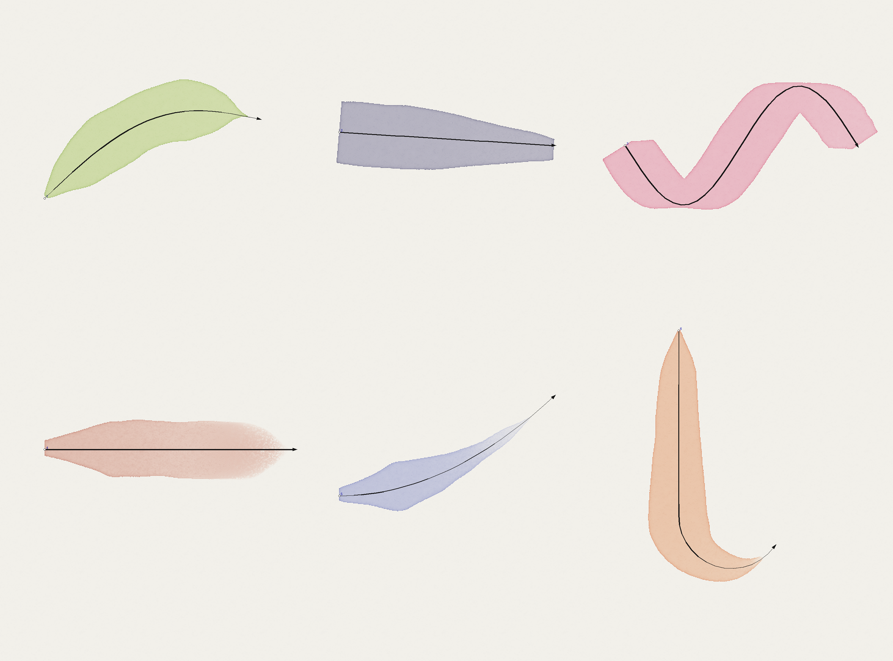

```js
const path = (n, at) => Array.from({ length: n }, (_, i) => at(i / (n - 1)));   // at(t): a point at t = 0..1
kit.stroke(round, sheet, path(24, t => ({ x, y, p: 0.04 + 0.96 * swell(t) })));         // 1 leaf: point, belly, point
kit.stroke(flat, sheet, path(24, t => ({ x, y, p: 0.95, blade: 90 * (1 - t) })));         // 2 wedge: square, twisted to its edge
kit.stroke(flat, sheet, path(30, t => ({ x, y: sCurve(t), p: 0.9 })), { upright: true }); // 3 ribbon: the blade held one way
kit.stroke(thirsty, sheet, path(30, t => ({ x, y, p: 0.9, v: 20 + 400 * t * t })));      // 4 capacity 70: slow and wet, then fast, then dry
kit.stroke(round, sheet, path(30, t => ({ x, y, p: landThenLift(t), v: 40 + 300 * t * t }))); // 5 land on the point, flick off
kit.stroke(round, sheet, path(32, hook));        // 6 down, slowed and pressed at the bottom, carried round the turn and flicked up
```

- Top, left to right: a leaf (the pressure alone shapes it); a wedge of shadow (a flat pressed square, its blade
  twisted onto its edge as it goes: broad where it lands, a line where it leaves); a ribbon (a flat held at one angle
  on the sheet along an S: broad where the path crosses the blade, thin where it runs along it). Bottom: a brush given
  little load (capacity 70) pressed evenly, slow where it lands so the paint pools, faster as it goes; partway its load
  runs out and from there it catches only the grain of the paper, a dry broken tail. A stroke that lands on its point,
  presses and flicks off. A hook: the path runs into the turn without a corner, slowed and pressed at the bottom, then
  flicked up. Speed alone, at an even pressure and a full load, changes little: a fast stroke lays a little less paint.
- On a full-size sheet: 6 sweeps, 1 drying, 122 water steps; 43 s on Apple M5 Max (shared with other work).

### 15. Two or three strokes make a form; the same form outlined and filled
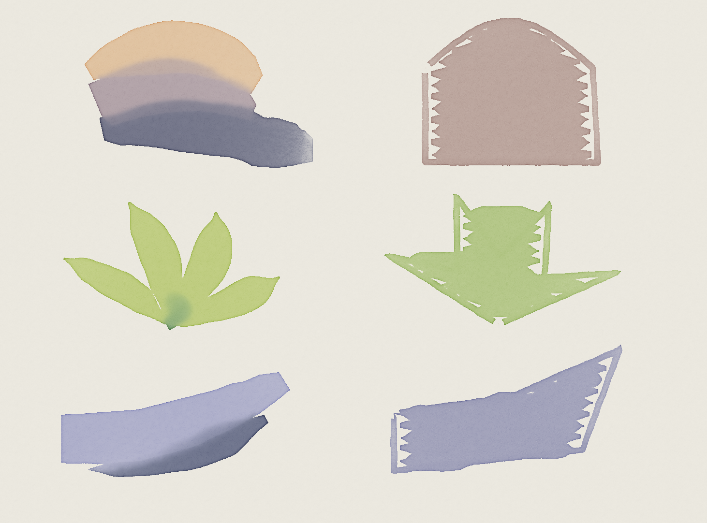 

```js
// left, a rock: three flat strokes, one above the other, each following the dome, each into the last while it is wet
const dome = (k, t) => ({ x: L - S * (0.16 - 0.01 * k) + S * (0.32 - 0.02 * k) * t, y: rows[0] - S * 0.05 + S * 0.055 * k - S * (0.06 - 0.02 * k) * Math.sin(Math.PI * t) });
kit.stroke(flat, sheet, path(20, t => ({ ...dome(0, t), p: 0.6 + 0.4 * Math.sin(Math.PI * t), blade: 20 + 70 * Math.sin(Math.PI * t) })));  // pale top, rounded ends
kit.stroke(flat, sheet, path(20, t => ({ ...dome(1, t), p: 0.9, blade: 30 + 60 * Math.sin(Math.PI * Math.min(1, 0.2 + t)) })));       // darker middle
kit.stroke(flat, sheet, path(24, t => (t < 0.7                                                                                         // darkest foot,
  ? { ...dome(2, t / 0.7), p: 0.5 + 0.5 * t / 0.7, v: 40, blade: 30 + 60 * Math.min(1, 2.5 * t) }                                       // pressed harder to the right,
  : { x: dome(2, 1).x + S * 0.12 * (t - 0.7) / 0.3, y: dome(2, 1).y + S * 0.01, p: 1 - 0.95 * (t - 0.7) / 0.3, v: 40 + 300 * (t - 0.7), blade: 90 - 80 * (t - 0.7) / 0.3 })));  // then out as the cast shadow
// left, a bush: five leaf strokes fanned from one root (p 0.08 -> full -> 0.08), the darkest last and low;
// a boat's bow: a flat along the sheer line, its blade turned to its edge at the stem, and one dark round under the flare
// right: each left-hand form's outline, moved across, drawn with a small brush, then filled with even rows of one mix
```

- Left: each form is a few strokes, light to dark, joined soft because each went into the last while it was wet; the
  form's turn and its shadow come from the strokes. Right: the same shapes outlined and filled. The fill is one even
  tone, the outline shows as a darker rim, and paper is left in the corners the rows could not reach: a flat slab, not
  a form.
- On a full-size sheet: 43 sweeps, 1 drying, 266 water steps; 187 s on Apple M5 Max (shared with other work).

## The brush

### 1. Brush size: two lemons
 

```js
const big = kit.createBrush({ radius: H * 0.05, bristles: 40, capacity: 800 });    // left: 5 sweeps
const small = kit.createBrush({ radius: H * 0.0125, bristles: 14, capacity: 200 }); // right: 20 sweeps
kit.dip(b, { water: 0.85, conc: paint });          // a full brush for every sweep
kit.stroke(b, sheet, pts);                         // each sweep the length of the fruit, bending with it, easing off at the ends
```

- Choose the biggest brush the shape allows: here the brush (twice its radius) is about a quarter as wide as the lemon
  is tall. The small brush paints much the same lemon with four times the sweeps.
- Dip before every sweep of a wash, with capacity enough for the sweep (example 13); a brush that runs dry leaves a
  pale, broken stripe. `water` near 0.85 lays a full wet wash; near 0.3 the brush skips on the grain (dry brush).
- On a full-size sheet: 25 sweeps, 1 drying, 380 water steps; 311 s on Apple M4 (shared with other work).

### 2. Big shapes first, with the big brush
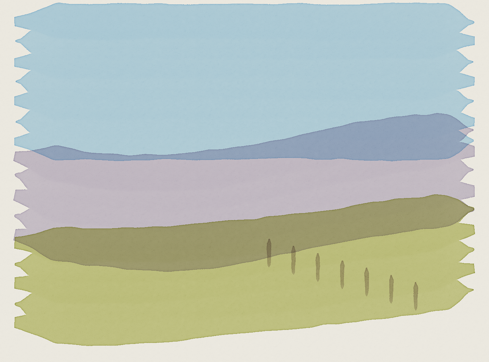 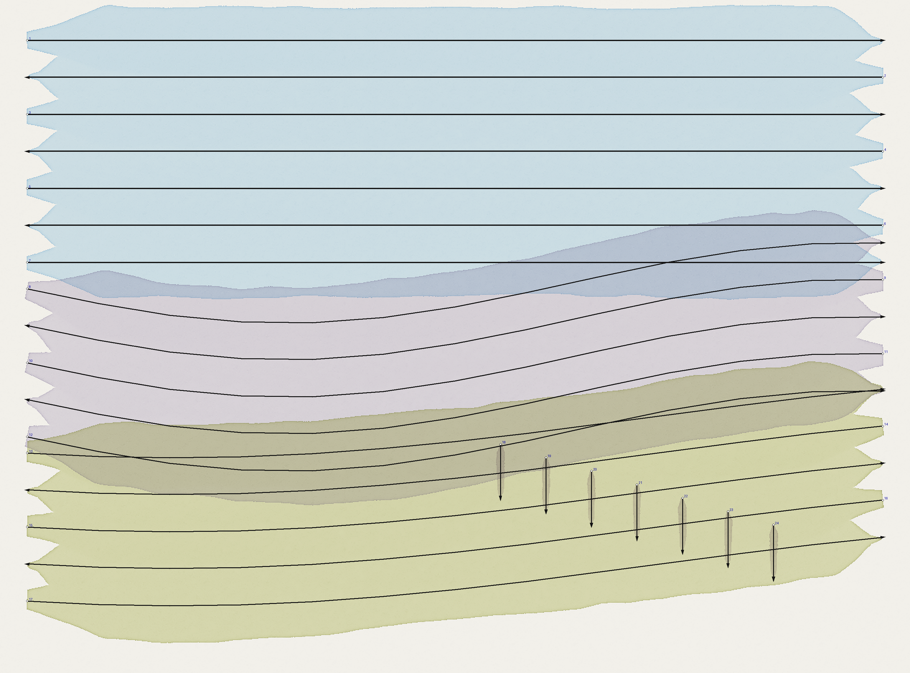

```js
band(sky);  kit.dryAll(sheet);        // 1: the biggest shape, one wet wash, rows overlapping by half the brush
band(farHill); kit.dryAll(sheet);     // 2: the next; every row follows the hill line
band(nearHill); kit.dryAll(sheet);    // 3
posts(smallBrush); kit.dryAll(sheet); // 4: the few small marks last, on dry paper
```

- Light before dark, broad before detail. The whole sheet is covered in a few dozen sweeps; the small brush
  comes last and does little.
- On a full-size sheet: 24 sweeps, 4 dryings, 997 water steps; 744 s on Apple M5 Max (shared with other work).

### 3. How wet the paper is
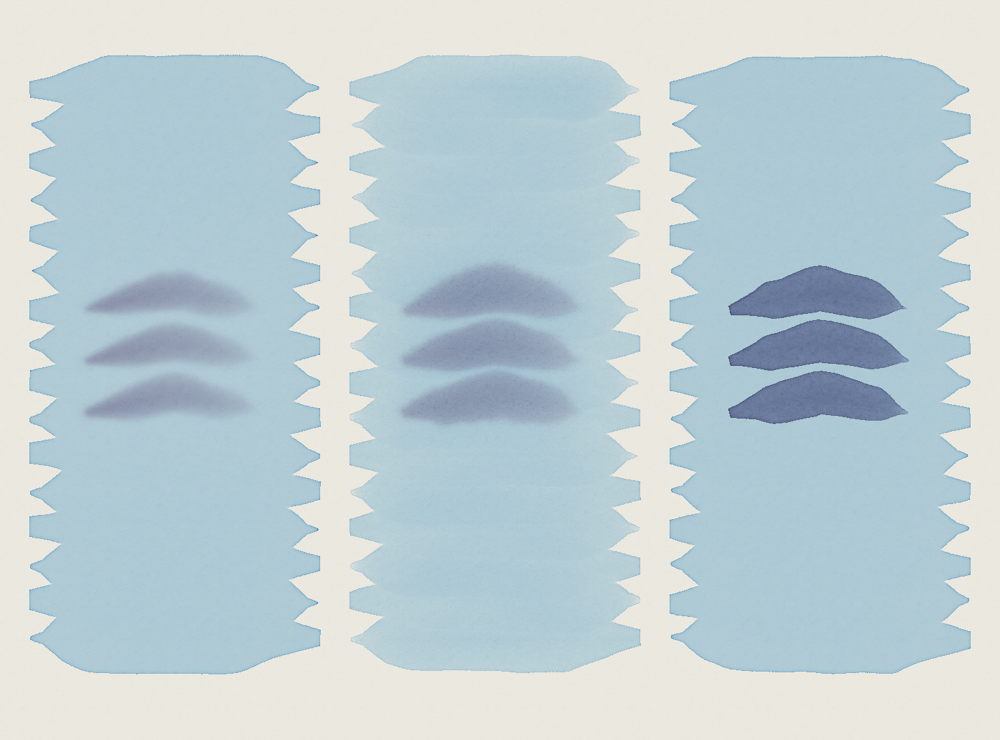 

```js
sky(0.67, 0.97, 0.9); kit.dryAll(sheet); cloud(W * 0.82);   // right, dried first: a hard edge
sky(0.35, 0.64, 0.45); cloud(W * 0.495);                    // middle, damp: it keeps its shape, with a soft edge
sky(0.03, 0.32, 0.9); cloud(W * 0.175);                     // left, very wet, laid last: the cloud spreads and pales
```

- You set how wet the paper is by the `water` of the brush that wets it. Into very wet paper (0.9) the cloud spreads,
  pales and loses its edge; into damp paper (0.45) it keeps its shape with a soft edge; on dry paper it keeps a hard
  one and its full strength.
- For damp paper, lay the wash damp to begin with (water about 0.45); waiting is not a reliable way to get there.
- On a full-size sheet: 57 sweeps, 2 dryings, 488 water steps; 546 s on Apple M4 (shared with other work).

### 4. Hard and soft edges
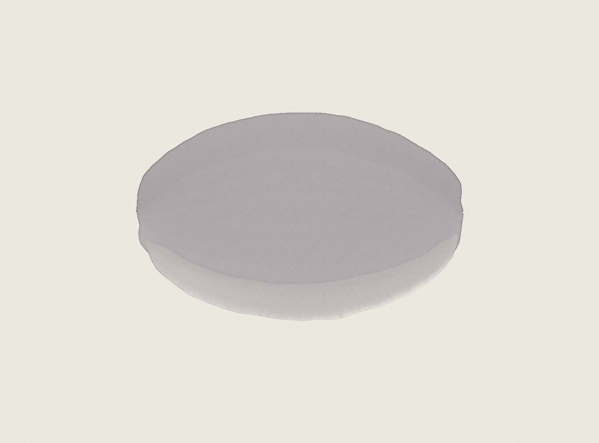 

```js
kit.dip(water, { water: 0.45, conc: kit.mix({}) });   // clean water is kit.mix({})
kit.stroke(water, sheet, lowerEdge);                  // damp paper where the pebble's lower edge will be
// then the pebble: eight sweeps along it, the outer ones on its edges, so the lowest lies on the damp
```

- An edge on dry paper is hard; an edge that meets damp paper is soft. Decide each edge before the paint goes on.
- On a full-size sheet: 9 sweeps, 1 drying, 270 water steps; 148 s on Apple M5 Max (shared with other work).

### 5. A glaze over a dried wash
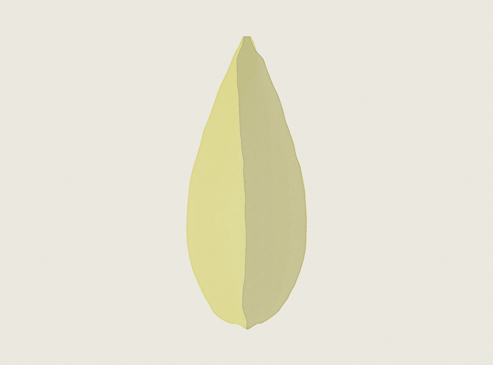 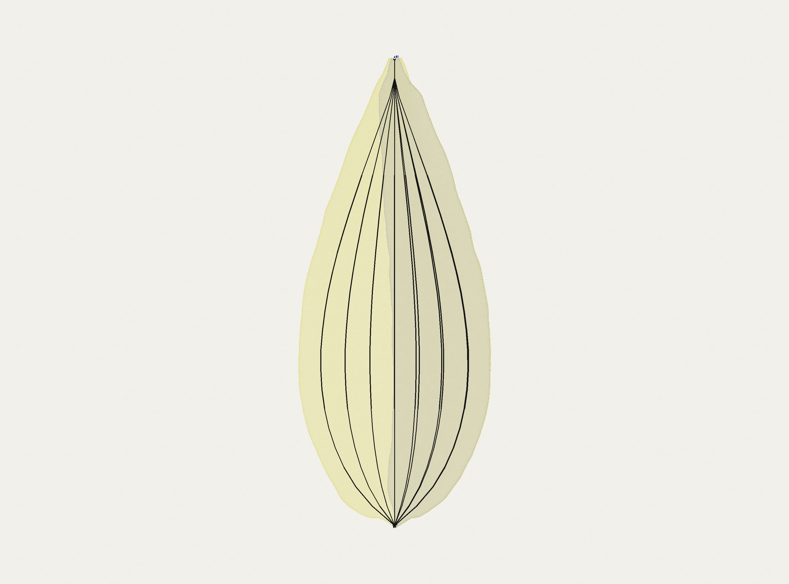

```js
pear(yellowGreen, all);  kit.dryAll(sheet);   // the first wash is DRY before the second
pear(thinViolet, shadowSide);                 // thin, laid once, left alone
```

- The first colour shows through the second: a shadow without mud. Painting into a damp wash to darken it moves
  what is under it instead.
- On a full-size sheet: 10 sweeps, 2 dryings, 393 water steps; 169 s on Apple M4 (shared with other work).

### 6. Whites
 

```js
const mask = new Uint8Array(W * H);    // masking fluid: 1 where it goes, row by row (mask[y * W + x])
kit.applyResist(sheet, mask);          // before any paint; kit.liftResist(sheet) once the sheet is dry
// painted round: the wash rows stop short of the white; then a smaller brush goes round its edge while the wash is wet
```

- Watercolour has no white paint: decide the whites before the first wash, and paint round them or mask them.
- Lifting takes back part of a wash while it is wet, never to white: tested on a middle-blue wash (grey 176, paper
  231), a clean brush dipped at water 0.3 to 0.5 and drawn through it left 199 to 205; a tissue (`kit.blot(sheet,
  mask)`, 1 in the mask where it presses) 208; a nearly dry brush (water 0.1) took nothing. Good for a soft light
  (a cloud's edge, a sheen); for a true white, paint round it or mask it.
- On a full-size sheet: 23 sweeps, 1 drying, 482 water steps; 645 s on Apple M4 (shared with other work).

### 12. Two colours meeting wet
 

```js
band(H * 0.58, H * 0.92, 0.04, 0.55, yellow); kit.dryAll(sheet); band(H * 0.58, H * 0.92, 0.5, 0.96, rose);   // bottom, first
kit.dryAll(sheet);
band(H * 0.08, H * 0.42, 0.04, 0.55, yellow); band(H * 0.08, H * 0.42, 0.5, 0.96, rose);                     // top
```

- Top: the rose rows (back and forth) reach over the yellow's wet right edge, so the two run together. Bottom: the yellow was dried
  first: a hard seam. Soft joins come from wet meeting wet, both laid in one sitting. A third, mixed colour laid between two dried ones
  makes a band, not a blend.
- On a full-size sheet: 32 sweeps, 3 dryings, 741 water steps; 428 s on Apple M5 Max (shared with other work).

### 13. How far one dip goes
 

```js
for (const capacity of [120, 400, 800, 1500]) {                       // four furrows, one dip each
  const b = kit.createBrush({ radius: H * 0.04, bristles: 36, capacity });
  kit.dip(b, { water: 0.85, conc }); kit.stroke(b, sheet, furrow);    // 1,340 cells long
}
```

- A brush holds a fixed load. With radius 43 cells and 36 bristles, capacity 120 runs dry after about 450 cells and
  breaks up into dry grain; 400 runs low just before the end of the 1,340; 800 and 1,500 last the whole furrow. As a
  rule (about 36 to 40 bristles), one dip lasts about capacity x 150 / radius cells: give a brush that, or dip again
  before it runs out. A brush with fewer bristles holds less. To make a stroke run dry on purpose, give it less.
- On a full-size sheet: 4 sweeps, 1 drying, 252 water steps; 103 s on Apple M5 Max (shared with other work).

## Drawing

### 8. The pen: a fence
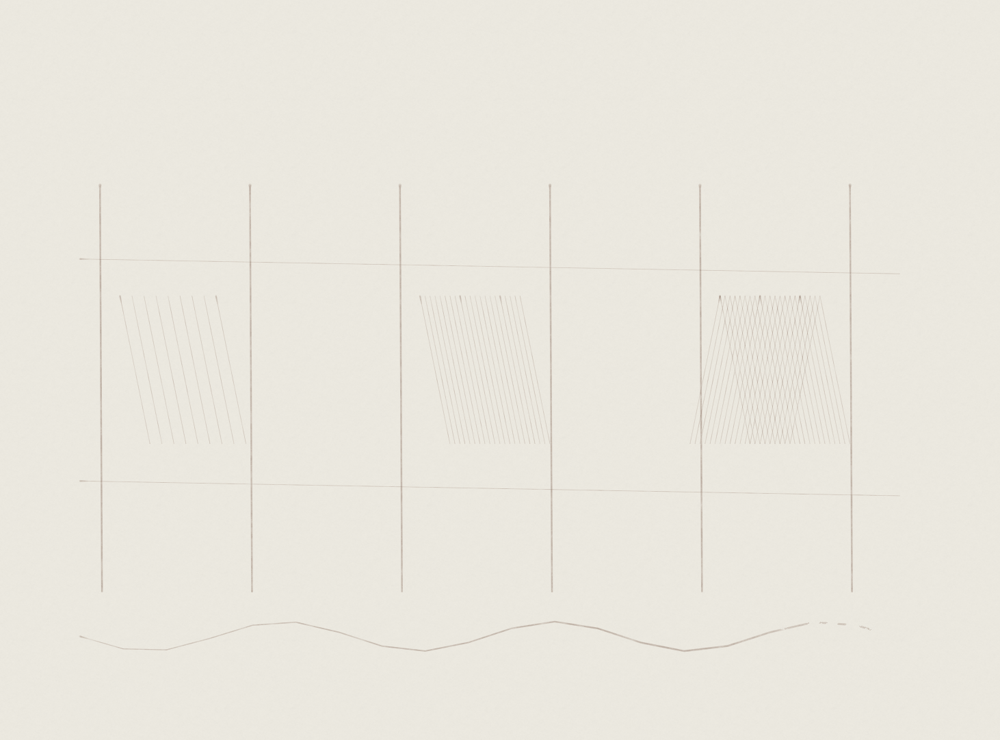 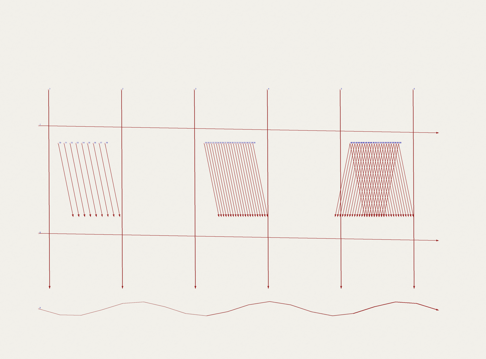

```js
const broad = kit.createPen({ nib: 2.4, flex: 0.3 }), fine = kit.createPen({ nib: 0.8, flex: 0.2 }), flexy = kit.createPen({ nib: 0.8, flex: 2.5 });
kit.dipPen(pen, kit.mix({ sepia: 3 }));         // inks: sepia, lampblack; a pen runs out too: one dip drew about 2,000 cells of line here
kit.penStroke(pen, sheet, [{ x, y, p }...]);    // p pressure: it opens a flexible nib; nib and flex are in cells
```

- Posts broad, rails fine, the ground line thin to thick (a flexible nib, pressed harder as it goes). Tone by hatching: one direction, closer for darker,
  crossed for darkest; not by pressing harder.
- On a full-size sheet: 0 sweeps, 81 pen lines, 1 drying, 800 water steps; 28 s on Apple M5 Max (shared with other work).

### 9. Ink under a wash
 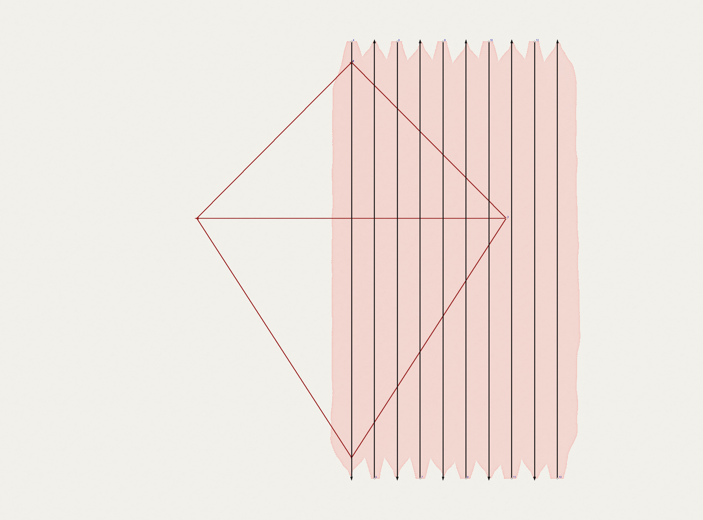

```js
kit.dipPen(pen, kit.mix({ sepia: 3 })); kit.penStroke(pen, sheet, kite);   // the drawing
kit.dryAll(sheet);                                                          // the ink dry before the wash
// then a wash over the kite's right half
```

- Draw, dry, then wash: once dry, the ink holds under the wash and stays as drawn. Opening the sheet with
  `kit.open(task, { ink: 'waterproof' })` gave the same picture to the pixel; the choice of ink matters only for a
  wash laid into ink that is still wet, where soluble ink (the default) moves a little.
- On a full-size sheet: 10 sweeps, 3 pen lines, 2 dryings, 449 water steps; 187 s on Apple M5 Max (shared with other work).

### 11. Pencil lay-in and the eraser: a jug
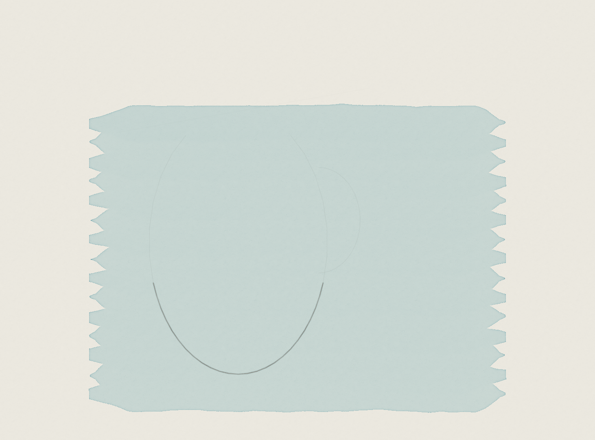 

```js
const hb = kit.createPencil({ grade: 'HB' }), soft = kit.createPencil({ grade: '2B' });   // HB paler and finer, 2B darker
kit.pencilStroke(hb, sheet, body);                           // light lines (p 0.4 at every point) where a pale wash will go
kit.erase(sheet, wrongLine, { width: H * 0.03 });            // rubs out on bare, dry paper; it refuses a wet sheet
kit.pencilStroke(soft, sheet, base);                         // heavy (p 1): it shows through every wash
```

- Where your subject shows pencil, draw those lines and choose their weight: light ones all but vanish under a wash,
  heavy ones stay (pencil does not dissolve). A line you do not want is rubbed out before any paint; under dried
  paint the eraser takes little.
- On a full-size sheet: 15 sweeps, 4 pencil lines, 1 rubs of the eraser, 1 drying, 419 water steps; 370 s on Apple M5 Max (shared with other work).

## What makes a painting slow

Paint as the picture needs: nothing here is charged but the paintings you run (each run of your script is one; see
the brief). `kit.work()` reports what your painting asked of the simulator; you need not call it, it is recorded
beside your score either way.

- **A big brush on wet paper.** While a brush is on the paper the kit moves the water over the whole sheet, and each
  time it does, the brush reads the wet paper round it again. A wide brush in a wide wet wash is the slow case: in
  example 2 each sweep of the sky took about half a minute. A small brush, or a brush on dry paper, is quick.
- **Dryings.** A drying dries the whole sheet. It runs on the GPU while your script goes on, and the next stroke
  waits until it is done; on a wet full-size sheet that is a noticeable wait. Dry when the painting needs it:
  before a glaze, before a shape that must keep a hard edge against its neighbour, before pen or pencil over paint,
  before the eraser. Between strokes of one wash it spoils the wash (they must be wet together).
- **Waits.** `kit.wait(sheet, moments)` moves the water with the brush off the paper; it does not make paper damp
  (on the earlier kit a wash laid at water 0.9 was still too wet for a stroke after `kit.wait(sheet, 600)`). It is
  rarely needed.
- Each example above gives its own counts and seconds on a full-size sheet, painted on one of two machines (named
  beside it), each with other work on it: the seconds are that machine's on that night; the counts are the same
  anywhere.
- Slow is not wrong: paint the washes the picture needs. A slow painting only takes longer to see.
