# Tips: painting with the kit, by worked example

Fourteen small paintings, each painted with the kit on a blank full-size sheet (1462 x 1082 cells, 379 x 280 mm) by the script beside it, `bench/tips/N-name.mjs`. `N-name.png` is the dried result; `N-name-arrows.png` draws every stroke as a numbered arrow (thicker where the brush pressed harder; pen red, pencil green, eraser orange). Positions are shares of the sheet (`W * 0.3`). Brush capacities are set for this size; on a smaller sheet a dip goes further. The subjects are random: they show how brush, water and paper behave, not what to paint. They open a blank sheet called `'tips'`; your own script imports `./kit.mjs` and opens the task the brief names.

## The box

- Brush paints (`kit.BRUSH_PAINTS`): ultramarine, cerulean, hansa (yellow), ochre, sienna, umber, rose, sapgreen. `kit.mix({ ultramarine: 1, sienna: 0.5 })`: the numbers are strengths; a mix totals at most 8. In one layer, 0.5 is a pale tint, 1 to 2 a light to middle wash, 4 a middle dark, 6 to 8 a strong dark. Clean water is `kit.mix({})`.
- Pen inks (`kit.INK`): sepia, lampblack, at most 8 in all; `kit.mix({ sepia: 3 })` is a full black-brown line.
- A brush (`kit.createBrush`) is a tuft with a belly and a point, or with `flat: true` a flat with a blade. `radius` is in cells (0.259 mm); pressed fully it is about twice that wide. `bristles` is the lanes of hair across (more: finer streaks where it runs dry). `capacity` is how much each holds; capacity and bristles set how far one dip goes (example 13). A dip fills the brush to its capacity: for a brush that runs dry sooner, make one with less.
- Each point of a stroke has `x`, `y`; `p`, the pressure, 0 to 1 (how much of the brush lies down); and optionally `v`, the hand's speed in mm/s (default 60: slower leaves more paint) and, for a flat, `blade`, its angle to the direction of travel in degrees (default 90, square across, full width; 0, on its edge, a thin line). Both ease from point to point. A round's width follows the pressure. A flat's width follows its blade (full width times the sine of the angle); pressure hardly changes it (only below 0.05) but lays more paint.
- `{ upright: true }` holds a flat's blade at one direction on the sheet, measured from straight down the sheet: blade 90 lies across it whichever way the stroke goes. `{ upright: 'sweep' }` measures from the line between the stroke's first and last points.
- Strokes meant to join into one form: overlap each with the last by a quarter to a half of its width and lay it while the last is wet, with no drying between.
- `kit.finish(note)` does not dry the sheet; the examples dry once at the end.

## What is yours to decide

The paper's colour (white, or `kit.open(task, { paper: [r, g, b] })`; paint only darkens it); whether to draw first, later or not at all (pen, pencil or none); which brush, how loaded, which way each stroke runs, how wet the paper is, when to wait, when to dry, when to stop. The kit moves the water while a brush or pen is on the paper. Strokes laid on a wet sheet run together; on a dry sheet they keep their edges. `kit.wait(sheet, moments)` lets the water run with the brush off the paper (a moment is one water step, about the time a brush takes to travel 17 cells); `kit.dryAll(sheet)` dries the sheet.

## Brushwork: the brush makes the form

A form painted as a flat, even patch (an outline filled with one tone) is what most makes a painting look machine-made. A brush is as wide as it is pressed, a flat as wide as its blade is turned, paint pools where the hand slows and the stroke runs dry as the load runs out. Change these along the stroke and one stroke becomes a leaf, a wedge or a fold; two or three side by side become a rock or a bush.

Use shaped strokes for anything with a shape of its own: leaves, petals, folds, rocks, hulls, sleeves, branches, the wedge of a shadow, dark accents. Use a wash for what is big, flat and quiet: sky, ground, water, a wall, the first light over a form. Give a stroke a dozen or more points so its changes are smooth.

### 7. One stroke, one form: leaves, petals, grass
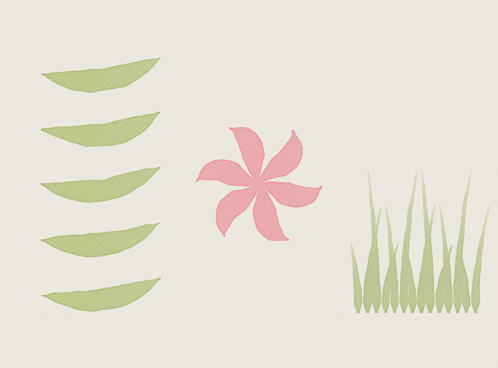 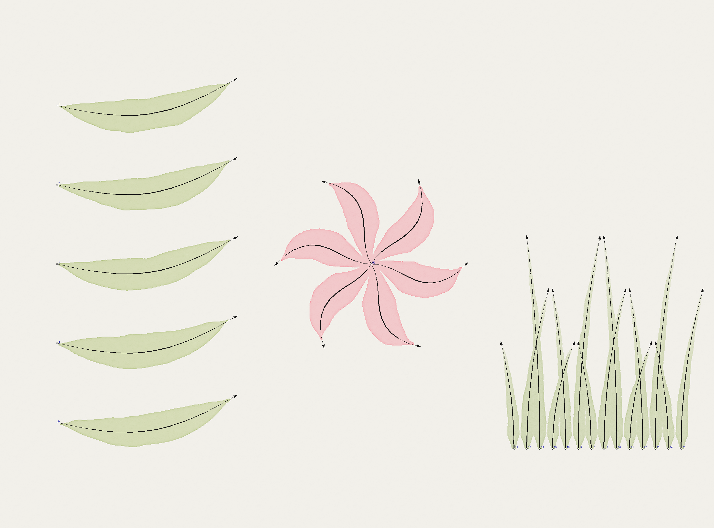

```js
const swell = t => 0.08 + 0.85 * Math.sin(Math.PI * t) ** 1.2;   // pressure: nothing, full, nothing
kit.stroke(b, sheet, leafPath.map((q, i) => ({ ...q, p: swell(i / (leafPath.length - 1)) })));   // a leaf: one stroke
```

A leaf, a petal, a blade of grass is one stroke: press, then lift. No outline, no filling in. Grass is pressed at the root and lifted to nothing at the tip.

### 14. One stroke, shaped as it travels
 

```js
const path = (n, at) => Array.from({ length: n }, (_, i) => at(i / (n - 1)));   // at(t): a point at t = 0..1
kit.stroke(round, sheet, path(24, t => ({ x, y, p: 0.04 + 0.96 * swell(t) })));         // 1 leaf: point, belly, point
kit.stroke(flat, sheet, path(24, t => ({ x, y, p: 0.95, blade: 90 * (1 - t) })));         // 2 wedge: square, twisted to its edge
kit.stroke(flat, sheet, path(30, t => ({ x, y: sCurve(t), p: 0.9 })), { upright: true }); // 3 ribbon: the blade held one way
kit.stroke(thirsty, sheet, path(30, t => ({ x, y, p: 0.9, v: 20 + 400 * t * t })));      // 4 capacity 70: slow and wet, then fast, then dry
kit.stroke(round, sheet, path(30, t => ({ x, y, p: landThenLift(t), v: 40 + 300 * t * t }))); // 5 land on the point, flick off
kit.stroke(round, sheet, path(32, hook));        // 6 down, slowed and pressed at the bottom, round the turn, flicked up
```

A flat pressed square and twisted onto its edge is broad where it lands and a line where it leaves. A flat held at one angle along an S is broad where the path crosses the blade, thin where it runs along it. A brush with little load (capacity 70) pools where it lands, then runs dry and catches only the grain of the paper. Speed alone, at even pressure and full load, changes little.

### 15. Two or three strokes make a form
 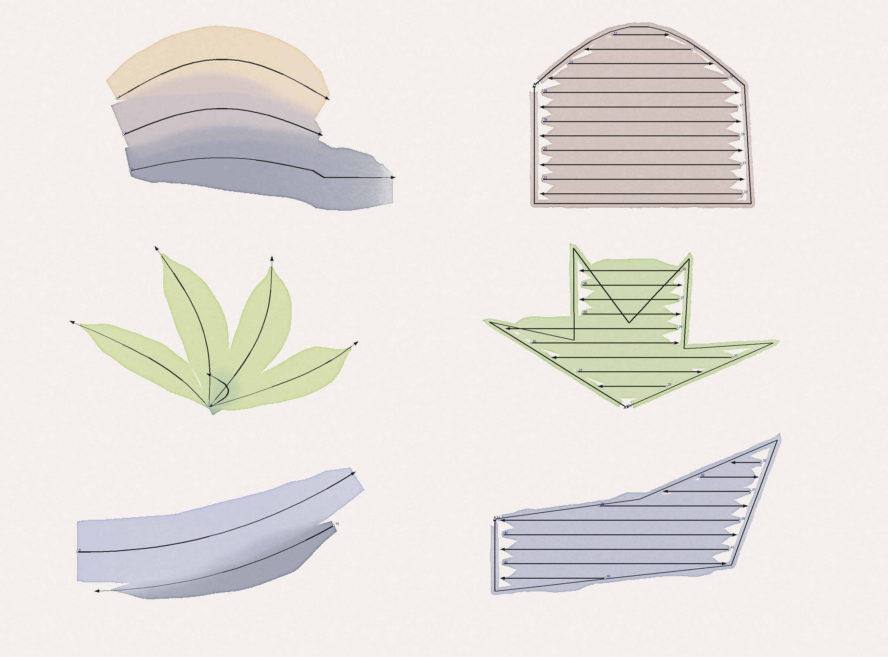

```js
// left, a rock: three flat strokes, one above the other, each following the dome, each into the last while it is wet
kit.stroke(flat, sheet, path(20, t => ({ ...dome(0, t), p: 0.6 + 0.4 * Math.sin(Math.PI * t), blade: 20 + 70 * Math.sin(Math.PI * t) })));  // pale top
kit.stroke(flat, sheet, path(20, t => ({ ...dome(1, t), p: 0.9, blade: 30 + 60 * Math.sin(Math.PI * Math.min(1, 0.2 + t)) })));       // darker middle
// third: darkest foot, pressed harder to the right, then out as the cast shadow
// left, a bush: five leaf strokes fanned from one root, the darkest last and low
// right: each left-hand form's outline, drawn with a small brush, then filled with even rows of one mix
```

Left: a few strokes, light to dark, joined soft because each went into the last while wet; the turn and the shadow come from the strokes. Right: the same shapes outlined and filled are one even tone with a darker rim and paper left in the corners: a slab, not a form.

## The brush

### 1. Brush size: two lemons
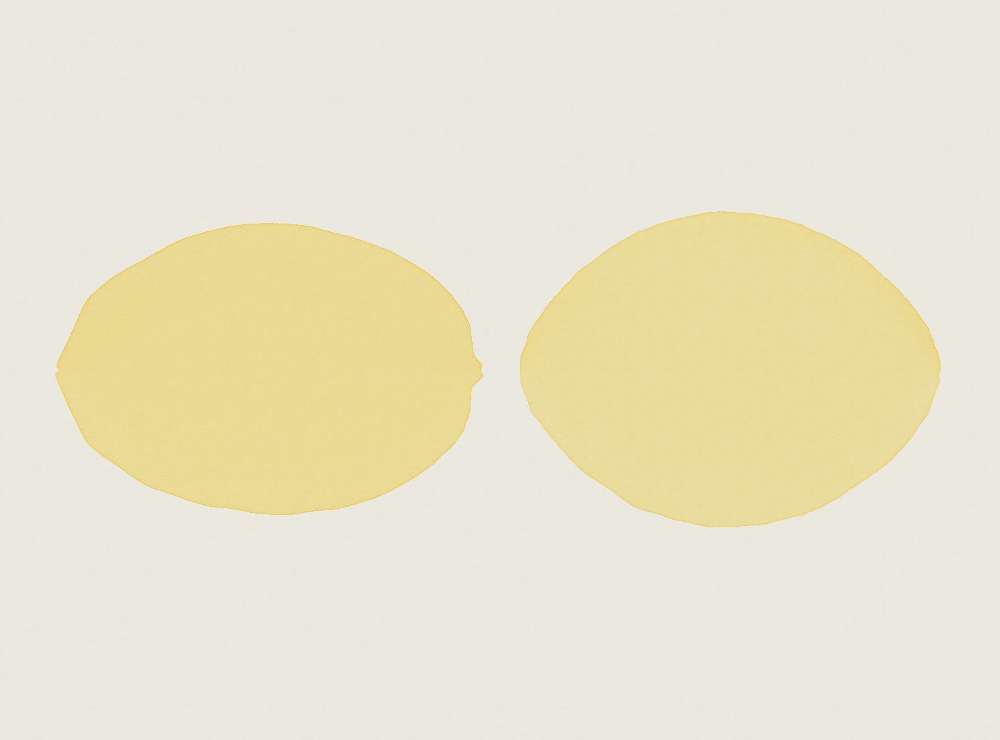 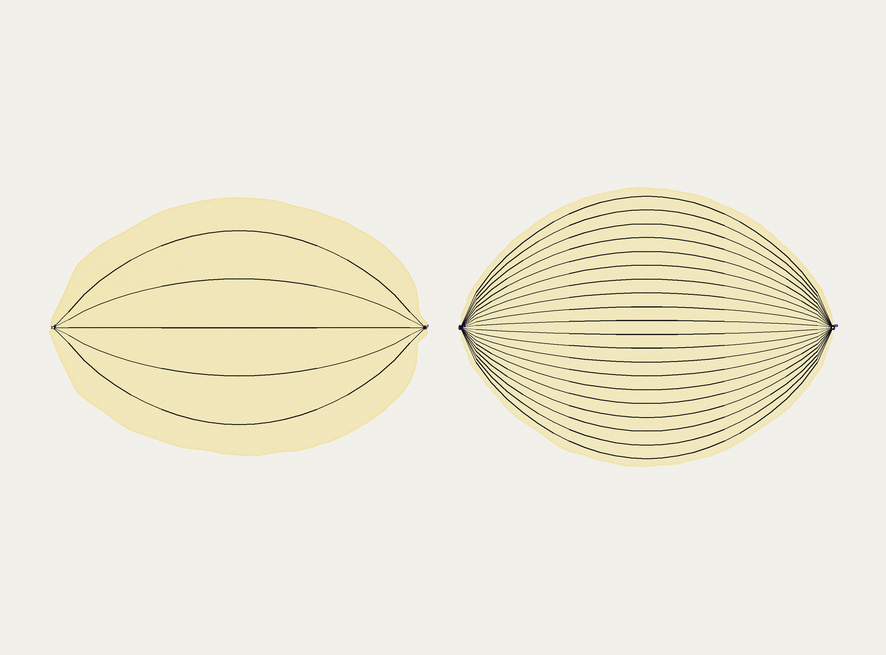

```js
const big = kit.createBrush({ radius: H * 0.05, bristles: 40, capacity: 800 });    // left: 5 sweeps
const small = kit.createBrush({ radius: H * 0.0125, bristles: 14, capacity: 200 }); // right: 20 sweeps
kit.dip(b, { water: 0.85, conc: paint });          // a full brush for every sweep
kit.stroke(b, sheet, pts);                         // each sweep the length of the fruit, bending with it
```

Choose the biggest brush the shape allows: here about a quarter as wide as the lemon is tall. The small brush paints much the same lemon with four times the sweeps. Dip before every sweep of a wash; a brush that runs dry leaves a pale, broken stripe. `water` near 0.85 lays a full wet wash; near 0.3 the brush skips on the grain (dry brush).

### 2. Big shapes first, with the big brush
 

```js
band(sky);  kit.dryAll(sheet);        // 1: the biggest shape, one wet wash, rows overlapping by half the brush
band(farHill); kit.dryAll(sheet);     // 2: every row follows the hill line
band(nearHill); kit.dryAll(sheet);    // 3
posts(smallBrush); kit.dryAll(sheet); // 4: the few small marks last, on dry paper
```

Light before dark, broad before detail. A few dozen sweeps cover the sheet; the small brush comes last and does little.

### 3. How wet the paper is
 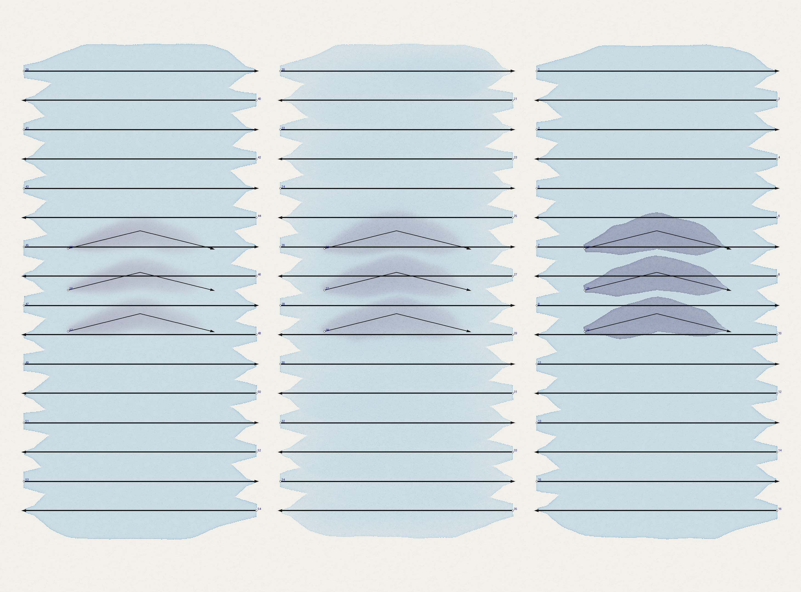

```js
sky(0.67, 0.97, 0.9); kit.dryAll(sheet); cloud(W * 0.82);   // right, dried first: a hard edge
sky(0.35, 0.64, 0.45); cloud(W * 0.495);                    // middle, damp: it keeps its shape, with a soft edge
sky(0.03, 0.32, 0.9); cloud(W * 0.175);                     // left, very wet, laid last: the cloud spreads and pales
```

You set how wet the paper is by the `water` of the brush that wets it. Into very wet paper (0.9) a cloud spreads, pales and loses its edge; into damp paper (0.45) it keeps its shape with a soft edge; on dry paper it keeps a hard edge and full strength. For damp paper, lay the wash damp to begin with (water about 0.45); waiting is not a reliable way to get there.

### 4. Hard and soft edges
 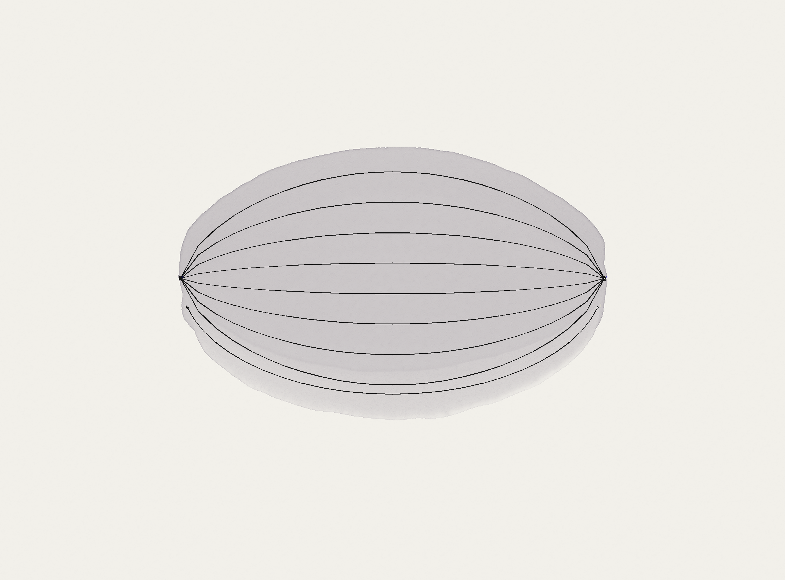

```js
kit.dip(water, { water: 0.45, conc: kit.mix({}) });   // clean water is kit.mix({})
kit.stroke(water, sheet, lowerEdge);                  // damp paper where the pebble's lower edge will be
// then the pebble: eight sweeps along it, the outer ones on its edges, so the lowest lies on the damp
```

An edge on dry paper is hard; an edge that meets damp paper is soft. Decide each edge before the paint goes on.

### 5. A glaze over a dried wash
 

```js
pear(yellowGreen, all);  kit.dryAll(sheet);   // the first wash is DRY before the second
pear(thinViolet, shadowSide);                 // thin, laid once, left alone
```

The first colour shows through the second: a shadow without mud. Painting into a damp wash to darken it moves what is under it instead.

### 6. Whites
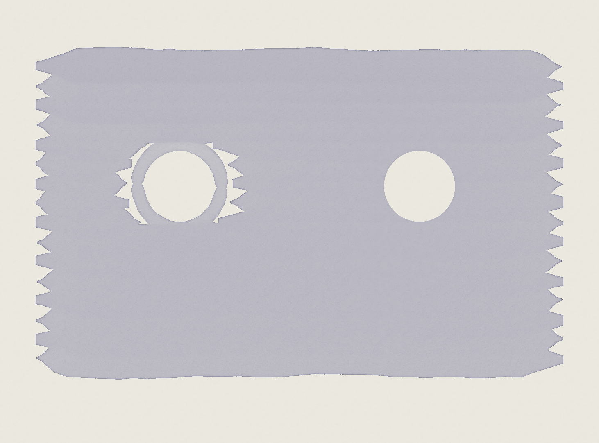 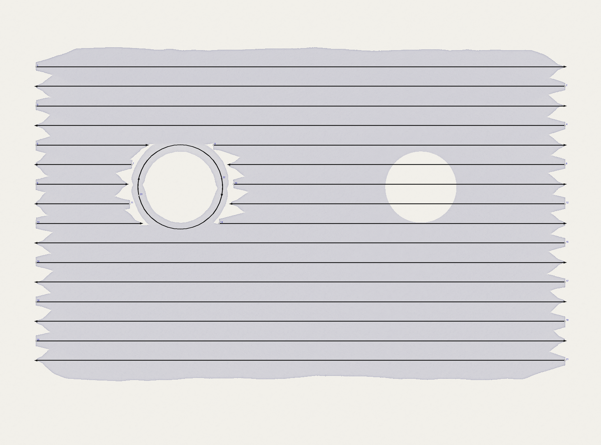

```js
const mask = new Uint8Array(W * H);    // masking fluid: 1 where it goes, row by row (mask[y * W + x])
kit.applyResist(sheet, mask);          // before any paint; kit.liftResist(sheet) once the sheet is dry
// painted round: the wash rows stop short of the white; then a smaller brush goes round its edge while the wash is wet
```

Watercolour has no white paint: decide the whites before the first wash, and paint round them or mask them. Lifting takes back part of a wet wash, never to white. On a middle-blue wash (grey 176, paper 231): a clean brush dipped at water 0.3 to 0.5 and drawn through it left 199 to 205; a tissue (`kit.blot(sheet, mask)`, 1 in the mask where it presses) 208; a nearly dry brush (water 0.1) took nothing. Lifting suits a soft light (a cloud's edge, a sheen).

### 12. Two colours meeting wet
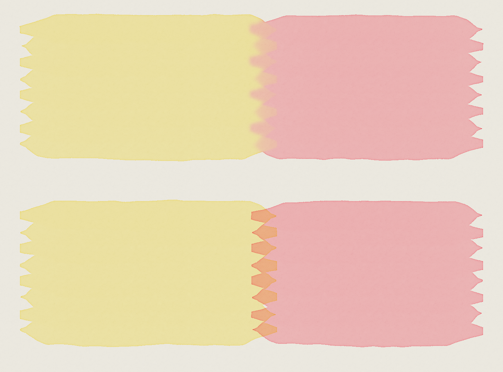 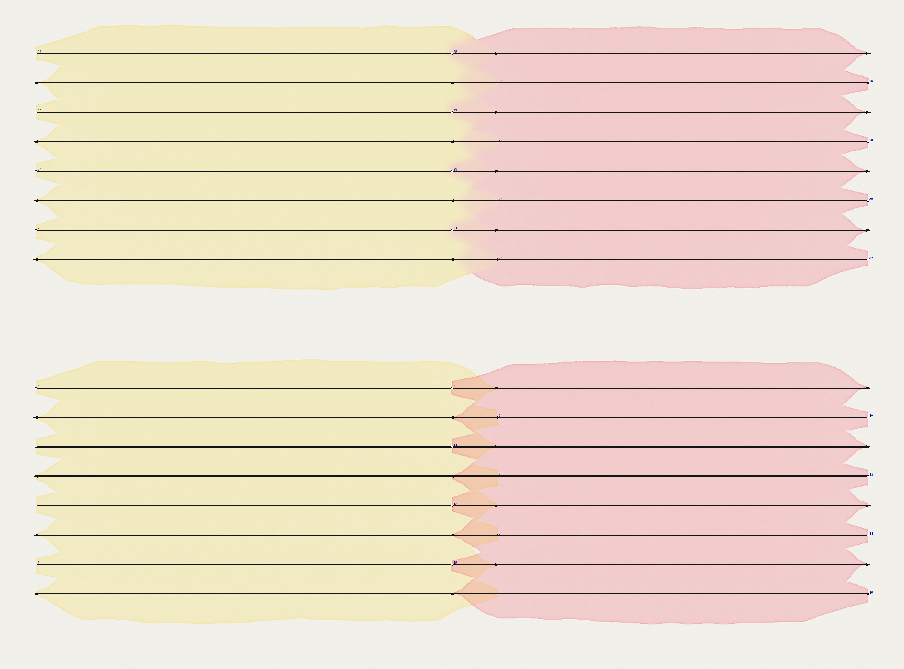

```js
band(H * 0.58, H * 0.92, 0.04, 0.55, yellow); kit.dryAll(sheet); band(H * 0.58, H * 0.92, 0.5, 0.96, rose);   // bottom, first
kit.dryAll(sheet);
band(H * 0.08, H * 0.42, 0.04, 0.55, yellow); band(H * 0.08, H * 0.42, 0.5, 0.96, rose);                     // top
```

Top: the rose rows reach over the yellow's wet right edge and the two run together. Bottom: the yellow was dried first, so the seam is hard. Soft joins need wet meeting wet, both laid in one sitting. A third, mixed colour laid between two dried ones makes a band, not a blend.

### 13. How far one dip goes
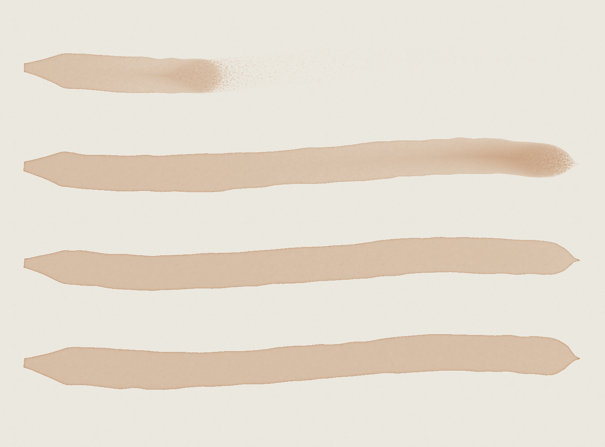 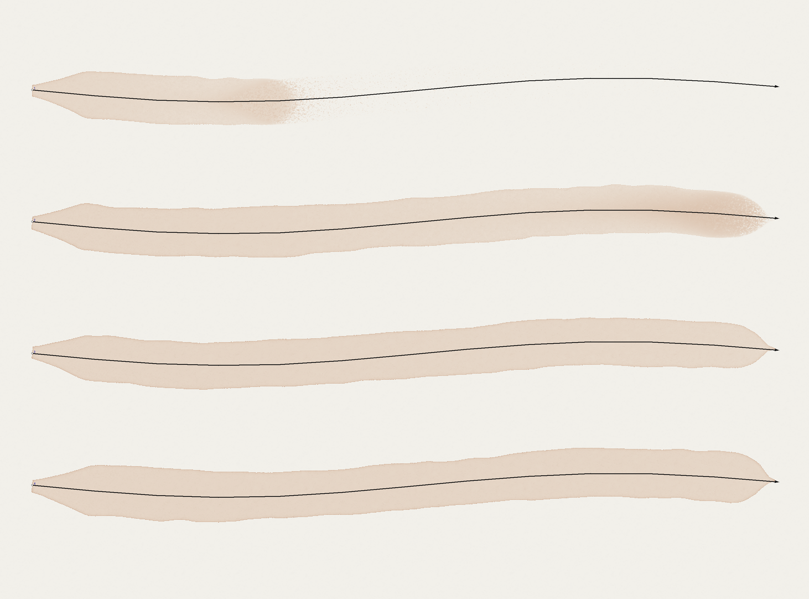

```js
for (const capacity of [120, 400, 800, 1500]) {                       // four furrows, one dip each
  const b = kit.createBrush({ radius: H * 0.04, bristles: 36, capacity });
  kit.dip(b, { water: 0.85, conc }); kit.stroke(b, sheet, furrow);    // 1,340 cells long
}
```

With radius 43 cells and 36 bristles, capacity 120 runs dry after about 450 cells; 400 runs low just before the end of the 1,340; 800 and 1,500 last the whole furrow. With 36 to 40 bristles, one dip lasts about capacity x 150 / radius cells: give a brush that, or dip again. Fewer bristles hold less. To run a stroke dry on purpose, give it less.

## Drawing

### 8. The pen: a fence
 

```js
const broad = kit.createPen({ nib: 2.4, flex: 0.3 }), fine = kit.createPen({ nib: 0.8, flex: 0.2 }), flexy = kit.createPen({ nib: 0.8, flex: 2.5 });
kit.dipPen(pen, kit.mix({ sepia: 3 }));         // inks: sepia, lampblack; a pen runs out too: one dip drew about 2,000 cells of line here
kit.penStroke(pen, sheet, [{ x, y, p }...]);    // p pressure: it opens a flexible nib; nib and flex are in cells
```

Posts broad, rails fine, the ground line thin to thick (a flexible nib, pressed harder as it goes). Tone by hatching: one direction, closer for darker, crossed for darkest; not by pressing harder.

### 9. Ink under a wash
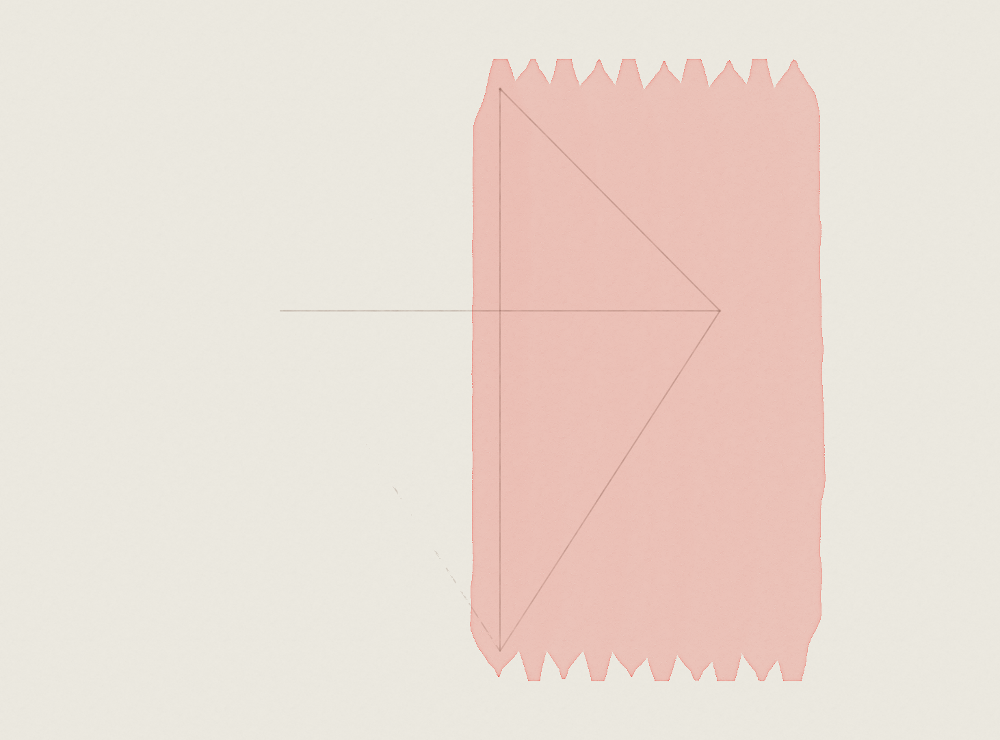 

```js
kit.dipPen(pen, kit.mix({ sepia: 3 })); kit.penStroke(pen, sheet, kite);   // the drawing
kit.dryAll(sheet);                                                          // the ink dry before the wash
// then a wash over the kite's right half
```

Draw, dry, then wash: dry ink holds under the wash as drawn. `kit.open(task, { ink: 'waterproof' })` gave the same picture to the pixel; the ink matters only for a wash laid into ink still wet, where soluble ink (the default) moves a little.

### 11. Pencil lay-in and the eraser: a jug
 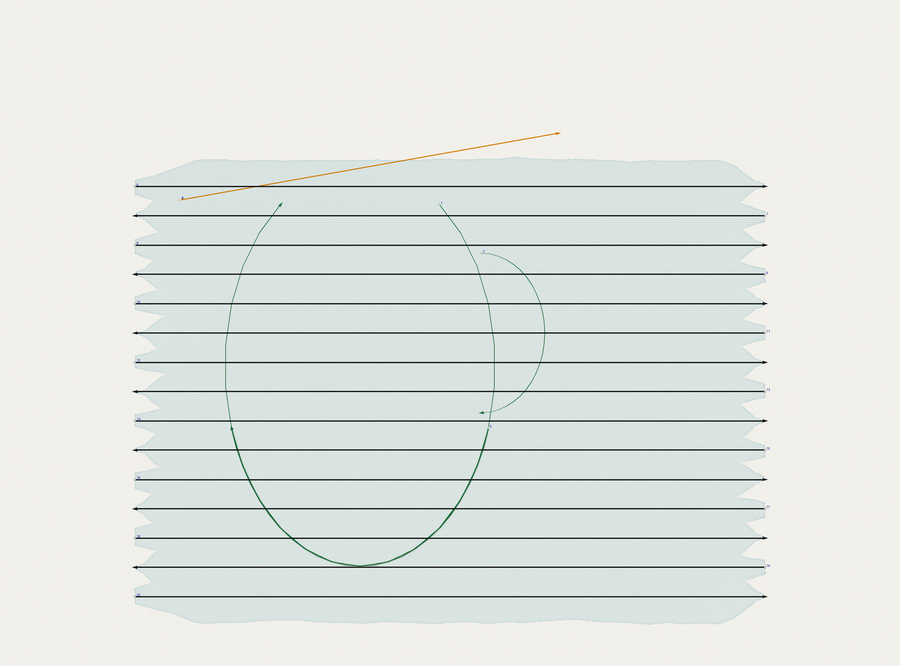

```js
const hb = kit.createPencil({ grade: 'HB' }), soft = kit.createPencil({ grade: '2B' });   // HB paler and finer, 2B darker
kit.pencilStroke(hb, sheet, body);                           // light lines (p 0.4 at every point) where a pale wash will go
kit.erase(sheet, wrongLine, { width: H * 0.03 });            // rubs out on bare, dry paper; it refuses a wet sheet
kit.pencilStroke(soft, sheet, base);                         // heavy (p 1): it shows through every wash
```

Draw the pencil lines your subject shows and choose their weight: light ones all but vanish under a wash, heavy ones stay (pencil does not dissolve). Rub out an unwanted line before any paint; under dried paint the eraser takes little.

## What makes a painting slow

Only the paintings you run are charged (each run of your script is one; see the brief). `kit.work()` reports what your painting asked of the simulator; it is recorded beside your score whether or not you call it.

- A big brush on wet paper. While a brush is on the paper the kit moves the water over the whole sheet and the brush reads the wet paper round it again each time. A wide brush in a wide wet wash is the slow case: in example 2 each sweep of the sky took about half a minute. A small brush, or a brush on dry paper, is quick.
- Dryings. A drying dries the whole sheet; it runs on the GPU and the next stroke waits for it. Dry before a glaze, before a shape that must keep a hard edge, before pen or pencil over paint, before the eraser. Between strokes of one wash it spoils the wash.
- Waits. `kit.wait(sheet, moments)` moves the water with the brush off the paper; it does not make paper damp. It is rarely needed.

Each example's counts on a full-size sheet are in `bench/v3/tips/costs.json`. Slow is not wrong: paint the washes the picture needs.
