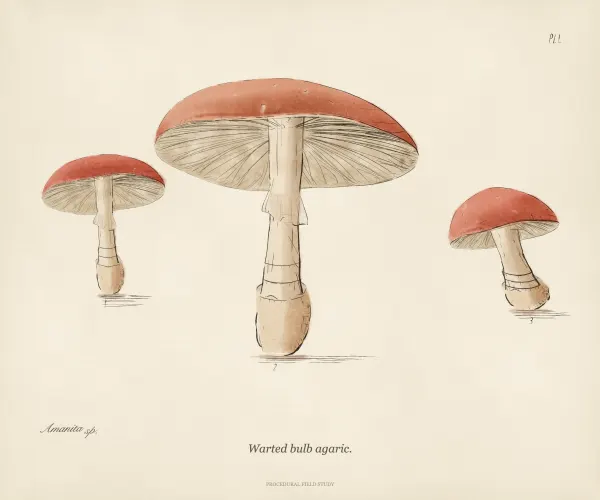
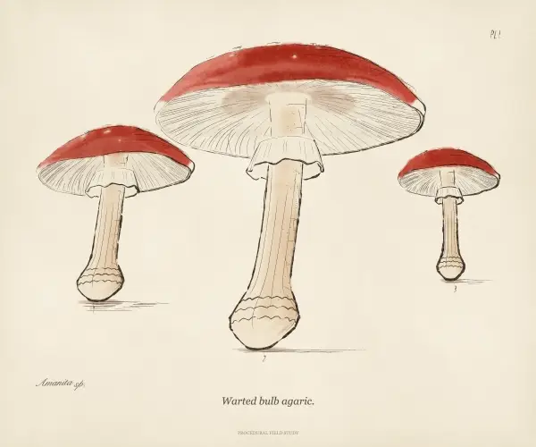
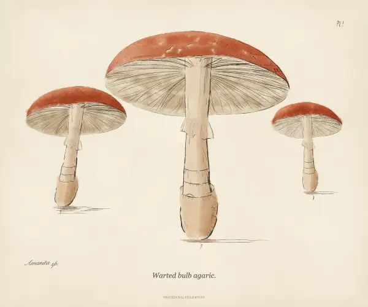
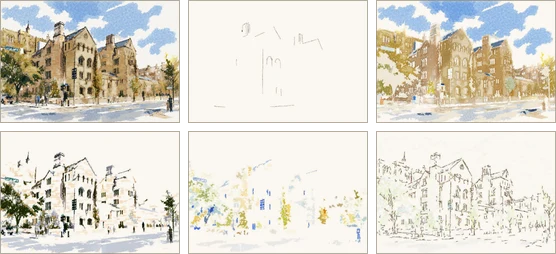

# Demos

Live at <https://sabj.github.io/unpainting/demos/>. Run locally: `python3 -m http.server 8000 --directory demos`.

## [Spore Studies](https://sabj.github.io/unpainting/demos/fungi/)

| Plate | Painting | Turning | Morphing |
| --- | --- | --- | --- |
|  |  |  |  |

## [Paint Lab](https://sabj.github.io/unpainting/demos/lab/)

| Painting | Painting it |
| --- | --- |
|  |  |

## [Layers](https://sabj.github.io/unpainting/demos/layers/)

| Painting | Taken apart |
| --- | --- |
|  |  |
