# Spore Studies

Mushroom plates in ink and watercolour, painted live. **[Open it](https://sabj.github.io/unpainting/demos/fungi/)**

| Random paints a new plate | Drag to turn | Morph |
| --- | --- | --- |
|  |  |  |

| | | |
| --- | --- | --- |
|  | [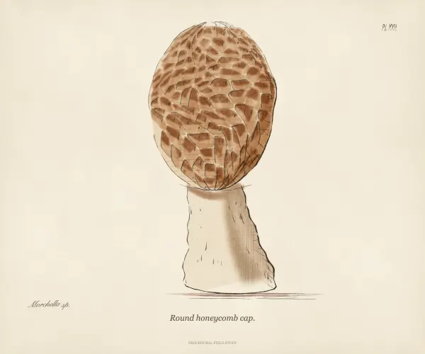](https://sabj.github.io/unpainting/demos/fungi/?type=morel-1) | [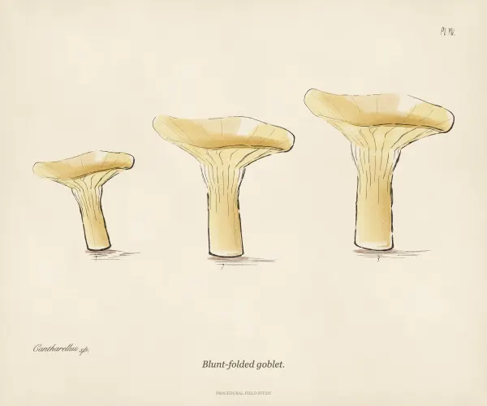](https://sabj.github.io/unpainting/demos/fungi/?type=chanterelle-1) |
| [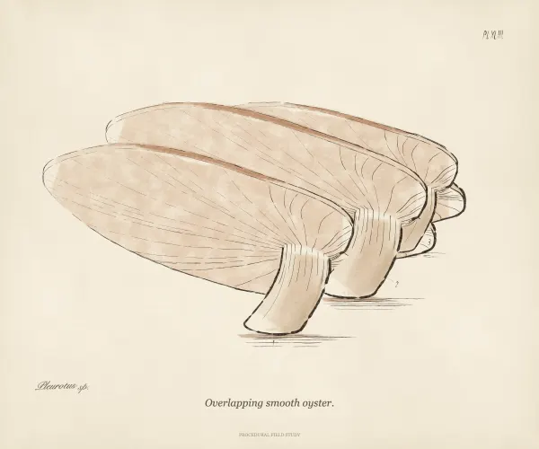](https://sabj.github.io/unpainting/demos/fungi/?type=oyster-1) | [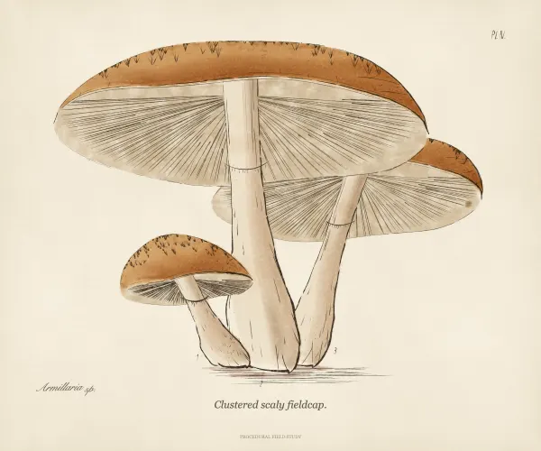](https://sabj.github.io/unpainting/demos/fungi/?type=agaric-4) | [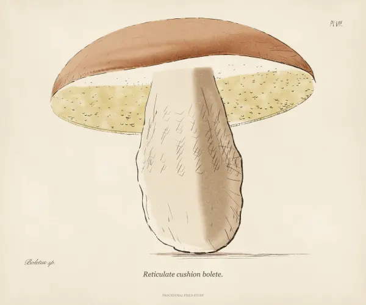](https://sabj.github.io/unpainting/demos/fungi/?type=bolete-1) |
| [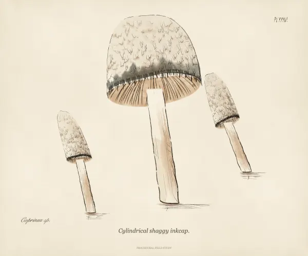](https://sabj.github.io/unpainting/demos/fungi/?type=inkcap-1) | [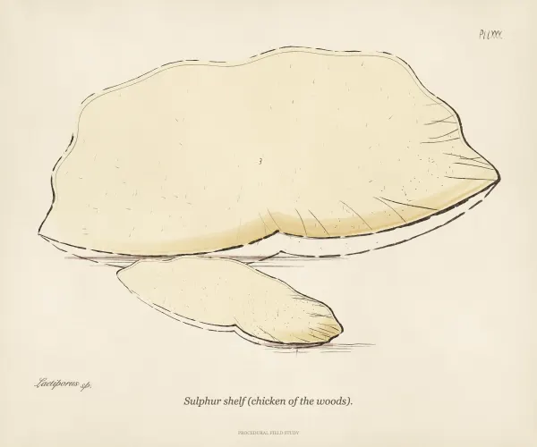](https://sabj.github.io/unpainting/demos/fungi/?type=bracket-6) | [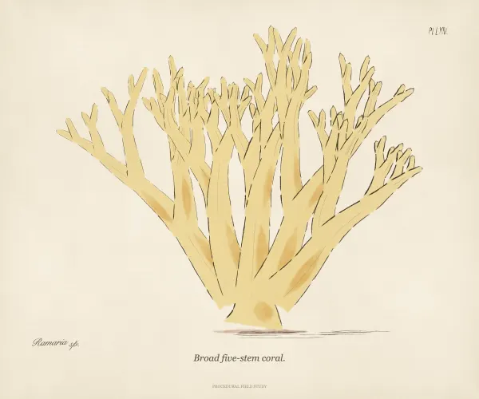](https://sabj.github.io/unpainting/demos/fungi/?type=coral-1) |
| [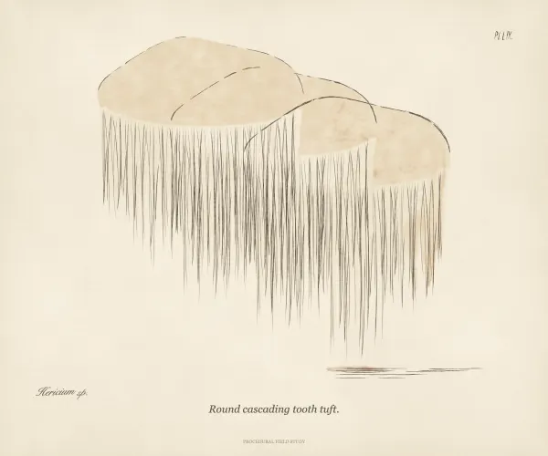](https://sabj.github.io/unpainting/demos/fungi/?type=tooth-1) | [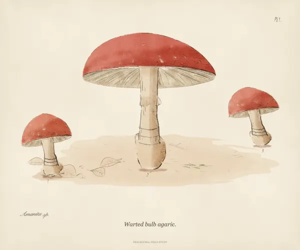](https://sabj.github.io/unpainting/demos/fungi/?type=amanita-1&background=1&scene=woodland) | [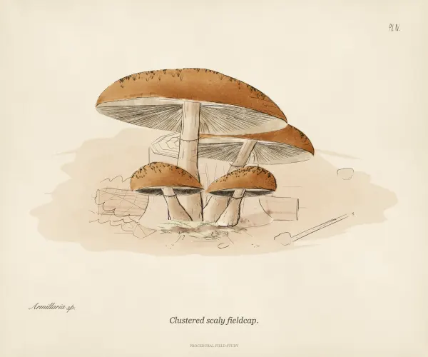](https://sabj.github.io/unpainting/demos/fungi/?type=agaric-4&background=1&scene=fallen-log) |

The palette button opens the plate in [Paint Lab](https://sabj.github.io/unpainting/demos/lab/).

Code: `mushrooms.mjs`. Tests: `node --test demos/fungi/mushrooms.test.mjs`.
