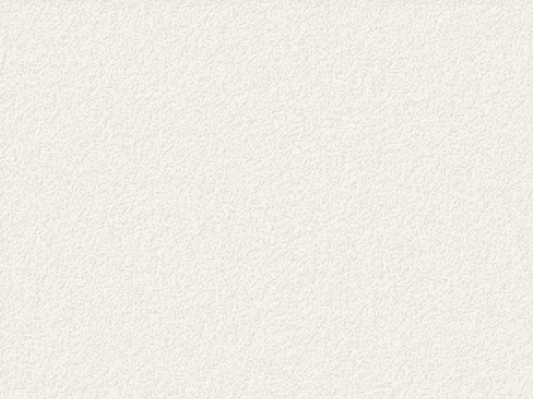
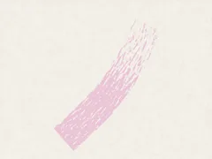
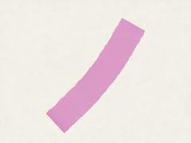
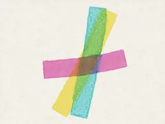
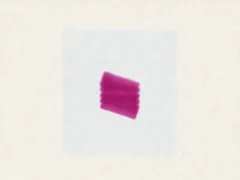
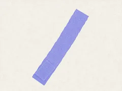
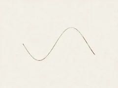
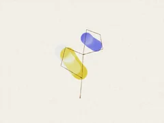
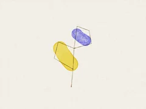

# Paint Lab

Paint by hand on simulated paper. **[Open it](https://sabj.github.io/unpainting/demos/lab/)**

0.3.1 keeps the browser's shared media in sync with the painter, and its WebGPU solver dries a wet rim with the painter's local dry-fraction rule (`tools/lab/gpu-mirror.test.mjs` and `gpu-edge-parity.test.mjs` check it). The planner, ink and stroke-plan changes of 0.3.1 are CLI-only: Paint Lab paints by hand and replays recorded tapes. Paint Lab has its own WebGPU flow solver and runs brush contact on the CPU; it does not use the CLI's fused GPU stroke pipeline or disk preparation cache. The CLI benchmark speedup therefore does not describe Paint Lab's frame rate.

- `lab.js`: the page, with pointer input, controls and frames from the worker.
- `worker.js`: the simulation, run off the page's thread.
- `media/`: paper, sheet, brush, pen, pencil, pigments and mixing. `paper.js`, `sheet.js`, `brush.js`, `pen.js`, `pencil.js`, `km.js` and the helpers they import are the painter's own `src/media/`, copied by `node tools/lab/sync-site-media.mjs`; edit the source and run it again (`npm test` fails while the copy is stale). `lab-media.js` adds what only the lab needs: a pigment joining a sheet mid-painting.
- `gpu/`: the WebGPU sheet, its GPU programs and WebGL2 colour rendering. The brush, pen and pencil always run on the CPU copy of the paper state; the WebGPU simulation advances the water and pigment between strokes with its own WGSL shaders (GPU programs). It lacks the thin surface-water diffusion, hole and slide options of `sheet.mjs`. `?physics=cpu` or `?nowebgpu=1` steps the painter's own `sheet.js` instead.
- `targets/`: one picker for recorded paintings and technique demonstrations. `worker/live-tape.js` re-runs the original recorded material events, including dips, in the simulator. Live is the default; 250 and 2,500 are early-stroke studies, not shortened recreations of a finished picture. Timeline seeks rebuild the physical state, and Carry on painting keeps it. Replay explicitly shows a recording, stepping saved frames without blending. No image upload is offered.
- `ui/`: pointer contact, the cursor and the move queue on the page side.
- `worker/`: the worker's helpers: demonstrations, pacing, undo history, autosave, sheet state and self-checks.
- `examples/`, `thumbnails/` and `fonts/`: example animations, demo thumbnails and the typeface. The full live tapes retain pigment recipes, tools, dip events and early strokes. Rebuild them with `node tools/lab/build-live-examples.mjs H36_250 H36_2500 SHIPS_250 SHIPS_2500`, four run directories; the older compact path logs are used only by recording mode.

| Dry brush | Flat wash | Glazing | Wet in wet |
| --- | --- | --- | --- |
|  |  |  |  |
| **Backrun** | **Dip pen** | **Ink then wash** | **Wash then ink** |
|  |  |  |  |

[Running the painter](../../docs/running.md#paint-lab) covers the examples and how to rebuild their animations. `tools/lab/build-site.mjs` copies this folder into the static site.

Manual brush and pen loads survive lifting. Use Re-dip brush / pen for a fresh load. Changing a material or tool loads that choice. Surface and pore water evaporate through the normal CPU or WebGPU physics; scratch marks use separate disposable paper.

Live operations are explicit. Blue-grey tint shows recorded masking fluid (`r`);
an ochre outline shows the allowed passage (`c`), which clips brush deposition.
The named operation timeline includes applying/removing either, loading tools,
drying, settling, blotting, and rewetting. Drying colours the affected wet area;
hand drying shows the local heat footprint. Unknown tape events stop with an
error instead of disappearing silently. Recording mode still shows saved frames.

Use **Mask** to paint fluid, then paint washes and **Remove mask** to lift it.
**Show masks & boundaries** hides only the overlay, not the physical protection.
**Remove boundary** releases a recorded passage when carrying on by hand.
**Lift** removes mobile colour with a damp tool (staining remains); **Blot** takes
surface water and suspended pigment; **Water** rewets; **Dryer** dries locally.
These changes participate in undo/autosave. Masks are restored when seeking.
Masking should precede the washes it protects.

The first-wash gaps have two explicit causes in both shipped tapes: resist and
passage clips. h36's 1086 × 724 tape masks 92,398 cells; White Ships' 720 × 514
tape masks 23,485. Their 2,500-stroke excerpts contain `r`, `c`, and `y` operations
but no `R` removal, so the fluid stays on until a later recorded removal or the
user removes it. Dry contact and depleted load can also leave broken marks;
they are not substitutes for the explicit recorded masks.

Replay uses each point's recorded radius for the WebGPU read and write bounds.
The first washes record radii up to 358.8 source cells in h36 and 257.3 in White
Ships. The live indicator outlines only cells whose water or pigment changed in
that application. It appears with the finished paint frame and clears between
strokes and operations. It does not animate travel across untouched paper.
Overlays do not enter image exports.
