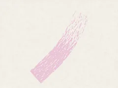
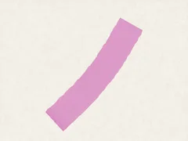
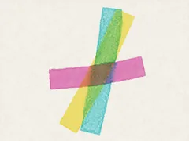
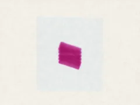
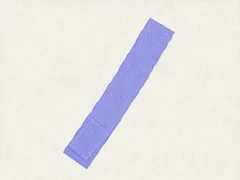
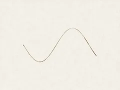
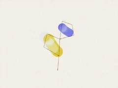
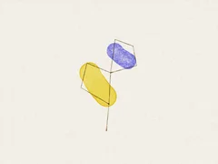

# Paint Lab

Paint by hand on simulated paper. **[Open it](https://sabj.github.io/unpainting/demos/lab/)**

0.4.0-rc.3. The sheet's cell size follows the paper's size on screen: about one cell to a device pixel, up to 0.125 mm a cell with WebGPU and 0.42 mm on the CPU, which is what each keeps interactive. The Cell size menu picks another, and the status line shows the cells, the millimetres per cell, the screen pixels per cell and the frame time. Paint Lab has its own WebGPU flow solver and runs brush contact on the CPU; `?physics=cpu` steps the painter's own `sheet.js` instead.

- `strokes/`: the stroke bench, the painter's own bench strokes (`src/media/stroke-bench.mjs`) on the CPU sheet and the WebGPU sheet side by side, at 0.25, 0.1 or 0.05 mm a cell, exported as a labelled PNG.
- `lab.js`: the page, with pointer input, controls and frames from the worker.
- `worker.js`: the simulation, run off the page's thread.
- `media/`: paper, sheet, brush, pen, pencil, pigments and mixing. `paper.js`, `sheet.js`, `brush.js`, `pen.js`, `pencil.js`, `km.js`, `stroke-bench.js` and the helpers they import are the painter's own `src/media/`, copied by `node tools/lab/sync-site-media.mjs`; edit the source and run it again (`npm test` fails while the copy is stale). `lab-media.js` adds what only the lab needs: a pigment joining a sheet mid-painting.
- `gpu/`: the WebGPU sheet, its GPU programs and WebGL2 colour rendering. The brush, pen and pencil always run on the CPU copy of the paper state; the WebGPU simulation advances the water and pigment between strokes with its own WGSL shaders (GPU programs). It lacks the thin surface-water diffusion, hole and slide options of `sheet.mjs`. `?physics=cpu` or `?nowebgpu=1` steps the painter's own `sheet.js` instead.
- `targets/`: one picker for recorded paintings and technique demonstrations. `worker/live-tape.js` re-runs the recorded material events, including dips, in the simulator. Live replays one tape made by the current pipeline, the Tiepolo camel. Timeline seeks rebuild the physical state, and Carry on painting keeps it. Replay explicitly shows a recording, stepping saved frames without blending. No image upload is offered.
- `ui/`: pointer contact, the cursor and the move queue on the page side.
- `worker/`: the worker's helpers: demonstrations, pacing, undo history, autosave, sheet state and self-checks.
- `examples/`, `thumbnails/` and `fonts/`: example animations, demo thumbnails and the typeface. The live tape retains pigment recipes, tools, dip events and every stroke. Build it from a run painted with `--drawingfile`, `--washplan`, `--marks 1` and `--inkres 1` (Live has no fine pen sheet): `node tools/lab/build-live-examples.mjs <id> <run dir> <target image>`, then `node tools/lab/build-live-checkpoints.mjs` for the seek points.

| Dry brush | Flat wash | Glazing | Wet in wet |
| --- | --- | --- | --- |
|  |  |  |  |
| **Backrun** | **Dip pen** | **Ink then wash** | **Wash then ink** |
|  |  |  |  |

[Running the painter](../../docs/running.md#paint-lab) covers the examples and how to rebuild their animations. `tools/lab/build-site.mjs` copies this folder into the static site.

Manual brush and pen loads survive lifting. Use Re-dip brush / pen for a fresh load. Changing a material or tool loads that choice. Surface and pore water evaporate through the normal CPU or WebGPU physics; scratch marks use separate disposable paper.

Live operations are explicit. Blue-grey tint shows recorded masking fluid (`r`);
an ochre outline shows the allowed passage (`c`), which clips brush deposition.
The named operation timeline includes applying/removing either, loading tools,
drying, settling, blotting, and rewetting. Drying colours the affected wet area;
hand drying shows the local heat footprint. Unknown tape events stop with an
error instead of disappearing silently. Recording mode still shows saved frames.

Use **Mask** to paint fluid, then paint washes and **Remove mask** to lift it.
**Show masks & boundaries** hides only the overlay, not the physical protection.
**Remove boundary** releases a recorded passage when carrying on by hand.
**Lift** removes mobile colour with a damp tool (staining remains); **Blot** takes
surface water and suspended pigment; **Water** rewets; **Dryer** dries locally.
These changes participate in undo/autosave. Masks are restored when seeking.
Masking should precede the washes it protects.

Dry contact and depleted load can leave broken marks; recorded masks and passage clips leave gaps on purpose.

Replay uses each point's recorded radius for the WebGPU read and write bounds.
The live indicator outlines only cells whose water or pigment changed in
that application. It appears with the finished paint frame and clears between
strokes and operations. It does not animate travel across untouched paper.
Overlays do not enter image exports.
