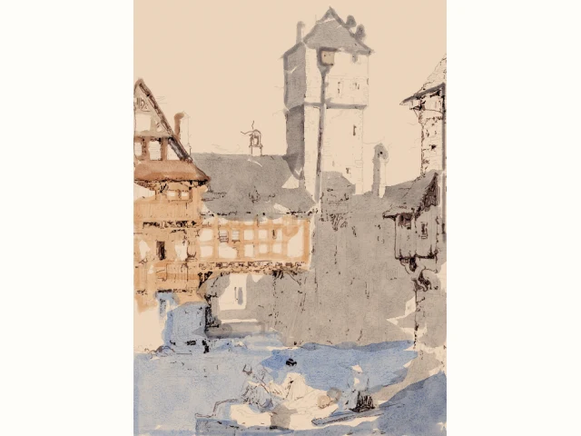

# Paint Lab

Paint by hand on simulated paper: [open it](https://sabj.github.io/unpainting/demos/lab/).

The sheet's cell size follows the paper's size on screen: about one cell to a device pixel, up to 0.125 mm a cell with WebGPU and 0.42 mm on the CPU, which is what each keeps interactive. The Cell size menu picks another, and the status line shows the cells, the millimetres per cell, the screen pixels per cell and the frame time. Paint Lab has its own WebGPU flow solver and runs brush contact on the CPU.

- `strokes/`: the stroke bench, the painter's own bench strokes (`src/media/stroke-bench.mjs`) on the CPU sheet and the WebGPU sheet side by side, at 0.25, 0.1 or 0.05 mm a cell, exported as a labelled PNG.
- `lab.js`: the page, with pointer input, controls and frames from the worker.
- `worker.js`: the simulation, run off the page's thread.
- `media/`: paper, sheet, brush, pen, pencil, pigments and mixing. `paper.js`, `sheet.js`, `brush.js`, `pen.js`, `pencil.js`, `km.js`, `stroke-bench.js` and the helpers they import are the painter's own `src/media/`, copied by `node tools/lab/sync-site-media.mjs`; edit the source and run it again (`npm test` fails while the copy is stale). `lab-media.js` adds what only the lab needs: a pigment joining a sheet mid-painting.
- `gpu/`: the WebGPU sheet, its GPU programs and WebGL2 colour rendering. Brush, pen and pencil run on the CPU copy of the paper state; WGSL shaders advance water and pigment between strokes, without the thin surface-water diffusion, hole and slide options of `sheet.mjs`. `?physics=cpu` or `?nowebgpu=1` steps the painter's own `sheet.js` instead.
- `targets/`: one picker for recorded paintings and technique demonstrations. `worker/live-tape.js` re-runs the recorded material events, including dips, in the simulator. Live replays one tape made by the current pipeline, the Tiepolo camel. Timeline seeks rebuild the physical state, and Carry on painting keeps it. Replay steps saved frames without blending. No image upload.
- `ui/`: pointer contact, the cursor and the move queue on the page side.
- `worker/`: the worker's helpers: demonstrations, pacing, undo history, autosave, sheet state and self-checks.
- `examples/`, `thumbnails/` and `fonts/`: example animations, demo thumbnails and the typeface. The live tape retains pigment recipes, tools, dip events and every stroke. Build it from a run painted with `--drawingfile`, `--washplan`, `--marks 1` and `--inkres 1` (Live has no fine pen sheet): `node tools/lab/build-live-examples.mjs <id> <run dir> <target image>`, then `node tools/lab/build-live-checkpoints.mjs` for the seek points.

[Running the painter](../../docs/running.md#paint-lab) covers the examples and how to rebuild their animations. `tools/lab/build-site.mjs` copies this folder into the static site.

Brush and pen loads survive lifting; Re-dip brush / pen gives a fresh one. Surface and pore water evaporate through the normal physics; scratch marks use disposable paper.

Mask paints masking fluid (blue-grey tint, `r`); an ochre outline (`c`) shows the allowed passage, which clips deposition. Remove mask lifts it. Show masks & boundaries hides only the overlay, not the protection; Remove boundary releases a recorded passage. Lift removes mobile colour with a damp tool (staining remains), Blot takes surface water and suspended pigment, Water rewets, Dryer dries locally. These join undo and autosave, and masks are restored on seeking. Mask before the washes it protects. Unknown tape events stop with an error. Replay uses each point's recorded radius; overlays do not enter exports.
