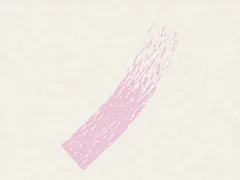
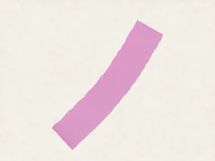
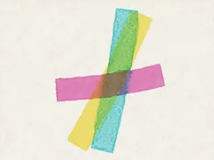
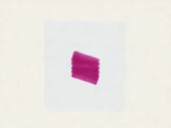
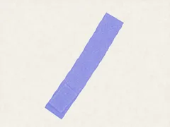
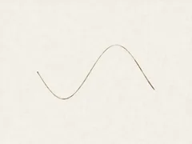
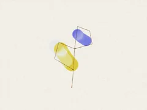
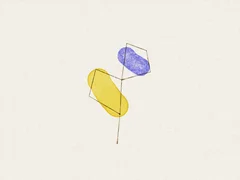

# Paint Lab

Paint by hand on simulated paper. **[Open it](https://sabj.github.io/unpainting/demos/lab/)**

| Dry brush | Flat wash | Glazing | Wet in wet |
| --- | --- | --- | --- |
|  |  |  |  |
| **Backrun** | **Dip pen** | **Ink then wash** | **Wash then ink** |
|  |  |  |  |

See an example replays the painter's own runs, stroke by stroke.

Code: `lab.js` is the page, `worker.js` the simulation. `media/` copies the painter's `src/media/`; edit the source, then run `node tools/lab/sync-site-media.mjs`.
