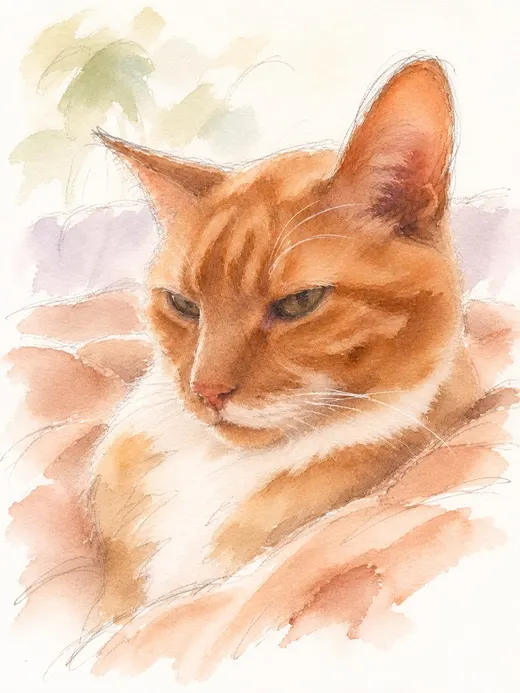
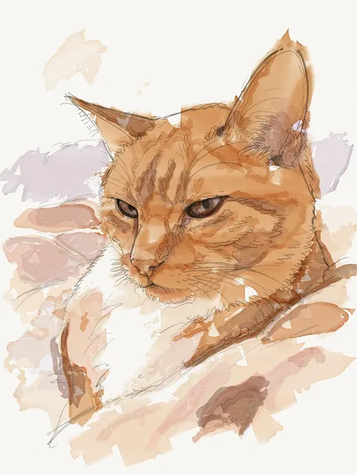
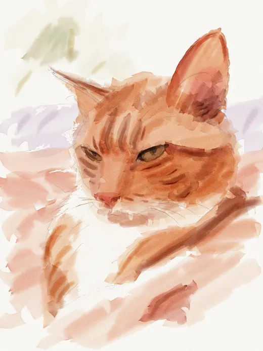
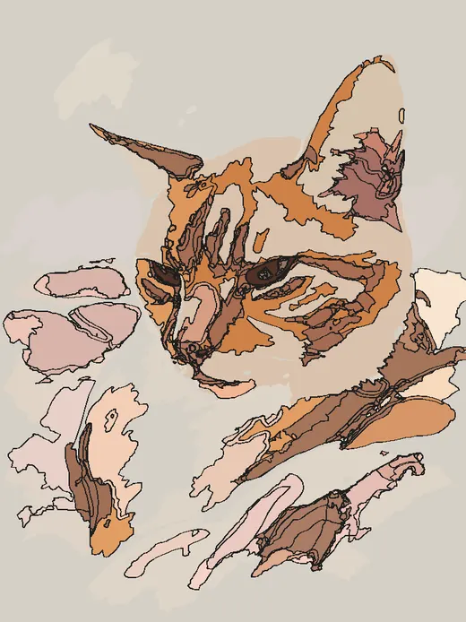
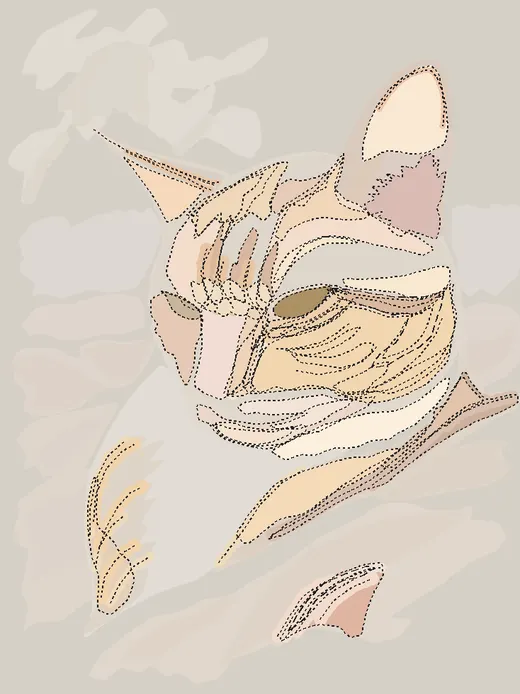
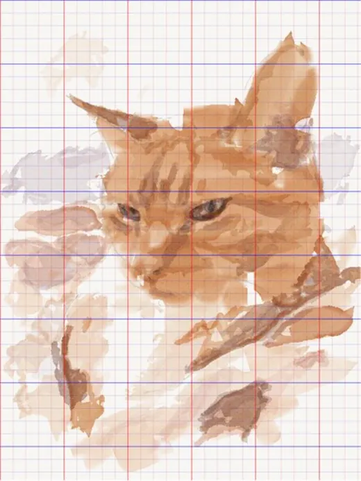
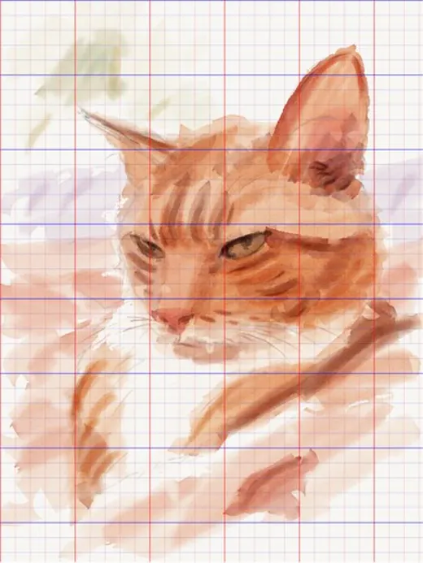
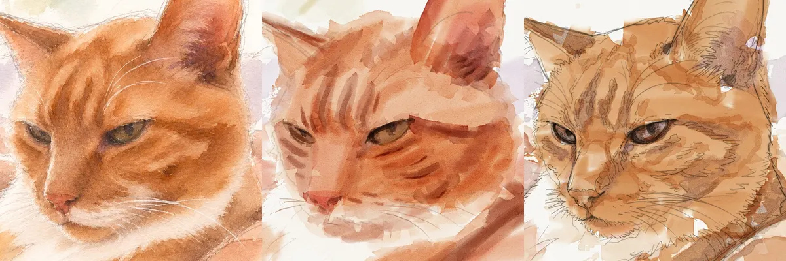
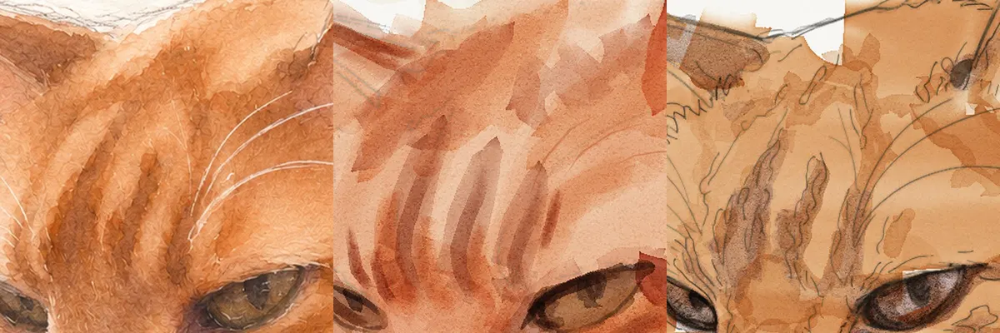
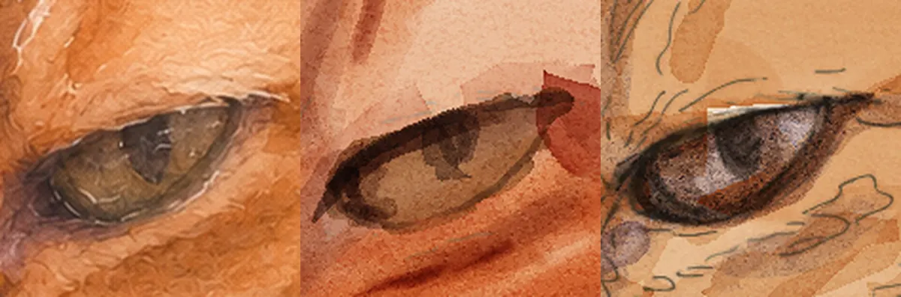

# Auto against a model

How the code alone ("Auto") paints a cat, and how a model paints the same cat at level 2. The subject is Mittens. This page is a short version of the full explainer that shows every mix, brush and passage; that page is kept with the 0.4 release material and is not in this repository.

The numbers here describe one pair of paintings, to show the difference in method. They are not benchmark results.

RESULTS: to be filled from the frozen run.

## Same cat, same inputs, two painters

Left to right: the picture, Auto, and a model (Astra) at level 2.

Both start from the same prepared inputs:

- 3,531 prepared pencil lines
- three studies: broad flat shapes, middle detail, fine detail and accents
- 11 named forms, such as the eyes, the ears and the forehead stripes

## How Auto paints

Auto cuts a study into flat shapes and turns each shape into a wash. It then fills each wash with strokes.

- 121 washes, 6 paints, 1,108 strokes.
- Stage 1 is 18 pale washes. Stage 3 is 101 darker washes laid over them. Stage 4 is two tiny dark accents in the eyes.
- Each wash is laid in its stage order, from light to dark.

Auto's washes at stage 3.

## How a model paints at L2

The model gets the same pictures and writes its own script. There is no cutting step. It draws its own shapes and stroke paths.

- Each passage has a shape, a paint mix, a brush, a paper state (wet, damp or dry), a way of stroking and a reason.
- 116 passages, 10 paints, 1,165 strokes.
- It keeps 334 of the 3,531 pencil lines and draws them very light.
- It also painted eight small test versions ("looks") and changed course between them. The first only changed Auto's settings. The last is its final script.

The model's passages at stage 3.

Its eight looks, first and last:

## Three places, side by side

Each picture is the source, the model's result and Auto's result, left to right.

The first wash over the head. The model lays a very pale warm apricot ground. Auto lays a strong orange mixed from five paints.

The forehead stripes. The model lays long wet strokes along each stripe. Auto fills jigsaw shapes from the study with many short dry strokes.

The near pupil. The model paints only the pupil, last, with a 2 mm brush. Auto stacks six ever darker glazes over the whole eye, then adds one touch.

## What a model may change at L2, and what it is not given

May change:

- Auto's settings: how it cuts and plans
- Auto's plan, wash by wash
- Its own script, every passage its own
- The named forms: merge, cut, rename
- The pencil lines: keep, drop, lighter, darker
- The paints: up to 14

Not given at L2:

- The study shapes as regions (only the study pictures)
- Anything finer than the 11 named forms
- Auto's finished painting (that comes at L4)

Drawing new pencil lines is being added. See [levels](../bench/docs/levels.md) for what each level gives and [rules](../bench/docs/rules.md) for what a model may change.

## Why this matters for scoring

Auto is the reference. How far a model's painting and its making go beyond Auto's is what the benchmark measures. Judges read how human the making looks, from the painting in progress, so the difference in method shows up in the score: see [scoring](../bench/docs/scoring.md).

Picture credit: Mittens is a photo by Sam Jackson, see [NOTICE](../NOTICE).
