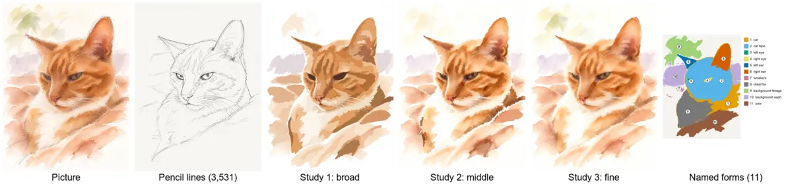
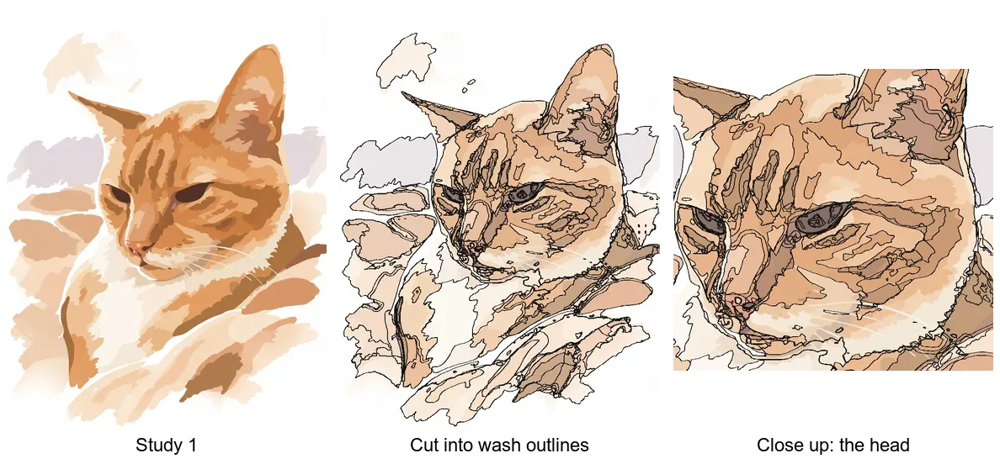
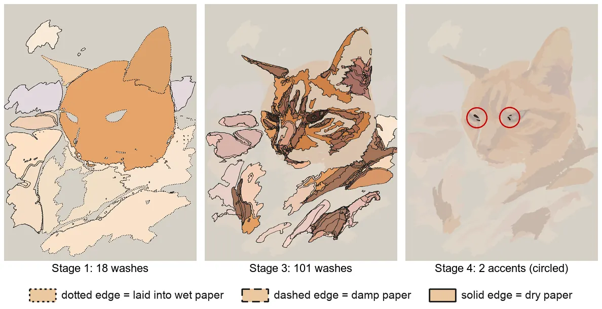
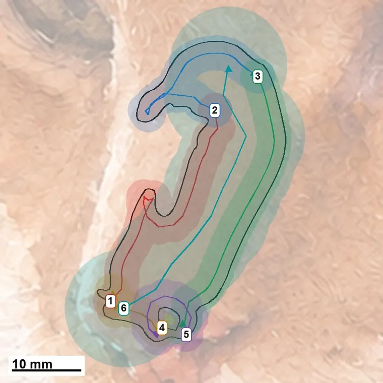
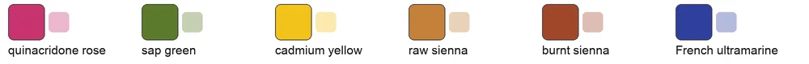
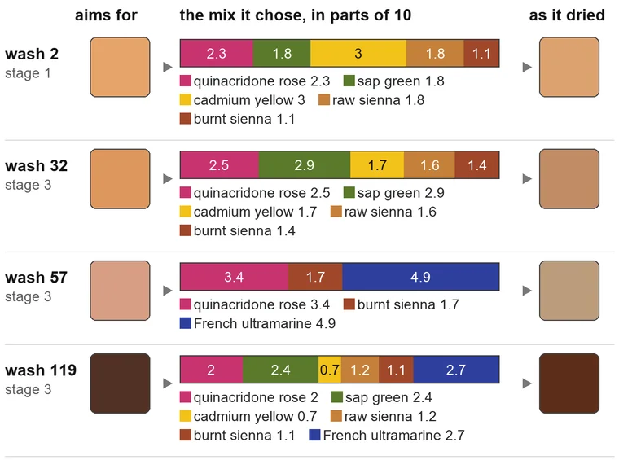

# How Auto paints, and how a model's script differs

Auto is the code planner alone. It paints from prepared inputs and never looks at the picture while it paints. A model
in the [benchmark](../bench/README.md) writes its own script instead. This page walks through Auto's method on one
picture, Mittens, and then lists how a model's script differs in kind.

The full account of the painter, stage by stage with the code, is [How it paints](how-it-paints.md).

## The inputs

- Pencil lines, prepared from the picture.
- Three studies: flat-colour versions of the picture. 1 broad shapes, 2 middle detail, 3 fine detail and accents.
- Named forms: parts with names, such as cat face, left eye, chest fur, background foliage.

## How Auto paints

### 0. Pencil

Auto draws a short lay-in first: a few light lines that place the main forms.

### 1. A study is cut into flat shapes

Study 1, its wash outlines, the head close up.

- The study's colours are grouped; each connected patch of one colour is a shape.
- Slivers join a neighbour. A near-white shape stays bare paper.
- A complex form, such as the head, becomes many small pieces.

### 2. Each shape becomes a wash, by stage

Washes by stage. Earlier stages are faded.

- Light and large first: pale washes over the big forms.
- Then the darker shapes, each over a dry wash.
- Last, a few small dark accents.
- A soft form, such as the face, starts with one pale wash into clean water.

### 3. A wash is filled with strokes

One wash and its strokes.

- Black line: the wash outline. Coloured band: one stroke, as wide as the brush. Number: its order. Arrow: the pull.
- Auto takes the biggest brush that fits and lays lanes along the shape.
- The brush can be wider than the shape.

### 4. Paints and mixes

The paints chosen for this picture.

Four washes: aim, mix, dried colour.

- Auto picks a small set of paints from the box to cover the studies' colours.
- Each shape has one colour to aim for and one mix, in parts of 10.
- The dried colour is taken from the sheet, so it includes any later wash of the same stage.

### 5. Brushes

Widths to scale.

- Real brush sizes, from a wide wash brush down to a small round.
- Wide brushes lay the first washes in a few strokes; small rounds lay the detail.

## How a model's script differs

A model writes a [painting script](painting-script.md): a list of passages, each with a shape, paint, brush, paper,
strokes and a reason.

| | Auto | A model's script |
|---|---|---|
| Shapes | cut from a study | its own passages, drawn in millimetres; they can follow a form, such as a stripe or an ear |
| Mixes | one per shape, often of many paints | named per passage, with a strength; often fewer paints in a mix |
| Strokes | lanes that fill each shape | its own paths, with clean water first where it wants a soft edge |
| Order | light and large to dark and small | its own stages |
| Pencil | a short lay-in | its choice: keep, drop, lighten or redraw lines, or none |
| Looks at the sheet | none | test paintings while it works, within a budget |
| Reasons | none written | one per passage |

[A real passage](painting-script.md#a-real-passage) shows one, with its strokes.

What each level of the benchmark gives a model is in the [benchmark README](../bench/README.md#the-ladder-in-04).
How the making is scored is in [scoring](../bench/docs/scoring.md).

Picture credit: Mittens is a photograph by Sam Jackson, modified with an image generator; see [NOTICE](../NOTICE).
