# Auto against a model

One cat, Mittens, painted two ways from the same prepared inputs:

- **Auto**: the code planner alone.
- **Astra, L2**: a model (gpt-6-astra) at level 2, writing its own script.

The example paintings were made on 22 Nov 2026 at commit `66690c4f`. They will be remade from the release candidate. They are one pair of paintings, not benchmark results.

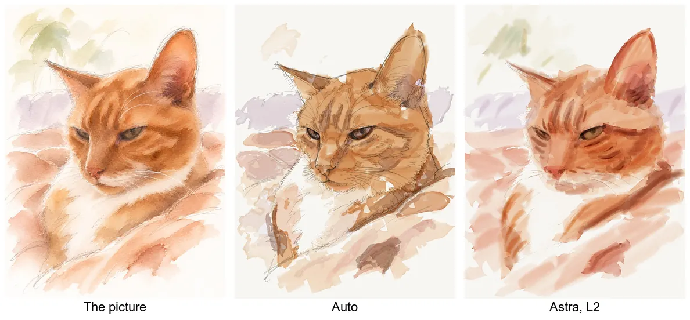

| | Auto | Astra, L2 |
|---|---|---|
| Method | cut a study into flat shapes, make each a wash, fill each wash with strokes | write a script of passages: shape, paint, brush, paper, strokes, a reason |
| Washes or passages | 121 | 116 |
| Stages used | 1, 3, 4 | 1 to 5 |
| Paints | 6 | 10 |
| Brushes | 8 | 10 |
| Strokes laid | 1,108 (134 of clean water) | 1,165 (497 of clean water) |
| Test paintings ("looks") | none | 8 |

Contents: [inputs](#what-both-start-from) ·
[0 pencil](#0-pencil) · [1 shapes](#1-shapes) · [2 stages](#2-washes-stage-by-stage) · [3 one wash](#3-one-wash-with-its-strokes) · [4 paints](#4-paints-and-mixes) · [5 brushes](#5-brushes) · [6 sheets](#6-the-sheet-after-each-stage) · [7 film](#7-film) ·
[three places](#three-places-side-by-side) · [what a model may change](#what-a-model-may-change-and-what-it-is-not-given) · [notes](#notes)

## What both start from

- Sheet: 282 x 376 mm.
- Pencil lines: 3,531, prepared from the picture.
- Studies: three flat-colour versions of the picture. 1 broad shapes, 2 middle detail, 3 fine detail and accents.
- Named forms: 11 parts with names, such as cat face, left eye, right ear, chest fur, background foliage.
- Auto's plan: Astra was run under the earlier L2, which also handed over Auto's plan as a starting point. Since 22 November L2 gets only Auto's inputs, and Auto's plan belongs to L4 ([levels](../bench/docs/levels.md)). This page shows that earlier run.

## 0. Pencil

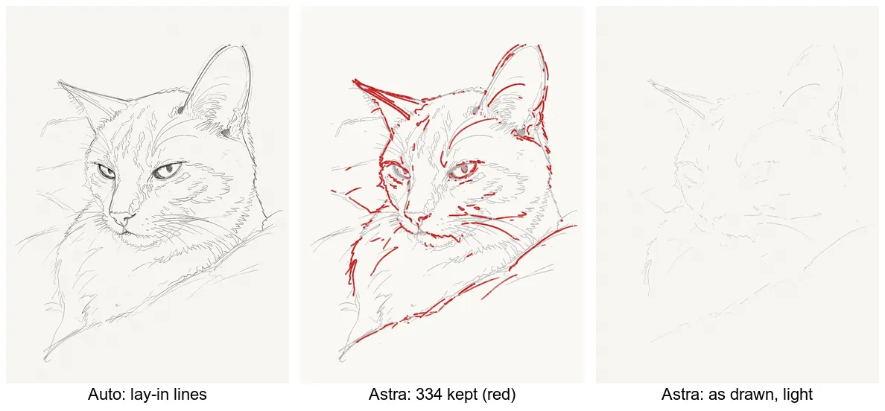

| Auto | Astra, L2 |
|---|---|
| Draws a short list of lay-in lines first. The run does not record how many. | Keeps 334 of 3,531 lines and draws them very light. |
| | 9 rules: drop lines tagged "drop", lighten all, darken the eye lines, keep or drop a few by number. |

## 1. Shapes

Auto: study 1, its wash outlines, the head close up.

| Auto | Astra, L2 |
|---|---|
| Cuts study 1 into flat shapes. Each wash outline is made of study shapes. | No cutting. Draws its own shapes and stroke paths in millimetres. |
| The head becomes many small pieces. | Shapes follow forms: a stripe, a brow, an ear. |

## 2. Washes, stage by stage

Each wash or passage is filled with the colour it aims for. Earlier stages are faded.

Auto: 121 washes.

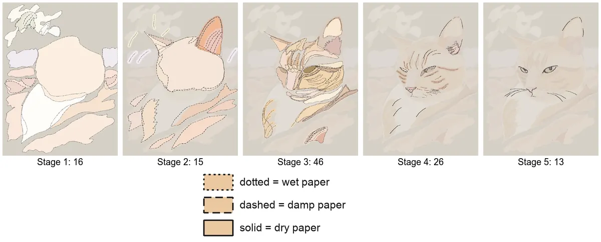

Astra: 116 passages.

| | Auto | Astra, L2 |
|---|---|---|
| Stage 1 | 18 pale washes | 16: pale grounds |
| Stage 2 | none | 15: ears, side fur, folds, background |
| Stage 3 | 101 darker washes | 46: head shadows and stripes |
| Stage 4 | 2 dark accents in the eyes | 26: irises, darker stripes, nose, ear creases |
| Stage 5 | none | 13: pupils, lids, nostrils, lip |
| Paper | 6 wet, 115 dry | 82 wet, 18 damp, 16 dry |

## 3. One wash, with its strokes

Left: Auto, wash 57. Right: Astra, passage "crown".

| | Auto, wash 57 | Astra, "crown" |
|---|---|---|
| What | cool shadow on the lower face | honey shadow near the parting of the brow |
| Brush | 17 mm | 10 mm |
| Paper | dry | wet |
| Clean water first | none | 17 strokes |
| Paint strokes | 6 | 14 |
| Pattern | along the shape; the brush is wider than the shape | long strokes along the stripes and the brow |

How to read them: black or dotted line, the outline; coloured band, one real stroke as wide as the brush; number, its order; arrow, where the brush was pulled; blue dashed band, clean water.

## 4. Paints and mixes

Auto: 6 paints.

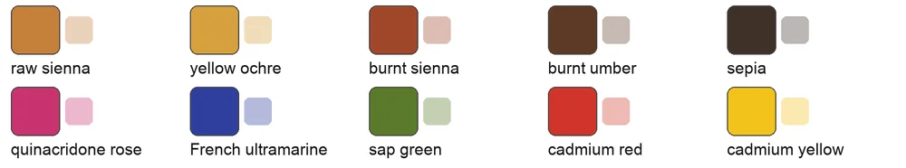

Astra: 10 paints.

| | Auto | Astra, L2 |
|---|---|---|
| Paints | quinacridone rose, sap green, cadmium yellow, raw sienna, burnt sienna, French ultramarine | raw sienna, yellow ochre, burnt sienna, burnt umber, sepia, quinacridone rose, French ultramarine, sap green, cadmium red, cadmium yellow |
| Paints in one mix | usually 5 (64 of 121 washes) | usually 3 (80 of 116 passages) |
| Strength | not named per wash | named per passage: 37 very pale, 63 pale, 15 medium, 1 strong |

Auto: four washes, aim, mix, dried colour.

Astra: all 116 mixes, by stage

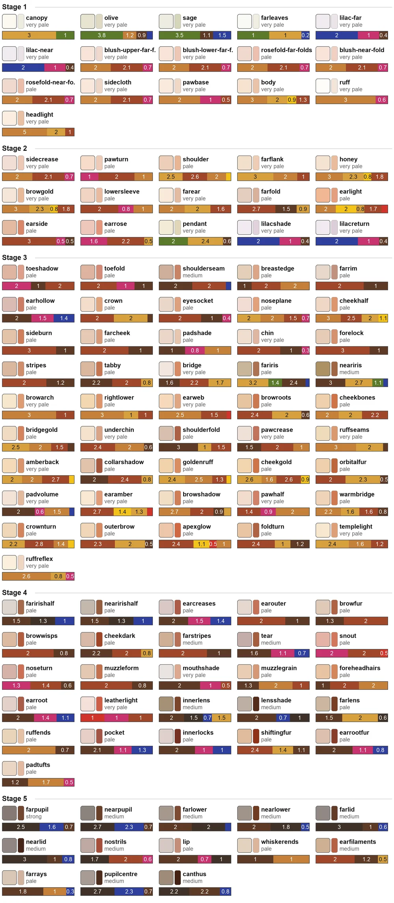

## 5. Brushes

Width to scale, with strokes laid.

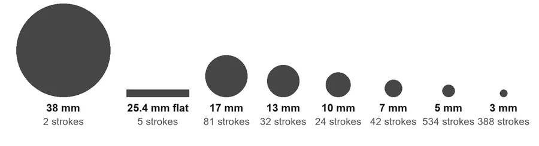

Auto.

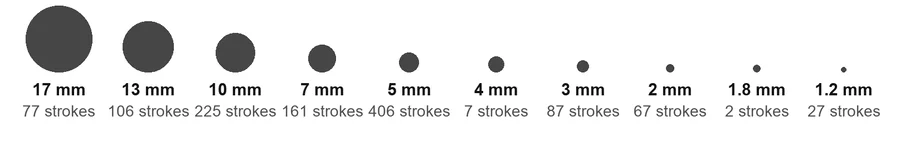

Astra.

| | Auto | Astra, L2 |
|---|---|---|
| Range | 3 to 38 mm, and a 25.4 mm flat | 1.2 to 17 mm |
| Most used | 5 mm (534 strokes), 3 mm (388) | 5 mm (406), 10 mm (225) |
| Widest | 38 mm, 2 strokes | 17 mm, 77 strokes |

## 6. The sheet after each stage

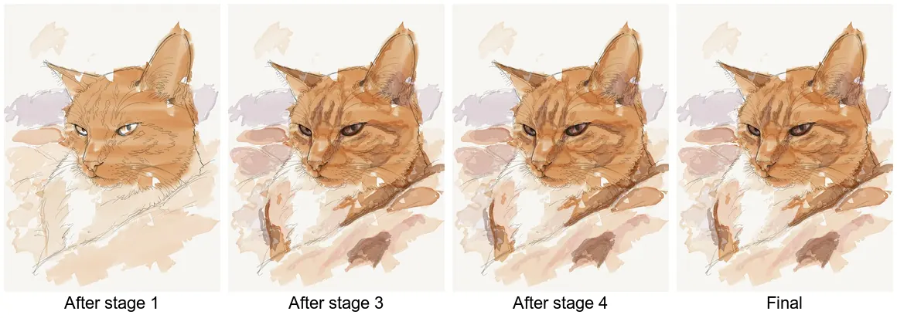

Auto.

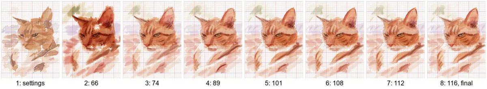

Astra's 8 looks, with passages in each. Look 1 changed only Auto's settings. Looks are painted at half the detail.

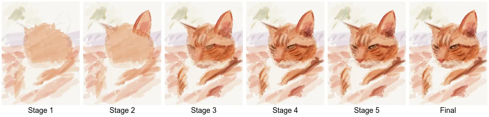

Astra, full size.

## 7. Film

Eight evenly spaced frames of the replay.

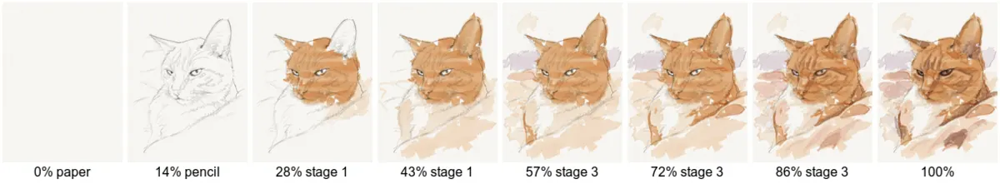

Auto.

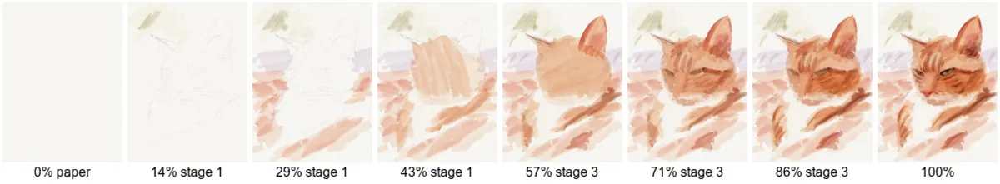

Astra.

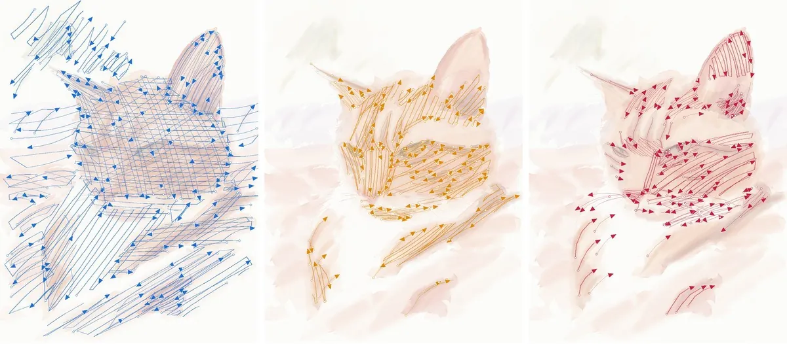

Astra's strokes by third. Dot: start. Arrowhead: end.

| Third | Typical stroke | Typical brush |
|---|---|---|
| First (blue) | 111 mm | 11 mm |
| Middle (orange) | 51 mm | 7 mm |
| Last (red) | 38 mm | 4.5 mm |

Auto has no such sheet; its stroke directions show in the close up in step 3.

## Three places, side by side

Each picture: Astra on top, Auto below. Source, shape and strokes, what it chose, finished.

Card key: colour square, paint parts, brush to scale, paper (full circle wet, half damp, empty dry), stroke direction (crossed arrows: many ways), stage.

### The first wash over the head

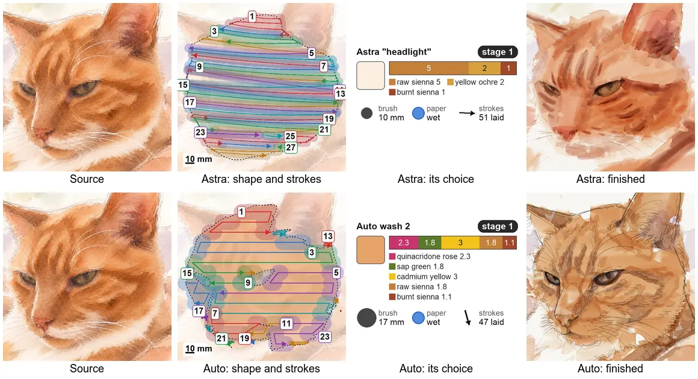

- Astra, "headlight": very pale and warm. Its reason: "Pale apricot ground through ears, face and whisker pads."
- Auto, wash 2: a strong orange from five paints, ending under the muzzle. Its plan: base wash of the cat face, into clean water.

### The forehead stripes

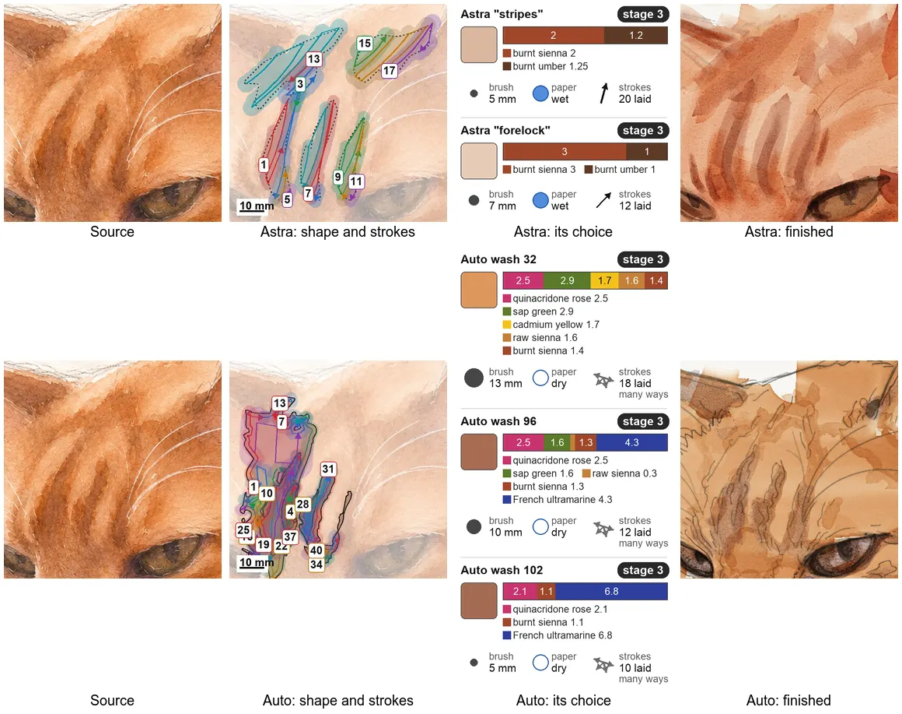

- Astra, "stripes" and "forelock": long wet strokes along each stripe.
- Auto, washes 32, 96, 102: jigsaw shapes from the study, filled with many short dry strokes.

### The near pupil

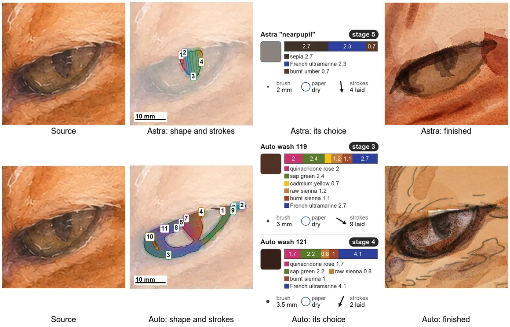

- Astra, "nearpupil": only the pupil, last, with a 2 mm brush.
- Auto, wash 119 and accent 121: six ever darker glazes over the whole eye, then one dark touch.

## What a model may change, and what it is not given

As of 0.4. Levels are in [levels](../bench/docs/levels.md); the session's tools in [`tools/paint/SESSION-README.md`](../tools/paint/SESSION-README.md).

| May change | |
|---|---|
| Its own script (L2 and up) | every passage its own ([painting script](painting-script.md)) |
| Traced study shapes (L4) | name them in its script as regions, change, redraw or ignore them |
| Prepared pencil lines | keep, drop, lighter, darker, before or after the washes |
| Its own drawn lines | new lines, pen or pencil, placed point by point |
| Drawing medium | pen, pencil or none |
| Paints | up to 14 of the box |

| Level | Given | Not given |
|---|---|---|
| L0 | the picture, a brush and a pen | tips; defined, not run |
| L1 | L0 and harness tips; a kit with pen, pencil and eraser; ink waterproof or soluble | prepared inputs |
| L2 | the same inputs Auto gets: the prepared drawing, the three studies, the named forms; it plans the painting itself, as its own script; one go | Auto's plan and planner (no `auto/`; a settings choice or plan edit is refused); study shapes as regions (only the study pictures); anything finer than the 11 forms; Auto's finished painting |
| L3 | L2 again after studying its own L2 run: its painting beside the subject, replay, stroke map, what it handed over | as L2 |
| L4 | L3, then one more retry, also given the studies' traced shapes as regions (offered, maybe wrong) | anything of Auto: plan, planner, settings, finished painting, film, stroke map; the plan's washes |

At every level:

- Never given: a score, a judge's verdict, or outside critique.
- Not allowed: reading the subject's pixels with code ([anti-cheat](../bench/docs/anti-cheat.md)).
- Fixed: paper, simulator, paint box, brush physics, the three studies, sheet size.
- Pen ink at L2 to L4: a model's own pen lines, and a pen drawing with lines or a medium of its choosing, are set waterproof before the washes unless its choice says `"ink": "soluble"`. Auto's ink is unchanged.
- Erasing at every level. L1: the kit's eraser. L2 to L4: an erase passage in a model's own script rubs pencil out with the same eraser, anywhere in the order, on dry paper only; before the first wash it takes most of the pencil, after a dried wash far less. The painter also lifts pencil from the lights by itself.

## Notes

What is approximate in these pictures:

- Wash outlines: Auto's wash outlines (`value-plan.json`), each made of study shapes. There is no separate shape file.
- Paint chips: approximate tube colours, not measured from the simulator.
- Auto's "as it dried": the middle colour inside the wash outline on the sheet after its stage, so later washes of that stage are included.
- Astra's mixes: from `script-colour.jsonl`.
- Auto writes no reason per wash; its plan label is shown instead.
- Stroke counts include clean-water strokes.

Scoring reads how human the making looks, from the painting in progress, so differences in method show up in the score: see [scoring](../bench/docs/scoring.md). A model's result is read against Auto, the difficulty index.

Picture credit: Mittens is a photo by Sam Jackson, see [NOTICE](../NOTICE).
