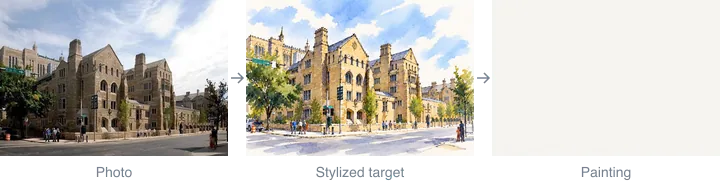
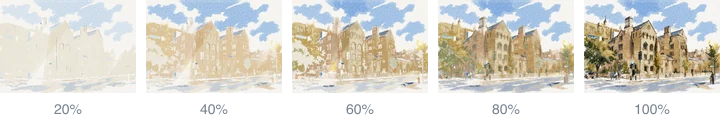
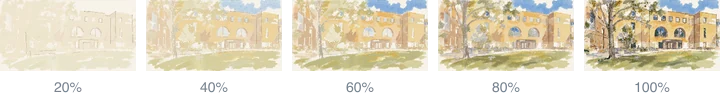
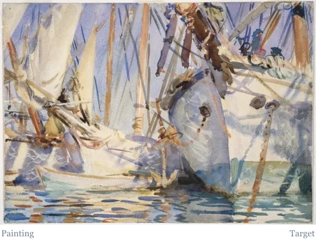

# Painting sequences

These are recorded paintings. Each animation plays the saved sheet states in order, from blank paper through the drawing and the washes to the finish. The row below it shows five saved states for a closer look.

## Trumbull College

The ink drawing sets out the building first. Pale walls and sky follow, then the deeper roof, window and road values.

## Luce Hall

Broad warm washes establish the building. Later layers deepen the recesses and the foliage around it. A few ink accents go on at the end. The region plan for this run is private.

The [quick start](running.md#examples) runs a small stroke plan instead, and [How it paints](how-it-paints.md) explains each stage.

## White Ships

The finished painting wipes in over the target and back out, with no blending.

## Benchmark paintings

The [benchmark gallery](../bench/results/gallery.md) shows each model's paintings beside their saved stages, with a link to each run record.

Trumbull College and Luce Hall photographs, targets and paintings: noncommercial use related to this project. See [NOTICE](../NOTICE).
