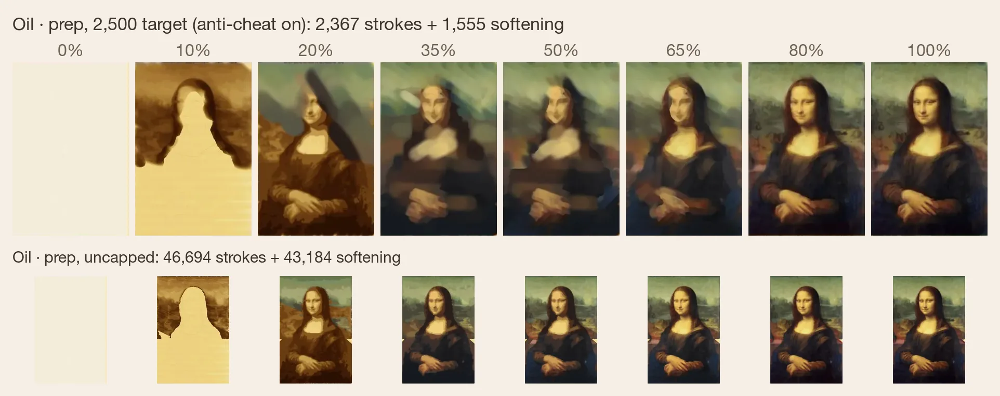

# Future ideas to test

Untested ideas, roughly in order of expected value. Each needs a measured result before it changes the painter or the benchmark.

## Benchmark and judging

### 1. An embedding judge fitted to the owner's taste

A retest moves a vision-judge score by about 0.34. Use a pretrained vision encoder (I-JEPA, V-JEPA or DINOv2) to turn paintings and targets into numeric image descriptions. Then fit a small scoring model on the owner's pairwise picks.
- Test: collect a few hundred quick picks, hold some out, and compare agreement with the current judges.
- Why: it is instant and repeatable, so it could also score every saved stage of a painting.

### 2. A diffusion language model as a planner

Diffusion language models, such as Inception's Mercury, draft a whole plan in parallel and finish in seconds. Current planners take 20 to 30 minutes.
- Test: enter it as a contestant in benchmark versions V4 and V5 through the same benchmark runner.
- Unknown: its vision and long-context reasoning are weaker, so plan quality may suffer.

### 3. Judged previews inside a V4 try (a possible V6)

Let a model render a few small previews during one attempt. Each preview is judged on the finished image and the painting process, and the model revises before its one scored render. V4 allows one scored render per try; V5 allows practice between tries.
- Test: a fixed preview budget (for example 3 at 270 px) against V4 with one scored render on the same subjects.

### 4. Budgets that do not measure the infrastructure

The V4/V5 brief tells models they have 85 minutes of their own time. Waiting for the painter is not counted, and a separate 300-minute wall-clock limit catches hangs.
- Test: replace the stated number with "a generous safety limit", or a cost budget in dollars, and report tokens and cost per try.
- Why: a stated time budget can change how a model plans, and token counts differ between vendors.

### 5. Making the default generalize

The default recipe carries settings fitted on Trumbull (stone blocks, recess layers, sky lanes, darker darks) and runs them on every image. [techniques.md](techniques.md) lists them. On images it wasn't tuned on, it gives heavy ink and pale washes.
- To do: move fitted settings into presets a plan opts into. Calibrate brush charge to what actually reaches the paper. Cap ink at the source's own share of line. Test on held-out images under the strict guard.
- Test: paint subjects each item was not tuned on, with the item on and off, and compare blind picks and scores.
- Why: an item that only helps its own images should leave the default recipe.

## Painter features

### 6. Searching painter settings on small image sections

The planning tools can already change the plan and the painter settings. Let the pipeline try many setting combinations on small image sections with GPU batching, and keep the best by score and blind picks.
- Test: does a searched setting beat the default recipe (a preset of painter settings) on subjects it was not tuned on?

### 7. A learned stand-in for the simulator

A learned world model would predict the sheet after a passage (a wash or group of marks with one job) without running the physics. A planner could then try thousands of plan variants before one real render.
- Test: train on recorded stages and stroke logs, then measure how far its predictions drift from real renders.
- Cost: weeks of work, so it comes after the items above.

### 8. Edge drying that knows how much water there is

Known weakness. A wet cell within 2 cells of any dry cell evaporates about 9 times faster (`src/media/sheet.mjs`), and water flows toward that edge carrying pigment. The rule cannot tell a wash's outer edge from a millimetre-wide pit the brush skipped. On cold-press paper, every skipped pit can then dry as a white dot in a dark ring. `--holefill` and `--holerim` patch this on the CPU and the GPU, as workarounds.
- In real paint the ring depends on the water. A damp wash leaves skipped pits as clean white flecks. A very wet wash can fill a pit, or leave a faint ring or bloom as it dries back.
- Test: scale the extra edge evaporation with the share of dry paper within a few millimetres of a cell. Scale the ring strength with the standing water. Check that outer edges keep their dark rim, pits in damp washes stay clean, and wet washes still bloom. Compare all four benchmark targets before and after, on CPU and GPU.

### 9. Flat washes that merge at any resolution

Known weakness. A flat wash is laid in horizontal lanes. At the default sheet resolution (0.218 mm per cell), neighbouring lanes often start drying before they merge. The wash shows horizontal stripes while it is laid, and some stay after it dries. The same wash merges cleanly at 0.08 mm per cell, so the result depends on grid size. The seams are also too clean. Real lanes leave soft, uneven joins. On prewet paper they do not show at all, because the paint spreads and feathers into the wet sheet.
- What a painter does: use a big wash or mop brush, so a sky takes a few wide strokes. Keep a bead of wet paint along the lower edge of each lane so the next lane runs into it. Lift excess water or paint with a thirsty brush or tissue to even out pools and hard seams.
- Test: check that a wash on prewet paper shows no lane seams and feathers at its edges. Plan big washes with the wide mop and a carried bead, and add a lift pass for pools and seams. Scale lane overlap and wet merging by the brush's width in millimetres. Check flat and graded washes at both resolutions, then all four benchmark targets before and after.

### 10. Opaque media: oil and gouache

The painter is built for watercolor, where light comes from the paper and each layer stays visible through the next. An experimental oil mode, used in the [Part 1 post](https://samjackson.org/writing/whats-a-painting-anyway-part-1/), lays opaque strokes plus softening strokes that blend wet paint. It is not in this repository.
- Results so far: the oil Mona Lisa below lays an underpainting, then shifts color in opaque layers, as sfumato needs. Under the anti-cheat guard with a 2,500-stroke target, it used 2,367 strokes and 1,555 softening strokes. Uncapped (smaller row), it used 46,694 and 43,184, far more than a person would. There is also a 2,500-stroke oil study of a cat ([n1a](https://samjackson.org/writing/whats-a-painting-anyway-part-1/#oil-n1a-2500)).
- Related work: [Learning to Paint](https://github.com/hzwer/ICCV2019-LearningToPaint) (ICCV 2019) trains a model to cover a canvas in opaque strokes quickly. It suits opaque media better than watercolor.
- Test: port the oil mode, add a covering-power term per pigment, and benchmark it under the same stroke budget and guard as watercolor.

## Known defects

Things I know are wrong and plan to fix.

### 11. Ink too heavy, paint too pale

On images the default wasn't tuned on, closing ink can end up darker than the darkest wash, and the washes come out light. The brush delivers about 0.6 to 0.75 of the pigment the plan asks for, and touch-ups don't make up the rest.
- Fix: charge the brush for what actually reaches the paper, cap ink to the source's own share of line, keep closing ink lighter than the darkest wash.

### 12. The progression judge doesn't check prep

It asks whether each stage looks made by a person, not whether the opening places the main shapes. Its early score barely tracks any measure of the 10% and 25% stages, and the two judges disagree there.
- Fix: a separate prep score that names the target's main structures and checks they're placed, validated against my own picks.

### 13. The vision judges reward matching the photo

They bunch most paintings between 5 and 6 and favor close copies over convincing paintings. Small gaps between models are noise.
- Fix: see item 1, and a rubric that asks whether it looks painted by a person.

### 14. Older paintings in the docs

Some figures come from earlier painter versions or development runs with hand-written plans. They should be repainted by the current pipeline once item 5 lands.

### 15. Line models are optional for now

`tools/seg/lines.py` is the only trained line model shipped, and it is optional. Without a line file the painter uses its own ink separator.

### 16. Paper texture

The simulated cold-press tooth is coarser and weaker than real paper.

### 17. Higher-resolution targets and scoring

The benchmark targets are small crops, about 300 px wide. V4 and V5 render them at 1224 px, and every painting is scored after shrinking it back to the target's size, so the judges never see most of the detail the painter lays down.
- Fix: cut the targets from the high-resolution originals, score paintings at the size they were rendered against a target of the same size, and score each target against itself the same way to set the ceiling.
- Cost: larger images make judge calls several times more expensive.

### 18. Painting in whole-sheet layers

The painter lays each value band across the whole sheet at once, light to dark, so every stage looks like the same picture a little darker. The progression judges flag it all the time: the whole sheet at one faint value, flat slabs for forms, texture arriving late. A person works more passage by passage, with some areas well along while others are still blank.
- Fix: let the plan order subjects and let each one run ahead through its washes and glazes, light to dark within it, with some overlap. Not strictly one subject at a time, but closer to it.

### 19. A weak judge

Qwen3.5-9B scores most early stages 1 and every target 10, so it adds noise. Replace it with a stronger vision judge, checked against my own picks.
