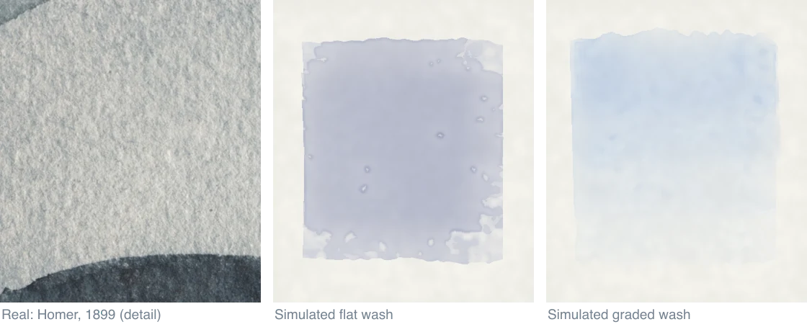
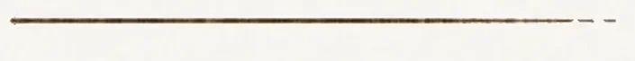
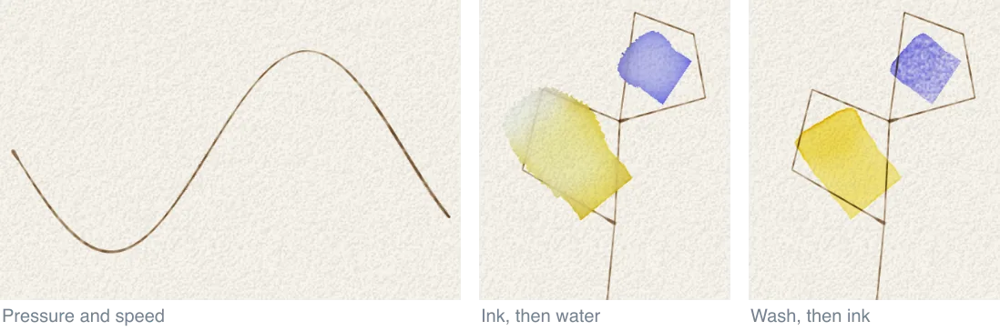
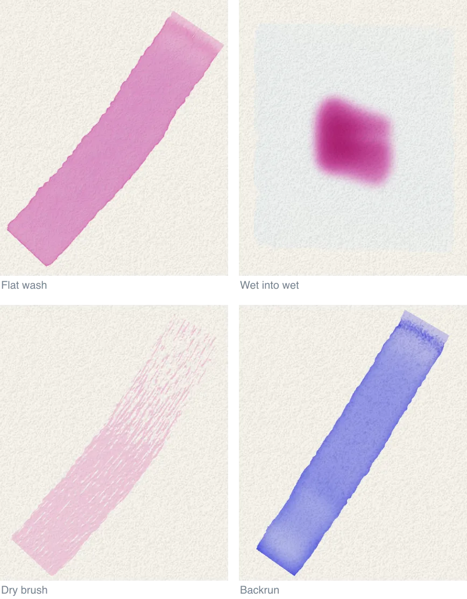
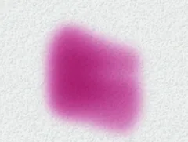
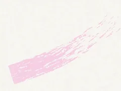
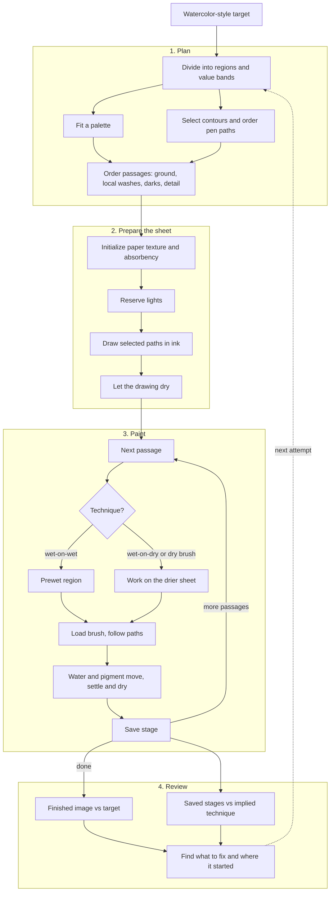

# How it paints

The painter starts with blank paper. It draws in ink, lets the drawing dry, then builds the painting from light to dark in washes, layers of diluted paint. The painter saves the sheet as it goes, so you can stop or rewind anywhere between blank paper and the finished painting.

The [README diagram](../README.md#how-does-it-work) shows the whole loop on one screen.

## 1. Paper

Each cell, a square of the simulation grid, holds five things:

- water standing on the surface
- water soaked into the pores
- pigment floating in the surface water
- pigment settled on the surface but not yet fixed
- pigment carried into the pores

The paper has fibers, tooth (surface texture) and, for cold-press paper, raised bumps 0.5 to 2 mm across. A dry brush catches the raised parts and skips the hollows. A wetter brush fills the hollows and bridges them.

Left, a real wash on moderately textured paper (Winslow Homer, 1899). Middle and right, a flat wash and a graded wash on the default paper. All three are at 0.08 mm a pixel. The real paper's tooth shows clearly through the wash, and the simulated tooth only faintly.

Water keeps moving after the brush has gone. It spreads across the surface, soaks into the pores and evaporates fastest at the edge of a wash. Water flowing out to that edge carries pigment, so the edge dries darker. Settling pigment collects in the hollows and gives granulation, a mottled texture. The brush path sets where paint starts, and the water sets where the dried mark ends.

By default the sheet fits the target inside a 6 x 4 in postcard turned to match it. Its width depends on the target's proportions. `--sheetmm` sets the physical width, for example `--sheetmm 152.4`. `--width` sets how many cells span it. A larger export of the same sheet adds no detail. A wider sheet at the same cell count makes each cell coarser, and the cold-press tooth with it.

Code: `src/media/paper.mjs` builds the surface and `src/media/sheet.mjs` moves the water and pigment. [Pigments and paper](pigments-and-paper.md) has the details.

## 2. Ink

The ink goes down first as a drawing and dries before the washes. Default sepia ink can rewet and lift under them; black ink resists lifting better. The default recipe, a preset of painter settings, also adds closing ink accents.

The pen is a dip pen with a finite load of walnut ink. Four things change its line:

- Speed. The paper draws ink out at a steady rate, so a slow line is wide and dark and a fast one is thin.
- Pressure. Pressing harder spreads the tines, the two halves of the nib (the pen's metal tip), and widens the contact.
- Load. A fresh dip leaves a wide first mark. As the nib empties, the line thins, then skips across the high fibers, then needs another dip.
- Paper. On dry paper the edge is slightly ragged. On damp paper the ink wicks along the fibers and feathers.

The default, `--outlinemedium auto`, draws in ink when the source shows at least 0.5% line and in graphite below that. `--outlinemedium graphite` forces the lighter pencil drawing. Code: `src/media/pen.mjs` and `src/paint/methods/pencil-line.mjs`. The command line does not use the separate `src/media/pencil.mjs` API, which models wear, dust and movable graphite. [Ink](ink.md) covers how the lines are chosen and the other drawing orders.

## 3. Paint

Watercolor is transparent. Light passes through each layer of pigment, reflects off the paper and comes back, so the paper is part of every color. A light wash cannot cover a dark one. Lights have to be reserved, painted pale, or lifted while the paint still allows it.

The effects below all come from the same paper and brush model. Only the water load, the paper state and the drying schedule change.

The paper state under the brush matters as much as the brush. Paint into a wet passage, a wash or group of marks with one job, and the colors merge into one soft mass. Paint on dry paper and the mark keeps its edge.

| Wet into wet | Dry brush | Dry between strokes, then flooded |
|---|---|---|
|  |  |  |

A dried wash becomes its own layer. A glaze is a transparent wash over dried paint. The layers mix optically, so they look different from the same two paints stirred together.

Code: `src/media/brush.mjs` (bristles and load), `src/media/wash.mjs` (wash paths and softening) and `src/media/km.mjs` (Kubelka-Munk, a model of pigment absorption and scattering). [Techniques](techniques/README.md) lists each effect and its code.

## 4. The pipeline

A painting runs in four stages. Each stage hands a record to the next. The saved frames show whether the process looked like painting at every step.

The same run.

### Plan

The planner reads the target, which should already be a watercolor or ink-and-wash picture. It divides the picture into regions and value bands (value is how light or dark a color is). It fits a palette from the 16 paints in the box and selects the contours worth drawing. It then orders the passages: a background wash, local washes, deeper values, and detail. Each passage gets a region, a mixture, brush paths and a technique.

A [stroke plan](plan-format.md) can supply all of these decisions. The image painter, `tools/paint-plate.mjs`, infers them from the target.

### Prepare the sheet

The painter lays fresh paper, reserves the lights that must stay white, and draws the selected paths in ink. Then it dries the drawing.

### Paint

For each passage, the painter sets the paper state the technique needs. Wet into wet prewets the region with clean water. Wet on dry and dry brush wait for a drier sheet. The painter loads the brush, follows the planned paths, and lets water and pigment move, settle and dry. Then it saves a frame and takes the next passage.

While painting, the [guard](honesty.md) blocks reads of the target's pixels. The painter works from its plan and the sheet.

### Review

Five saved stages of the same run.

Review has two halves. The finished painting is compared with the target for form, values, lights and edges. The saved stages are checked for process: was the drawing in place first, did big shapes arrive before detail, did the darks come late? `frames.json` names each saved stage, and the stroke records show what the brush did. [Judging](judging.md) covers the measures and the stage checks.

| Stage | Main code | Writes |
|---|---|---|
| Plan | `src/crop/` (regions, palette, contours), `src/paint/` ([methods, techniques and tuned settings](techniques.md)) | `plan.jpg` |
| Prepare | `src/media/paper.mjs`, `src/media/pen.mjs`, `src/paint/methods/pencil-line.mjs` | `ink.jpg`, opening frames |
| Paint | `src/media/brush.mjs`, `src/media/sheet.mjs`, `src/media/km.mjs` | `painting.png`, `wash.jpg`, frames, animation |
| Review | `src/eval/`, `tools/judge/`, `tools/guard/` | `target-guard.json`, `cheat-risk.json` |

## Limits

- The material model is not calibrated against a real sheet of paper.
- Automatic plans can leave stencilled edges along value boundaries. The whole-painting plans behind the Trumbull and Luce examples are not bundled.
- CPU and GPU runs are each repeatable, but they differ from each other.

Larger interactive figures are in [Part 1 of the essay](https://samjackson.org/writing/whats-a-painting-anyway-part-1/#suffering-xl-pipeline). Commands are in [Running the painter](running.md). Image rights are in [NOTICE](../NOTICE).
