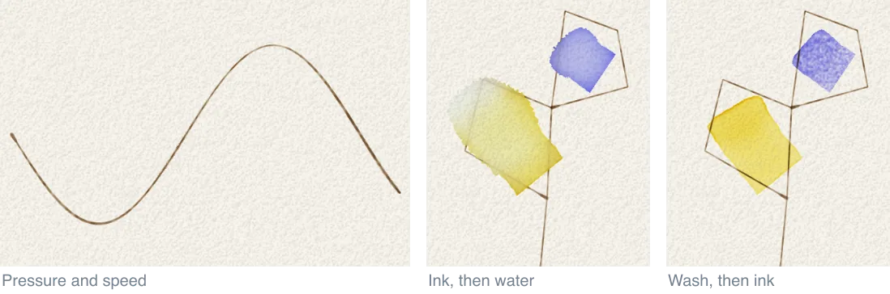

# How it paints

Auto works out its washes from flat colour studies and can start with a prepared line drawing. A model can start with bare paper and write its own [painting script](painting-script.md). Both use the same brush, water and paper. WebGPU runs the sheet on Metal on Apple Silicon or Vulkan on NVIDIA.

## From a script to a painting

The painter lays one passage at a time. A passage is one wash or one group of marks.

### The paper

The sheet is a grid of small squares called cells. Each cell keeps track of the water on its surface, the water inside the paper's pores, and the pigment. Pigment can be floating in the water, settled on the paper or soaked into the pores (`src/media/sheet.mjs`).

The paper has a height map of curved fibres and fine grain, based on real cold-press paper (`src/media/paper.mjs`, `src/media/paper-relief.mjs`). The gaps between its fibres set the pressure needed for water to enter each cell (`src/media/fibre-throat.mjs`). It is also sized, which means dry paper resists water. So a stroke on dry paper stays where the brush went.

### The brush and its water

A brush is a row of bristles with a reservoir of paint and water in its belly (`src/media/brush.mjs`). Bristles stick together in clumps. Water and pigment are tracked separately. More pressure puts more of the brush on the paper. Paint passes from a bristle to a cell only when the liquid on the bristle reaches down to the paper's grain there.

A brush full of water lays a smooth film. A nearly dry brush catches only the high points of the grain and leaves broken colour. This is dry brush. Brush sizes are in `src/paint/brushes.json`.

Pressure brings the bristles onto the crests; liquid bridges more hollows as the tuft fills (`src/media/tuft-section.mjs`). Dry paper can pull paint from damp bristles even below their free-water threshold. A dip restores a finite supply at the requested concentration, with a small, smooth gradient across the tips (`src/media/brush-load-variance.mjs`). Once the bristles clear the line where a stroke began, or reverse direction, that line stops clipping the brush. A sweep can double back on itself without cutting a gap in the return stroke (`src/media/brush.mjs`).

### How a wash is laid

A wash is laid as parallel lanes (`src/paint/methods/sweep-fill.mjs`, `src/paint/methods/script-marks.mjs`). The brush sweeps across the shape, then comes back along the next lane. Each lane overlaps the one before it. Auto overlaps by 30% of the brush width. A model's script gets 30 to 55%.

A hand is never perfectly even, so each lane has a small tilt and bow, and the brush is recharged after a few lanes. The overlap lets the wet bead at the edge of one lane flow into the next. The wash then dries as one even layer, not as separate stripes.

### Wet and damp paper

How wet the paper is when the brush touches it changes the result.

- On dry paper, the paint keeps its shape and dries with a hard edge.
- On wet paper, the paint spreads and mixes with what is already there. This is wet into wet.
- On damp paper, the paint spreads a little. Damp paper is used to make an edge soft.

For wet into wet, the painter first lays clean water over the area with a clean brush. Then it checks that the paper is moist enough before it adds paint (`tools/painter/wet-bed-prep.mjs`). A script can also set `into`, which lays a passage into the one just before it while that one is still wet.

### Drying

Between passages the painter waits for the sheet to dry, unless the script says otherwise (`src/paint/methods/wetdry.mjs`). Drying is not a timer. The simulator measures the water on the surface and in the pores. It waits until the paper is dry enough, or wet enough, for the next passage.

Water evaporates faster at a wash edge. Water flowing out to replace it carries pigment, so the edge dries darker. Drop clean water into a damp wash and it pushes pigment ahead of it. Where it stops, the paint leaves a rim around a pale bloom. The advancing water follows the gaps between paper fibres (`src/media/backrun.mjs`).

A deep puddle flows more readily than a thin film. Once the surface loses its shine, water held in the paper can still wick through the pores (`src/media/film-mobility.mjs`). Fast drying takes longer steps as the film recedes. The GPU finishes moving water and pigment before it tests whether the sheet is dry enough for the next pass.

### Glazes

When a wash dries, it is fixed as its own layer. The next wash is laid over it as a glaze. The layers are combined with a simple optical model, so a thin blue over yellow looks different from blue and yellow mixed in the dish ([pigments and paper](pigments-and-paper.md)). New water lifts only a little of a dried layer. Staining paints lift less.

### Edges

A wash laid on dry paper has a hard edge on every side. Painters soften an edge by running a clean, damp brush along it while the wash is still wet. The painter does this too (`src/paint/techniques/soften-lift.mjs`). A script can ask for soft edges with `edges: lost`, or for hard ones with `found`. A script can also leave bare paper, called a light, by listing it in `lights`. The painter works round the light and never paints across it. Auto can mask selected highlights and rub off the masking fluid at the end. An authored script gets no mask from the source pixels. It must reserve its lights or leave the paper alone.

### Granulation

Ultramarine, cerulean and earth colours settle into the hollows of cold-press paper as a wash dries. A wet wash gives the grains time to gather. As the film recedes, loose grains move down the slopes. Water held in the fibres can no longer carry them. Staining colours such as phthalo blue dry smoother (`src/media/grain-water.mjs`).

### Pen and pencil

A pencil drawing does not move when it gets wet. A pen drawing is ink from a dip pen. Pressure and speed change its width and darkness, and it runs low as the nib empties (`src/media/pen.mjs`). The pen's ink is either waterproof or soluble. Soluble ink can be moved by a wash laid over it. The pen and pencil are covered in [ink](ink.md).

### What the video records

The painter saves a frame of the sheet at set points as it works, such as the end of each pass and when the paper has dried. With `--video 1` it keeps all of them and makes an MP4 (`tools/speed/frame-policy.mjs`). `frames.json` says which stage each frame belongs to. A frame never loses paint unless paint was taken off on purpose (`src/paint/film-painted.mjs`).

With a resident GPU and ordinary paper optics, fast-mode frames use two readback buffers to send RGB snapshots to a background worker (`src/media/gpu/optical-framer.mjs`). The worker composes separate-resolution ink using its capture-time material state and writes lossless WebP with the fastest compression search. Native recording uses lossless PNG at compression level one. The painter keeps at most six handed frames pending. Captures retain their original stage and mark counts, and leave queued drying enabled. Full operation recording, wet darkening and special paper optics retain their existing observation path.

### What it does not do yet

- Lifting paint back off dried paper is weak. New water lifts only a little. A blotting step exists in `src/media/sheet.mjs`, but no painting step uses it.
- Erasing works on pencil only.
- A passage cannot be soft on one side and hard on the other.
- A script cannot return to an earlier wash while it is still wet. Only the passage just before can be wet.

## Rules at every stage

- There are two modes, and their results are never compared or averaged. By default the painter looks at the subject once for each passage, at the scale of a shape. In strict mode (`--notargetlooks 1`) it never reads the target after planning.
- Nothing may be tuned to one picture. That bans a gain that hides an engine error, a constant fitted to one subject and anything tuned to raise a score. `npm test` fails on code that names a benchmark picture or a file called `tuned`, `fitted` or `per-subject` (`tools/guard/subject-scan.mjs`, `src/paint/overfit.test.mjs`).
- Looking and correcting at the scale of a brush or a shape is painting. Working pixel by pixel is copying. So is using so many strokes that they stop looking like brushwork. Hill climbing is copying too.
- Auto takes its lines from the drawing file and its washes from the studies. A model supplies its own passages and can draw its own lines.
- Fail loudly. The run stops if a Python environment, SAM checkpoint, line file, study or GPU is missing. `npm run doctor` checks them (`tools/doctor.mjs`, `src/paint/doctor.mjs`). The run also stops, with the reason, if it is given an option that has been removed (`src/paint/removed-options.mjs`).

## Code stages

`tools/paint-plate.mjs` runs seven stages from `tools/plate/`. They share one `ctx` object and run in the order set by `tools/plate/load-order.mjs`. `src/paint/recipe.mjs` puts the default flags first on the command line. `--recipe none` turns that off.

| Stage | File | Does |
|---|---|---|
| 1 | `tools/plate/setup.mjs` | options, source image, target guard, source of the lines |
| 2 | `tools/plate/plan.mjs` | paints, drawing medium, wash plan from the studies |
| 3 | `tools/plate/sheet.mjs` | brushes, sheet, looks at shapes, marks, scrap swatches |
| 4 | `tools/plate/pen.mjs` | video frames, pen drawing plan |
| 5 | `tools/plate/drawing.mjs` | order of work, drawing steps |
| 6 | `tools/plate/paint.mjs` | paint loop |
| 7 | `tools/plate/finish.mjs` | masking removed, pencil rubbed out, closing pen, output files |

A choice about the painting belongs in the plan. A technique belongs in `src/paint/techniques/` or `src/paint/methods/`. The physics belongs in `src/media/`.

## 1. Planning

An image model draws a clean line drawing. `tools/seg/trace-drawing.py` traces it and `tools/seg/order-strokes.mjs` puts the lines in order. The result is `--drawingfile STEM` ([line files](plan-format.md#line-files)). Another image model simplifies the picture into flat studies (`--washplan STUDY.png[:MIN[:glaze]],...`). A model's [painting script](painting-script.md) can replace the plan from the studies (`--washplan script:FILE.json`). `--valueplan` sets the sheet, the drawing steps, the paints and the order (`src/paint/pipeline-plan.mjs`). Stroke plans run with `node tools/run-plan.mjs` ([plan format](plan-format.md)). The skills for agents are `.agents/skills/painting-planner/SKILL.md`, `.agents/skills/watercolor-technique/SKILL.md`.

## 2. Finding regions

Before painting, `src/crop/segment-prep.mjs` runs `tools/seg/segments.py` on the target to find its regions. The result is cached by the picture's SHA-256 hash. The run fails without SAM and its checkpoint.

## 3. Shapes from the studies

`src/paint/methods/study-washes.mjs` builds the wash plan from the studies without reading the picture. It scales each study to the sheet. The run stops if the shapes differ by more than 2%. It groups the study's colours. Each connected patch becomes a shape. Thin slivers join a neighbour. Near-white stays bare paper. The lightest and largest shapes go first, then darker shapes over dry washes, and the darkest accents last. A soft named part such as a face, fur, sky or water starts with one pale wash into clean water. Each later study adds only what is darker than the layers above it. The paints come from `src/crop/palette.mjs`, or from `--paints`.

## 4. Technique for each shape

| Technique | Code |
|---|---|
| Flat wash, wet on dry | `src/media/wash.mjs` |
| Wet on wet: clean water first, then pigment | `tools/painter/wet-bed-prep.mjs` |
| Glaze over dried, fixed paint; masking fluid (lifting and blotting are weak or unused) | `src/media/sheet.mjs` |
| Dry brush | `src/media/brush.mjs` |
| Softened edge | `src/paint/techniques/soften-lift.mjs` |
| Shaped marks | `src/paint/techniques/shaped-marks.mjs` |

The painter tests each planned instrument on scrap of the same paper. It prepares lane, mark and damp-wash swatches before painting, using up to eight CPU workers, and caches their exact readings by material inputs and simulator code (`tools/painter/calibration-swatches.mjs`, `tools/painter/calibration-pool.mjs`). Readings are applied in passage order, including the existing first-mark rule for rounded calibration keys. The swatches never read the painting or the target.

## 5. Brush and strokes

Brushes: `src/media/brush.mjs`, with physical sizes in `src/paint/brushes.json`. Paths: `src/paint/methods/sweep-fill.mjs`, `wash-strokes.mjs`. A script's washes (`script-marks.mjs`) are laid in lanes. The lanes overlap by 30 to 55% of the brush width. They pivot and bow like a wrist and arm.

## 6. Wet physics and drying

The sheet is a grid of cells. Each cell tracks the water on the surface, the water in the paper's pores, and the pigment that is floating, settled or in the pores ([pigments and paper](pigments-and-paper.md)). Code: `src/media/sheet.mjs` (`sheet-kernel.mjs` on the CPU, `src/media/gpu/stepfull.wgsl` on the GPU) and `src/paint/methods/wetdry.mjs`. `--strict 1` stops the run if the physics breaks a rule. Otherwise `continued-checks.json` records it.

Before the brush lands, the painter checks the cells under the tuft and the paper around it. When a CPU brush paints on a GPU sheet, it reads the newly exposed cells and sends back the rows it changed (`src/media/gpu/cpu-demand-window.mjs`, `src/media/gpu/rect-transfer.mjs`, `src/media/cpu-stroke-dirty.mjs`).

The fine drawing adds ink or graphite to the affected cells. The GPU keeps the water and dried layers on the sheet during that transfer (`src/media/gpu/pigment-cells.mjs`).

## 7. Looking at the picture

In the default mode, each passage reads the target once as it is laid. It reads only the shape's average, and the paint is adjusted by how much darker the shape still needs to be (`src/paint/methods/shape-deficit.mjs`). In strict mode the paint is fixed during planning. `src/paint/step-backs.mjs` and `src/paint/painting-look.mjs` decide when a look is allowed. The target guard seals the target and its maps when painting starts (`tools/guard/no-target.mjs`, `tools/guard/seal-maps.mjs`; [honesty](honesty.md)).

## 8. Lines

A pen drawing goes down first and dries before the washes. A pencil drawing goes down in phases (`src/paint/methods/drawing-phases.mjs`). The first light lines go down before the first washes. Each other line goes on dry paper just before the wash that needs it. A model's script may time the lines itself. Auto takes lines from the drawing file (`src/paint/line-source.mjs`) and reads their darkness from the target. A model can place its own pen or pencil lines with `lines.own` ([ink](ink.md)). The pen and pencil code is in `src/paint/methods/` (`drawing-*.mjs`, `ink-*.mjs`, `pencil-*.mjs`, `medium-decision.mjs`).

## 9. Finish

After all the washes are dry, `tools/plate/finish.mjs` removes masking fluid, rubs out any pencil that is not kept, and draws the closing pen lines. It writes `painting.png`, `wash.jpg`, `ink.jpg`, `frames.json`, the stage frames, `run-card.json`, `target-guard.json`, `cheat-risk.json`, `marks.json` and `pipeline-plan.json`.

At a finer export size, the renderer reconstructs wash edges and the grain inside each cell. It preserves the amount of deposited pigment in each layer, including small marks that fall between output pixel centres (`src/media/subcell-grain.mjs`). The paper texture comes from the sheet’s own grain field (`src/media/gaussian-field.mjs`).

## 10. Judging

Scores never feed back to the painter: [honesty](honesty.md) for the guard, [judging](judging.md) for measurements, [scoring](../bench/docs/scoring.md) for the benchmark.
