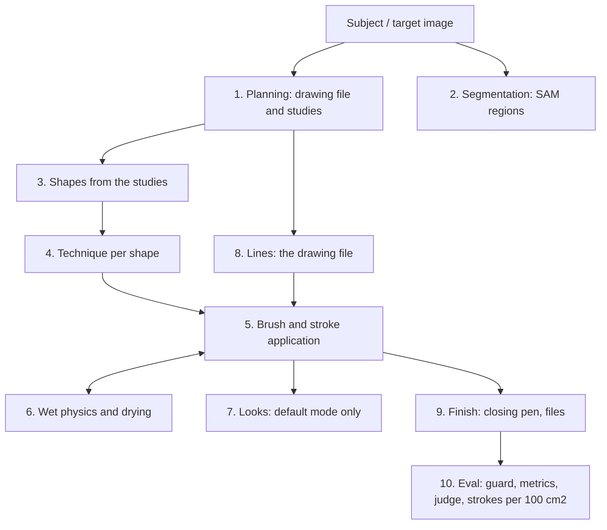

# How it paints

This is the pipeline contract for painter 0.4 (`package.json`). It follows one picture from subject to finished plate and says, for each stage, which files do the work, what goes in and out, which flags control it, and where a choice belongs. A pipeline change merges only together with its update to this page.

A painting takes three inputs: the target image, a drawing file and one or more block-in studies. The painter lays the drawing, lets it dry, then lays the washes the studies describe, light to dark. It saves the sheet as it goes, so you can stop or rewind anywhere between blank paper and the finished painting.

The [README diagram](../README.md#how-it-works) shows the whole loop. The paintings and swatches on this page were made with release 0.1.0 (painter V096, sim 100).

## Rules that apply at every stage

- **Two modes, both kept.** Default: the painter looks at the subject while painting, once a passage, at shape scale. Strict (`--notargetlooks 1`): no target reads after planning. Every score names its mode, and scores from the two modes are never compared or averaged.
- **No gains, no subject-fitted values.** A model-settable gain or calibration that covers an engine error, a constant fitted to one subject, or anything tuned to raise a score is banned in both modes. Every rule is stated in painter or physical terms and is the same for every subject. `tools/guard/subject-scan.mjs` (`src/paint/overfit-scan.test.mjs`) fails `npm test` if any JavaScript or Python file under `src/` or `tools/` names a benchmark subject outside reviewed allowlists, and `src/paint/overfit.test.mjs` fails on any file or folder named `tuned`, `fitted` or `per-subject`.
- **Copying test.** Looking, colour checks, corrections and line drawing are art at brush and shape scale. Pixel by pixel, or with so many strokes that marks stop reading as brushwork, they are copying. Hill climbing (look, correct, look again until it converges) is copying too.
- **Strokes per 100 cm²** is reported with every score.
- **The plan's inputs are the drawing file and the studies.** The painter never extracts line from the subject and never plans washes from it.
- **Fail loudly.** A missing Python environment, SAM checkpoint, line file, study or GPU stops the run. `npm run doctor` (`tools/doctor.mjs`, `src/paint/doctor.mjs`) checks them before any benchmark run. An option removed in 0.4 stops the run with its reason (`src/paint/removed-options.mjs`).
- **New logic goes in small modules** under `src/` or `tools/` with unit tests, not into `tools/paint-plate.mjs` or `tools/plate/`.

## Default recipe

The default recipe (`src/paint/recipe.mjs`) puts these flags in front of the command line (`--recipe none` turns it off; `default`, `general` and `combined` are identical):

- `--physical 1`: physical brush sizes, water and loads (`src/paint/brushes.json`).
- `--palettewide 1`: palette paints chosen per area of the picture.
- `--paperbase source`, `--paperrgb auto`: paper colour from the target's sheet.
- `--paper coldpress`, `--paperphysical 1`: cold-press tooth, fibre and relief in millimetres.
- `--loadedcontact 1`: a loaded brush touches the paper's pits.
- `--drawing first`: the drawing goes down before the washes.
- `--frames 8`, `--marks 1`: about 8 recorded wash frames and every stroke in `marks.json`.
- `--shapedmarks 1`: shaped plane marks (`src/paint/techniques/shaped-marks.mjs`).

## The stages at a glance

`tools/paint-plate.mjs` runs seven code stages in order, all in `tools/plate/`, sharing one `ctx` object:

| Code stage | File | Pipeline stages |
|---|---|---|
| 1 | `tools/plate/setup.mjs` | options, source image, target guard, line source (1, 2) |
| 2 | `tools/plate/plan.mjs` | palette, medium, study wash plan (3, 4) |
| 3 | `tools/plate/sheet.mjs` | brushes, sheet, looks, marks, scrap swatches (5, 6, 7) |
| 4 | `tools/plate/pen.mjs` | film frames, pen drawing plan (8) |
| 5 | `tools/plate/drawing.mjs` | order of work, drawing passes (8) |
| 6 | `tools/plate/paint.mjs` | paint loop (5, 6, 7) |
| 7 | `tools/plate/finish.mjs` | lifting, closing pen, output files (9) |

`tools/plate/load-order.mjs` fixes the import order; `tools/plate/source.mjs` gives tests the stage source text.

Choices belong in one of four homes:

- **plan**: the drawing file, studies and planner options decided before painting.
- **technique library**: a named technique in `src/paint/techniques/` or `src/paint/methods/`.
- **painter rule**: a universal rule in painter terms (for example, waiting for the shine to go off).
- **physics**: the sheet model (`src/media/`).

## 1. Planning

The planner prepares the inputs before the first mark: a drawing file, studies, paints and the sheet.

- **Drawing**: an image model draws a clean line drawing of the subject; `tools/seg/trace-drawing.py` traces it and `tools/seg/order-strokes.mjs` orders the strokes (`tools/seg/pencil-hand.mjs` for pencil), producing `--drawingfile STEM` ([line files](plan-format.md#line-files)).
- **Studies**: an image model simplifies the subject into flat shapes of clean colour, lights left as paper (`--washplan STUDY.png[:MIN[:glaze]],...`).
- **Skills**: `.agents/skills/painting-planner/SKILL.md` and `.agents/skills/watercolor-technique/SKILL.md`.
- **Stroke plans**: ordered brush paths, loads and drying commands run with `node tools/run-plan.mjs <file>` ([plan-format.md](plan-format.md)).
- **Value plan file**: `--valueplan` can set the sheet, drawing stages, paints and order (`src/paint/pipeline-plan.mjs`, written to `pipeline-plan.json`). Unused keys are reported (`src/paint/plan-keys.mjs`, exit 3).
- **Record**: `src/paint/run-methods.mjs` writes the line source, line file and studies to the log and `run-card.json` (`src/paint/run-card.mjs`).

**Controls:** `--drawingfile`, `--washplan`, `--paints`, `--sheetmm`, `--seed`, `--valueplan`.

## 2. Segmentation

- `src/crop/segment-prep.mjs` runs `tools/seg/segments.py` (`tools/seg/sam_regions.py`) on the target before painting, cached by target SHA-256 (`--segcache`). Without SAM and its checkpoint the run fails (`--segments off` is for tests). `src/crop/segments.mjs` reads the regions.
- `PAINTER_SEG_DEVICE=mps|cpu|cuda` selects the device (default `mps`, then `cuda`, then `cpu`), logged to `segments.json` and `run-card.json`.

**Controls:** `--segments`, `--segcache`, `PAINTER_SEG_DEVICE`.

## 3. Shapes from the studies

`src/paint/methods/study-washes.mjs` builds the wash plan from the studies without reading the subject.

- **Registration**: `tools/painter/study-load.mjs` scales each study to the sheet (a > 2% aspect mismatch stops the run).
- **Shapes**: each study's colours are clustered; connected components become shapes (`src/paint/methods/study-shapes.mjs`, `src/paint/methods/puddles.mjs`); slivers join a neighbour; near-white shapes stay bare paper.
- **Order**: lightest and largest first, darker shapes over dry washes, darkest accents last. A soft named form (face, fur, sky, water) starts with one pale base wash into clean water (`src/paint/methods/form-base.mjs`, `@formbase`), except on line-led pen-and-wash works.
- **Layers**: each later study adds only what is darker or stronger than earlier layers above its `MIN` size floor. A `glaze` layer lays a few connected dark glazes.
- **Palette**: `src/crop/palette.mjs`, `src/crop/palettewide.mjs`, `src/crop/pigments.mjs` (`src/crop/box.mjs`), or `--paints`.

**Controls:** `--washplan`, `--paints`.

## 4. Technique per shape

The study plan chooses each shape's brush, paper moisture, wet-in-wet colour charges and drying waits.

| Technique | What it does | Code |
|---|---|---|
| Flat wash, wet on dry | Parallel overlapping sweeps across dry paper; dries with a hard edge | `TECHNIQUES['wet on dry']`, `src/media/wash.mjs`, `src/paint/methods/sweep-fill.mjs` |
| First wash | Fuller mop load so the first pale wash reaches the bottom of the paper tooth | `TECHNIQUES['first wash']` |
| Wet on wet | Clean water laid first (`"role": "clean-water"`), then pigment charged in for soft edges | `TECHNIQUES['wet on wet']`, `tools/painter/wet-bed-prep.mjs`, `wet-bed-wait.mjs` |
| Graded wash | Brush reloaded along a sweep from dark to light | `--gradedwash`, `gradientSweepAngle` in `src/media/wash.mjs` |
| Glaze | Transparent wash over dried, fixed paint (`"operation": "dry"`) | `TECHNIQUES.glazed`, `dry` and `fix` in `src/media/sheet.mjs` |
| Dry brush | Low water load (~20%) dragged across the paper tooth, leaving broken marks | `TECHNIQUES['dry brush']`, `src/media/brush.mjs` |
| Softened edge | Clean damp brush drawn along a wet wash edge | `src/paint/techniques/soften-lift.mjs`, `tools/painter/soften-lift-run.mjs` |
| Masking, lifting, blotting | Protect paper with resist, lift wet pigment with a thirsty brush, or blot standing water | `applyResist`, `liftResist`, `blot` in `src/media/sheet.mjs`; `thirsty` in `src/media/brush.mjs` |

Move names (`wet on wet`, `wet on dry`, `dry brush`, `glaze`) are normalized in `src/paint/techniques/passage-plan.mjs`. Before laying a passage, the painter tests the loaded brush on a scrap of the same paper and calibrates the charge from what the scrap held (`src/paint/methods/scrap-swatch.mjs`, `src/paint/methods/instrument-cal.mjs`).

## 5. Brush and stroke application

The painter dips a brush, tests it on scrap, lays a stroke along a path and reloads when depleted. A light brush touches only the peaks of the paper tooth (`src/media/paper.mjs`); pressure sets how many bristles touch and how deep they reach (`src/paint/methods/brushes.mjs`).

- **Brushes**: `src/media/brush.mjs`, `src/paint/brushes.json`, `src/paint/methods/brushes.mjs` (`--physical 1`).
- **Paths**: `src/paint/methods/sweep-fill.mjs`, `src/paint/methods/wash-strokes.mjs`, `src/media/wash.mjs`, `src/paint/methods/lay.mjs`, `src/paint/methods/mop-lanes.mjs`.
- **Script washes** (`src/paint/methods/script-marks.mjs`): lanes overlap by 30–55% of the brush width, pivot and bow like a wrist and arm (`--handlanes 1`, `--seed`), and turn along narrow bands rather than dashing across them.
- **Loop and optics**: `tools/plate/paint.mjs`, `src/paint/stroke-ledger.mjs` (`--marks 1`), and Kubelka-Munk layering in `src/media/km.mjs`.

**Controls:** `--physical`, `--marks`, `--handlanes`, `--seed`.

## 6. Wet physics and drying

Each cell tracks standing water, pore water, floating pigment, settled pigment and pore pigment. Water spreads, soaks in and evaporates fastest at a pinned wash edge, leaving darker rims. Settling pigment collects in hollows according to each paint's granulation and flocculation ratings ([pigments and paper](pigments-and-paper.md)).

| Wet into wet | Dry brush | Dry between strokes, then flooded |
|---|---|---|
|  |  |  |

A dried wash fixes as its own layer; transparent glazes over it mix optically:

- **Paper and solver**: `src/media/paper.mjs`, `src/media/paper-relief.mjs`, `src/media/sheet.mjs` (`src/media/sheet-kernel.mjs` on CPU; `src/media/gpu/stepfull.mjs` and `stepfull.wgsl` on GPU).
- **Timing and checks**: `src/paint/methods/wetdry.mjs`, `src/paint/methods/wash-session.mjs`, and `src/media/checks.mjs` (`--strict 1` stops on physics check violations; otherwise `continued-checks.json` records them).

**Controls:** `--paper`, `--paperphysical`, `--physics key=value`, `--strict`.

## 7. Looks

A look is the painter comparing whole shapes with the subject during painting:

| | Default | Strict (`--notargetlooks 1`) |
|---|---|---|
| Target reads after planning | Each passage once as it is laid, as its shape mean | None |
| Passage charge | Adjusted by the shape's deficit (`src/paint/methods/shape-deficit.mjs`, `--feedback`) | Frozen at planning |

`src/paint/step-backs.mjs` and `src/paint/painting-look.mjs` gate painting-time looks and write `step-backs.json`. The target guard (`tools/guard/no-target.mjs`, `tools/guard/seal-maps.mjs`) seals per-cell target maps when painting starts and writes `target-guard.json` ([honesty.md](honesty.md)).

**Controls:** `--notargetlooks`, `--targetguard`, `--lookbudget`, `--feedback`.

## 8. Lines

A pen drawing goes down first and dries before the washes. A pencil drawing goes down in phases with the washes (`src/paint/methods/drawing-phases.mjs`): lay-in lines before the first washes, each other line on dry paper just before the wash that needs it, and unclaimed detail with the last stage. An author script may also time lines explicitly (`before`, `stage N`, `after`).

- **Line source**: `--drawingfile` (`src/paint/line-source.mjs`, `src/paint/methods/drawing-registration.mjs`, `src/paint/methods/ink-lines-file.mjs`). Only target line darkness is read before painting (`--inkdarkmatch`, `--inkdarkcap`, `--inkwidthfloor`; `src/paint/methods/ink-match.mjs`, `src/paint/methods/ink-scrap.mjs`).
- **Film**: with `--video 1`, strokes are filmed big forms first (`--drawingorder forms`, `src/paint/methods/drawing-film.mjs`, `--drawingfilm 0.2`).
- **Hand and fine sheet**: `src/paint/methods/drawing-file.mjs`, `drawing-hand.mjs`, `stroke-order.mjs`, `pencil-hand.mjs`, `pencil-line.mjs`, `ink-res.mjs`, `fine-erase.mjs`.
- **Medium and stages**: `--outlinemedium graphite|ink|auto`, `--inkrecipe wash|v2`, `--stages prep,prepink,finishink` (`src/paint/methods/medium-decision.mjs`, `outline-medium.mjs`, `drawing-stages.mjs`, [ink.md](ink.md)).

**Controls:** `--drawingfile`, `--drawinglast`, `--drawing first|last|both|none`, `--outlinemedium`, `--inkrecipe`, `--stages`.

## 9. Finish

`tools/plate/finish.mjs` runs lifting, the closing pen (after all washes and the final dry gate) and writes `painting.png`, `wash.jpg`, `ink.jpg`, `frames.json`, stage frames (`src/paint/film-timeline.mjs`), `run-card.json`, `target-guard.json`, `cheat-risk.json`, `marks.json`, census data (`tools/speed/census-write.mjs`) and `pipeline-plan.json`.

## 10. Eval

Eval scores a finished painting and its saved stages without feeding back into the painter:

- **Guard and copy risk**: `tools/guard/cheat-risk.mjs`, `tools/guard/promote-check.mjs`, `tools/guard/lint-target-use.mjs` ([honesty.md](honesty.md)).
- **Metrics and judges**: `src/eval/` and `tools/judge/` ([judging.md](judging.md)).
- **Strokes**: `src/paint/stroke-ledger.mjs`, `tools/stroke-gate.mjs`, `tools/stroke-stats.mjs` ([judging.md#stroke-sizes](judging.md#stroke-sizes)), and `bench/scripts/copy-limits.mjs` (strokes per 100 cm²).
- **Benchmark scoring**: [bench/docs/scoring.md](../bench/docs/scoring.md).
- **Execution evidence**: `node tools/designed-paths-check.mjs <run-folder>` checks `bench/designed-paths.json` and exits 4 if required execution evidence is missing.
