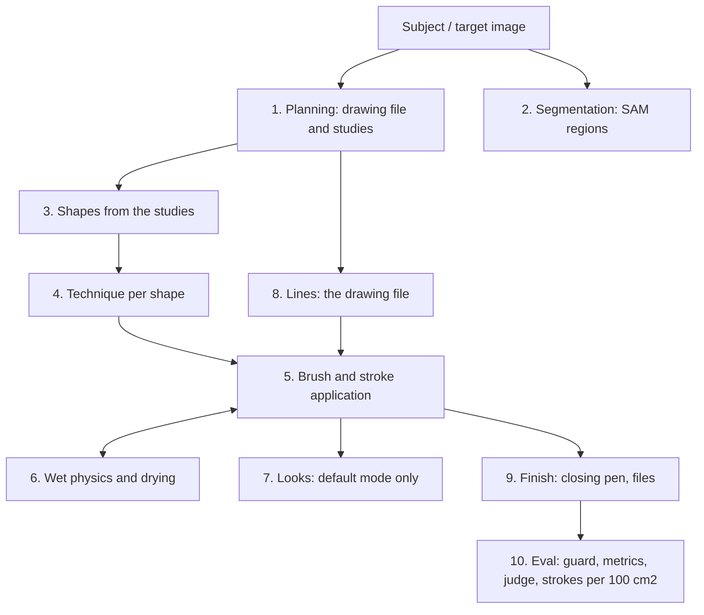
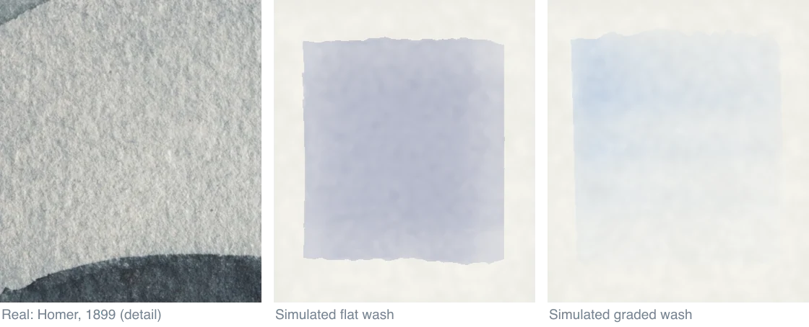
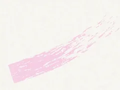
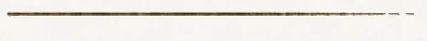

# How it paints

This is the pipeline contract for painter 0.4 (`package.json`). It follows one picture from subject to finished plate and says, for each stage, which files do the work, what goes in and out, which flags control it, and where a choice belongs. Read it before you add a rule, a flag or a mode. A pipeline change merges only together with its update to this page.

A painting takes three inputs: the target image, a drawing file and one or more block-in studies. The painter lays the drawing, lets it dry, then lays the washes the studies describe, light to dark. It saves the sheet as it goes, so you can stop or rewind anywhere between blank paper and the finished painting.

The [README diagram](../README.md#how-does-it-work) shows the whole loop on one screen. The paintings and swatches on this page were made with release 0.1.0 (painter V096, sim 100), before 0.4 changed how the drawing and the washes are planned.

## Rules that apply at every stage

These are the project's looking-and-cheating rules. Each stage section below says where they bite.

- **Two modes, both kept.** Default: the painter looks at the subject while painting, once a passage, at shape scale. Strict (`--notargetlooks 1`): no target reads after planning. Never delete, rename or rebuild either. Every score names its mode, and scores from the two modes are never compared or averaged.
- **No gains, no fitted values.** A model-settable gain or calibration that covers an engine error, a constant fitted to one subject, or anything tuned to raise a score is banned in both modes. A rule is stated in painter or physical terms and is the same for every subject. No subject names or ids in painting code.
- **Copying test.** Looking, colour checks, corrections and line drawing are art at brush and shape scale. Pixel by pixel, or with so many strokes that marks stop reading as brushwork, they are copying. Hill climbing (look, correct, look again until it converges) is copying too.
- **Strokes per 100 cm2** is reported with every score. A count far above a human painting of that size is a cheating flag.
- **The plan's inputs are the drawing file and the studies.** The painter never extracts line from the subject and never plans washes from it. A choice the painter makes is a rule in painter terms, the same for every study.
- **Fail loudly.** A missing Python environment, SAM checkpoint, line file, study or GPU stops the run. `npm run doctor` (`tools/doctor.mjs`, `src/paint/doctor.mjs`) checks them before any benchmark run. An option removed in 0.4 stops the run with its reason (`src/paint/removed-options.mjs`; the list is in [Running the painter](running.md#removed-in-04)).
- **New logic goes in small modules** under `src/` or `tools/` with unit tests, not into `tools/paint-plate.mjs` or the stage files in `tools/plate/`.

## The stages at a glance

`tools/paint-plate.mjs` runs seven code stages in order, all in `tools/plate/`, sharing one `ctx` object:

| Code stage | File | Pipeline stages it holds |
|---|---|---|
| 1 | `tools/plate/setup.mjs` | options, the source image, the target guard, the line source (1, 2) |
| 2 | `tools/plate/plan.mjs` | palette, the medium, the study wash plan (3, 4) |
| 3 | `tools/plate/sheet.mjs` | brushes, the sheet, looks, marks, scrap swatches (5, 6, 7) |
| 4 | `tools/plate/pen.mjs` | film frames, the pen drawing's plan (8) |
| 5 | `tools/plate/drawing.mjs` | order of work, drawing passes (8) |
| 6 | `tools/plate/paint.mjs` | the paint loop (5, 6, 7) |
| 7 | `tools/plate/finish.mjs` | lifting, the closing pen, output files (9) |

`tools/plate/load-order.mjs` fixes the import order; `tools/plate/source.mjs` gives tests the stage source text.

A "where choices live" line names one of four homes:

- **plan**: the drawing file, the studies and the options a planner passes, decided before painting.
- **technique library**: a named technique in `src/paint/techniques/` or `src/paint/methods/`, with no subject names and no numbers taken from a plate.
- **painter rule**: a universal rule in painter terms (for example "wait for the shine to go off").
- **physics**: the sheet model decides it (`src/media/`). Nothing above may patch it.

## 1. Planning

The planner prepares the inputs before the first mark: a drawing file, the studies, the paints and the sheet.

- **The drawing.** An image model draws a clean line drawing of the subject. `tools/seg/trace-drawing.py` traces it and `tools/seg/order-strokes.mjs` orders the strokes as a hand draws, structure first (`tools/seg/pencil-hand.mjs` for pencil). The result is a line file, `--drawingfile STEM` ([line files](plan-format.md#line-files)).
- **The studies.** An image model simplifies the whole subject into a couple of dozen flat shapes of clean colour, lights left as paper. A coarse study makes the first layer; richer ones make later layers. `--washplan STUDY.png[:MIN[:glaze]],...` lists them.
- **Who plans.** The V6 draft (`bench/v6/TASK.md`) has a model call those tools and write `plan.json`; `bench/v6/plan-args.mjs` maps it to painter options. It is not yet run. The model chooses the medium, the ink level, the studies for each layer with their least size and glaze, the paints, and when to stop. The V4 and V5 tasks are retired; tag v0.3.2 replays them.
- **Skills a planner reads.** `.agents/skills/painting-planner/SKILL.md` and `.agents/skills/watercolor-technique/SKILL.md`, installed for Claude Code under `.claude/skills/`.
- **Stroke plans.** Ordered brush paths, loads and drying commands, run with `node tools/run-plan.mjs <file>`. Examples: `examples/plans/graded-wash.json`, `examples/plans/glazes.json`, `examples/plans/drying-dry-between.json`, `examples/plans/drying-too-wet.json`.
- **Recipe and plan file.** A recipe is a preset of painter flags placed before the user's flags (`src/paint/recipe.mjs`). A value plan file (`--valueplan`) can set the sheet, the drawing stages, the paints and the order (`src/paint/pipeline-plan.mjs`, resolved plan written to `pipeline-plan.json`). The painter reports any plan key nothing reads (`src/paint/plan-keys.mjs`) and exits 3 after writing its outputs.
- **The record.** `src/paint/run-methods.mjs` writes the line source, the line file and the studies to the log and the run card.

**Inputs:** target image, drawing file, studies. **Outputs:** `pipeline-plan.json`, `plan.jpg`, `run-card.json` (`src/paint/run-card.mjs`).
**Controls:** `--drawingfile`, `--washplan`, `--paints`, `--sheetmm`, `--seed`, `--valueplan`.
**Where choices live:** plan.
**Rules here:** no subject ids in painting code. A study is the planner's simplification; the painter does not re-read the subject to refine it.
**Teacher's view:** squint until detail goes and make a value study in a few flat shapes. Choose what to leave out.

## 2. Segmentation

- `src/crop/segment-prep.mjs` runs `tools/seg/segments.py` (`tools/seg/sam_regions.py`) on the target before any painting. The map is cached by target SHA-256 and script version (`--segcache`). Without SAM and its checkpoint the run fails; `--segments off` is for tests. `src/crop/segments.mjs` reads the regions.
- **Device.** `PAINTER_SEG_DEVICE=mps|cpu|cuda` makes the device an explicit choice; unset keeps `mps`, else `cuda`, else `cpu`. The device is logged and written to `segments.json` and the run card. A SAM job that uses no CPU for 10 minutes is killed and the run fails, naming the image and the device. Many concurrent SAM jobs on Metal can wedge; when Metal is busy, run SAM on the CPU with `PAINTER_SEG_DEVICE=cpu`.

**Controls:** `--segments`, `--segcache`, `PAINTER_SEG_DEVICE`.
**Rules here:** the regions are computed before painting and sealed with the target. A missing checkpoint is a loud failure.

## 3. Shapes from the studies

`src/paint/methods/study-washes.mjs` reads the wash plan from the studies. It never reads the subject; the subject is used only to register the study and to score the plate.

- Registration: `tools/painter/study-load.mjs` scales each study to the sheet. A study whose proportions differ from the sheet's by more than 2% stops the run.
- Shapes: the study's colours are clustered; each cluster's connected parts are shapes; slivers join their neighbour. Each shape has one colour and one mix (`src/paint/methods/study-shapes.mjs`, `src/paint/methods/puddles.mjs`). A near-white shape is bare paper.
- Order: lightest and largest first. A darker shape on a lighter one of like hue is a second wash over it once it is dry. The darkest small shapes come last.
- Layers: each later study adds only what is darker or stronger than the layers before it, above its least size. A `glaze` layer is a few connected dark glazes.
- Palette: `src/crop/palette.mjs`, `src/crop/palettewide.mjs`, `src/crop/pigments.mjs` (the pans in `src/crop/box.mjs`), or the paints a plan names (`--paints`).
- `flat:` before the study list lays the same shapes as plain flat fills, for tests. `--drawingonly 1` lays no washes.

**Inputs:** the registered studies. **Outputs:** shapes with a mix, an order and lanes; `plan.jpg`; `value-plan.json`.

A soft named form (a face, fur, a sky, water) is begun with one pale wash over the whole form, into clean water (`src/paint/methods/form-base.mjs`, setting `@formbase`). Not on a line-led picture (pen and wash, where the drawing carries the forms): there the whole-form wash lifts pen ink that still rewets and flattens the lights the drawing leaves, so a form has a base wash only where the study's settings ask for one.
**Controls:** `--washplan`, `--paints`.
**Where choices live:** plan for which studies and how many layers; painter rule for the shapes, mixes and order.
**Rules here:** a wash is a whole shape with one mix, never a per-cell map.
**Teacher's view:** link small pieces of similar value into one shape. Mix the colour. Reserve the paper whites and go round them.

## 4. Technique per shape

The study plan chooses, by its own rules, the brush for each shape, wet or dry, where to charge in a second colour, and when to wait.

- In the larger washes, a warmer and a cooler neighbour's mix are dropped in while wet. The load varies along a wash. Close values are laid against each other damp, for soft edges. A broken mass such as foliage is laid in loose dabs of a round.
- Move names (`wet on wet`, `wet on dry`, `dry brush`, with aliases such as `wet in wet` and `glaze`) are normalised in `src/paint/techniques/passage-plan.mjs`. `src/paint/techniques/README.md` indexes the library.
- Per-pass scrap swatch: the painter tries a loaded brush on a scrap of the same paper and charges each passage by what the swatch held (`src/paint/methods/scrap-swatch.mjs`; a wet-into-wet swatch's bed is wetted as the sheet's is, `tools/painter/wet-bed-prep.mjs`). A script wash's swatch is laid in lanes lapped as the wash's own lanes are (the lanes state their lap, to a tenth of the brush; `src/paint/methods/instrument-cal.mjs`): a tuft levels with the wet film it finds, so lanes lapped further leave less than their sum, and the charge follows the lap.
- Index of modules: [methods and techniques](techniques.md).

A plan cannot yet set these per shape (`bench/v6/TASK.md`, "Not yet executable").

**Where choices live:** painter rule, the same for every study. A subject-fitted value is not allowed.
**Teacher's view:** hard edge is wet on dry; soft edge is wet into wet or a damp brush along it; lose an edge where two neighbours match in value.

## 5. Brush and stroke application

The painter dips a brush, tries it on scrap, lays a stroke along a path, and reloads when the load runs out. A light brush touches the tops of the paper's tooth: each fibre is compared with the tooth level under it (`src/media/paper.mjs`), so a dry brush marks the hills and skips the hollows. Pressure sets how many hairs touch and how deep they reach into the tooth. A load is spent only on paper the brush paints (`src/paint/methods/brushes.mjs`).

- Brushes: `src/media/brush.mjs` (bristles and load), `src/paint/brushes.json` (real brush sizes), `src/paint/methods/brushes.mjs` (`--physical 1`).
- Paths: `src/paint/methods/sweep-fill.mjs` (parallel sweeps that carry the bead), `src/paint/methods/wash-strokes.mjs`, `src/media/wash.mjs`, `src/paint/methods/lay.mjs`, `src/paint/methods/mop-lanes.mjs`.
- A script's washes (`src/paint/methods/script-marks.mjs` `sweeps`, `LANE_HAND`): the lanes are laid as a hand lays them. Each lane laps the one before by 30 to 55% of the width the brush really lays at its pressure, so lanes run into one wash; the lanes turn steadily across the wash as a wrist pivots, bow along the arm's arc, the pressure swells along a stroke, and two to four lanes are one load. A part of a wash's region too short for lanes along the passage's direction (its lanes would be under two and a half brush widths long, and it is clearly longer another way) is laid along its own length: a band of shadow is a stroke or two along the band, not a row of dashes across it. `--handlanes` (default 1) is the amount of it (0: a ruler's lanes); `--seed` is the hand: another seed lays the same script visibly differently.
- Loop: `tools/plate/paint.mjs`. The stroke record (`src/paint/stroke-ledger.mjs`) is kept in every run; `--marks 1` ships the full tape.
- Optics: `src/media/km.mjs` (Kubelka-Munk absorption and scattering) turns layers into colour.

**Outputs:** strokes on the sheet, `marks.json`, frames.
**Controls:** `--physical`, `--marks`.
**Where choices live:** painter rule (the biggest brush that fits; load as the technique needs) and physics.
**Rules here:** one skilled stroke is worth many naive ones. Strokes per 100 cm2 is reported with the score.
**Teacher's view:** the biggest brush that fits the shape; a few long strokes for broad passages; a small round only for detail.

## 6. Wet physics and drying

The sheet holds five things per cell: standing water, water in the pores, pigment floating, pigment settled, pigment in the pores. The paper is sized. A loaded brush's free liquid stays on the surface where it lands, and the dry pores take only their share, so a lane leaves a wet edge for the next one to join. Water keeps moving after the brush has gone. It spreads, soaks in and evaporates fastest at a wash's edge, so edges dry darker. Settling pigment collects in hollows and gives granulation, each paint by its own published rating ([pigments and paper](pigments-and-paper.md#paper)).

| Wet into wet | Dry brush | Dry between strokes, then flooded |
|---|---|---|
|  |  |  |

A dried wash becomes its own layer. A glaze is a transparent wash over dried paint, and the layers mix optically.

- Paper: `src/media/paper.mjs` (the relief in micrometres from `src/media/paper-relief.mjs`, 0.1 to a few mm), `src/media/sheet-size.mjs`. The sheet fits the target inside a 6 x 4 in postcard by default; `--sheetmm` sets the width and `--width` the cell count. The painter stops on a `--width` above the source's width unless `--sourcescale` states the enlargement (`tools/plate/source-scale.mjs`).
- Water and pigment: `src/media/sheet.mjs` with `src/media/sheet-kernel.mjs` (the CPU step) and `src/media/gpu/stepfull.mjs`, `src/media/gpu/stepfull.wgsl` (the GPU step). [Pigments and paper](pigments-and-paper.md) has the details.
- Timing: `src/paint/methods/wetdry.mjs` (paper wetness and waiting for the paper to dry) and `tools/painter/wet-bed-wait.mjs` (a wet-into-wet passage is charged once the shine goes off the typical cell of its bed). `src/paint/methods/wash-session.mjs` keeps passages in one wet session; sessions never cross a glaze or shadow boundary.
- Softening: `src/paint/techniques/soften-lift.mjs` and `tools/painter/soften-lift-run.mjs`, a clean damp brush along a wash's soft edge while it is wet.
- Checks: `src/media/checks.mjs` counts physics violations; `--strict 1` makes them stop the run. Without it the run continues and writes `continued-checks.json`.

**Known defect:** the study plan's charged-in wet washes fail the wet-bed check on small test sheets (`src/paint/study-wet-bed.test.mjs`, skipped).

**Controls:** `--paper`, `--paperphysical`, `--physics key=value`.
**Where choices live:** physics. A painter rule may choose when to lay (wait, prewet, lane by lane) but may not change what water and pigment do.
**Rules here:** no gain or calibration may cover an engine error. Fix the physics or the timing. CPU and GPU runs are each repeatable but differ from each other.
**Teacher's view:** wetness and paint strength are chosen together. Timing is the technique: stop touching a wash once it starts to set, and wait for full dryness before a glaze.

## 7. Looks

A look is the painter stepping back to compare whole shapes with the subject. There are two modes.

| | Default | Strict (`--notargetlooks 1`) |
|---|---|---|
| Target reads after planning | each passage once as it is laid, as its shape mean | none |
| Passages | the charge follows what the sheet already holds of the passage's pans | the charge frozen at planning |

- `src/paint/step-backs.mjs` gates every painting-time look: a passage may look as it is laid, and any other look returns null. No step-back is planned. It writes `step-backs.json`. `src/paint/painting-look.mjs` is the strict switch under it. `tools/plate/setup.mjs` makes both.
- The passage charge look (`--feedback`) is the one look a passage takes: its charge is the shape's lack against what the plan booked (`src/paint/methods/shape-deficit.mjs`).
- The target guard blocks cell-level reads of the target, and of every map made from it (`tools/guard/seal-maps.mjs`), when painting starts and records every look (`tools/guard/no-target.mjs`). [Honesty](honesty.md) has the modes and `target-guard.json`. `tools/guard/step-backs.test.mjs` checks that the guard's looks are exactly the passage looks.
- Frozen replay for a benchmark: `--notargetlooks 1 --feedback 0 --targetguard strict`.

**Controls:** `--notargetlooks`, `--targetguard`, `--lookbudget`, `--feedback`.
**Where choices live:** painter rule. Looks are at shape scale and fixed in advance.
**Rules here:** no per-cell target reads in either mode. No loop of look, correct, look.
**Teacher's view:** step back a few times; compare shapes, not pixels.

## 8. Lines

The drawing goes down first and dries before the washes. The pen is a dip pen with a finite load of ink. Speed, pressure, load and paper change its line: a slow line is wide and dark, a pressed nib spreads, a fresh dip leaves a wide first mark and an empty nib thins, skips and needs a dip.

- Source of lines: the drawing file only (`--drawingfile`, `src/paint/line-source.mjs`). With none the run prints `!!! NO LINE` and draws no line. `src/paint/methods/drawing-registration.mjs` maps the file onto the target.
- As drawn: the pen or pencil draws the file's lines as they are. Nothing cuts, smooths, re-decides or re-measures them (`src/paint/methods/ink-lines-file.mjs`). Only the target's line darkness is read, before painting, to set the pen's load: `--inkdarkmatch`, `--inkdarkcap`, `--inkwidthfloor` (`src/paint/methods/ink-match.mjs`, `src/paint/methods/ink-scrap.mjs`).
- Filmed as drawn: with the film on (`--video 1`) the drawing's strokes are laid big forms first, detail last (`--drawingorder forms`, the default: the drawing's passes in turn over the whole sheet, the largest form first in each; `file` keeps the file's own order, which may finish one form before the next is placed), a few to a frame at equal shares of the hand's time, so the film shows the drawing being drawn (`src/paint/methods/drawing-film.mjs`). `--drawingfilm` (default 0.2) is the opening drawing's frames as a share of the washes' `--frames`; a closing pen is filmed at the same pace. What is laid is the same as in one step.
- Hand: `src/paint/methods/drawing-file.mjs`, `src/paint/methods/drawing-hand.mjs`, `src/paint/methods/stroke-order.mjs` (chain, order, taper). Pencil: `src/paint/methods/pencil-hand.mjs`, `src/paint/methods/pencil-line.mjs`. Fine sheet: `src/paint/methods/ink-res.mjs`.
- Medium: `--outlinemedium graphite` (default), `ink` or `auto`; `--inkrecipe wash` turns ink on. `src/paint/methods/medium-decision.mjs`, `src/paint/methods/outline-medium.mjs`, `src/paint/methods/material-profiles.mjs`, `src/media/pen.mjs`, `src/media/graphite.mjs`. Under `--subjectmedium none|pencil` any drawing is a light graphite drawing (`src/paint/subject-medium.mjs`).
- Stages and closing pen: `src/paint/methods/drawing-stages.mjs` cuts the linked stages (`prep`, `prepInk`, `finishInk`) from the drawing file. A closing pen needs `--drawinglast FILE` or a finish stage (`--stages ...finishink`); otherwise `--drawing both` logs `!!! NO CLOSING LINE` and skips it.

**Inputs:** the drawing file, the target's line darkness (read before painting). **Outputs:** the opening drawing, `ink.jpg`, `ink-lines.json`.
**Controls:** `--drawingfile`, `--drawinglast`, `--drawing first|last|both|none`, `--outlinemedium`, `--inkrecipe`, `--stages`.
**Where choices live:** plan (which drawing, which medium, how much ink) and physics (ink and wash edges).
**Rules here:** each line in the file is a stroke a hand could pull. The painter adds no line of its own.
**Teacher's view:** contour drawing is slow looking, one line at a time. In line and wash, the line gives edge and structure, the wash gives tone and colour.

## 9. Finish

- Lifting, the closing pen and the output files: `tools/plate/finish.mjs`. The closing pen runs after every wash and the final dry gate.
- Output: `painting.png`, `wash.jpg`, `ink.jpg`, `frames.json` and stage frames (`src/paint/film-timeline.mjs`), `run-card.json`, `target-guard.json`, `cheat-risk.json`, the mark tape, the census (`tools/speed/census-write.mjs`), and `pipeline-plan.json`.

**Controls:** `--drawing`, `--frames`, `--marks`.

## 10. Eval

Eval scores a finished painting and its saved stages. Judges are advisory: no verdict is fed back into the painter.

- Guard and risk: `tools/guard/cheat-risk.mjs` (stage progression, fine-detail copy correlation, small-stroke share), `tools/guard/promote-check.mjs`, `tools/guard/lint-target-use.mjs`, [honesty](honesty.md).
- Metrics: `src/eval/colour.mjs` (CIEDE2000), `src/eval/fidelity.mjs`, `src/eval/values.mjs`, `src/eval/stages.mjs` (do the frames follow the order a person paints in), `src/eval/score.mjs`. Some compare pixel by pixel and are for diagnosis only. [Judging](judging.md).
- Judge: `tools/judge/judge-plate.mjs`, `tools/judge/stage-check.mjs`, `tools/judge/concert-judge.mjs`. J1 is noisy: score at least three times and judge by the mean.
- Strokes: `src/paint/stroke-ledger.mjs` records them. `tools/stroke-gate.mjs` and `tools/stroke-stats.mjs` measure sizes ([stroke statistics](stroke-stats.md)). `bench/scripts/copy-limits.mjs` reports strokes per 100 cm2. [Benchmark scoring](../bench/docs/scoring.md) and [anti-cheat](../bench/docs/anti-cheat.md) cover the rounds.
- Compare on the same terms: same batch, same judge route, same scoring size, same mode.

**Where choices live:** eval only. Nothing here steers a painting.
**Rules here:** every score carries its mode and strokes per 100 cm2. Judge cheating by the playback, not by a flag alone.
**Teacher's view:** judge by how it was made: how many marks, whether each reads as a brush or pen mark, how many times it looked.

## Limits

- The material model is not calibrated against a real sheet of paper.
- A plan cannot yet set a shape's brush, wetness or charge.
- CPU and GPU runs are each repeatable, but they differ from each other.

Commands are in [Running the painter](running.md). Image rights are in [NOTICE](../NOTICE).

## Designed paths must leave execution evidence

`bench/designed-paths.json` is the execution contract: required paths must leave evidence; every other row says "not yet on" and why. Run `node tools/designed-paths-check.mjs <finished-run-folder>`. It writes `designed-paths-check.txt` and JSON, reports RAN or DID NOT RUN for every row with its evidence, and exits 4 if required execution evidence is absent. A requested flag alone never proves execution.
