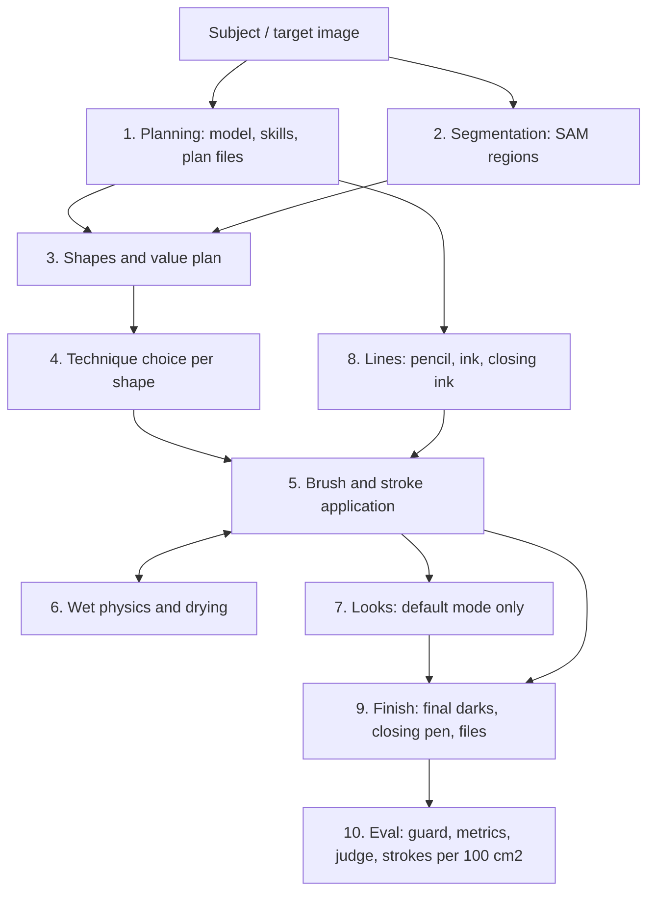
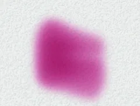

# How it paints

This is the pipeline contract for painter 0.3.2 (`package.json`). It follows one picture from subject to finished plate and says, for each stage, which files do the work, what goes in and out, which flags or plan fields control it, and where a choice belongs. Read it before you add a rule, a flag or a mode. A pipeline change merges only together with its update to this page.

The painter starts with blank paper. It draws in pencil, lets the drawing dry, then builds the painting from light to dark in washes, layers of diluted paint. Ink comes only from a plan, `--outlinemedium ink` or the automatic stage choice. The painter saves the sheet as it goes, so you can stop or rewind anywhere between blank paper and the finished painting.

The [README diagram](../README.md#how-does-it-work) shows the whole loop on one screen. The paintings and swatches on this page were made with release 0.1.0 (painter V096, sim 100). The Trumbull plan asks for ink, so its drawing is sepia ink.

## Rules that apply at every stage

These are the project's looking-and-cheating rules. Each stage section below says where they bite.

- **Two modes, both kept.** Default: the painter looks at the subject while painting, as a painter does. Strict (`--notargetlooks 1`): no target reads after planning. Never delete, rename or rebuild either. Every score names its mode, and scores from the two modes are never compared or averaged.
- **No gains, no fitted values.** A model-settable gain or calibration that covers an engine error, a constant fitted to one subject, or anything tuned to raise a score is banned in both modes. A rule is stated in painter or physical terms and is the same for every subject. No subject names or ids in painting code.
- **Copying test.** Looking, colour checks, corrections and line drawing are art at brush and shape scale. Pixel by pixel, or with so many strokes that marks stop reading as brushwork, they are copying. Hill climbing (look, correct, look again until it converges) is copying too: looks are few, fixed in advance, and at set points.
- **Strokes per 100 cm2** is reported with every score. A count far above a human painting of that size is a cheating flag.
- **The semantic instruction set is the one place a planner's choice is made.** Technique per shape comes from the plan (area plans), not from a painter-side pixel classifier that overrides it. If the set cannot express a choice, extend the set and its validator and document it here.
- **Fail loudly.** A missing Python environment, SAM checkpoint, line file or GPU stops the run. `npm run doctor` (`tools/doctor.mjs`, `src/paint/doctor.mjs`) checks them before any benchmark run.
- **New logic goes in small modules** under `src/` or `tools/` with unit tests, not into `tools/paint-plate.mjs` or the stage files in `tools/plate/`.

## The stages at a glance

`tools/paint-plate.mjs` runs seven code stages in order, all in `tools/plate/`, sharing one `ctx` object:

| Code stage | File | Pipeline stages it holds |
|---|---|---|
| 1 | `tools/plate/setup.mjs` | options, the source image, the target guard (1, 2 start) |
| 2 | `tools/plate/plan.mjs` | palette, pigment demand, masks, order of layers (3, 4) |
| 3 | `tools/plate/sheet.mjs` | brushes, value plan, the sheet, looks, marks, scrap swatches (3, 5, 6, 7) |
| 4 | `tools/plate/pen.mjs` | film frames, the plan of the pen drawing (8) |
| 5 | `tools/plate/drawing.mjs` | order of work, reserves, drawing passes, preparation (8) |
| 6 | `tools/plate/paint.mjs` | passage brushes, touch-ups, the paint loop (5, 6, 7) |
| 7 | `tools/plate/finish.mjs` | lifting, closing pen, gouache, output files (9) |

`tools/plate/load-order.mjs` fixes the import order; `tools/plate/source.mjs` gives tests the stage source text.

A "where choices live" line names one of four homes:

- **plan**: a file or the automatic planner decides it, for this picture, before painting.
- **technique library**: a named technique in `src/paint/techniques/` or `src/paint/methods/` that a plan can call, with no subject names and no numbers taken from a plate.
- **painter rule**: the painter applies a universal rule in painter terms (for example "wait for the shine to go off").
- **physics**: the sheet model decides it (`src/media/`). Nothing above may patch it.

## 1. Planning

The planner decides before the first mark: palette, regions and value bands, which lines to draw, the order of passages, a technique and brush per passage.

- **Who plans.** In benchmark rounds V4 and V5 a model writes plan files and command-line arguments for painter presets and settings. It writes no code. The pipeline executes those choices. V4 starts each try fresh. V5 can revise from its earlier painting and notes (`bench/scripts/pipeline/plan-args.mjs`, `bench/scripts/pipeline/harness.mjs`, `bench/docs/run-format.md`). With no plan file, the automatic planner inside `tools/plate/plan.mjs` reads the target.
- **Skills a planner reads.** `.agents/skills/painting-planner/SKILL.md` (procedure: style, regions, technique per region, layer order, glazes, ink, checks) and `.agents/skills/watercolor-technique/SKILL.md` (moisture, brush load, edges, value). The same files are installed for Claude Code under `.claude/skills/`.
- **Plan formats** (field reference in [plan format](plan-format.md)):
  - *Stroke plan*: ordered brush paths, loads and drying commands. Run with `node tools/run-plan.mjs <file>`. Examples: `examples/plans/graded-wash.json`, `examples/plans/glazes.json`, `examples/plans/drying-dry-between.json`, `examples/plans/drying-too-wet.json`.
  - *Value plan* (`--valueplan <file>`): region families with bounds, reference cue and base move; style selection; reserves; and the `drawing`, `washes` and `order` sections. Example: `examples/plans/trumbull-values.json`. Active when `--order painter` and no area plan is present.
  - *Area plan* (`--areaplan <file>`): the semantic instruction set: as many named areas as the subject needs (the count is an outcome; a plan with no areas stops the run), each with ordered passes; each pass is laid as one wash over the cells of its area in its value range, holding the paint the value ladder puts there. Validated by `tools/painter/semantic-areas.mjs`; `node tools/paint-plate.mjs --areahelp` prints the contract. The set carries version 1, normalized target coordinates, a binding to the target's SHA-256, and for each pass a move (`wet on wet`, `wet on dry`, `dry brush`; each with the technique library's brush contact, so a dry brush pass skips the tooth's hollows), wet sessions (`pass.session`: passes laid back to back with no drying between, so they merge; the session dries once), edges (`edges`, required whenever areas touch: every boundary two areas share is hard, dried before the neighbour is painted; soft, a clean damp brush along it while the pass is wet; or lost, laid in one wet session; `pass.soften` softens one pass's edge), lifting from damp paint (`lights.mode: "lift"`: the painter waits for the shine to go off the light, then lifts it with a thirsty clean brush), colour and value changed in the wet wash (`pass.wash` graded or variegated along a direction, lanes laid across it; `pass.charge`, a second colour dropped in while the pass is wet), the paper (`pass.tone` lays one wash of a named paint over a whole area, toning the page first; `ignore` lists the page's blemishes, which are not painted), a brush (round or flat) and load, lights (`none`, `paint-owned`, `paper`, `negativepaint`, `film`, `lift`), drawing roles, dependencies and optional explicit brush paths. Extra material stages are not in the set, and the validator rejects them. `--areaplanonly 1` exits before the sheet and writes CPU coverage; `--areastop` stops after a compiled pass group.
  - *No file*: the automatic planner.
- **Recipe.** A recipe is a preset of painter flags placed before the user's flags (`src/paint/recipe.mjs`). A flag typed after it wins. The painter reports any plan key no consumer reads (`src/paint/plan-keys.mjs`) and exits 3 after writing its outputs. An option the painter no longer has stops the run before painting, with the reason (`src/paint/removed-options.mjs`); the bench harness refuses a stored plan that names one the same way (`bench/scripts/pipeline/plan-args.mjs`). One plan owns drawing, washes and order; flags are an execution adapter (`src/paint/pipeline-plan.mjs`, resolved plan written to `pipeline-plan.json`).
- **Subject order.** `--subjectorder s` and the plan's `order` section hold later subjects back so a background goes first and a focal subject last (`src/paint/methods/subject-order.mjs`). Strength 0 keeps whole-sheet bands. 1 brings each subject mostly through its washes before the next.
- **Order of work on an area plan.** The plan's schedule is the order: `pass.order` and `dependsOn` say what goes first, `pass.session` which passes are laid back to back while wet. The automatic painter order (`src/paint/methods/painter-order.mjs`) does not reorder or cut the ladder under an area plan, and an order or session option typed beside `--areaplan` (`--darkfirst`, `--subjectorder`, `--bgfirst`, `--ordersubject`, `--order*`, `--washsession`, `--charge`, `--wetmix`, `--drypigment`, `--orderdry`, or `--order` other than `painter`) stops the run with the plan field that says it (`src/paint/area-owned-options.mjs`). The dry gate and the wet-bed wait still time each pass: they are physics, not order.
- **Edges on an area plan.** Every edge is the plan's (`tools/painter/area-edges.mjs`). Between areas, `edges` names each shared boundary hard, soft or lost. A pass's own edge, `pass.edges.kind`, is laid as named: soft, a clean damp brush runs along the pass's edge right after it while it is wet (where `pass.soften.polygon` says, when given), never along a boundary named hard or lost; lost, the pass is in a wet session; broken, the pass is dry brush; hard, nothing is added. A pass edge the painter cannot lay as named stops the plan. The value route's soft ring and arcs (`--softwet*`, `--softmm`, `--softsplit`, `--softclipmm`) and the first-wash softening (`--fwsoften*`) stop the run when typed beside `--areaplan`.
- **Edges on a value plan.** The planner classes each boundary cell of a passage soft (the value across it differs by under 0.14 and the colour edge is under 0.45) or hard. A passage is laid wet on dry inside a clip, so its edge dries as a one-cell step, and the sheet carries no pigment across a clip on its own. Right after the passage, while it is wet, a clean damp brush runs along its soft cells the way it does on an area plan (`tools/painter/soften-lift-run.mjs`). The brush is the largest round of the kit that fits inside the shape (its width is at most the shape's support width) and is no wider than the passage's own brush; `--softmm` caps its width. The paint creeps out to the damp strip and the step becomes a ramp of about the brush width. A shape narrower than the finest round keeps its dry edge, and a soft cell within one brush of a hard cell of the same passage or of a reserved light keeps the cut. `--softsplit 0`, or a plan's `soften: false`, turns it off.

**Inputs:** target image, optional plan files. **Outputs:** `pipeline-plan.json`, `plan.jpg` (a preview), `run-card.json` (`src/paint/run-card.mjs`).
**Controls:** `--valueplan`, `--areaplan`, `--order`, `--recipe`, `--subjectorder`.
**Where choices live:** plan (colour, order, technique per area). Technique names a plan may call live in the technique library.
**Rules here:** the planner may read the target (planning is before the guard seals it). No subject ids in the planner's code. A plan carrying target edges into every stroke is still copying, so check the stroke count.
**Teacher's view:** squint until detail goes and write a value study in three or four values, one value per big shape. Choose what to leave out. Order passages by which must be wet together and which dry.

## 2. Segmentation

SAM regions are the painter's proxy for how a painter sees the subject: sky, mass, figure, object.

- `src/crop/segment-prep.mjs` runs `tools/seg/segments.py` (`tools/seg/sam_regions.py`) on the target before any painting. The map is cached by target SHA-256 and script version (`--segcache`). Without SAM and its checkpoint the run fails; `--segments off` turns every segment-aware step into a cut by colour and value alone; it is for tests, not for paintings.
- `src/crop/segments.mjs` reads the regions; `src/crop/blockin.mjs` and `src/crop/form.mjs` build region and form data.

**Inputs:** target image. **Outputs:** a region map, cached by hash.
- **SAM device and hangs.** `PAINTER_SEG_DEVICE=mps|cpu|cuda` makes the device an explicit choice: a wrong value, or a device torch does not have, fails the run; unset keeps `mps`, else `cuda`, else `cpu`. The device is logged (`SAM vit_b on cpu (PAINTER_SEG_DEVICE)`) and written to `segments.json` and the run card (`segments.device`, `segments.deviceChoice`). A map made on an explicit device has its own cache entry. A SAM job that uses no CPU for 10 minutes (CPU time is sampled, so a slow CPU run is not mistaken for a hang) is killed and the run fails naming the image, the device and the minutes waited; there is no retry and no switch of device. Many concurrent SAM jobs on Metal (MPS) can wedge in a command buffer: that is what the watchdog catches (2026-11-11, seven jobs at 0% CPU for 5 to 45 minutes).
- **SAM previews and bench checks are renders too.** Any run that starts `segments.py` (a painter run, a bench workspace, a preview) takes a render lock (`~/wt/locks/a` or `b`, see RULES) like a painting does. When Metal is busy or both locks are held, run SAM on the CPU: `PAINTER_SEG_DEVICE=cpu node tools/paint-plate.mjs ...` (minutes, not seconds, on a 1024 px image, and a CPU map is cached apart from an mps one). Do not hide MPS with wrappers.

**Controls:** `--segments`, `--segcache`, `PAINTER_SEG_DEVICE`; the SAM checkpoint is checked by `npm run doctor`.
**Where choices live:** painter rule (SAM regions are the starting units for shapes, see 3).
**Rules here:** the regions are computed before painting and sealed with the target. A missing checkpoint is a loud failure, never a silent fall back to colour cuts.
**Teacher's view:** look at the subject as a few big shapes, light and dark, before touching paper.

## 3. Shapes and value plan

The value planner groups the picture into light and dark bands and shapes the painter will lay.

- `src/paint/methods/target-regions.mjs` builds colour and value regions. `src/paint/methods/light-to-dark.mjs` plans five light-to-dark value bands per pigment (`--order painter`), with `src/paint/methods/layer-cuts.mjs` for middle layers (`--midlayers`). `src/paint/methods/painter-order.mjs` orders passes (`--order legacy-painter`).
- Reserved lights: `src/paint/methods/light-reserves.mjs`, `src/paint/methods/small-marks.mjs` (catchlights and lit gaps under the minimum shape stay paper; small darks go once, last), `src/paint/methods/wash-join.mjs`. These rules, the paper-white hold (`--whitefloor`: cells planned under half a glaze join no pass) and the frisket or gouache small lights (`--smalllights`, `--white`) serve value plans and runs with no plan. An area plan's lights are the ones it lists: `pass.lights` paper, negativepaint, film or lift, each a polygon with a reason, catchlights included; nothing holds a target-light cell out of its passes, and those options typed beside `--areaplan` stop the run (`src/paint/area-owned-options.mjs`). A light the plan does not list is painted with its pass.
- Palette and demand: `src/crop/palette.mjs`, `src/crop/palettewide.mjs`, `src/crop/pigments.mjs` (the 16 pans in `src/crop/box.mjs`), `src/paint/methods/shape-deficit.mjs` (each passage is charged from its whole shape).
- Value delivery: values are planned against the sheet's own optics and delivered as planned (`src/eval/plan-optics.mjs`, `src/eval/plan-values.mjs`). A wash that comes out too dark or light is a plan or physics fault, not something a gain can repair.

**Inputs:** target, regions, plan. **Outputs:** passages (region, mixture, brush paths, technique), `plan.jpg`, the wash plan pictures (`--washplanpng 1`).
**Controls:** `--order`, `--midlayers`, `--massplan`, `--paperlights`, plan `washes` and `order` sections.
**Where choices live:** plan for what is a shape and what value it has; painter rule for how big shapes are cut and how small pieces join; never physics.
**Rules here:** shapes are shape-scale decisions, not per-cell maps. No per-subject ids or hand-placed boxes in painting code. Do not re-cut SAM regions by band, pigment and piece into a contour map: the painter fills a contour map as one dab per piece, which is the copying pattern the teacher review found (about one stroke per piece).
**Teacher's view:** link small pieces of similar value into one interlocked shape. Mix the colour, do not stack single pigments. Reserve the paper whites and go round them.

## 4. Technique choice

Each shape gets a technique chosen from what the subject shows there.

- Technique library: `src/paint/techniques/README.md` indexes it. Passage material and move names (`wet on wet`, `wet on dry`, `dry on dry`, with aliases such as `wet in wet`, `glaze`, `dry brush`) are normalised in `src/paint/techniques/passage-plan.mjs`.
- Techniques by kind: `src/paint/techniques/shaped-marks.mjs` (flat-brush planes, sky sweeps, short texture marks), `src/paint/techniques/surface-marks.mjs` (fur, masonry and other surface marks), `src/paint/techniques/passage-plan.mjs` (named passages).
- Style profiles: `src/paint/styles/loader.mjs` with `src/paint/styles/ink-and-wash.json`, `src/paint/styles/precise-watercolor.json`, `src/paint/styles/urban-sketch.json`, `src/paint/styles/atmospheric-wet.json`, chosen by the plan's `styleSelection`.
- Per-pass scrap swatch: the painter tries a loaded brush on a scrap of the same paper and charges each passage by what the swatch delivered (a wet-into-wet swatch's bed is wetted with the sheet's own clean brushes, pickup and wait, `tools/painter/wet-bed-prep.mjs`) (`src/paint/methods/scrap-swatch.mjs`).
- Index of every module and flag: [methods and techniques](techniques.md).

The rule for choosing, in painter terms: joined wash or wet in wet for large soft areas and soft transitions; wet on dry for crisp edges and layered glazes; dry brush for broken texture. Wet on dry and dry brush are good techniques. The job is the right one per shape, not making everything wet. The choice is made in the plan (area-plan passes name the move, value-plan families their base move) and logged per shape. The paint step lays that move as written: no switch replaces it, and a value plan's technique never overrides an area pass. The source's technique reading (`src/crop/technique.mjs`) runs only for passages no plan wrote (the automatic ladder).

**Inputs:** the shape, what the target shows there (read while planning). **Outputs:** a move, brush, load and edge treatment per passage.
**Controls:** area-plan `moves`; value-plan `baseMove`; `--passages`, `--shapedmarks`.
**Where choices live:** plan (which technique where) and technique library (what a technique does). A painter-side pixel classifier that overrides the plan is not allowed. A subject-fitted value is not allowed in either place: a fitted idea becomes a general technique with no subject names and no plate numbers, or is deleted.
**Teacher's view:** hard edge is wet on dry; soft edge is wet into wet or a damp brush along it; lose an edge where two neighbours match in value. A wash is one act, not a stack of steps.

## 5. Brush and stroke application

The painter dips a brush, tries it on scrap, lays a stroke along a path, and reloads when the load runs out. A light brush touches the tops of the paper's tooth: each fibre is compared with the tooth level under it in the paper's own height units (`src/media/paper.mjs` toothRange), so a dry brush marks the hills and skips the hollows. A hair that touches lets its free liquid go by contact: pressure sets how many hairs touch and how deep they reach into the tooth, not how much a touching hair gives, so a hand landing or lifting in the middle of a wash lays the wash's full strength and a fresh load melts into the last one's wet edge. A load is spent only on paper the brush paints: a stretch over a reserve or outside the passage's edge spends none of it (`src/paint/methods/brushes.mjs` splitLoads).

- Brushes: `src/media/brush.mjs` (bristles and load), `src/paint/brushes.json` (real brush sizes), `src/paint/methods/brushes.mjs` (`--physical 1`), `src/paint/methods/passage-brush.mjs` (`--brushchoice`).
- Paths: `src/media/wash.mjs` (wash paths, softening, prewetting), `src/paint/methods/lay.mjs` (one passage as sweeps), `src/paint/methods/stroke-plan.mjs` (`--strokeplan 1`, overlapping parallel sweeps), `src/paint/methods/mop-lanes.mjs` (a mop's overlapping, slightly curved lanes).
- Loop: `tools/plate/paint.mjs`. The stroke record (`src/paint/stroke-ledger.mjs`) is kept in every run and every mode; `--marks 1` ships the full tape.
- Optics: `src/media/km.mjs` (Kubelka-Munk absorption and scattering) turns layers into colour.

**Inputs:** passages. **Outputs:** strokes on the sheet, `marks.json`, frames.
**Controls:** `--physical`, `--brushchoice`, `--strokeplan`, `--marks`, `--strokebudget`; plan load and brush fields.
**Where choices live:** painter rule (which brush for which shape: biggest that fits; load as the technique needs) and physics (what a brush does when it touches).
**Rules here:** one skilled stroke is worth many naive ones: technique, gesture and load, not finer polygons or per-pixel fills. Strokes per 100 cm2 is reported with the score.
**Teacher's view:** the biggest brush that fits the shape; a few long strokes for broad passages; a small round or rigger only for detail. Fine strokes never carry the tone of a region that should be a wash.

## 6. Wet physics and drying

The sheet holds five things per cell: standing water, water in the pores, pigment floating, pigment settled, pigment in the pores. The paper is sized. A loaded brush's free liquid, the water it holds beyond what its hairs keep, stays on the sized surface where it lands, and the dry pores take only their share of it, so a lane leaves a wet edge for the next one to join. A thin or damp brush gives little: there is little free liquid to give. Water keeps moving after the brush has gone. It spreads, soaks in and evaporates fastest at a wash's edge, so edges dry darker. Settling pigment collects in hollows and gives granulation: each paint by its own published rating (ultramarine and cerulean heavily, the earths moderately, the staining paints not at all), more in a wetter or slower-drying wash ([pigments and paper](pigments-and-paper.md#paper)). The brush path sets where paint starts and the water sets where the dried mark ends.

| Wet into wet | Dry brush | Dry between strokes, then flooded |
|---|---|---|
|  |  |  |

A dried wash becomes its own layer. A glaze is a transparent wash over dried paint, and the layers mix optically. Every pass is laid once: a second glaze is a second pass the plan writes, never a repeat the painter adds.

- Paper: `src/media/paper.mjs` (fibres and the relief in micrometres from `src/media/paper-relief.mjs`, 0.1 to a few mm), `src/media/sheet-size.mjs`. The sheet fits the target inside a 6 x 4 in postcard by default; `--sheetmm` sets the physical width and `--width` the cell count. More cells at the same width add detail up to the source's own pixels, and the painter stops on a `--width` above the source's width unless `--sourcescale` states the enlargement (`tools/plate/source-scale.mjs`); a larger export adds none.
- Water and pigment: `src/media/sheet.mjs` with `src/media/sheet-kernel.mjs` (one step cut into row bands for the CPU) and `src/media/gpu/stepfull.mjs`, `src/media/gpu/stepfull.wgsl` (the GPU step). Pigment data comes from `src/crop/pigments.mjs`. [Pigments and paper](pigments-and-paper.md) has the details.
- Timing: `src/paint/methods/wetdry.mjs` (paper wetness, brush load, waiting for the paper to dry) and `tools/painter/wet-bed-wait.mjs` (a wet-into-wet passage is prewetted and charged once the shine goes off: when the typical cell of the bed, not its wettest puddle, holds no more than a glossy film. Every wet-into-wet passage of a value plan has its bed prepared under the brush the same way (a clean brush made like the painting brush at 0.55, a pickup, the wait; `tools/painter/wet-bed-prep.mjs`), whether or not the plan names its passage material, never wetted lane by lane at a full load. A passage waits for a neighbouring wash once, before its first lane, never between its own lanes, so its lanes join while wet). `src/paint/methods/wash-session.mjs` joins value-plan passages in one wet session (`--washsession`); sessions never cross a glaze, subject or shadow boundary. An area plan names its sessions itself (`pass.session`).
- Checks: `src/media/checks.mjs` counts physics violations; `--strict 1` makes them stop the run. Without it the run continues and writes `continued-checks.json`; the bench verdict marks such a painting not clean, with a loud note naming each check (`bench/scripts/pipeline/plan-args.mjs` renderVerdict), and `--strict-verdict` fails it. Exit 3 means only that a typed option was read by nothing.

**Inputs:** strokes with brush, load and paper state. **Outputs:** the dried and wet sheet, frames, `wash.jpg`.
**Controls:** `--paper`, `--paperphysical`, `--washsession`, `--physics key=value`, plan `washes.physics`.
**Where choices live:** physics. A painter rule may choose when to lay (wait, prewet, lane by lane) but may not change what water and pigment do. A wet-on-wet passage is wetted lane by lane, as its scrap swatch is. Wet edges must meet wet edges for lanes of one wash to join; separate shapes laid wet on dry keep their hard edges by design.
**Rules here:** no gain or calibration may cover an engine error. Fix the physics or the timing. Measure sheet wetness when a stroke lands and the time between neighbours against drying time before changing a law. CPU and GPU runs are each repeatable but differ from each other.
**Teacher's view:** wetness and paint strength are chosen together every time. Timing is the technique: stop touching a wash once it starts to set, wait for full dryness before a glaze.

## 7. Looks

A look is the painter stepping back to compare whole shapes with the subject. A painter steps back a few times, at set points fixed before the first mark, usually after a layer dries. There are two modes.

| | Default | Strict (`--notargetlooks 1`) |
|---|---|---|
| Target reads after planning | each passage once as it is laid, and the planned step-backs, each shape once a round, always as its mean (a whole shape of at least 64 cells) | none |
| Step-backs | `washes` (with `--touchpoints` R > 0, R rounds): after the planned washes dry, and after each round's glazes, each planning family once; `accents` (with `--finaldarks` > 0): before the last small darks, each accent family once | the same plan, with no look |
| Passages | one shape-level look each as it is laid; the charge follows what the sheet already holds of the passage's pans | keep the charge frozen at planning |
| Use | the painter as a painter works; 0.1.x winners ran this way (with more looks) | the benchmark switch |

- `src/paint/step-backs.mjs` plans the step-backs from the options before painting and gates every painting-time look: a passage may look as it is laid, any other look returns null outside an open step-back, a step-back not in the plan or taken twice stops the run, and a shape read twice stops the run. It writes `step-backs.json` (planned, taken, step-back looks, passage looks, looks declined). `src/paint/painting-look.mjs` is the strict switch under it: with `--notargetlooks 1` every look returns null. Planning looks before the first mark are not affected. `tools/plate/setup.mjs` makes both.
- The target guard blocks cell-level reads of the target, and of every map made from them (`tools/guard/seal-maps.mjs`), when painting starts and records every look (`tools/guard/no-target.mjs`; modes `gentle` default, `hard` with `--lookbudget`, `warn`, `off`). [Honesty](honesty.md) has the modes and records: `target-guard.json`. `tools/guard/step-backs.test.mjs` checks that the guard's looks are exactly the passage looks and the step-backs' shape looks.
- Frozen replay for a benchmark: `--notargetlooks 1 --feedback 0 --touchpoints 0 --finaldarks 0 --targetguard strict`.
- Touch-ups (`--touchpoints`, `src/paint/methods/touch-up.mjs`, families from `src/paint/methods/shape-refit.mjs`): `--touchpoints` rounds, each a step-back fixed before the first mark; a round after a round that corrected nothing is skipped. A family that reads visibly lighter (2 L*) or less chromatic (2 C*) than the subject gets one glaze of the mixed lack, filed under its leading pan and sized from the gap through the sheet's film optics (light crosses a film twice, so density is 2 K x), with no gain. Darken only: the simulator has no physical rule for lifting dried pigment. Final darks: `src/paint/methods/final-darks.mjs` (`--finaldarks`, off in the default recipe), brush marks made with the detail brush's tip on the plan's accent families, each at least one tip touch, kept off the reserved lights only.
- The passage charge look (`--feedback`) is the one look a passage takes: its charge is the shape's lack against what the plan booked, 0 to 2 times the planned amount. The kept-colour recharge (`--keeprecharge`) and the texture look (`--texflow`) are not step-backs and get no look: they use their planned values.

**Inputs:** the sealed target (shape means only, at step-backs). **Outputs:** corrections at shape scale, `target-guard.json`, `step-backs.json`.
**Controls:** `--notargetlooks`, `--targetguard`, `--lookbudget`, `--feedback`, `--touchpoints`, `--touchdmin`, `--finaldarks`.
**Where choices live:** painter rule. Looks are at shape scale and fixed in advance: one a passage, and the step-backs at set points, such as after a layer dries.
**Rules here:** no per-cell target reads in either mode. No loop of look, correct, look until a score stops improving: the rounds are fixed before painting and each reads each shape once. Every score names its mode.
**Teacher's view:** step back a few times; compare shapes, not pixels. A last layer is few and deliberate.

## 8. Lines

Contour drawing comes first and dries before the washes. The pen is a dip pen with a finite load of walnut ink. Speed, pressure, load and paper change its line: a slow line is wide and dark, a pressed nib spreads, a fresh dip leaves a wide first mark and an empty nib thins, skips and needs a dip.

- Medium: `--outlinemedium graphite` (default), `ink`, or `auto` (ink when the source shows at least 0.5% line). `src/paint/methods/outline-medium.mjs`, `src/paint/methods/material-profiles.mjs`, `src/media/pen.mjs`, `src/media/graphite.mjs`, `src/paint/methods/pencil-line.mjs`. Ink stages are kept only when ink is asked for; otherwise the run keeps the pencil prep alone. The source decides the medium, whether or not the plan asks: under `--subjectmedium none|pencil` (the bench harness passes the subject's medium, `bench/v4v5/subjects.json`) any drawing is a light graphite preparatory drawing, opening lines only, with no ink and no closing lines (`src/paint/subject-medium.mjs`); on a pen subject the harness draws a plan that names no medium in ink, opening and closing lines (`bench/scripts/pipeline/plan-args.mjs`).
- Source of lines: `src/paint/methods/linework-stage.mjs` (`--linework auto`; record `linework-stage.json`) picks the source, cleans the lines (`src/paint/methods/line-cleanup.mjs`) and gates whether to draw, the medium and how much. Models: `tools/seg/sketch-map.py`, `tools/seg/copy-lines.py`, `tools/seg/sketch-lines.py`, `src/paint/methods/line-model.mjs`. [Linework](linework.md) and [Ink](ink.md) say how lines are chosen.
- Decide, hold, measure (inking stage 2): `src/paint/methods/ink-lines-file.mjs`, `src/paint/methods/ink-decide-file.mjs`, `src/paint/methods/ink-decide.mjs`, `src/paint/methods/line-class.mjs`, `src/paint/methods/ink-labels.mjs`, `src/paint/methods/ink-lines.mjs`, `src/paint/methods/ink-measure.mjs`. Mass edges (shadow and wash steps) are cut by the line-or-mass test; sky, foliage and water stay wash. These region-label rules serve value plans. On an area plan each area's `drawingRole` decides its lines (`none`; `scaffold` and `structural` take opening lines; `structural` and `focal` take closing ink; `tools/painter/semantic-areas.mjs` semanticDrawingGroups), and an on `--inkdecide` or `--inkdarkrule`, typed or set by `--inkrecipe wash`, stops the run (`src/paint/area-owned-options.mjs`). Line holding (`--linesupport`) and the tracer's fixed limits apply on both routes.
- Line holding (`--linesupport`, `--linesmooth`, `--inkwidthfloor`, `--inkdarkcap`, `--inkdamp`) keeps the pen on the target's own lines; see [Ink](ink.md#holding-ink-to-the-target).
- Linked stages: `src/paint/methods/drawing-stages.mjs` and `src/paint/methods/drawing-stages-auto.mjs` (`--drawingstages auto`, the default) choose `prep` (pencil), `prepInk` (trace-ink) and `finishInk` (closing-ink) for each picture with `src/paint/methods/drawing-choice.mjs`. Hand plan: `src/paint/methods/drawing-file.mjs`, `src/paint/methods/drawing-hand.mjs` (chain lines, long contours first, taper). Ink load: `src/paint/methods/ink-match.mjs`, `src/paint/methods/ink-scrap.mjs`. Fine sheet: `src/paint/methods/ink-res.mjs`.
- Plan: the value plan's `drawing` section (`medium`, `source`, `stages`, `closingLines`); `src/paint/drawing-plan.mjs` turns it into flags.

**Inputs:** target (read before painting), line models, plan. **Outputs:** the opening drawing, closing-ink lines file, `ink.jpg`, `linework-stage.json`.
**Controls:** `--outlinemedium`, `--linework`, `--drawing first|last|both|none`, `--drawingstages`, plan `drawing`.
**Where choices live:** plan (medium, how much, which stages) and painter rule (how a line is gated, joined, tapered). Ink and wash edges are physics.
**Rules here:** a traced line is drawn whole, with one nib and one weight: its width is its mark's mean equivalent width across the line (darkness below both flanks over its peak), its weight its mean darkness; the pen's pressure curve shapes it along its length, and the tracer rounds its path between pen lifts. The tracer (`bench/v4v5/tools/trace-ink.mjs`) takes its limits from the subject's own value range (a line is one step of a nine-step scale, darker than both sides; unless the subject's drawing medium is pen, it must also lie in the scale's darker half, so pale painted texture is not traced) and the limits are not settable. It draws as a pen does (`src/crop/pen-trace.mjs`, one tracer the bench tool reaches through a link; the painter's own line stage uses the fused ControlNet lineart models (`src/paint/methods/line-model.mjs`) for ink stages when `--linemodel` is active, and `src/crop/pen-trace-file.mjs` for pencil-only `prep` or when `--linemodel 0` is set, reading a finer subject at the tracer's 0.93 mm pixel): it walks straight through a crossing, drops the thinning's one-pixel staircase, lifts where a line turns back on itself, joins pieces that continue one another across its own reach, and keeps a line only when one side of it is a light shape: the median of the band from its reach to its shortest line (3.7 to 13.1 mm) out is lighter than the middle of the subject's value scale (a contour; a line inside a dark mass is texture, and a white fleck or sheen streak beside it is not a shape). Its distances are millimetres on the sheet (`TRACE_MM`): flank 1.9 to 3.7 mm, reach 3.7 mm, shortest line 13.1 mm, wiggly lines under 37.3 mm. They are its old pixel limits on a bench subject (300 px on 280 mm), so such a subject traces exactly as before; trace-ink takes the sheet width from `--sheetmm`, the workspace's `frozen.json` or the 280 mm bench sheet. Closing accents restate each chosen line whole, never the pieces where the target reads strongest. A value plan family's `drawingRole` (`none`, `scaffold`, `structural`, `focal`, the area plan's words) keeps or leaves out each line whole (`src/paint/methods/family-roles.mjs`), and `drawing.reason` states why the medium. The medium measure (`--outlinemedium auto`, `src/paint/methods/pen-share.mjs`) reads pen lines by their contrast over their flanks, their width on the sheet and their run (`separate(..., { asDrawn: true })`), so a pale reed or quill line counts and tooth does not. Closing ink and `--linesupport` keep or drop each line whole: a line stays if at least half of it follows a line in the target. Drawing ink or pencil lines from the subject's edges is allowed, as an artist draws contours: trace-ink, closing-ink and line holding stay. Ink is off unless the plan or the source asks, and never forced. Each line needs a reason: no dark lines where the target has none. Ink goes on branches and structure, not on leaves, shadow or wash. Check ink changes against held-out plates before showing them.
**Teacher's view:** contour drawing is slow looking, one continuous line at a time. Choose each line's job; do not trace every painted boundary. In line and wash, the line gives edge and structure, the wash gives tone and colour.

## 9. Finish

The last passes: a few small decisive darks, the closing pen, the files.

- Final darks (pupils, the gap under a door, the deepest fold) are placed last as single touches: `src/paint/methods/final-darks.mjs`, `src/paint/methods/small-marks.mjs`. Lifting and gouache: `tools/plate/finish.mjs`.
- Final lights: a light thinner than the wash planner can go round (about a rigger touch, 1.2 mm), clearly lighter than its dark ring in L*, is found in the planning data (`src/crop/thin-lights.mjs`, `tools/plate/gouache-plan.mjs`), before the first wash and in both looking modes, and laid last as a rigger stroke of white gouache tinted to the light's own colour (`tools/plate/gouache-finish.mjs`, `src/media/gouache.mjs`). Single lights (whiskers, rigging, lane lines) are fitted with one cubic each. Strands inside a region the surface labels call a coat are that coat's texture, laid with the engine's dry brush (below). Dots only as true glints. The decision is a rule, with no option; the run card records it as `gouache`, and a stroke is laid only where the washes covered its light.
- Thin darks: the mirror of the final lights. A rim of glasses, a seam, a lid line or a dark whisker is a ridge clearly darker than its ring in L*. It is long for its width and narrower than the wash planner can go round (`src/crop/thin-lights.mjs`, polarity dark; `tools/plate/thin-darks-plan.mjs`). Each is fitted with one smooth curve and read as a drawn line is read (`src/paint/methods/line-weight.mjs`): its step, how many L* darker it is than its sides, and its width at half that depth. The lines are laid last, over the dry washes (`tools/plate/thin-darks-lay.mjs`), so that each shows the subject's own step on the sheet. The sheet is read along the line first, and a line it already shows within the tolerance (3 L*, or a quarter of the step where that is more) is left alone. What is missing is painted with the rigger's point where the point can lay it. A swatch on the run's paper (`src/paint/methods/point-swatch.mjs`) gives the loads that hold a line and the line's width, and the load is the one whose film of the line's own paints makes the missing step over that ground. The point's line may be at most one and a half times as wide as the subject's, and a sheet takes at most four painted lines in 100 square centimetres. Every other line is restated in pencil, a 2B pressed by a table read over paint of the ground's colour (`src/paint/methods/pencil-scrap.mjs`). The sheet is read again after laying, and `thin-darks.json` sets each line's planned step against its painted one. A line the drawing layer already draws in ink or visible graphite is not planned twice, and no line goes inside a coat.
- Surface marks on an unplanned run: a vision judge labels the SAM regions as a contact sheet of cut-outs (`src/paint/methods/surface-labels.mjs`, judge `--inklabeljudge`, model `INK_LABEL_MODEL`); a coat label chooses a coat's texture and dressed stone chooses masonry marks (`tools/plate/surface-plan.mjs`). Everything else and every doubt takes none. A coat's texture (`src/crop/coat-texture.mjs`, `tools/plate/coat-lay.mjs`) is dry-brush strokes along the strands the subject shows. Where it shows thin light hair over the coat, the stroke is white gouache tinted to the hair's colour. Where it shows thin dark hair over a lighter passage, the stroke is the coat's own paint, laid as a thin dark is. The plan carries the step the strands stand off their own ground, in L*. The sheet is read along the stroke first. The stroke adds that step, less what the sheet already shows there, and never takes the sheet darker than the strand itself. Its load comes from a swatch of the same dry brush, laid with dark paint by the run's own brush and read as the sheet is (`src/paint/methods/point-swatch.mjs`). It is laid in two passes with a reading between, and `coat-texture.json` sets planned against painted for each stroke. A scale rule comes first. The strand's width is measured on the subject's ridge. The narrowest line the dry brush lays at the run's density is measured on a swatch (`src/paint/methods/brush-swatch.mjs`). If the laid line would be more than one and a half times the strand, no mark is laid there. The run card records the inputs. No stroke goes within 1.5 mm of an eye, a nostril, a mouth line or a reserved light. Strokes are laid until the paint they leave, as the swatch measured it, covers as much of the region as the strands do. Lengths, pressure and width vary along each stroke. Masonry marks (`src/paint/techniques/surface-marks.mjs`, `tools/plate/surface-lay.mjs`) lie along the region's courses and are denser where the source is darker. They are left out of lights. A judge that cannot run is reported in the log and the run card and lays nothing: no other judge stands in. An area plan's own `pass.marks` win.
- Closing ink: the `finishInk` stage runs after every wash and the final dry gate (see 8).
- Output: `painting.png`, `wash.jpg`, `ink.jpg`, `frames.json` and stage frames (`src/paint/film-timeline.mjs`), `run-card.json`, `target-guard.json`, `cheat-risk.json`, the mark tape, the census (`tools/speed/census-write.mjs`), and `pipeline-plan.json`.

**Controls:** `--finaldarks`, `--drawing`, `--finishmasses`, `--frames`, `--marks`, `--inklabeljudge`, `--inklabelcache`.
**Where choices live:** plan (whether and where) and painter rule (placed last, once, as marks; final lights and surface marks by a rule over the planning data and the region labels).
**Rules here:** final darks are placed as shape-level marks, never a mask of per-cell residue. They do not run in strict mode, where every look is off.
**Teacher's view:** accents go in last, few, as marks. Counted on two hands, never filled in as outlined shapes.

## 10. Eval

Eval scores a finished painting and its saved stages. Judges are advisory: no verdict is fed back into the painter.

- Guard and risk: `tools/guard/cheat-risk.mjs` (stage progression, fine-detail copy correlation, small-stroke share), `tools/guard/promote-check.mjs`, `tools/guard/lint-target-use.mjs`, [honesty](honesty.md).
- Metrics: `src/eval/colour.mjs` (CIEDE2000), `src/eval/fidelity.mjs`, `src/eval/values.mjs`, `src/eval/stages.mjs` (do the frames follow the order a person paints in), `src/eval/score.mjs`. Some compare pixel by pixel and are for diagnosis only, never for steering. [Judging](judging.md).
- Judge: `tools/judge/judge-plate.mjs`, `tools/judge/stage-check.mjs`, `tools/judge/concert-judge.mjs`. J1 is noisy: score at least three times and judge by the mean. Differences under about 0.2 are noise.
- Strokes: `src/paint/stroke-ledger.mjs` records them. `tools/stroke-gate.mjs` and `tools/stroke-stats.mjs` measure sizes ([stroke statistics](stroke-stats.md)). `bench/scripts/copy-limits.mjs` reports strokes, strokes per 100 cm2 of sheet and the share of the stroke ceiling. [Benchmark scoring](../bench/docs/scoring.md) and [anti-cheat](../bench/docs/anti-cheat.md) cover the rounds.
- Compare on the same terms: same batch, same judge route, same scoring size, same mode.

**Controls:** `bench/scripts/run.mjs`, `tools/judge/judge-plate.mjs`.
**Where choices live:** eval only. Nothing here steers a painting.
**Rules here:** every score carries its mode and strokes per 100 cm2. A comparison against 0.1.x winners states that they ran in default mode with looks on. Judge cheating by the playback, not by a flag alone.
**Teacher's view:** judge by how it was made. Ask how many marks, whether each reads as a brush or pen mark, how many times it looked, and whether the rule holds for any subject.

## Limits

- The material model is not calibrated against a real sheet of paper.
- Automatic plans can leave stencilled edges along value boundaries.
- CPU and GPU runs are each repeatable, but they differ from each other.

Commands are in [Running the painter](running.md). Image rights are in [NOTICE](../NOTICE).

## Changing now

The pipeline is meant to change, and this page describes only what runs at the tip. Proposed changes are kept in a separate list, one entry per stage change: owner, branch, what moves where, why in painter terms, status. In flight, by branch:

- `claude/033-shapes`: stages 3 and 4, shapes from SAM regions, one wash each.
- `claude/033-looks`: stage 7, looks and tracers at brush and shape scale.
- `claude/033-unfit`: stage 4, the fitted tuned folder is gone; kept ideas are general techniques.

## Designed paths must leave execution evidence

The benchmark uses the default recipe plus the authored plan. `bench/designed-paths.json` is the 23-row execution contract: required paths must leave evidence; every remaining row says “not yet on” and why. Run `node tools/designed-paths-check.mjs <finished-run-folder>` (or `node bench/scripts/pipeline/check.mjs <finished-run-folder>`). It writes `designed-paths-check.txt` and JSON, reports RAN or DID NOT RUN for every row with its evidence, and exits 4 if required execution evidence is absent. Missing or invalid run cards fail. Subject-medium and brush-lane checks apply only to the relevant medium or selected method. Medium applicability comes from the registry’s benchmark declarations, so omitting `--subjectmedium` cannot opt out of the medium check. A requested flag alone never proves execution. Run cards retain the expanded arguments and lane execution counts are recorded after actual stroke calls. Benchmark completion, rerenders and the shared evaluation runner invoke this check; planning admission is separate because it has not painted yet.
