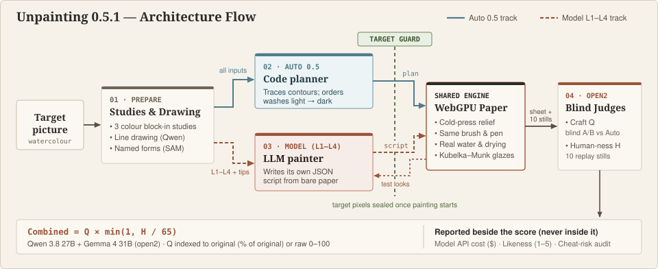
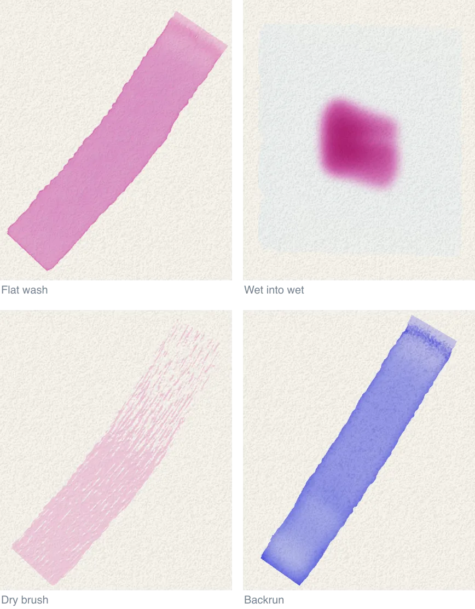
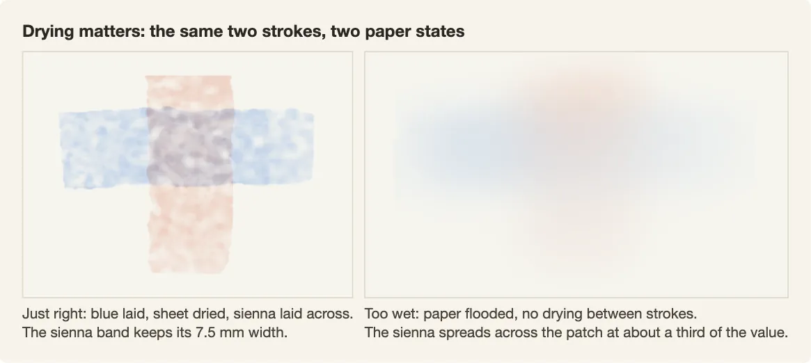

# How it paints

Auto plans its washes from flat colour studies and a traced drawing; a model starts from bare paper and writes its own [painting script](painting-script.md). Both drive the same cold-press paper, bristle brush, dip pen, and WebGPU physics simulator (Metal on Apple Silicon, Vulkan on NVIDIA).

## The 0.5.1 architecture

## Paper, water, and brush physics

Each cell on the sheet simulates surface water (`W`), suspended pigment (`G`), settled deposit (`D`), capillary pore water (`s`), and absorbed stain (`P`). Between passages the GPU waits for real moisture to evaporate — never a fixed timer.

| Paper state | What happens on the sheet |
|---|---|
| **Dry** | Sized fibres hold the wash in place → crisp edge (`edges: found`); a low-water brush skips valleys → **dry brush**. |
| **Wet** | Pre-wet with clean water (or `into` a still-wet wash) → pigments diffuse, blend on the sheet, and bloom. |
| **Damp** | A clean damp brush softens edges (`edges: lost`) without washing out the shape. |

## Washes, drying, and glazes

A wash is laid in overlapping brush lanes (30% overlap for Auto, 30–55% for scripts) with slight wrist tilt and bow so wet beads merge into one continuous pass instead of stripes. Once a wash dries, it fixes as a translucent Kubelka–Munk layer ([pigments and paper](pigments-and-paper.md)) — blue glazed over dry yellow reads differently from green mixed in the dish.

| Drying between passages | Optical glazing |
|---|---|
|  |  |
| Skipping drying bleeds edges into earlier paint; waiting locks crisp boundaries and granulation. | Each dried layer stays fixed while new water lifts only a trace (staining pigments lift least). |

## Pen and pencil

Dip-pen width and darkness vary with pressure, speed, and remaining ink on the nib ([ink](ink.md)). Waterproof ink stays fixed under later washes; soluble ink pulls into clean water; pencil lays down in phases just ahead of the washes that need it.

## Auto vs. model scripts

- **Auto 0.5** segments the picture with SAM, reads three-value block-in studies, orders washes light-to-dark, and calibrates swatches on scrap paper before painting.
- **Model scripts (`L1–L4`)** author passages directly (`region`, `mix`, `brush`, `edges`, `lights`). Target pixels are sealed by the guard once painting starts ([honesty](honesty.md)).

## Rules & current limits

- **No pixel copying or per-picture tuning.** `npm test` blocks benchmark-specific constants (`src/paint/overfit.test.mjs`). Strict mode (`--notargetlooks 1`) never reads the target after planning.
- **Current limits:** lifting dried paint is weak; erasing works on pencil only; a single passage has one edge style (`lost` or `found`); only the immediately preceding wash can stay wet.

## Where the code lives

`tools/paint-plate.mjs` runs seven stages in `tools/plate/` (`load-order.mjs`):

| Stage | Module | Role |
|---|---|---|
| 1–2 | `setup.mjs`, `plan.mjs` | Options, target guard, palette, wash plan / script |
| 3–5 | `sheet.mjs`, `pen.mjs`, `drawing.mjs` | Cold-press sheet, scrap swatches, video frames, line phases |
| 6–7 | `paint.mjs`, `finish.mjs` | WebGPU paint loop (`src/media/gpu/stepfull.wgsl`), mask lift, outputs |

See [honesty](honesty.md) for the target guard, [judging](judging.md) for how runs are scored, and [scoring](../bench/docs/scoring.md) for the full benchmark rubric.
