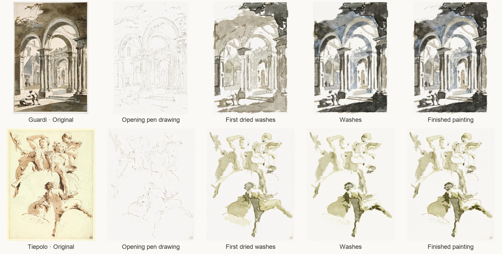

# Ink

Pen and wash pairs an ink drawing with washes over or under it. Each run saves the drawing and the washes as separate images (`ink.jpg`, `wash.jpg`) beside the painting.

Auto 0.5 painting Guardi’s *A Colonnade* and Tiepolo’s *Bacchus and Ariadne*. Both runs use pen. The fourth column shows the washes on their own. [Picture credits](../bench/PICTURES.md#museum-works).

## Ink or pencil

The default drawing is light pencil, which does not move under water (`--outlinemedium graphite`). Ink is drawn with `--outlinemedium ink` or `--inkrecipe wash`. `--outlinemedium auto` draws ink when at least 0.5% of the source is pen line, and pencil otherwise (`src/paint/methods/medium-decision.mjs`). In the benchmark the model chooses pencil, pen or no drawing.

For a pencil drawing, Auto draws only the first light lines (`src/paint/methods/drawing-default.mjs`). These are the outlines, the lines that place the main shapes, the inner contours, the quarter of lines that matter most and the lines round facial features. None is darker than the first light lines. Hatching and texture marked `drop` are left for the washes. A pen drawing lays all lines.

## Drawing files

For Auto, the line source is a drawing file (`--drawingfile STEM`), made as in [tools/seg](../tools/seg/README.md). Without it the painter logs `!!! NO LINE` and draws nothing. The pen or pencil draws the file's lines as they are. The painter reads only how dark the target's lines are, to set how much ink the pen carries (`src/paint/methods/ink-lines-file.mjs`):

- `--inkdarkmatch c`: adjusts the ink on a scrap of paper until test strokes are `c` times as dark as the target's firm lines.
- `--inkdarkcap c`: limits the ink so a test line on scrap is at most `c` times as dark as the target's.
- `--inkwidthfloor f`: no line is thinner than `f` pixels of the target.

## The dip pen

`src/media/pen.mjs` models a dip pen after Kim et al., "[Hydrodynamics of Writing with Ink](https://doi.org/10.1103/PhysRevLett.107.264501)" (*Physical Review Letters*, 2011).

- Contact: more pressure spreads the nib and widens the line. A fresh dip carries a drop that widens the first marks.
- Speed: slow strokes leave more ink for each millimetre. Fast strokes thin out.
- Running out: as the ink runs low, the line thins and skips over raised fibres. Then the pen is dipped again.
- Paper: dry paper gives a crisp edge. Damp paper pulls ink along its fibres, so the line feathers.

Ink colour is separate from the wash paints. It is `sepia` (the default, which dissolves in water) or `black` (waterproof). `--inkfast auto|1|0` sets whether the opening ink dries and sets before the washes.

## Pen-and-wash recipe

`--inkrecipe wash` sets the flags for pen-and-wash pictures (`src/paint/methods/ink-recipe.mjs` lists every value). Flags on the command line override it. It draws in ink before the washes and again after them (`--drawing both --stages prepink,finishink`). It matches the ink's darkness to the target's lines. It also paints on a finer sheet. `npm run example:animal` paints one.

`--drawing` sets when lines run: `first` (default), `both` (the opening drawing, then closing accents over the dry washes, taken from `--drawinglast STEM` or the `finishink` stage), `last` or `none`. `--drawingonly 1` lays the drawing alone.
