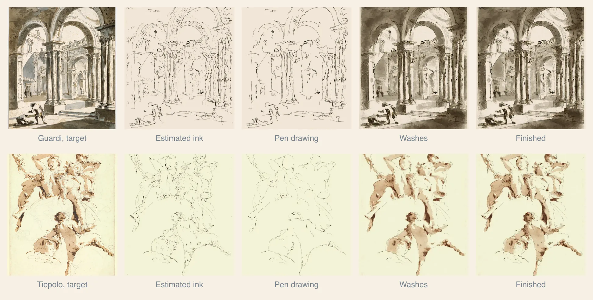

# Ink

Pen and wash is an ink drawing with watercolor over or under it. The painter keeps the two layers separate, so you can see each one.



Two pen-and-wash paintings. Both targets are almost all pen line. Each row: the target, the estimated ink, the pen drawing before any paint, the washes before the closing ink, and the finish. The estimated ink is worked out from the saved frames; the painter doesn't save it as a layer. Both were painted with release 0.1.0 (painter V096, sim 100).

In the third image of each row, the pen drawing is thin, brown and hard-edged. In the fourth, the washes are broad and soft and settle into the shapes the pen set. The ink gives the structure and the wash gives the light.

## Ink or pencil

In 0.2.0 `--outlinemedium` defaults to graphite, a light pencil underdrawing, while ink is reworked. On a run with no prepared drawing, the [automatic stage choice](#automatic-drawing-stages) can still add ink stages. Pencil is light, neutral and does not move under water, so the washes cover it.

`--outlinemedium ink` draws in ink. `--outlinemedium auto` chooses from the target. It draws in ink if at least 0.5% of the picture reads as ink line (`--penfirst`), and in pencil below that. Ink on a target without line would add marks the original lacks.

A plan can set this itself. `drawing.medium: "ink"` asks for ink. The `drawing` section also sets the ink color, how many lines and how heavy ([plan-format.md](plan-format.md#value-plans-the-drawing-section)).

## Where the lines come from

A plan picks the line set with `drawing.source`:

| Source | Use it for | Avoid it for |
|---|---|---|
| `source-ink` | pen drawings and pen-and-wash masters: the target's own pen lines, traced | photographs (it traces dark ridges, not structure) |
| `photo-sketch` | architecture photographs: continuous structural lines with a width hierarchy (`tools/seg/sketch-lines.py`) | portraits and loose landscapes, where it is weaker; it needs python3 with numpy and OpenCV |
| `auto` | anything: `source-ink` when at least 0.5% of the target reads as pen line, else `photo-sketch` when it can run, else the pen finds its own lines | |
| `none` (default) | a plan with no source: the pen finds its own lines, or draws a `--drawingfile` | |

Under the plan's choice, the painter's tools are:

- The ink separator in `src/crop/inkwash.mjs` sorts the picture into ink, pigment, edges and bare paper.
- `tools/seg/ink-lines.mjs` traces that estimated ink into center lines and joins pieces that continue each other.
- Optional: a trained line model (`tools/seg/lines.py`) makes a line drawing from any target. You don't need it.
- Optional: `tools/seg/sketch-map.py` runs the published fine and coarse lineart models once before painting. `sketch-lines.py --map` uses that map as evidence ([setup](../tools/seg/README.md)).

The line tools need python with numpy and OpenCV. The painter picks `--sketchpython`, else `PAINTER_LINES_PYTHON`, else `$PAINTER_LINES_VENV/bin/python`, else the repo's `.venv-lines/bin/python`, else `python3`. `tools/cloud/setup-lines.sh` installs `.venv-lines`.

The plan picks which candidates to draw. A plan with `lines: "regions"` orders lines by the part of the picture they lie in. Head and hands come first, then clothing, then the setting. `maxLines` caps the count.

## The pen

`src/media/pen.mjs` is a dip pen. It follows Kim et al., "[Hydrodynamics of Writing with Ink](https://doi.org/10.1103/PhysRevLett.107.264501)" (Physical Review Letters, 2011). The paper finds that paper pulls ink out of a nib at a steady rate. That fact explains most of how a pen line looks.

- Contact. The nib, the pen's metal tip, touches a small circle. Pressing harder spreads its two halves and widens the circle. A freshly dipped nib carries a drop, so the first marks are wider.
- Speed. A slow stroke gets more ink per millimeter, so it comes out wide and dark. A fast stroke comes out thin.
- Running dry. As the nib empties, the line thins. Then only the paper's raised fibers touch ink, so the line skips. Then the pen dips again.
- Dry paper. Ink soaks into the pores and the fibers filter the dye, so the edge is crisp and slightly ragged.
- Damp paper. The dye joins the water already in the pores and wicks along the fibers, so the line feathers.

The ink color is separate from the wash palette. The default is a warm sepia, and black is the other choice.

Black opening ink sets before the washes by default; sepia stays soluble. `drawing.ink.waterproof` chooses whether it sets (`--inkfast auto|1|0`). The pen uses the declared `--inkconc` load. It keeps one nib reservoir across marks until it needs another dip. A plan can say the target is drawn in pen. Then the pen draws the source's own ink, short descriptive marks included, without the sparse sketch's 12-line, 8 mm limits. The plan says so with an `ink-and-wash` style, `drawing.medium: "ink"`, or a prepared line file (`--drawingfile`). A painted target without such a plan keeps the sparse limits. The separator also reads dark painted edges, such as foliage and windows, as ink. `--sourceink 0|1` overrides the choice. The source-ink closing pen defaults to pressure 0.6. Explicit `--openinglines`, `--closinglines`, `--openingminmm` and pressure flags win.

Three flags shape the closing pen. `--closingshare c` gives the opening and closing pens one line budget, with `c` of it for the closing pass. `--inkdarkskip v` cuts closing lines where the plan's value is above `v`, since the wash already states those edges. `--closingconc f` dilutes the closing ink, so accents stay lighter than the darkest wash.

## Holding ink to the target

In painter V101, five flags hold the pen to the target's own lines. Each is off by default, so without them V101 draws as V100 does. Before painting, the painter reads the opening (`--drawingfile`) and closing (`--drawinglast`) line files against the target (`src/paint/methods/ink-lines.mjs`). That includes the files the linked drawing stages write (`stage-prepink-lines.json`, `stage-finishink-lines.json`).

- `--linesupport t` keeps only the parts of a line where the target shows a line. Along the path, the target must be at least `t` L* darker than the mean of both sides, 1 to 2.25 target pixels out. Plain paper, a light line such as a white whisker, and a path along a tonal edge with no line fail. Default 0, off.
- `--linesmooth mm` smooths traced lines that step from pixel to pixel. Corners sharper than `--linesmoothcorner` degrees (default 50) stay sharp. Default 0, off.
- `--inkwidthfloor f` draws no ink line thinner than `f` target pixels on the sheet. The nib's widest contact rises to the floor when it must. Default 0, off.
- `--inkdarkcap c` sets the ink load from a test line on a scrap of the same paper (`src/paint/methods/ink-scrap.mjs`). On blank paper, the pen's line is then `c` times as dark as the target's lines are against what is beside them. Darkness is compared as absorbance. The cap only lightens the ink. Each pen stage is capped from its own line file. Default 0, off.
- `--inkdamp d` makes the pen find the paper at least `d` damp (0 to 1), as on a sheet not yet quite dry. At 0.3 a line spreads to about twice its contact width with soft edges. Default 0, dry paper.

`--linesupport` and `--linesmooth` write `ink-opening-lines.json` and `ink-closing-lines.json` next to the painting, and the pens draw those. Any of the five writes the target's line measures to `ink-lines.json`. `--inkdarkcap` also writes `ink-dark-cap.json`.

`--inkrecipe v2` sets all of them at once. A flag given on the command line wins over the recipe.

| Flag | Ink v2 | Off |
|---|---|---|
| `--linesupport` | 5 | 0 |
| `--linesmooth` | 1 | 0 |
| `--linesmoothcorner` | 50 | 50 |
| `--inkwidthfloor` | 1 | 0 |
| `--inkdarkcap` | 1 | 0 |
| `--inkdamp` | 0.3 | 0 |

The recipe does not turn ink on. Add `--outlinemedium ink --drawing both` for an opening ink drawing with closing accents.

See [Choosing linework](linework.md) for the short job-to-tool guide and its defaults.

## Pen and wash ink

`--inkrecipe wash` is ink for pen drawings and pen-and-wash sources, such as a Guardi or Tiepolo sheet or an ink-led sketch. It is in painter V101-dev from after 0.2.1-rc.1, and it is off by default. It turns ink on by itself.

- Lines. The pen draws the source's own pen lines, traced whole by `tools/seg/copy-lines.py`, first and with no pencil. The tracer runs when at least 0.5% of the source reads as pen line (`--copylinesmin 0.005`). It needs python with NumPy and OpenCV, as the other line tools do.
- Agreement. The tracer takes any narrow dark mark, so it also traces wash edges and the rims of dark brush masses. `--copylinesagree 2` cuts each traced line to the parts within 2 cells of what the ink separator reads as pen line. On Guardi, at 540 px, this keeps 507 lines whole, cuts 989 and drops 1871.
- No pen line. `--copylinesfloor 0.6` draws no pen lines when the separator reads under 0.6% of the source as pen line. The source then gets washes only.
- Placement. The support filter keeps a line only where the source shows one, joins gaps up to 0.6 mm and drops pieces under 1.2 mm. Smoothing is light, at 0.3 mm, so a short descriptive mark keeps its shape.
- Width and pressure. `--linemeasure 1` reads the source's line under each point of each stroke: its width, and its darkness against what is beside it. The pen then follows both, so a line swells and fades where the source's does.
- Darkness. `--inkdarkmatch 1` draws 60 of the stage's real strokes on a blank sheet and scales the ink load until their line cores are as dark as the source's. It raises the load as well as lowering it, within 1/8 to 4 times.
- Colour. `--inkhue source` turns the ink's absorption to the colour of the source's own line cells, so a bistre line stays brown and a black ink sketch stays neutral.
- Wet lines. `--inkbleed 0.35` draws a line the source shows wide and pale on paper 0.35 damp, so it feathers. Other lines are dry and crisp.

| Flag | Wash | Off |
|---|---|---|
| `--outlinemedium`, `--drawing` | `ink`, `both` | `graphite`, `first` |
| `--linesource` | `source-ink` | `none` |
| `--copylinesmin` | 0.005 | 0.025 |
| `--copylinesagree`, `--copylinesfloor` | 2, 0.6 | 0, 0 |
| `--drawingstages` | `off` | `auto` |
| `--stages` | `prepink,finishink` | none |
| `--prepinkfrom`, `--prepinkamount`, `--prepinkkeep`, `--prepinkadd`, `--prepinkdeviate` | `lines`, 1, 1, 0, 0 | stage defaults |
| `--openingpressure` | 0.75 | 0.3 on a staged run |
| `--linesupport`, `--linesmooth`, `--linesmoothcorner` | 5, 0.3, 50 | 0, 0, 50 |
| `--linegapmm`, `--lineminmm` | 0.6, 1.2 | 2 and 3 file pixels |
| `--inkwidthfloor` | 1 | 0 |
| `--linemeasure` | 1 | 0 |
| `--inkdarkmatch` | 1 | 0 |
| `--inkhue` | `source` | `profile` |
| `--inkdamp`, `--inkbleed` | 0, 0.35 | 0, 0 |

With `--linemeasure`, a line file drawn on a finer grid than the painting's is read on the painting's grid. `--inkdarkmatch` writes `ink-dark-match.json`. A flag given on the command line wins over the recipe.

`--lineinkonly 1` also keeps a line only within a pixel of cells the ink separator reads as pen line. On the ink-led sketches it drops the brush marks in foliage that the tracer reads as lines. On a Guardi it also drops arch mouldings drawn beside wash, so the recipe leaves it off.

The recipe is not for photographs. On a target with less pen line than `--penfirst` (0.5%) the painter warns. Fragonard's brush-and-wash Rinaldo reads as 0.41% pen line at 540 px, under `--copylinesfloor`, so it gets no pen lines.

## Linework stages

A drawing is up to three jobs, each from the same line set:

| Stage | Job | Medium | When to use it | Skip it when |
|---|---|---|---|---|
| `prep` | place the big shapes lightly before any ink | pencil (graphite) | placement is hard: architecture in perspective, portrait proportions, or a style that shows graphite | the subject is a simple silhouette, or the source is pen only |
| `prepInk` | the opening pen drawing, before the washes | ink | the structure must hold the washes (pen and wash, urban sketch) | pure watercolor with no visible line |
| `finishInk` | closing accents over the dry washes | ink | edges and darks the washes softened need restating | the opening ink already reads at the finish |

The stages are linked. Prep ink follows the pencil with small deviations: it refines each line, drops some (that pencil stays visible) and adds a few the pencil left out. Finish ink restates a share of the prep ink where the target's edges or darks are strongest. With no `stages` in the plan, prep ink and finish ink are each planned on their own.

Each stage takes a few choices ([plan-format.md](plan-format.md#value-plans-the-drawing-section)):

| Choice | Pick | For |
|---|---|---|
| `prepInk.method` | `contour` (default) | clean outlines; architecture and most subjects |
| | `connected` | longer, joined gestures over the same lines |
| | `scribble` | black or curly coats, dark hair: fewer longer strokes, lit edges left open, dark masses as loose scribble |
| `finishInk.method` | `accent` (default) | the strongest part of each chosen line, restated |
| | `architecture` | frames, arches, cornices and sills restated whole, thin and dark at full pressure (the Y1 closing pen) |
| `finishInk.masses` | `scribble` | a black coat that needs a pen texture over its paint; off by default, since a dark surface is paint's job |

Ink is waterproof (`drawing.ink.waterproof`) by default for black and soluble for sepia. Waterproof ink suits pen and watercolor and urban sketches, where the line must survive the washes. Soluble sepia suits brown ink-and-wash masters, where a wet wash should soften the line.

Each run with stages writes `stage-prep.jpg`, `stage-prepink.jpg` and `stage-finishink.jpg`, the sheet after each stage. It also writes `layer-*.jpg`, what each stage laid on its own, with the stage line files and `linework.json`.

## Automatic drawing stages

`--drawingstages auto`, the default, chooses the linked stages for each picture (`src/paint/methods/drawing-stages-auto.mjs`). It does not run when the command line names a `--drawingfile` or `--drawinglast`, or the run has a plan with `drawing.stages`, `--drawing none` or `--drawingstages off`.

The rule in `src/paint/methods/drawing-choice.mjs` reads the picture before painting:

- `prep`: a light pencil placement, or a fuller one for built structure. A picture with under 0.5% of its cells on an edge gets none.
- `prepInk`: ink over the pencil, for a pen source or built structure. A pen source shows at least 2.5% pen line. Built structure has two or more vanishing points carrying 12% of the long edges.
- `finishInk`: closing ink accents when at least 2% of the cells lie on an edge, which is most pictures.

Any ink stage sets `--outlinemedium ink`. An ink finish adds a closing pass, `--drawing both`, or `last` when there is no opening stage. With no stage at all the run draws nothing. A typed `--drawing first` drops the finish. The pen-and-wash style always gets `prepInk` and no `finishInk`. With `OPENROUTER_API_KEY` set, a vision model proposes the stages first; it can drop an ink stage but cannot add one the rule refuses. The choice is written to `drawing-choice.json`. `--drawingstages off` keeps the plain pencil drawing.

## Drawing order

The default recipe sets `--drawing first`: the drawing goes down first and dries, then the washes. A closing pass needs `--drawing both`, a plan's `finishInk` stage or `closingLines`, or an ink finish from the automatic stage choice. The opening drawing places the forms for the washes to fill. Sepia ink can rewet, so a wash over wet ink would smear it. The pen keeps one reservoir across marks and dips again when it runs low, so a long line does not run dry. The washes soften and partly cover the lines. A closing pass, when asked for, adds a few dark accents where the target has strong edges.

| `--drawing` | Before paint | After paint |
|---|---|---|
| `both` | drawing | ink accents |
| `first` (default) | pencil, or ink if asked | nothing; an ink finish stage or a plan's `closingLines` switches to `both` |
| `last` | nothing | ink |
| `none` | nothing | nothing |
| `detect` | the drawing, if the target shows pen line (`--penfirst`) | ink, if it does not |

Each image run writes `ink.jpg` and `wash.jpg` next to `painting.jpg`.

## Try it

```sh
npm run example:drawing
node tools/paint-plate.mjs --image <target> --outlinemedium ink
node tools/paint-plate.mjs --image <target> --outlinemedium ink --drawing both
node tools/paint-plate.mjs --image <target> --outlinemedium ink --inkprofile black-ink
node tools/paint-plate.mjs --image <target> --drawing last
```

For a value plan that selects `ink-and-wash`, the default recipe keeps the target's paper tone (`--paperrgb source`), a lean fitted palette, nested light-to-dark value masses and planned stroke lanes (`--strokeplan 1 --laneadapt 1`).

[running.md](running.md#main-command-line-controls) lists the other controls.
