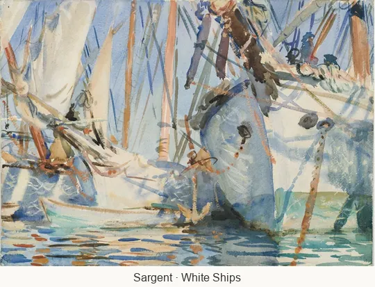

# Judging

In the clean 0.5.1 benchmark, three judges see the original beside the finished painting. The original is the 9/10 reference for watercolour craft. The judges also see ten stills from the film to score how human the process looks. Human-ness below 65% reduces the craft score. Likeness has its own column. Final scores are pending. [Scoring formula and judges](../bench/docs/scoring.md).



## Checks on a painting

These tools measure the painting after it dries. Their readings stay out of the model’s session. [Honesty](honesty.md).

- `node tools/judge/judge-plate.mjs --image TARGET --painted PAINTING.jpg`: measures one painting with the code in `src/eval/`. It checks tone levels and how much paper is left bare (`values.mjs`), how well tones and lines match by region (`fidelity.mjs`) and colour difference (`colour.mjs`).
- `node tools/judge/stage-check.mjs RUN_DIR`: checks whether the saved frames follow the order a painter would use (`src/eval/stages.mjs`). It flags three things. One is big shapes that are under half their final darkness a third of the way in. Another is speckle in the first half. The last is more than 70% of the final tone already down a quarter of the way in.
- `tools/judge/rounds/`: blind comparisons of stages. `run.mjs` mixes a new run with a control, a copy of the control, a known good run and a known bad run, under shuffled letters. `tally.mjs` drops any judge that ranks the controls wrongly.

## Stroke sizes

`tools/stroke-stats.mjs` and `tools/stroke-gate.mjs` flag large plain areas filled with tiny dabs or narrow sweeps. A dab is tiny if it is under 1 mm wide or 3 mm long. Tiny dabs or narrow sweeps may cover at most 30% of such an area. Detail work, pen lines and the 1 mm band along an edge are exempt.

```sh
node tools/stroke-stats.mjs RUN_DIR --out PANEL
node tools/stroke-gate.mjs RUN_DIR --mode reject
node tools/run-plan.mjs plan.json --stroke-gate reject --out work/plan
```
