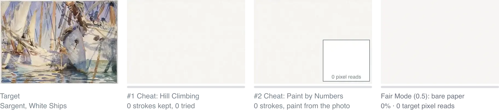

# Judging

Scores evaluate a painting **only after it dries** and never feed back into the painter ([honesty](honesty.md)). In **0.5.1**, every benchmark run is scored by the **`open2`** panel — two open-weight vision models (**Qwen 3.8 27B** and **Gemma 4 31B**) that run identically on local Apple Silicon (MLX) or OpenRouter.

## 1. Craft (`Q`) + Human-ness gate (`H`)

A finished image alone is easy to game: hill-climbing random dabs or sampling pixels can look close while painting like a broken printer. Judging therefore splits **finished craft** from **painting process**:

- **Craft `Q` (Versus Auto):** Each judge compares the finished painting side-by-side against **Auto 0.5** and the target twice — once as `(A, B)` and once swapped as `(B, A)` — cancelling position bias without an inflated 9/10 reference anchor.
- **Human-ness `H` (10 replay stills):** Each judge inspects 10 frames from blank paper to finish. Below `65%`, craft is scaled proportionally: **`Combined = Q × min(1, H / 65)`**.

## 2. Difficulty-adjusted scoring & why pixel metrics fail

Pictures vary by ~20 points in average difficulty: loose, bright scenes (*Cézanne*, *White Ships*) score much higher than dense architectural ink-and-wash (*Guardi*, *Prout*, *Yale Rosewalk*). Comparing raw scores across different pictures rewards whoever got the easiest subject.

- **Head-to-head rankings** always compare models on the **exact same 15-picture panel** (`All 15 · L2`) or `Core 5 · L1–L4`.
- **Standout highlights** subtract each picture’s field mean (**`Adjusted Δ = score − subject mean`**) so a strong painting on a hard subject beats a mediocre painting on an easy one:

- **Why not `ΔE` or `SSIM`?** In our **`L4b` Open-Book control**, giving frontier models full Python/OpenCV access to the target’s pixels cuts colour error `ΔE` by **19–53%** and doubles SSIM — yet judges reject the muddy, over-painted result **`0 / 5`** against honest Auto 0.5 washes.

## 3. Automated checks & CLI

| Check | Command | What it catches |
|---|---|---|
| **Plate metrics** | `node tools/judge/judge-plate.mjs --image TARGET --painted PAINTING.jpg` | Tone balance, bare paper (`values.mjs`), regional fidelity, colour error |
| **Stage order** | `node tools/judge/stage-check.mjs RUN_DIR` | Early speckle, front-loaded darks (`>70%` at ¼), or timid washes (`<50%` at ⅓) |
| **Stroke gate** | `node tools/stroke-gate.mjs RUN_DIR --mode reject` | Filling broad areas with `>30%` tiny dabs (`<1 mm` wide or `<3 mm` long) |
| **Blind rounds** | `tools/judge/rounds/run.mjs` & `tally.mjs` | Shuffled control checks that drop any judge ranking controls out of order |

See [bench/docs/scoring.md](../bench/docs/scoring.md) for the exact `open2` prompt templates, judge weights, and calibration data.
