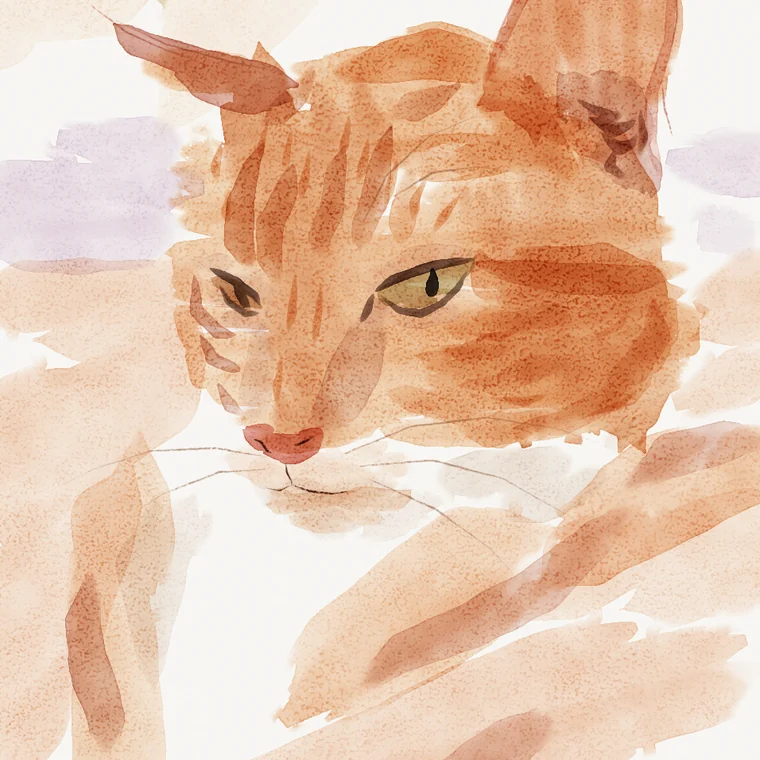

# Painting script

A painting script is a wash plan written the way a teacher writes out how to paint a picture: passages in the order a
painter lays them, each saying what it is, where (a loose region on the sheet), the paint, the brush, the move and the
kind of mark. A model that understands painting writes it by looking at the subject, the pen drawing and the block-in
studies; the painter executes it. It replaces the wash plan the painter computes from the studies:

```sh
node tools/paint-plate.mjs ... --washplan script:SCRIPT.json --paints <the script's palette> --paintsextend 0
```

Code: `src/paint/methods/script-washes.mjs` (the plan), `src/paint/methods/script-marks.mjs` (the marks),
`tools/painter/script-crop.mjs` (a script cut to a window of its sheet, for trying a piece fast) and
`tools/painter/script-overlay.mjs` (the passages and their strokes drawn over the subject).

## Format (painting-script 2)

```json
{
  "format": "painting-script 2",
  "subject": "h36", "author": "who wrote it",
  "sheet": { "widthMm": 280, "heightMm": 186.7 },
  "palette": ["ochre", "rawsienna", "ultramarine"],
  "brushes": { "mop": { "shape": "round", "widthMm": 22 }, "r8": { "shape": "round", "widthMm": 6 } },
  "approach": "how it will be painted, for people",
  "lights": [ { "what": "lit sill", "region": [[40, 34], [70, 34], [70, 37.5], [40, 37.5]] } ],
  "passages": [
    { "id": "p01", "what": "first wash: the stone front", "stage": 1, "kind": "wash",
      "region": [[6, 3], [272, 3], [272, 118], [8, 114]],
      "paint": { "pigments": { "ochre": 3, "rawsienna": 1 }, "dilution": "very pale", "swatch": "#efe0bf" },
      "paper": "wet", "edges": "lost",
      "handling": { "hold": "side", "start": "belly", "pressure": [0.7, 0.8, 0.6], "direction": 0, "speed": "fast", "load": "flooded" },
      "charges": [ { "pigments": { "sienna": 1 }, "dilution": "pale", "at": [[195, 88]], "brush": "r8" } ] },
    { "id": "p11", "what": "tree shadows", "stage": 3, "kind": "strokes", "brush": "mop", "paper": "dry",
      "paint": { "pigments": { "ultramarine": 3, "rose": 1 }, "dilution": "pale" },
      "strokes": [ { "points": [[50, 38, 0.2], [58, 47, 0.7], [66, 58, 0.9], [76, 78, 0.15]] } ] }
  ]
}
```

| field | meaning |
|---|---|
| `sheet.widthMm` | must be the painter's `--sheetmm`; positions are sheet millimetres, x right, y down |
| `palette` | box keys (`src/crop/box.mjs`); give them to the painter with `--paints` |
| `brushes` | the kit by name; `widthMm` is the loaded belly's width at full pressure. Every brush is laid as a round today |
| `lights` | paper kept: no wash lane runs through a light and no touch is set down in one (they are worked round, not masked) |
| `stage` | 1 first pale washes, 2 local colours and masses, 3 shadows and glazes, 4 touches, 5 darks and accents; the replay's value step |
| `kind` | `wash` (overlapping strokes of a brush sized to it, about a third of its width, unless `brush` is named), `strokes` (a few separate strokes), `touches` (short marks scattered like a hand), `lines` (the point along each of `paths`) |
| `region` / `regions` | loose polygons (mm) that place the strokes; a guide to the hand, never a clip |
| `paths` | polylines the point follows, for `lines` |
| `strokes` | strokes written one by one: `{points: [[x, y, pressure], ...]}` (a point may add the hand's speed there in mm/s: `[x, y, pressure, speed]`), or `{from|at: [x, y], direction, lengthMm, pressure: [...], path}`; a stroke may name its own `brush` |
| `count`, `character` | for groups: how many, and `size` (even, varied), `spread` (scattered, clustered, along a line), `denser` (top, bottom, left, right, edges, middle) |
| `paint` | pigment parts; `swatch` (or `dilution`: very pale, pale, medium, strong, rich, dark) is the mix as one wash on white paper, and sets its strength |
| `paper` | `dry`; `wet` (clean water first, or with `into` into the wet passage just before); `damp` with `into` (laid beside the passage just before as it loses its shine) |
| `handling` | `mark` (one of the 26 kinds of the shared mark library, `src/paint/marks`: the executor places each stroke and the library gives it its pressure, speed, blade and water; strokes written point by point are laid as written), `hold` (upright, side: the belly, the width steadier), `start` (point, belly), `pressure` (a list from start to end; the width follows it), `path` (straight, curved, s-curve, zigzag, flick, wobble), `direction` (degrees, 0 right, 90 down), `speed` (slow: more points and a waver; fast), `load` (flooded, loaded, damp, dry: the brush's water; dry is dry brush), `lengthMm`, `look` (for people) |
| `into` | the passage just before; this one is laid in the same wet session |
| `wait` | how far the sheet dries before this passage: `dry` (the default: everything dried first, a new sitting), `damp` (laid straight after the passage before, beside it as it loses its shine) or `none` (straight on). The plan records it per passage |
| `glaze` | `[i, n]`: one of a series of glazes over the same area (recorded; each is laid on a dry layer unless `wait` says otherwise) |
| `shapes`, `reserve`, `{along: id}` | a block-in study's shapes by number (`tools/painter/script-resolve.mjs` turns them into regions, a passage's own reserves and a stroke down a shape's axis; the shapes come from the authoring tools' numbered list) |
| `charges` | dabs of their own mix dropped into the passage while wet, one at each `at` |
| `edges` | `lost` on dry paper: laid into a damp bed of clean water under its own footprint, so its edges run soft; `found` or `mixed`: on the paper as it is |
| `what`, `dryFirst`, `why` | for people and judges; a stage-3 passage on dry paper is laid as a glaze |

Touches are set down like a hand: scattered (no two nearer than half the even spacing, never on a grid), in clumps,
or along the region's long axis, weighted toward the side `denser` names, and visited nearest-next from the top left.
Each is held to the region's chord along its direction (and stops at a light), so it keeps inside the shape it is
laying without being cut. Every stroke has its own small irregularity of place, angle, length and pressure from a hand
seeded by the passage's id. Format 1 scripts (`mark`, `move`, `strokes` as a count) are upgraded on reading.

`tools/painter/script-overlay.mjs` draws a script as the painting it describes, before it is painted: each stroke a
ribbon as wide as its pressure, in its paint, each passage multiplied over the last, the lights blank, a dot at each
stroke's start and an arrow at its end; with `--stages` and `--order`, the same after each stage and after 5 to 100% of
the passages.

## A real passage

Passage "crown" from a model's script for Mittens (gpt-6-astra at level 2, 22 Nov 2026, commit `66690c4f`). Its two
outlines are cut short here.

```json
{ "id": "crown", "what": "Honey shadow near the parting of the brow", "stage": 3, "kind": "wash",
  "paint": { "pigments": { "sienna": 2, "ochre": 2, "umber": 0.3 }, "swatch": "#f4ddcb", "dilution": "pale" },
  "brush": "10", "paper": "wet", "edges": "lost", "wait": "dry",
  "handling": { "mark": "sweep", "direction": -65, "hold": "side", "start": "belly", "load": "loaded", "speed": "medium" },
  "regions": [ [[91.14, 149.9], [90.57, 147.48], "... 54 points"], [[139.76, 164.95], "... 72 points"] ],
  "why": "Honey shadow near the parting of the brow." }
```

| Part | In "crown" |
|---|---|
| Shape | two outlines, in sheet millimetres |
| Paint | burnt sienna 2, yellow ochre 2, burnt umber 0.3 (parts); pale |
| Brush | the script's 10 mm round |
| Paper | wet: clean water is laid first |
| Into | none; a passage on damp paper names one, such as `"into": "headlight"` |
| Wait | dry: the sheet dries before it |
| Strokes | sweeps with the side of the brush, pulled up and to the right (-65 degrees) |
| Stage | 3, shadows and glazes |



As painted: 17 clean-water strokes, then 14 paint strokes. More of this script: [Auto against a model](auto-vs-model.md).

## What it adds to the plan format

The wash plan becomes a file a model writes (`bench/v6/TASK.md`, "not yet executable": the wash plan was computed inside
the painter from the studies). New in the plan's vocabulary: passages with a mark kind, brush, move, direction, count
and length; charges at named points; `into` for a wet session; swatch colours. The painter's own plan (`value-plan.json`)
records each passage as an instruction with its strokes, so a script and the strokes it became can be compared.

## Not yet

- Flat brushes are laid as rounds; `hold: side` only steadies the width.
- `swatch` is the mix on white paper; glazes over earlier passages compound. The plan writes, for each passage, the
  finished film it predicts over its cells against the subject's mean there (`summary.colourCheck`), as a check only.
- Lifting, scraping and masking fluid are not marks.
