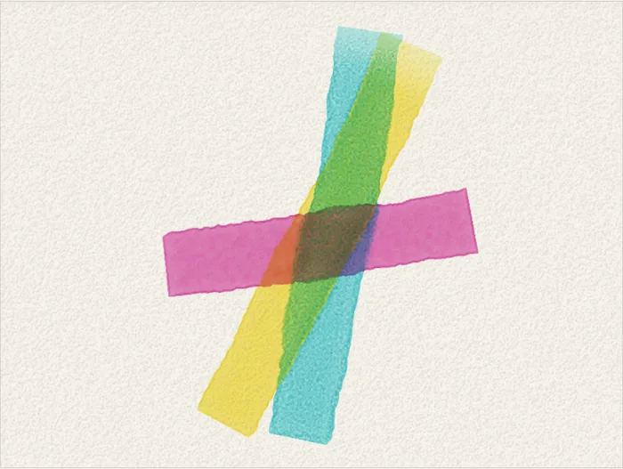
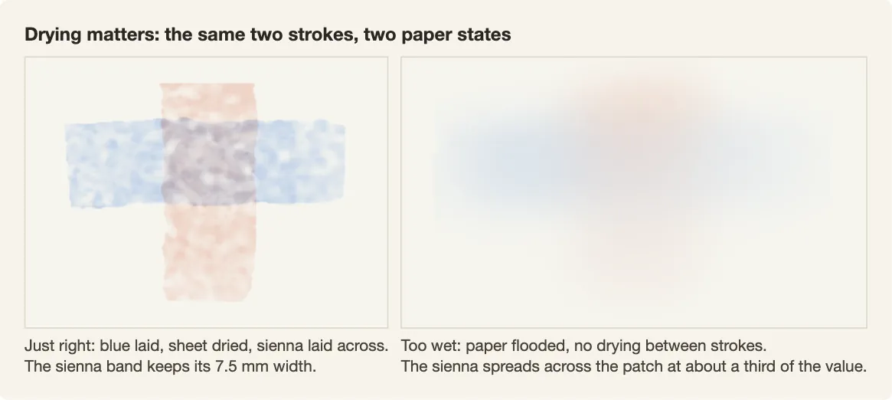

# Pigments and paper

## Kubelka-Munk layers

`src/media/km.mjs` gives each paint two numbers for each of red, green and blue. K is the light the paint absorbs. S is the light it scatters back. There is no full spectrum model. `fromColours` works out K and S from the paint's colour over white and over black (Curtis et al. 1997).

Paints mixed in one wash have their K and S averaged, weighted by thickness. A dried wash is its own layer. Layers stack over the paper, oldest first, with `R = R1 + T1² R2 / (1 − R1 R2)`. Light passes through the top layer, reflects off what is under it and comes back through. So a glaze differs from the same paints stirred together. A glaze is a transparent wash over dried paint.

[examples/plans/glazes.json](../examples/plans/glazes.json) paints glazes with `node tools/run-plan.mjs`.

## The box

The painter mixes from the 16 paints in `src/crop/box.mjs`:

- Eleven are measured, using published colours: French ultramarine, phthalo blue, cerulean blue, phthalo green, hansa yellow, cadmium yellow, yellow ochre, burnt sienna, burnt umber, quinacridone rose and cadmium red.
- Raw sienna is estimated.
- Lamp black absorbs light evenly.
- Sap green, Payne's gray and sepia are mixes of the other paints.

On the sheet, each paint behaves by its published granulation, flocculation, staining and density (`src/media/pigment-physical.mjs` lists the sources). Granulation is how much the pigment settles into the paper's texture. Flocculation is how much it clumps. Staining is how hard it is to lift off. The paints for a picture are chosen with one fixed set of constants, so the physics cannot change which paints a picture gets.

| pigment | granulation (gamma) | flocculation | staining (omega) |
|---|---|---|---|
| French ultramarine, cerulean blue | heavy (0.85) | yes (0.3) | non-staining (0.5) |
| yellow ochre, raw and burnt sienna | moderate (0.55) | ochre slight, siennas none | non-staining |
| burnt umber | slight (0.25) | none | non-staining |
| phthalo blue and green, hansa yellow, quinacridone rose | none (0) | none | staining (20) |
| cadmium yellow and red, lamp black | none | none | non-staining |
| sap green, Payne's grey, sepia | their parents' shares | | |

White gouache is a paint on the sheet too (`src/media/gouache.mjs`). It absorbs almost no light and scatters it as an opaque paint does. The finish lays it with a thin brush for fine lights that no wash could have left bare.

## Paper

`src/media/paper.mjs` builds a height map of curved fibres and fine tooth. By default the height is the cold-press relief from `src/media/paper-relief.mjs`. That is one fixed pattern, measured in micrometres and fitted to the grain of real washes. It is averaged over each cell, so a sheet at any cell size is the same paper. `--paper flat --paperphysical 0` turns it off. Pigment settles through the water at its Stokes speed, and faster into hollows (`src/media/settling.mjs`). So ultramarine, cerulean and the earth colours granulate, and the staining organic paints dry smooth. A wetter or slower-drying wash granulates more.

## Water and drying

`src/media/sheet.mjs` tracks five things in each cell: surface water, pore water, floating pigment, settled pigment that is not yet fixed, and pigment in the pores.

Water evaporates faster at the edge of a wash. More water flows out to replace it and carries pigment with it, so the edge dries darker. Damp pores can wet the surface again beside standing water. That makes backruns and blooms, which are the cauliflower shapes that form where water runs back into a drying wash.

`dry()` steps the sheet forward until it is dry. Then it fixes the settled pigment as a new layer. New water lifts a little of the top layer, and more of the pigment that is not yet fixed.

On dry paper the next wash keeps its shape and glazes over what is there. On wet paper it spreads and mixes. The painter paints wet into wet on purpose for soft edges. A painting that never dries turns every glaze to a blur.

Both pictures use the same blue and sienna strokes. When the paper dries in between, the sienna band stays about as wide as the brush. When it is flooded and not dried in between, the band spreads and dries at about a third of the darkness (`examples/plans/drying-dry-between.json`, `drying-too-wet.json`).

The plan decides when to dry. `src/paint/methods/wetdry.mjs` measures the surface water and how full the pores are. It waits until the paper is dry enough to glaze, or wet enough to blend.
