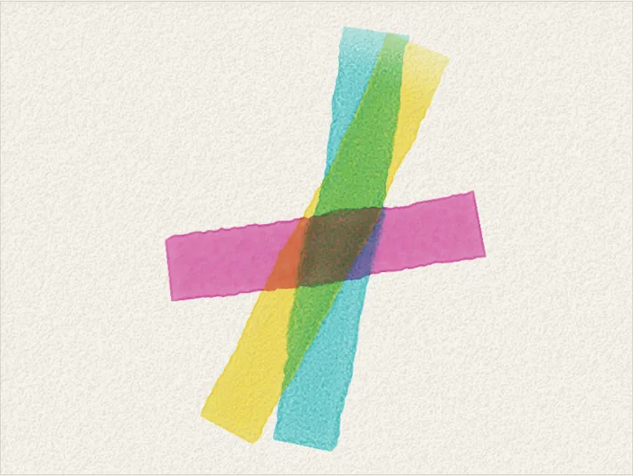
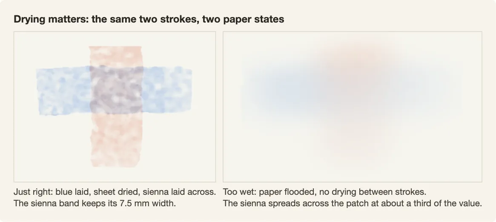

# Pigments and paper

Watercolor is transparent paint on paper that absorbs water. The simulator models how layers of pigment color light, and how water carries pigment over and into the sheet.

## Kubelka-Munk layers

Kubelka-Munk is an optical model of how pigment absorbs and scatters light. `src/media/km.mjs` gives each paint two numbers per red, green and blue channel:

- K, how much light it absorbs
- S, how much light it scatters back

There is no spectral model. `fromColours` derives K and S from a paint's color over white and over black, after Curtis et al. 1997.

Paints mixed in one wash (a layer of diluted paint) average their K and S, weighted by thickness. A dried wash is a separate layer. Layers stack oldest first over the paper with the Kubelka-Munk layering formula, `R = R1 + T1² R2 / (1 − R1 R2)`. Light passes through the top layer, reflects off what is under it, and comes back through.



For that reason a glaze, a transparent wash over dried paint, looks different from the same two paints stirred together. The picture is the glaze demonstration in Paint Lab. It and the drying figure below were made with sim 100 (release 0.1.0). [examples/plans/glazes.json](../examples/plans/glazes.json) paints glazes from the command line:

```sh
node tools/run-plan.mjs examples/plans/glazes.json
```

## The box

The painter mixes from 16 paints in `src/crop/box.mjs`:

- Eleven measured paints: French ultramarine, phthalo blue, cerulean blue, phthalo green, hansa yellow, cadmium yellow, yellow ochre, burnt sienna, burnt umber, quinacridone rose and cadmium red.
  Their colors are published masstones, the colors of paint at full strength.
- Raw sienna, estimated.
- Lamp black, with flat absorption.
- Three mixes synthesized from the base paints: sap green, Payne's gray and sepia.

All 16 share the same physical constants:

| property | constant | value |
|---|---|---|
| opacity | S (scattering) | 0.02, so all are transparent |
| staining (resistance to lifting) | omega | 1.4 |
| granulation (mottled pigment texture) | gamma | 0.25 |
| density | rho | 0.05 |

Opaque white sits outside the Kubelka-Munk model. `src/media/gouache.mjs` lays opaque paint over the finished render, outside the physics simulation, and only when you ask for it.

## Paper

`src/media/paper.mjs` builds a height map of curved fibers and fine tooth, the paper's surface texture. By default (`--paper coldpress --paperphysical 1`) it adds cold-press bumps 0.5 to 2 mm across, plus broad swells and pits. Fiber lengths, density and brush relief are in millimeters. `--paper flat` and `--paperphysical 0` turn these off. The hollows hold more water in the pores.

Granulation follows the paper. Settling pigment is pushed toward the hollows, and settled grains slide downhill. A render-time pass (`microAmps`) adds the same effect below one cell.

## Water and drying

`src/media/sheet.mjs` tracks, for every cell:

- water on the surface and water in the pores;
- pigment floating in the water, pigment settled but not yet set, and pigment in the pores.

Water evaporates faster at the pinned edge of a wash, where the water's edge has stopped moving. Water flows out to replace it and carries pigment, so the edge dries darker. Damp pores can rewet the surface next to standing water. That rewetting makes backruns, blooms where wetter paint flows into a drying wash.

`dry()` steps the sheet until it is dry, then fixes the settled pigment as a new layer. New water can lift a little of the top layer back, and lifts more of unfixed pigment. When the painter draws in ink, sepia is the default and is rewettable. Black ink resists lifting better. The default pencil drawing does not lift.

## Why drying matters

On dry paper the next wash keeps its shape and glazes over what is there. On wet paper it spreads and mixes.



Both sheets use the same blue and sienna strokes:

- Just right: blue, dry, then sienna across it. The sienna band dries 7.5 mm wide, about the width of the 8 mm brush.
- Too wet: the paper is flooded with clean water first, and nothing dries between strokes. The sienna spreads across the whole patch and dries at about a third of the darkness.

Run them with `node tools/run-plan.mjs examples/plans/drying-dry-between.json` and `drying-too-wet.json`.

The painter uses wet into wet on purpose for soft-edged areas. A painting that never dries turns every glaze into a blur.

The plan decides when to dry. `src/paint/methods/wetdry.mjs` measures surface water and pore saturation and waits for dry-layer or wet-blend conditions. It stops execution if its readiness checks fail. The stroke-plan runner warns when `requiredPaper` is unmet and continues; each `dry` command dries the sheet.
