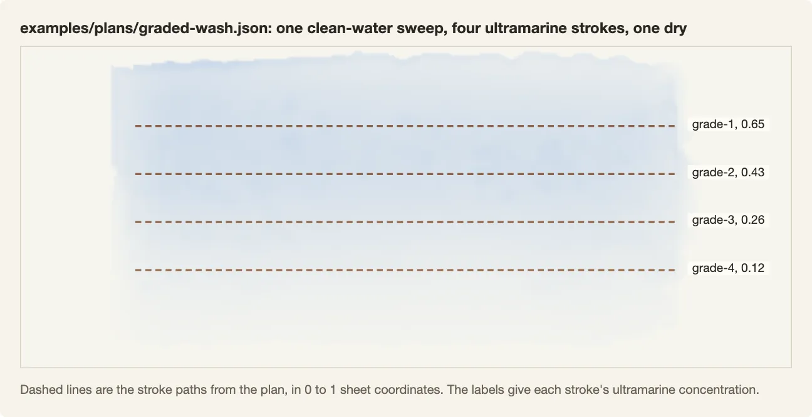

# Plan format

A stroke plan is a JSON file that tells the simulator what to paint: one entry per brush stroke, in order. Each stroke names a brush, a paint concentration and amount of water, and the paper moisture it expects. Its path is in sheet coordinates, with pressure and radius at each point. A `dry` entry dries the whole sheet before the next stroke. Text fields are notes for people; the simulator ignores them.

Run one with:

```sh
node tools/run-plan.mjs examples/plans/graded-wash.json --out work/plan-graded-wash
```

It writes `result.png` (the dried sheet) and `run.json`. Stroke-size admission warns by default; `--stroke-gate reject` refuses tiny-dab plans before painting. See [stroke sizes and thresholds](stroke-stats.md) for configuration and the planner guide.



The full example is [examples/plans/graded-wash.json](../examples/plans/graded-wash.json); its saved output is [examples/output/graded-wash-result.png](../examples/output/graded-wash-result.png).

## Top level

| field | type | meaning |
|---|---|---|
| `version` | integer | format version, currently `1` |
| `id`, `title` | string | names for people and output folders |
| `source` | object | optional notes on what the plan imitates (URL, author, timestamp, expected effect); ignored by the simulator |
| `grid` | `{w, h, mmPerCell}` | sheet size in cells and the physical size of one cell. 384 × 160 cells at 0.125 mm is a 48 × 20 mm study |
| `paperRGB` | `[r, g, b]` | color of bare paper in the rendered result |
| `paper` | object | paper surface: `fibres` and `tooth` (surface texture, 0 to 1), optional raised `coldPress` texture (`bumpMm`, `cover`, `swell`) |
| `paperSeed` | integer | seed for the paper texture and brush hairs; the same plan and seed give the same sheet on the same backend |
| `palette` | string[] | pigment keys from `src/crop/box.mjs`, for example `ultramarine`, `ochre`, `sienna`, `sapgreen`, `lampblack` |
| `budget` | object | limits a planner promised to respect (`maxGestures`, `maxWallSeconds`, `maxNativeSteps`); kept only in the input plan; ignored by `run-plan` and not copied into `run.json` |
| `commands` | array | the strokes and drying steps, in painting order |
| `criteria` | object | optional pass and fail notes for a judge; ignored by the simulator |

## Commands

A stroke:

```json
{
  "id": "grade-1",
  "operation": "stroke",
  "requiredPaper": "wet",
  "role": "paint",
  "brush": { "kind": "flat", "widthMm": 8, "orientation": "follow", "free": 0.4, "feed": 0.4, "film": 0.25, "wetMix": 0.85 },
  "load": { "capacityMm3": 160, "waterQuantityMm3": 112, "concentration": { "ultramarine": 0.65 } },
  "paths": [[
    { "x": 0.15, "y": 0.25, "p": 0.85, "rMm": 4.0 },
    { "x": 0.85, "y": 0.25, "p": 0.85, "rMm": 4.0 }
  ]]
}
```

Stroke fields:

- `id`: unique name; also seeds this stroke's bristles
- `operation`: `stroke` or `dry`
- `requiredPaper`: `dry`, `wet` or `any`: the paper state under the brush that the planner expects. `run-plan` measures it before the stroke and prints a warning when it is not met
- `role`: `paint`, or `clean-water` to wet the paper with a clean brush (no pigment is laid)
- `brush.kind`: `flat` or `round`
- `brush.widthMm`: brush width in millimeters
- `brush.orientation`: `follow` turns the brush with every segment of the path. `sweep` holds it square to the stroke's overall run, from first point to last
- `brush.free`, `feed`, `film`, `wetMix`: optional brush controls passed to `createBrush` in `src/media/brush.mjs`. `free` sets the liquid threshold for release; `feed` sets flow from the reservoir to the bristles; `film` sets the thin liquid layer deposited on contact; `wetMix` sets exchange with existing wet paint. Defaults 0.4, 0.4, 0.25 and 0.85
- `load.capacityMm3`: how much liquid the brush can hold
- `load.waterQuantityMm3`: how much it holds after dipping; the ratio to capacity is the water load
- `load.concentration`: pigment per palette key in the loaded water; keys must be in `palette`. Empty for clean water
- `paths`: one or more polylines, paths of connected straight segments. Points are in 0 to 1 sheet coordinates (`x` across, `y` down), with pressure `p` (0 to 1) and contact radius `rMm`

A drying step:

```json
{ "id": "finish-dry", "operation": "dry" }
```

The sheet steps its water and pigment every 8 brush samples while a stroke is laid. So wet strokes run into each other the way they do on paper. `dry` dries everything and sets the current wash as a separate layer. If the last command is not `dry`, `run-plan` dries the sheet before it renders.

## The example: a graded wash

[examples/plans/graded-wash.json](../examples/plans/graded-wash.json) is a 48 × 20 mm study of a graded sky wash, based on the graded-wash demonstration it cites. It has six commands:

1. `prepare-connected-field`: an 18 mm flat brush of clean water sweeps the paper so the next strokes land wet.
2. `grade-1` to `grade-4`: four 8 mm flat strokes of ultramarine, top to bottom, each overlapping the last while it is wet. Their concentrations are 0.65, 0.43, 0.26 and 0.12.
3. `finish-dry`: dry the sheet.

The criteria ask for one connected wash that gets lighter from top to bottom, with no white stripes or dark drying edges between the strokes. `tools/run-plan.test.mjs` checks that the top band dries darker than the bottom band.

## More examples

- [examples/plans/glazes.json](../examples/plans/glazes.json): three bands, each dried before the next. See [pigments-and-paper.md](pigments-and-paper.md).
- [examples/plans/drying-dry-between.json](../examples/plans/drying-dry-between.json) and [drying-too-wet.json](../examples/plans/drying-too-wet.json): the same two strokes with and without drying between them.

## Other plan formats in this repository

- Area plans (`tools/paint-plate.mjs --areaplan <file>`, validated by `tools/painter/semantic-areas.mjs`) describe a whole painting as 10 to 100 named areas. Each area has ordered passes (move, value range (light to dark), brush, load, lights, dependencies). Passes can carry brush paths supplied by the plan like the strokes above. `node tools/paint-plate.mjs --areahelp` prints the contract. No area plan example is bundled.
- Value plans (`--valueplan`) describe a subject with region families (groups of related image regions), style choices and reserved lights. Target colors determine the actual regions; family boxes supply descriptions. Example: [examples/plans/trumbull-values.json](../examples/plans/trumbull-values.json), run with `npm run example:architecture`.
- Without a plan file, the automatic planner inside `tools/paint-plate.mjs` produces passes from the target image.

## Value plan input

`--valueplan FILE` reads a JSON object. It supplies descriptions and style choices to the value planner when `--order painter` is active and no area plan is present. It does not supply brush strokes or replace the target image. There is no version field or whole-file schema validator. The consumers validate drawing choices, style choices and explicit reserves separately.

| Field | Type and meaning | Default if omitted |
|---|---|---|
| `subject` | string used for the style lookup in `src/paint/tuned/subjects.json`; it turns on no fitted rule except under `--recipe v096` | no subject mapping |
| `presets` | array of preset names from `src/paint/tuned/presets.mjs` (`architecture`, `glaze-gains`, `trumbull`, `trumbull-paints`, `portrait-3t`, `dog-1d`); their flags go after the recipe's, and an unknown name stops the run ([overfitting.md](overfitting.md)) | no presets |
| `name` | string for the preview title | preview fallback title |
| `photo` | source photo label in the preview; only its basename is used, and no photo is read | `unknown` |
| `families` | array of descriptive region families, described below | empty array |
| `reserves` | array of explicit bare-paper highlights, described below | empty array |
| `styleSelection` | object with `style`, `reason` and optional `regions` | subject mapping, when present |
| `view` | optional metadata object; a truthy `wholeOf` enables per-cell family style selection unless `--cellfamilies` overrides it | region-level style selection |
| `drawing` | drawing choices in the next section | no drawing flags added |

Each family can have `id`, `bounds`, `referenceCue` and `baseMove`. `bounds` is `[x0, y0, x1, y1]` in normalized target coordinates. It helps describe target-derived color regions; it does not clip a wash to a box. `referenceCue` is a note about the target, and `baseMove` is a descriptive move such as `wet on dry`. Missing cues and moves use generated descriptions and `wet on dry`. Family fields have no separate schema validation. Use ordered bounds between 0 and 1 and distinct string ids.

Each reserve needs a nonempty `reason` and four finite `bounds` values between 0 and 1, with `x0 < x1` and `y0 < y1`. Invalid reserves stop planning. They protect the bounded cells as bare-paper highlights.

A style selection needs a `style` and nonempty `reason`. The supported styles are `ink-and-wash`, `precise-watercolor`, `urban-sketch` and `atmospheric-wet`. `regions` maps family ids to `{ "style": "...", "reason": "..." }` overrides; each override needs a reason. Unknown styles stop planning. Style selection is resolved only when `subject` is present. Without a subject mapping or explicit selection, the planner keeps its own settings. `--regionstyle family=style[,family=style]` overrides family styles and requires a plan with a style mapping.

Code: `src/paint/methods/light-to-dark.mjs`, `target-regions.mjs`, `src/paint/styles/loader.mjs` and `tools/painter/value-plan-preview.mjs`. Extra JSON fields are not rejected. They have no effect unless a consumer reads them.

## Value plans: the drawing section

Line models (`tools/seg/lines.py`) only extract candidate lines. They are optional; `tools/seg/ink-lines.mjs` makes a line file from the painter's own ink separator. A value plan (`--valueplan`) chooses whether to draw, in what medium, how much and which lines, in an optional `drawing` object:

```json
"drawing": { "medium": "ink", "inkColor": "sepia", "amount": 1, "lines": "all", "weight": 1, "closingLines": 1 }
```

| field | values | painter flags |
|---|---|---|
| `medium` | `none`, `graphite`, `ink`, `auto` | `none` sets `--drawing none` and the other fields are ignored; `graphite` and `ink` set `--outlinemedium` |
| `inkColor` | `sepia`, `black` | `--inkprofile sepia-ink` or `black-ink` |
| `amount` | 0 to 1 | the share of candidate lines drawn, strongest first (`--drawshare`). A line's strength is the model's mean response along it times its length. The opening and closing count caps become 100000 (`--openinglines` and `--closinglines`). Minimum lengths and other drawing filters still apply |
| `lines` | `all`, `contours`, `subject`, `regions` | which candidates from a `--drawingfile`: `contours` leaves out dark fill (`--drawingskip "dark fill"`), `subject` leaves out setting lines (`--drawingskip setting`). `regions` ranks the lines by the region each lies in (`--drawregions 1`): head, face, hands and book first, then clothing, then the setting (chair, background and unknown regions), and lines in a dark wash last; strongest first inside a tier. It needs a line file whose lines carry a `region`, such as `tools/seg/ink-lines.mjs --regions` writes |
| `maxLines` | whole number | the most candidate lines drawn, taken in the order above (`--drawmax`); without `regions`, the strongest. Lifts the opening and closing count caps like `amount` |
| `weight` | 0 to 1 | how heavy the line is. 0 selects the light end of the explicit range; 1 is the heaviest. Omit the field to use the medium's default. It scales `--inkkscale` 1 to 8, `--drawwidthgain` 1.39 to 2, `--drawwant` 0.6 to 1 and `--closingpressure` 0.4 to 1 |
| `closingLines` | 0 to 1 | how much the closing pen draws. 0 sets `--drawing first`, with no closing pen. Above 0 it sets `--closingedgemin` to 0.44 x (1 - closingLines), so 0.5 sets 0.22 and 1 removes that extra edge gate |
| `source` | `auto`, `source-ink`, `photo-sketch` | where the line set comes from (`--linesource`): the target's own pen lines, or `tools/seg/sketch-lines.py` on a photograph. `auto` (explicitly selected) picks `source-ink` when the target shows 0.5% pen line or more, else `photo-sketch` when python3 with numpy and OpenCV is available, else the pen's own walk. A `--drawingfile` on the command line wins |
| `ink` | `{ "color": "sepia" or "black", "waterproof": true or false }` | the ink (`--inkprofile`) and whether it sets before the washes (`--inkfast`). `waterproof` defaults to true for black and false for sepia |
| `stages` | `{ "prep", "prepInk", "finishInk" }` | the linked drawing stages, any subset; see below. Not with `closingLines`, and not with `medium: "graphite"` (use `prep`) |

### Stages

```json
"drawing": { "source": "auto", "ink": { "color": "sepia" },
  "stages": { "prep": { "amount": 0.5 },
              "prepInk": { "from": "prep", "keep": 0.8, "add": 0.15, "method": "contour" },
              "finishInk": { "from": "prepInk", "select": "both", "restate": 0.3, "method": "accent" } } }
```

A stage left out is not drawn; `true` takes its defaults. Prep uses amount 0.5; prep ink directly from lines keeps amount 1 without deviation; from pencil it keeps 0.8 and adds 0.15, with small bounded deviation. Finish restates 0.3. Zero shares produce zero marks. `from` defaults to the stage before it that is present.

| stage | field | values | meaning |
|---|---|---|---|
| `prep` | `amount` | 0 to 1 | the share of the line set's length the pencil places, structure first |
| `prepInk` | `from` | `prep`, `lines` | ink over the pencil, or straight from the line set |
| | `keep`, `add` | 0 to 1 | the share of pencil lines inked (the rest stay pencil), and how many more lines to add, as a share of those kept |
| | `amount` | 0 to 1 | with `from: "lines"`, the share of the line set's length inked |
| | `method` | `contour`, `connected`, `scribble` | as planned; joined into walker gestures (`--drawinglogic 2`); fewer longer strokes with the lit edges open and the dark masses scribbled (`--drawinglogic 3`) |
| | `deviate` | 0 to 1 | bounded variation; default 0 directly from lines, 0.25 over pencil |
| `finishInk` | `from` | `prepInk`, `prep`, `lines` | which earlier lines it restates |
| | `select` | `edges`, `darks`, `both` | where it restates: the target's strongest edges, its darks, or both |
| | `restate` | 0 to 1 | the share of those lines restated |
| | `method` | `accent`, `architecture` | the strongest part of each line, or whole lines at full pressure with widths from the target's darkness, and strong sepia |
| | `masses` | `none`, `scribble` | `scribble` adds loose scribble over the dark masses (`--finishmasses 1`); default none |

[ink.md](ink.md#linework-stages) says which stage and method fits which job. Code: `src/paint/methods/drawing-stages.mjs` and `linework-plan.mjs`.

A field left out, or set to `auto`, adds no flag. The painter's own default applies: `--outlinemedium auto` picks ink when the target shows its own pen line and graphite when it does not, with the drawing limits and pressure appropriate to the medium. Source ink keeps the source/plan line budget and short marks; graphite keeps sparse construction-sketch limits. A plan with no `drawing` section uses these defaults. A recipe is a preset of painter settings. The plan's flags go after the recipe's and before the command line's, so a flag on the command line still wins. Code: `src/paint/drawing-plan.mjs`.

For a pen-and-wash target, `tools/seg/ink-lines.mjs` takes the candidates from the target's own pen lines: the ink the separator in `src/crop/inkwash.mjs` estimates, traced to center lines and joined where pieces continue each other. With `--regions` it tags each line with the region it lies in, from the label map `tools/seg/subject-regions.py` writes (Mask R-CNN for the person, Segment Anything for named parts). A plan uses them with `lines: "regions"` and `maxLines`.

[examples/plans/trumbull-values.json](../examples/plans/trumbull-values.json) asks for every candidate line in heavy sepia ink, opening and closing.

For the stroke gate, annotate intended broad wash interiors with `broadAreas` polygons and optional `detailPolygons`; see [stroke statistics](stroke-stats.md). Count share is diagnostic. Only area and visible contribution from tiny paint inside these planned interiors can trigger the gate.
