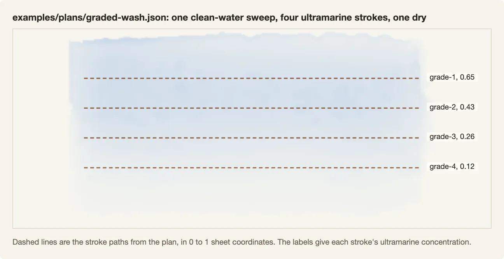

# Plan format

A stroke plan is a JSON file that tells the simulator what to paint: one entry per brush stroke, in order. Each stroke names a brush, a paint concentration and amount of water, and the paper moisture it expects. Its path is in sheet coordinates, with pressure and radius at each point. A `dry` entry dries the whole sheet before the next stroke. Text fields are notes for people; the simulator ignores them.

Run one with:

```sh
node tools/run-plan.mjs examples/plans/graded-wash.json --out work/plan-graded-wash
```

It writes `result.png` (the dried sheet) and `run.json`. Stroke-size admission warns by default; `--stroke-gate reject` refuses tiny-dab plans before painting. See [stroke sizes and thresholds](stroke-stats.md) for configuration and the planner guide.



The full example is [examples/plans/graded-wash.json](../examples/plans/graded-wash.json); its saved output is [examples/output/graded-wash-result.png](../examples/output/graded-wash-result.png). The figure and the saved output were made with sim 100 (release 0.1.0).

## Units and resolution

A plan describes a painting in physical and relative units, never in sheet cells, so the same plan paints at any
resolution:

```
target image (px)          plan                                   sheet (cells)
306 × 242   ──lines──▶     line files: target px + image size  ──┐
                           positions, regions: 0 to 1           ─┼──▶  W × H cells, mmPerCell each
                           brush widths, contact radii: mm      ──┘    (sheet width fixed in mm)
```

- Positions in `paths`, region `bounds` and reserve `bounds` are 0 to 1 of the sheet or target.
- Brush widths (`widthMm`) and contact radii (`rMm`) are millimetres.
- Line files are in target pixels and carry the image size they were drawn on (`image: {w, h}`); the painter maps them
  onto the sheet.
- The sheet's physical width is fixed (`grid` here, `sheet.widthMm` or `--sheetmm` for value plans). The painting width
  in cells (`grid.w`, or `--width` for value plans) only sets `mmPerCell`.

Painting the same plan at a quarter of the cells (half the width) keeps every stroke in the same place at the same
physical size; only fine detail below one cell is lost.

## Top level

| field | type | meaning |
|---|---|---|
| `version` | integer | format version, currently `1` |
| `id`, `title` | string | names for people and output folders |
| `source` | object | optional notes on what the plan imitates (URL, author, timestamp, expected effect); ignored by the simulator |
| `grid` | `{w, h, mmPerCell}` | sheet size in cells and the physical size of one cell. 384 × 160 cells at 0.125 mm is a 48 × 20 mm study |
| `paperRGB` | `[r, g, b]` | color of bare paper in the rendered result |
| `paper` | object | paper surface: `fibres` and `tooth` (surface texture, 0 to 1), optional `coldPress` (the physical cold-press relief, `src/media/paper-relief.mjs`) |
| `paperSeed` | integer | seed for the paper texture and brush hairs; the same plan and seed give the same sheet on the same backend |
| `palette` | string[] | pigment keys from `src/crop/box.mjs`, for example `ultramarine`, `ochre`, `sienna`, `sapgreen`, `lampblack` |
| `budget` | object | limits a planner promised to respect (`maxGestures`, `maxWallSeconds`, `maxNativeSteps`); kept only in the input plan; ignored by `run-plan` and not copied into `run.json` |
| `commands` | array | the strokes and drying steps, in painting order |
| `criteria` | object | optional pass and fail notes for a judge; ignored by the simulator |

## Commands

A stroke:

```json
{
  "id": "grade-1",
  "operation": "stroke",
  "requiredPaper": "wet",
  "role": "paint",
  "brush": { "kind": "flat", "widthMm": 8, "orientation": "follow", "free": 0.4, "feed": 0.4, "film": 0.25, "wetMix": 0.85 },
  "load": { "capacityMm3": 160, "waterQuantityMm3": 112, "concentration": { "ultramarine": 0.65 } },
  "paths": [[
    { "x": 0.15, "y": 0.25, "p": 0.85, "rMm": 4.0 },
    { "x": 0.85, "y": 0.25, "p": 0.85, "rMm": 4.0 }
  ]]
}
```

Stroke fields:

- `id`: unique name; also seeds this stroke's bristles
- `operation`: `stroke` or `dry`
- `requiredPaper`: `dry`, `wet` or `any`: the paper state under the brush that the planner expects. `run-plan` measures it before the stroke and prints a warning when it is not met
- `role`: `paint`, or `clean-water` to wet the paper with a clean brush (no pigment is laid)
- `brush.kind`: `flat` or `round`
- `brush.widthMm`: brush width in millimeters
- `brush.orientation`: `follow` turns the brush with every segment of the path. `sweep` holds it square to the stroke's overall run, from first point to last
- `brush.free`, `feed`, `film`, `wetMix`: optional brush controls passed to `createBrush` in `src/media/brush.mjs`. `free` sets the liquid threshold for release, and `feed` the flow from reservoir to bristles. `film` sets the liquid layer left on contact, and `wetMix` the exchange with wet paint. Defaults 0.4, 0.4, 0.25 and 0.85
- `load.capacityMm3`: how much liquid the brush can hold
- `load.waterQuantityMm3`: how much it holds after dipping; the ratio to capacity is the water load
- `load.concentration`: pigment per palette key in the loaded water; keys must be in `palette`. Empty for clean water
- `paths`: one or more polylines, paths of connected straight segments. Points are in 0 to 1 sheet coordinates (`x` across, `y` down), with pressure `p` (0 to 1) and contact radius `rMm`

A drying step:

```json
{ "id": "finish-dry", "operation": "dry" }
```

The sheet steps its water and pigment every 8 brush samples while a stroke is laid. So wet strokes run into each other the way they do on paper. `dry` dries everything and sets the current wash as a separate layer. If the last command is not `dry`, `run-plan` dries the sheet before it renders.

## The example: a graded wash

[examples/plans/graded-wash.json](../examples/plans/graded-wash.json) is a 48 × 20 mm study of a graded sky wash, based on the graded-wash demonstration it cites. It has six commands:

1. `prepare-connected-field`: an 18 mm flat brush of clean water sweeps the paper so the next strokes land wet.
2. `grade-1` to `grade-4`: four 8 mm flat strokes of ultramarine, top to bottom, each overlapping the last while it is wet. Their concentrations are 0.65, 0.43, 0.26 and 0.12.
3. `finish-dry`: dry the sheet.

The criteria ask for one connected wash that gets lighter from top to bottom, with no white stripes or dark drying edges between the strokes. `tools/run-plan.test.mjs` checks that the top band dries darker than the bottom band.

## More examples

- [examples/plans/glazes.json](../examples/plans/glazes.json): three bands, each dried before the next. See [pigments-and-paper.md](pigments-and-paper.md).
- [examples/plans/drying-dry-between.json](../examples/plans/drying-dry-between.json) and [drying-too-wet.json](../examples/plans/drying-too-wet.json): the same two strokes with and without drying between them.

## Line files

A drawing file is a line file, `STEM-lines.json` or `STEM-lines.json.gz`, given to the painter as `--drawingfile STEM`. `tools/seg/trace-drawing.py` writes it from a clean line drawing and `tools/seg/order-strokes.mjs` orders it; [examples/drawings/](../examples/drawings/) holds one.

| field | meaning |
|---|---|
| `inputKind` | `drawing` for a traced drawing |
| `medium` | `ink` or `pencil` |
| `image` | `{w, h}`: the pixel size the lines were traced on |
| `targetSHA256` | the target the drawing belongs to; a file made for another image is refused |
| `lines` | the strokes in drawing order, each with `points` (target pixels), `width`, `weight`, `role` and its place in the order (`seq`, `object`, `part`, `pass`) |

The painter maps the image box onto the target (`src/paint/methods/drawing-registration.mjs`) and draws each line as it is.

## The V6 draft plan

`bench/v6/TASK.md` drafts a whole-painting plan for a planning model. It is not yet run. A plan is a folder with `plan.json`, an optional drawing line file and the studies:

```json
{
  "subject": "camel",
  "sheet": { "widthMm": 280, "seed": 0 },
  "drawing": { "medium": "ink", "file": "drawing-lines.json" },
  "washes": {
    "layers": [ { "study": "studies/s1.png", "leastMm2": 150 }, { "study": "studies/s2.png", "leastMm2": 120, "glaze": true } ],
    "paints": ["ochre", "ultramarine", "sienna"]
  }
}
```

| field | meaning | painter option |
|---|---|---|
| `sheet.widthMm`, `sheet.seed` | sheet width in mm, and the seed | `--sheetmm`, `--seed` |
| `drawing.medium` | `ink`, `pencil` or `none` | `--inkrecipe wash`, `--outlinemedium graphite` or `--drawing none` |
| `drawing.file` | the traced, ordered line file | `--drawingfile` |
| `washes.layers` | studies coarse to fine; `leastMm2` is the least shape a layer lays, `glaze` makes it a glaze | `--washplan STUDY:MIN[:glaze],...` |
| `washes.paints` | box keys from `src/crop/box.mjs` | `--paints` |

The painter does not read this file yet. `bench/v6/plan-args.mjs` turns it into painter options. The model chooses the medium, the ink level it asks the drawing model for, the studies for each layer with their least size and glaze, the paints, and when to stop.

## Value plan file

`--valueplan FILE` reads a JSON object. It does not supply washes; the washes come from the studies. `src/paint/plan-keys.mjs` lists every key the painter reads, and a key nothing reads makes the run log `UNUSED PLAN KEYS`, write `unused-plan-keys.txt` and exit 3 after its outputs (`--allowunusedplan 1` keeps exit 0).

| field | meaning |
|---|---|
| `sheet` | `{ widthMm, seed, targetGuard }`; `widthMm` sets `--sheetmm` and must match it when both are given |
| `drawing` | the drawing choices below |
| `washes` | `paints` (box keys), `sessions` (`dry`, `passage`, `connected`), `inkAware`, `soften` and `physics` (`holeRimMm`, `marangoni`, `slope`) |
| `order` | `subjects` (`{id, bounds}` or `{id, families}`) and `strength` 0 to 1 |
| `families` | `{id, bounds, drawingRole}`: regions for `order.subjects`; `drawingRole` (`none`, `scaffold`, `structural`, `focal`) keeps or leaves out each line whole |

`rationale`, `drawingNote`, `run` and a subject's `reason` are notes for people.

### Value plans: the drawing section

```json
"drawing": { "medium": "ink", "ink": { "color": "sepia" }, "stages": { "prepInk": { "from": "lines" }, "finishInk": { "from": "prepInk", "restate": 0.3 } } }
```

| field | values | meaning |
|---|---|---|
| `medium` | `none`, `graphite`, `ink`, `auto` | `none` sets `--drawing none`; the others set `--outlinemedium` |
| `reason` | a sentence | why this medium, logged |
| `ink` | `{ "color": "sepia" or "black", "waterproof": true or false }` | the ink and whether it sets before the washes; waterproof defaults to true for black |
| `amount`, `maxLines` | 0 to 1; a whole number | the share or count of the file's lines drawn, strongest first |
| `lines` | `all`, `contours`, `subject`, `regions` | which lines of the file: `contours` leaves out dark fill, `subject` leaves out the setting, `regions` orders by the region a line lies in |
| `weight` | 0 to 1 | how heavy the line is |
| `closingLines` | 0 to 1 | how much the closing pen draws; 0 means none |
| `stages` | `prep`, `prepInk`, `finishInk` | the linked stages, cut from the drawing file |

Stage fields: `prep.amount`, `prep.weight`, `prep.fade`, `prep.frames`; `prepInk.from` (`prep` or `lines`), `keep`, `add`, `amount`, `deviate`, `method` (`contour` or `scribble`); `finishInk.from`, `select` (`edges`, `darks`, `both`), `restate`, `deviate`, `method` (`accent` or `architecture`), `masses` (`none` or `scribble`). The finish runs after every wash. Code: `src/paint/drawing-plan.mjs`, `src/paint/methods/drawing-stages.mjs`.

[examples/plans/white-ships.json](../examples/plans/white-ships.json) is a value plan.

The painter records the resolved plan and any command-line overrides in `pipeline-plan.json`.
