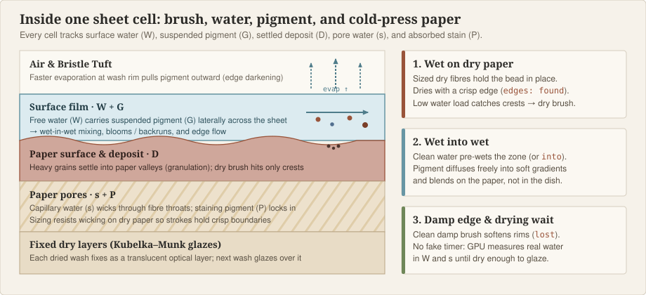
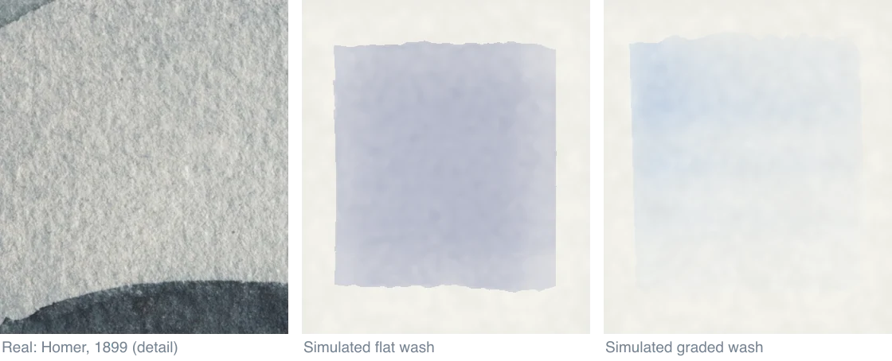
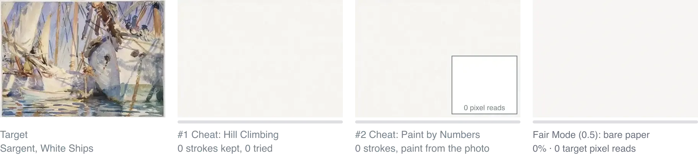
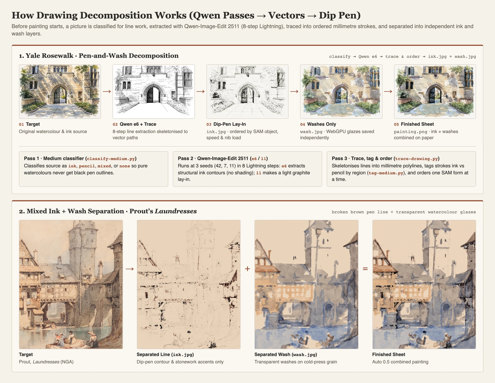
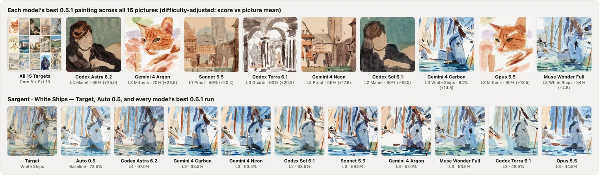

# Reading list & prior work

This is the single canonical bibliography for Unpainting. All other docs link here instead of repeating references. Third-party code is shipped only where [THIRD_PARTY_NOTICES.md](../THIRD_PARTY_NOTICES.md) says so.

## 1. Watercolour, paper, brush & ink physics

- **David Small**, “[Simulating watercolor by modeling diffusion, pigment, and paper fibers](https://doi.org/10.1117/12.44417)”, *SPIE* 1991.
- **Curtis, Anderson, Seims, Fleischer & Salesin**, “[Computer-Generated Watercolor](https://grail.cs.washington.edu/projects/watercolor/)”, *SIGGRAPH* 1997 — water, pigment, and layered glaze model (`src/media/sheet.mjs`).
- **Kubelka & Munk** (1931) and **Kubelka**, “[New contributions to the optics of intensely light-scattering materials, part II](https://doi.org/10.1364/JOSA.44.000330)”, *JOSA* 1954 — optical glaze stacking (`src/media/km.mjs`).
- **Deegan et al.**, “[Capillary flow as the cause of ring stains from dried liquid drops](https://doi.org/10.1038/39827)”, *Nature* 1997 — coffee-ring edge darkening.
- **Strassmann**, “[Hairy brushes](https://doi.org/10.1145/15886.15911)”, *SIGGRAPH* 1986; **Baxter, Scheib, Lin & Manocha**, “[DAB](https://doi.org/10.1145/383259.383313)”, *SIGGRAPH* 2001 — bristle tuft & contact (`src/media/brush.mjs`).
- **Chu & Tai**, “[MoXi: Real-time ink dispersion in absorbent paper](https://doi.org/10.1145/1073204.1073221)”, *SIGGRAPH* 2005 — fibre-capillary flow (`src/media/sheet.mjs`).
- **Kim, Moon, Lee, Mahadevan & Kim**, “[Hydrodynamics of writing with ink](https://doi.org/10.1103/PhysRevLett.107.264501)”, *PRL* 2011 — dip-pen width, speed, and ink exhaustion (`src/media/pen.mjs`).
- **Lionel Mora**, [Sudo Aquarelle](https://sudoaquarelle.com/) — loaded-brush splats, lit paper relief, and grain ideas (reimplemented, no code shared).
- **Jonathan Whitaker**, [Inkwash](https://github.com/johnowhitaker/inkwash) — sharp ink core with soft bleed.
- **Bruce MacEvoy**, [handprint.com watercolour pigments](https://www.handprint.com/HP/WCL/waterfs.html) — pigment masstones and real paint recipes.

## 2. Stroke planning & inverse painting

- **Aaron Hertzmann**, “[Painterly rendering with curved brush strokes of multiple sizes](https://doi.org/10.1145/280814.280951)”, *SIGGRAPH* 1998.
- **Aaron Hertzmann**, “[Paint by Relaxation](https://mrl.cs.nyu.edu/publications/painterly-relaxation/)”, *CGI* 2001.
- **Huang, Heng & Zhou**, “[Learning to Paint with model-based deep reinforcement learning](https://doi.org/10.1109/ICCV.2019.00880)”, *ICCV* 2019 ([code](https://github.com/hzwer/ICCV2019-LearningToPaint), MIT).
- **Singh, Smith, Echevarria & Zheng**, “[Intelli-Paint](https://doi.org/10.1007/978-3-031-19787-1_39)”, *ECCV* 2022.
- **Schaldenbrand, McCann & Oh**, “[FRIDA](https://doi.org/10.1109/ICRA48891.2023.10160702)”, *ICRA* 2023.
- **Chen, Wang, Curless, Kemelmacher-Shlizerman & Seitz**, “[Inverse Painting](https://doi.org/10.1145/3680528.3687574)”, *SIGGRAPH Asia* 2024 ([code](https://github.com/ArmastusChen/inverse_painting)).
- **Song et al.**, “[ProcessPainter](https://doi.org/10.1145/3680528.3687596)”, *SIGGRAPH Asia* 2024.

## 3. Regions, studies & line extraction (prep only)

- **Qwen-Image-Edit 2511** ([technical report](https://arxiv.org/abs/2508.02324)) + [Lightning 8-step LoRA](https://huggingface.co/lightx2v/Qwen-Image-Edit-2511-Lightning) — block-in colour studies and line extraction before painting starts.
- **Kirillov et al.**, “[Segment Anything](https://arxiv.org/abs/2304.02643)”, *ICCV* 2023 (SAM ViT-B) — named forms and regions (`tools/seg/`).
- **Chan, Durand & Isola**, “[Learning to generate line drawings that convey geometry and semantics](https://arxiv.org/abs/2203.12691)”, *CVPR* 2022 (Informative Drawings) — optional line model (`tools/seg/lines.py`).
- **Li, Lin, Měch, Yumer & Ramanan**, “[Photo-Sketching](https://doi.org/10.1109/WACV.2019.00154)”, *WACV* 2019.
- **He et al.**, “[Mask R-CNN](https://arxiv.org/abs/1703.06870)”, *ICCV* 2017; **Qin et al.**, “[U²-Net](https://arxiv.org/abs/2005.09007)”, *Pattern Recognition* 2020.

## 4. Agent painting & anti-cheat evaluation

- “[Paint What You See: Benchmarking Dexterous Visual Tool Use in Multimodal Agents](https://arxiv.org/abs/2608.25417)”, 2026.
- “[Loomis Painter: Reconstructing the Painting Process](https://arxiv.org/abs/2511.17344)”, 2025.
- “[Local Brushstroke Quality Assessment via Vision-Language Feedback](https://arxiv.org/abs/2607.16330)”, 2026.
- “[Hack-Verifiable Environments: Towards Evaluating Reward Hacking at Scale](https://arxiv.org/abs/2605.20744)”, 2026 — see [honesty.md](honesty.md).

Extended notes and museum citations live in [bench/PICTURES.md](../bench/PICTURES.md) and the [Part 1 literature review](https://samjackson.org/writing/whats-a-painting-anyway-part-1/#reference-literature-review).
