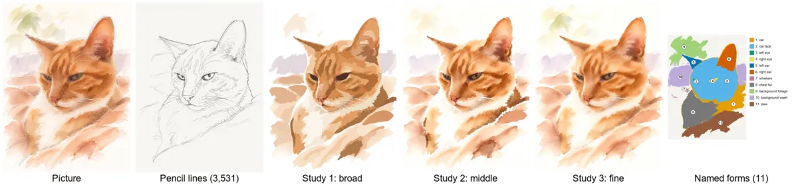
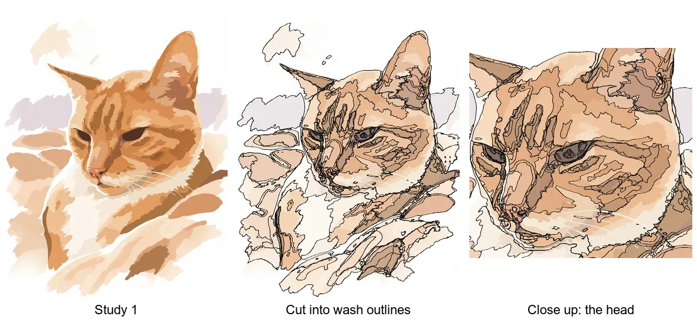
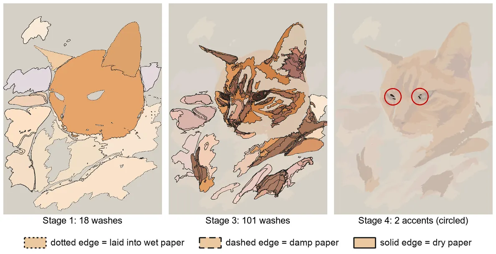
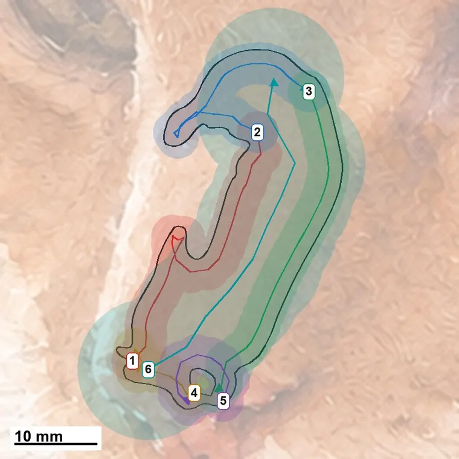
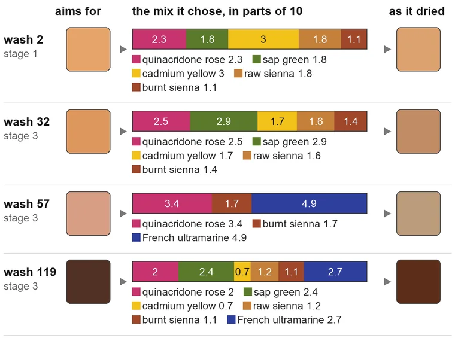

# What the model gets

The [benchmark](../bench/README.md) asks AI models to paint a picture with the simulator. This page says how Auto, the code's own planner, plans a painting, how a model plans one, and what a model is given at each level.

## Auto and a model plan differently

Auto plans the washes from the studies. A study is a simplified version of the picture in flat colours. A model looks at the picture and writes its own plan, called a [painting script](painting-script.md). The whole pipeline is in [how it paints](how-it-paints.md).

### The inputs

- The picture is what to paint.
- The drawing is a set of pencil lines, traced from a line drawing and put in drawing order.
- The three studies are versions of the picture in flat colours. Study 1 has broad shapes, study 2 adds middle detail and study 3 adds fine detail and accents.
- The named parts are regions of the picture with names such as `cat face`, `left eye` and `chest fur`.

### How Auto paints

Auto first draws light pencil lines to place the main shapes. Then it works in five steps.

1. It cuts each study into flat shapes. It groups the study's colours, and each connected patch of one colour becomes a shape. Thin slivers join a neighbour. Near-white shapes stay bare paper.

   

2. It puts the shapes in order. Light, large shapes go first. A soft form starts with one pale wash laid into clean water. Darker shapes come next, glazed over washes that have dried. Small dark accents go last.

   

3. It fills each shape with brush lanes. It picks the widest brush that fits and sweeps it in parallel, overlapping lanes. In the picture below, the black outline is the wash shape and the numbered bands are strokes.

   

4. It chooses paints. It picks from the box of 16 to cover the colours in the studies. Each shape gets one target colour and one mix, written in parts of 10.

   

5. It chooses brushes, using real widths from a 38 mm wash brush down to a 1.2 mm rigger.

### How a model's script differs

| | Auto | Model script |
|---|---|---|
| Shapes | Cut automatically from a study | Passages the model draws in millimetres, following parts such as a stripe or an ear |
| Mixes | One per shape, often with many paints | Named for each passage, with a swatch or a dilution. Usually fewer paints |
| Strokes | Parallel lanes that fill each shape | Strokes the model shapes itself, with its own marks and pressures. Clean water goes down first for soft edges |
| Order | Always light and large first, dark and small last | Chosen by the model |
| Drawing | Light pencil, or ink on pen pictures | Chosen by the model: pencil, pen or none. It can keep, drop, re-time or add lines |
| Test paintings | None | Half-size test paintings, within a budget |
| Reasons | None | Written for each passage |

## The four levels

Every level is one fresh session. A session is never given another level's result. Each level adds one thing to the one before.

| Level | What the model is given | How it works |
|---|---|---|
| L1 | The picture, the script format and painting tips | A fixed conversation |
| L2 | L1, plus the drawing, the three studies, the named parts and the shapes traced from the studies | A fixed conversation |
| L3 | L2, plus Auto's plan and Auto's finished painting | A fixed conversation |
| L4 | The same as L3 | An open session with tools |

In a fixed conversation the model has no shell, no tools and no files. It looks at the pictures and writes. In an open session it works in a sandbox with a shell and Python tools.

### What each input is

- **The picture.** The original, on a millimetre grid so the model can name positions. Every level gets it.
- **Painting tips.** Advice on brushes, wet and dry paper, and how to build a form. Every level gets it. It is advice, and the model may ignore it.
- **The drawing.** The prepared pencil lines. From L2 the model may keep them, drop them, change when each is drawn, or draw its own. At L1 there is no prepared drawing, so it may only draw its own.
- **The named parts.** The names and boxes of regions such as `left eye`, plus a picture of them. L2 and up.
- **The traced shapes.** The flat shapes of the studies, traced into outlines. They come as a numbered picture and a list with colour, area and box. A passage can name a shape by number instead of writing a polygon. They may be wrong, and the model need not use them. L2 and up.
- **Auto's plan.** Auto's washes in painting order, as numbers, to read. L3 and up. It is not a script, and a model cannot hand it in.
- **Auto's painting.** The finished painting, as a picture to improve on. L3 and up.
- **Tools.** At L4 only. These are a shell, numpy, pillow, scipy, scikit-image and opencv, and the painter's commands `./unpaint plan`, `look`, `show` and `status`.

### What the model hands in

At every level the model hands in its own painting script. It may also choose the drawing medium (pencil, pen or none) and the ink. A script is refused if it only copies Auto's plan or the planner's settings. A session that hands in no working script counts as a failed painting. After it hands in, its script is painted at full size and that is the painting that is scored.

### The budget

- A look is a test painting. The script is painted for real at half size and dried, and the model sees its own dried sheet.
- Each try has 3.0 units for looks. A look of the whole sheet costs 0.3. A look that stops after a stage, or covers only a region, costs its share, and never less than 0.05.
- Each try has a 60-minute clock. When the units or the clock run out, the script as it stands is painted.
- Painting itself costs nothing. Water, strokes, waits and drying are free.
- A fixed conversation lasts at most 40 turns.

### What the model may not do

It may not read the original's pixels with code. The sandbox refuses such a read, and a script that names the picture is caught when the transcript is checked. A try that does this is disqualified. The model may look at the picture with its own eyes, as a painter glances at a reference. It also may not nudge strokes to shrink the image error, which is called hill climbing. No judge score or critique is ever shown to it.

The full rules are in [rules](../bench/docs/rules.md), and the script format is in [painting script](painting-script.md).

Mittens: [NOTICE](../NOTICE).
