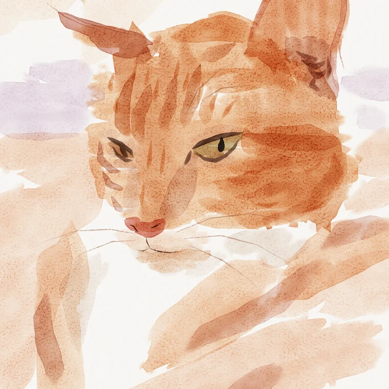

# What the model gets

The [benchmark](../bench/README.md) has two painters. Auto cuts shapes from colour studies and plans its washes. A model looks at the pictures it is given and writes a [painting script](painting-script.md).

## The four levels

| Level | What the model gets |
|---|---|
| L1 | The source picture, the script format and painting tips. Blank paper. |
| L2 | L1 plus three block-in studies, from broad colour masses to small accents. Blank paper. |
| L3 | L2 plus a prepared drawing, named forms and their boxes, numbered shapes traced from the studies, and Auto’s plan and finished painting. |
| L4 | The same inputs as L3, in an isolated shell with its own home directory, Python and the painter’s `./unpaint` commands. |

L1 to L3 are fixed conversations. At L1 and L2 the model can paint directly or sketch with `lines.own`. At L3 and L4 the prepared drawing starts off. The model can ask for pencil or pen, or select individual lines and choose when they go down. It may use a traced shape by number. Auto’s plan is there to read. The model still has to hand in its own script.

Opus 5.5 at L2. It saw Mittens and the three studies on a millimetre grid. The right-hand panel shows the finished sheet. Its script left the muzzle and chest as white paper.

## How Auto paints

For Mittens, Auto uses a light pencil drawing. Its wash plan starts with the colour studies.

1. It cuts each study into flat shapes. It groups the study's colours, and each connected patch of one colour becomes a shape. Thin slivers join a neighbour. Near-white shapes stay bare paper.

   

2. It puts the shapes in order. Light, large shapes go first. A soft form starts with one pale wash laid into clean water. Darker shapes come next, glazed over washes that have dried. Small dark accents go last.

   

3. It fills each shape with brush lanes. It picks the widest brush that fits and sweeps it in parallel, overlapping lanes. In the picture below, the black outline is the wash shape and the numbered bands are strokes.

   

4. It chooses paints. It picks from the box of 16 to cover the colours in the studies. Each shape gets one target colour and one mix, written in parts of 10.

   

5. It chooses brushes, using real widths from a 38 mm wash brush down to a 1.2 mm rigger.

## How a model's script differs

Codex Sol 6.1 at L2, detail. Its script reserves the two eye glints and six whiskers in `lights`.

| | Auto | Model script |
|---|---|---|
| Shapes | Cut automatically from a study | Passages the model draws in millimetres, following parts such as a stripe or an ear |
| Mixes | One per shape, often with many paints | Named for each passage, with a swatch or a dilution. Usually fewer paints |
| Strokes | Parallel lanes that fill each shape | Strokes the model shapes itself, with its own marks and pressures. Clean water goes down first for soft edges |
| Order | Always light and large first, dark and small last | Chosen by the model |
| Drawing | Light pencil, or ink on pen pictures | Chosen by the model: pencil, pen or none. It can keep, drop, re-time or add lines |
| Test paintings | None | Half-size test paintings, within a budget |
| Reasons | None | Written for each passage |

## Test paintings

Each session gets 3.0 units for looks. A look paints the script at half size and shows the model its own dried sheet. A whole look costs 0.3 units. Stopping at a stage or asking for a smaller region costs its share, down to 0.05. The final full-size painting is free.

Each session has 60 minutes. At L4, time waiting on the GPU is recorded separately. The model can check its script with `./unpaint plan`, try it with `look`, bring a reference back with `show` and check its budget with `status`.

The model can look at the original. Its code may not read the pixels or fit strokes to image error. No judge sees the work until after hand-in. [Benchmark rules](../bench/docs/rules.md).

Mittens is based on Sam Jackson’s photograph. The traced shapes and dried sheets come from Auto at `e0276330`. The L2 paintings are from the clean 0.5.1 run at `6dce5b91`. [Image credits](../NOTICE).
